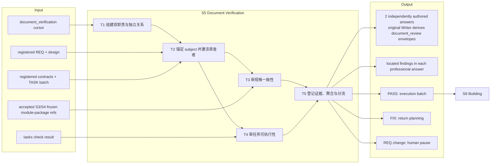
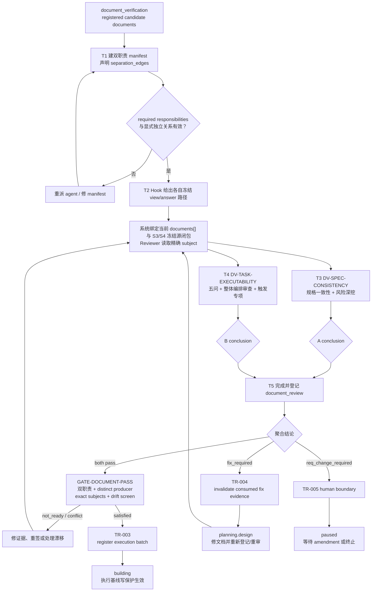

# L3-S5 — 文档验证（Document Verification）

> 层：第三层 ｜ 上游：L2 §S5 ｜ 前置：S4 registered TASK batch + 整体派发计划 ｜ 下游：S6 构建
>
> 阅读顺序：§1～§3 先建立“为什么审、审什么、如何分流”的完整漏斗；§4 再映射 reviewer、REV 信封、quality gate 和 transition；§5～§8 审计职责、真实强制边界、出口和易错点。本文把“审查者应做的判断”与“当前代码已经强制的事实”分开表述。

## 1. 第一层：S5 的立意与目标

### 本轮固定：S5 最小履职与返工接续

Main 沿原 team-planning/登记/准备入口，为当前 S5 entry 安排两个不同 reviewer。
系统提供当前批次的准确 manifest 候选位置、冻结资料、各自 view/answer 路径、责任与缺项；
返工后的 manifest、team、agent、assignment 和工作目录使用新批次的唯一位置/身份，
不覆盖旧清单、不复制旧指纹。当前资料由最新已接收 S4 的原来源闭包重建。
问卷直接说明三个结论的边界：`pass` 表示本责任未发现问题；`fix_required` 表示 REQ
含义明确，修正设计、合同或 TASK 即可满足；`req_change_required` 表示 REQ 本身存在
歧义、冲突或缺失，须由人类明确或变更需求，不表示已获变更授权。
通过时问题清单保持预填 `[]`；有问题才填写具体位置、应有内容和实际缺口，不复述身份、
指纹或机检汇总。新题干用于后续发行，已发行的冻结问卷和原回执保留原版本。
Reviewer 只读冻结资料，完成上述明确问题，在原 `answer` 中选择结论、按需补充问题并保存一次；原 Writer 生成
证据与回执，原门负责分流。已提供的结构机检与 task analysis 直接消费，手动检查仅作
具体诊断；系统缺资料或路径须明确报告，不能改走手写信封或要求重复 PLAN。

TR-004 在原事务中结束本次 S5 批次：使其当前 review evidence 失效、取消旧责任、
将 document-review execution 移入已有历史并保留原目录。只复用已有批次/执行登记字段
和全局五态，不新建状态机；本人已接收的原答案、信封和回执仍保留历史事实。
第一名 reviewer 已接收后等待另一责任，不等于全阶段完成，也不因此取消当前批次。

旧 manifest 保留结构、Runtime 归属、可达性及原发行字节一致性检查；已确定被返工取代
的历史批次不再与当前专业文件比指纹。当前/无法证明已过期的清单保持严格来源检查。
旧实例已有 entry 绑定时可据原 generation/entry 辨认历史，不能靠手改状态或刷旧 hash 消错。
同一 generation 再进 S5 用新 entry 区分，不为返工另增 generation。

原门与 TR-003 原事务都须取得当前 S5 entry 的两项独立、已接收 PASS；旧 PASS 即使
文件未变化也不能代替新批次责任。`fix_required` 走原 TR-004，`req_change_required`
保留原人闸；旧答卷重放只返回原回执，不推进新 entry。验收到 S6 出口即止，不开展 S6。

### 1.1 为什么需要 S5

S2～S4 已经形成设计、契约和任务链，但这些文档大多来自同一轮规划过程。作者很容易把自己的默认前提当成已写明事实；结构检查也只能证明字段、覆盖和 DAG 成立，不能证明规格真的自洽、Builder 拿到 TASK 真的做得完。

S5 因而不是再写一层规格，而是在写第一行实现代码前，用两个相互分离的职责回答两个问题：

1. **规格链是否一致**：REQ、设计、FE/BE/SYNC 契约与 TASK 是否指向同一件事；
2. **任务是否可执行**：范围、依赖、完成判据和证据要求是否足以让 Builder 在一个受控上下文内交付。

只有两个问题都得到当前版本的 PASS，系统才允许建立 execution batch 并进入 S6。S5 的价值是把纸面缺陷留在仍可低成本修改的阶段，并为后续锁定建立可追溯签字。

### 1.2 阶段目标与完成定义

| 项目 | 定义 |
|:--|:--|
| 输入 | runtime `documents[]` 中当前登记的 REQ、design、contracts、TASK 与整体派发计划指纹；已接收 S3/S4 冻结源闭包及其中对 S2 模块当前真相包的原始 document refs；当前 S5 packet 冻结的 `task_analysis.structural_check`（原 S4 checker）与 task contexts；`document_verification` cursor |
| 要搞清楚 | 规格链有没有断裂/矛盾；TASK 能否按声明范围完成且编排能有效并行；哪些风险专项被触发；两份结论签的是不是同一批当前文档 |
| 核心工作 | 组建双职责 → 锚定被审对象 → 两路独立审查 → 保存两份专业答卷 → 原 Writer 生成证据并由 gate 聚合分流 |
| 输出 | 两份独立专业答卷；原 Writer 派生两条 `document_review` 证据；双 PASS 时原子锁定的派发计划与 execution batch，或明确的修文档/改需求路由 |
| 完成 | `DV-SPEC-CONSISTENCY` 与 `DV-TASK-EXECUTABILITY` 均由不同 producer 给出当前轮 PASS；subject 精确匹配且已登记文档无漂移；TR-003 进入 building |
| 下一阶段 | S6 只在已签收的执行基线上任命 Builder、激活 scope 并产出实现证据 |

### 1.3 Overview：输入、主步骤与输出

S5 必须读取随已接收 S3/S4 冻结源闭包交付的原始 document refs。模块当前真相包不是可忽略的临时补充：只要 AC 指向 FR 或服务行为真相变化，即使 UI impact 为 `none`，reviewer 仍须核对七文件服务行为包（五个手写源 `scenario-model.json`、`fixture-contract.json`、`cross-matrix.json`、`stories.md`、`flows.md`，以及生成的 `cases.json`、`scenario-coverage.json`）。现有 FR 分母和 AC→CASE bridge 保持完整。服务分支使用 `browser_required:false`，因此无需 HTML、PATH 或浏览器 spec。reviewer 只读冻结闭包及其 refs 指向的版本；缺 ref、缺文件或摘要不符都应作为来源/规格 finding 处理，不能用本地 Glob 找到的同路径 live 文件替换被审 subject。Formal subject set = Runtime.document refs + 经原已接收 S4 packet/envelope/journal 证明的当前源闭包；不是 live 读取就能登记。

### 1.4 S5 的边界与当前保证

- **负责**：独立文档审查、风险触发深挖、当前指纹签收、结论证据和失败分流；
- **不负责**：改文档、改 REQ、实现代码或在审查中顺手修复；发现问题只定位并选择路由；
- **机器能保证**：两个规定职责都存在；显式 separation edge 不允许同一 agent 承担两职；两条 PASS 的 producer 不同；`subject_refs` 精确匹配当前登记文档；登记文档磁盘指纹未漂移；
- **机器不能保证**：两名 reviewer 的判断在认识论上独立；真实作者没有参与自审；finding 深度足够；触发式专项全部被执行；原 S3/S4 冻结源闭包是否在语义上包含了所需模块包和 refs；
- **锁定时序**：S5 仍允许通过 TR-004 返回规划修文档；TR-003 进入 building 后，当前执行基线的阶段感知写保护才生效。

## 2. 第二层：S5 的任务分解

| 任务 | 要解决的问题 | 主要动作 | 阶段产出 |
|:--|:--|:--|:--|
| T1 组建双职责与独立关系 | 谁分别回答“一致吗”和“做得完吗”；如何避免同人双签 | 建 team manifest；任命两个 document-verifier；声明 independence separation edge；按文档特征标记触发专项 | 两个不同 agent 的职责分配 |
| T2 锚定 subject 并交付审查问卷 | 每个人究竟审哪一版、承担什么职责 | 原 manifest 登记双职责与独立性；Hook 给出准确冻结 view/answer 路径，系统绑定 subjects 和来源闭包；只有显式 `plan_approval_required` 才走原读回审批 | 两份独立专业答案 |
| T3 审规格一致性 | REQ→设计→合同→TASK 是否语义闭合 | 核验引用和版本；走查 AC/NFR/错误路径；对账 FE/BE/SYNC 边界；参考场景包 | `DV-SPEC-CONSISTENCY` 结论与 findings |
| T4 审任务可执行性 | Builder 是否能在范围、依赖和证据约束下完成 | 消费冻结结构摘要；逐 TASK 做五问 + 整体编排审查；执行迁移、集成、critical 风险等触发审查 | `DV-TASK-EXECUTABILITY` 结论与 findings |
| T5 保存、聚合与分流 | 两个结论能否共同授权构建；失败回哪里 | Reviewer 保存准确 answer；原 Writer 派生/登记 REV envelope 并运行 document gate；按 PASS/FIX/REQ-change 走 TR-003/004/005 | execution batch，或受控返工/人闸 |

这五项任务形成一个漏斗：先确定谁审，再固定审查对象，然后各自回答正交问题，最后才聚合结论。不能先看结果再补 `subject_refs`，也不能让一个 reviewer 代另一个 reviewer 签字。

## 3. 从候选规格链到执行基线的完整工作流

正常路径不要求 reviewer 手工调用 transition。证据登记后，后续自然工具调用触发 gate 和 transition。若文档修复改变任一登记指纹，两份旧 PASS 都不再精确覆盖当前 subject 集，因此不能只让“发现问题的人”沿用旧签字；应按当前指纹重新签收。

## 4. 第三层：每项任务如何被引导和承载

### 4.1 T1 — 组建双职责与独立关系

| 维度 | 设计 |
|:--|:--|
| 固定职责 | `DV-SPEC-CONSISTENCY` 与 `DV-TASK-EXECUTABILITY` |
| 角色卡 | `agents/document-verifier.md`；两者使用相同角色类型、不同 assignment 与上下文 |
| 编排方法 | `team-planning` 生成 manifest；为两职责声明 reason=`independence` 的 separation edge |
| 事前检查 | team validator 检查 required responsibilities、agent 绑定、显式 separation edge 和内部依赖合法性 |
| 事后检查 | GATE-DOCUMENT-PASS 再检查两条证据 producer 不同 |
| 触发信息 | 问卷明确本责任检查项；reviewer 按冻结输入和 Skill 中的条件判断迁移、外部集成、critical risk 专项，系统不自动判定命中条件 |

两层检查证明“不是同一个 agent ID 双签”，并不证明两个 agent 没有共享模型偏差，也不证明它们真的独立完成了全部思考。当前 team validator 也没有检查 workgroup 成员的 prospective write-path overlap；S5 依靠两个 reviewer 写各自证据路径的任务约定，而不是这项尚不存在的机器能力。

### 4.2 T2 — 锚定 subject 与交付问卷

阶段答卷路径按 [L4 阶段答卷 §13](../l4-mechanisms/L4-stage-form.md)治理：packet-enabled 普通 `plan_checkpoint` 下，Hook 交付冻结 view 和准确 answer 路径，reviewer 直接完成独立专业判断并保存；原 Writer 派生领域信封，不抄机器身份、subjects 或 hash。显式 `plan_approval_required` 仍走原人工批准。下述手工信封细节只适用于明确 unpacketized 的旧实例；packet-enabled 缺路径由 Main/system 恢复，不改走旧入口。

旧的 unpacketized 兼容流程才使用下列手工信封说明；它不是新流程步骤。packet-enabled 普通路径不要求 reviewer 先写 generic PLAN_REPORT、readback 或复制 JSON envelope 骨架。若显式审批模式适用，Main 仍按原审批链处理，不能由问卷或保存替代。

关键字段的分工是：

| 字段 | 回答的问题 |
|:--|:--|
| `producer_agent_id` / `producer_responsibility` | 旧信封字段；当前 Writer 从真实责任绑定 |
| `conclusion` | `pass`、`fix_required`、`req_change_required` 三选一；作者仍须作专业判断 |
| `subject_refs` | 旧信封字段；当前发行绑定精确冻结 subjects，作者不复制 version/hash |
| `requested_event` | 旧信封字段；fix 与 REQ 人闸由原门路由 |
| evidence ID / path | 旧信封字段；当前接收身份和路径由原 Writer 产生 |

旧模板的 `review_round=0`、subject refs 手工复制规则只服务 unpacketized 兼容入口。正常问卷由系统冻结并投影 subject/source refs；reviewer 仍要阅读这些精确来源，发现闭包缺项或来源不一致时报告 finding，不得以 live 文件代替冻结来源。

S5 普通 `plan_checkpoint` 只走当前专业问卷，不另交 generic PLAN_REPORT、readback 或 activation；显式 `plan_approval_required` 保留原人工审批。Hook 提供准确 view/answer 路径并提示进度和缺项，不作为写权限屏障；原 S5 consumer/gate 继续检查真实 owner、来源、专业结论与独立性。

### 4.3 T3 — 规格一致性审查

`DV-SPEC-CONSISTENCY` 沿整条规格链回答以下问题：

1. REQ 的 AC 能否沿设计决策、合同条款和 TASK Closing Contract 走到可验证事实；
2. NFR 是否真正进入架构、合同或任务，而非停留在需求表；
3. FE、BE、SYNC 对同一字段、错误码、状态和外部边界的表述是否一致；
4. 负向路径、权限拒绝、异常状态是否在 REQ、场景与契约之间对得上；
5. 引用的路径、版本和 clause 是否是当前登记对象。

建议从 TASK 向上反查到合同和 REQ，再从关键 AC 向下抽样到 Closing Contract，避免只做单向“存在性浏览”。NFR、权限/API 负向分支是恒常或条件深挖；有 FR/service behavior subject 时还须审冻结闭包中的模块当前真相包。当前 `subject_refs` 精确匹配 runtime `documents[]`；它不授权 reviewer 从 live 工作树替代 S3/S4 闭包中缺失或漂移的模块包来源。

### 4.4 T4 — 任务可执行性审查

`DV-TASK-EXECUTABILITY` 先消费 packet 冻结 `task_analysis.structural_check` 中的 S4 结构结果，不重复运行机检或手算 coverage 和 DAG；注意该结果只证明结构地板。明确缺少摘要的旧 packet 才可按原入口补读可用的冻结检查资料，缺源则报告 Main/system。每个 TASK 继续回答五问 + 整体编排审查：

| 问题 | 判定焦点 | 当前机器帮助 |
|:--|:--|:--|
| 1. 单一职责 | 能否用一句话说完交付物；是否混装 FE/BE/SYNC 或多个独立结果 | 无语义检查 |
| 2. 单窗口可行 | 必读、触碰路径和预计改动会不会使 Builder 中途丢失任务上下文 | required-reading KB、write-path count 仅供参考 |
| 3. 依赖语义 | 地基是否先于消费者；有没有缺失边、假边或单链瓶颈 | 只查引用/取消目标/环 |
| 4. 自包含 | 路径、条款、scope 是否足够精确，不要求 Builder 重做全仓探索 | 无语义检查 |
| 5. 可测性前向 | Closing Contract 的命令和证据能否在 S6 产出、S7 复验 | 只查出现 Closing Contract 和至少一条 `assert` |
| 整体编排（必审） | 同波边界是否兼容；是否缺前置、存在假串行或共享资源遗漏；下游能否及时释放 | waves-v1 对账成员、波次和联合环；资源/写域重叠给诊断，语义仍需审查 |

按条件增加三类专项：数据模型变化时检查迁移/破坏性决策；存在 SYNC/外部依赖时检查 timeout、retry、degrade 与错误翻译；critical coverage 时检查 S7 风险维度是否已有落点。问卷提醒这些检查要求；reviewer 根据冻结输入和 Skill 中的条件判断适用项。原 gate 不替代 reviewer 完成这些专业检查。

### 4.5 T5 — 专业答卷、自动证据登记、聚合 gate 与三路分流

每名 reviewer 的最终领域工作是一份专业 answer：已发行答卷由原 Writer 派生并登记 JSON evidence envelope；`answer.findings` 已承载普通 packet 流程的定位与证据，不另写重复 Markdown REV 报告。无 packet 且 Runtime 明确 unpacketized 的旧实例才按原兼容契约手工登记信封/报告。合法 finding 同样完成本人交付；原门的资格、返工和人工需求决定分别判断。

packet-enabled 正常流程保存 answer 后由原 Writer 自动登记；作者不运行 `runtime evidence add`，不手填 ID、path、producer 或 hash。明确 unpacketized 的旧实例才按 REV template 登记；原 gate 仍拒绝重复 ID 和过期 subjects。随后：

| 结论 | 当前机制 | 去向 |
|:--|:--|:--|
| 双 PASS | GATE-DOCUMENT-PASS 查两职责、当前轮、distinct producer、exact subjects、registered-document drift；TR-003 登记 execution batch | S6 building |
| 任一 `fix_required` | 对应 envelope 请求 `document_fix_required`；TR-004 使已消费的 fix evidence 失效并回 planning | 修文档、更新登记指纹、两路重新签收 |
| 任一 `req_change_required` | 不伪造自动修文档事件；TR-005 是 human boundary | paused，等待 amendment/终止 |

gate 中存在 reviewer-vs-author 检查逻辑，但当前有机登记普遍把 `author_agent_id` 记为 `hook_controller`，而不是真实文档作者；因此这项检查实际上休眠。真正能工作的独立性保障是 assignment separation、producer distinct 和 reviewer 自觉上浮利益冲突。

## 5. 职责分布与覆盖审计

### 5.1 职能落点

| 职能 | 主责 | 承载位置 | 消费者 |
|:--|:--|:--|:--|
| 双职责组队与触发项识别 | Orchestrator | 原 team manifest + Hook 问卷 | team validator、reviewer |
| 规格链语义审查 | DV-SPEC-CONSISTENCY | 专业 answer；原 Writer 派生 REV envelope | document gate、修复者 |
| TASK 可执行性审查 | DV-TASK-EXECUTABILITY | 专业 answer；原 Writer 派生 REV envelope | document gate、S4 planner |
| 结构覆盖与 DAG 算术 | 原 S4 checker | packet 冻结的 `task_analysis.structural_check`；`tasks check` 保留为诊断 | task reviewer、TR-002 |
| subject 精确签收与漂移检查 | quality gate | evidence index + runtime documents | TR-003 |
| 失败分类与路由 | reviewer + protocol | conclusion / requested event / TR-004/005 | planner、人 |
| 执行批次建立与写保护切换 | protocol/store/policy | TR-003 + building state | S6 Builder/hook |

### 5.2 重叠是怎样被控制的

- 两名 reviewer 故意读取同一条规格链，但问题不同：A 判断“语义一致”，B 判断“照单可做”；同读不是职责重复；
- `tasks check` 与 B 的审查也不重复：前者算存在性、覆盖和无环，后者判断粒度、语义依赖、自包含与可测性；
- Orchestrator 只组队、指名触发项和等待结论，不代写 reviewer 的判断；
- 原 Writer 派生的 `document_review` JSON 是机器证据；普通 packet 答卷中的 findings 同时承载定位与修复依据，不要求再复制成 Markdown；明确 unpacketized 的旧契约仍按其原要求处理；
- subject exactness 与 drift screen 分别回答“签了哪些登记对象”和“登记后磁盘是否变过”，两道检查互补。

### 5.3 如实现状与未闭合缺口

1. **冻结闭包连续性**：模块包的来源由原 S3/S4 冻结源闭包及其 document refs 承接；若 S5 输入丢失这些 refs，reviewer 必须报告来源缺陷，不能靠 live glob 继续签收。legacy `subject_refs`/registered-document drift 仍只覆盖 runtime `documents[]`，不得把它描述成对闭包外文件的机器校验；
2. **作者独立性校验休眠**：`author_agent_id=hook_controller` 不能代表真实作者，reviewer-vs-author check 当前没有实际区分力；
3. **独立性仅是程序性的**：不同 agent ID、上下文和职责透镜优于自审，但不是双盲，也不能消除同模型偏差；
4. **manifest 不检查写路径重叠**：team validator 检查职责、separation、skill 和内部依赖，不检查 prospective write-path overlap；
5. **显式审批也不是工具权限锁**：`plan_approval_required` 保留原人工读回与批准；PreToolUse 只提示 graph/缺项，不拒绝普通工具调用；
6. **专项深挖是流程要求**：目前没有结构化字段或 gate 证明 NFR/迁移/外部集成/critical risk 的触发项逐项完成；
7. **历史手工 subject 规则已由当前问卷路径取代**：新流程不让 reviewer 复制 subject/hash；如果 exact view 缺失或来源漂移，交 Main/原门处理，不得自行补抄；
8. **TasksCheck 能力有限**：没有 TASK write-path overlap 检查，也不验证 Closing Contract 四类语义；S5 必须如实补判断层。

### 5.4 关键取舍

| 问题 | 当前选择 | 代价与边界 |
|:--|:--|:--|
| reviewer 数量 | 两人两职责 | 控制时滞；没有第三方仲裁，分歧只能转 fix/人闸 |
| 审查对象 | 对 runtime 当前 `documents[]` 精确签收，并按原 S3/S4 冻结源闭包 refs 审查适用的模块当前真相包 | `subject_refs`/registered-document drift 的机器保证仅覆盖 runtime `documents[]`；缺失闭包 refs 必须阻断该 subject 的签收 |
| 审查交付 | PASS 与 finding 均只填一份专业答卷 | 原 Writer 派生机器证据，findings 同时供 Main 定位修复 |
| subject 构造 | 原 S5 packet/Writer 绑定精确 subjects；reviewer 阅读冻结来源并作专业判断 | 作者不抄机器元数据；gate 校验原绑定与来源 |
| 任务规模 | info-only 数字 + 人工五问 | 避免硬阈值诱导，却保留判断差异 |
| 失败路由 | 文档问题自动回 planning；REQ 问题停在人闸 | 不允许 reviewer 越权改需求 |
| 写保护 | PASS 进入 S6 后生效 | S5 可修复；同时要求所有重签指纹真实更新 |

## 6. L1 准则如何嵌入 S5

| L1 准则 | S5 中的实际落点 |
|:--|:--|
| D1 权威外置 | 两个结论、producer、subject 指纹和 findings 落盘并登记 evidence index |
| D2 自然路径观测 | 证据登记后的正常工具调用触发 gate/transition；不依赖人工口头宣布 PASS |
| D3 门是顾问 | 缺职责、producer 重合、subject 不匹配、document drift 分别给出可定位原因 |
| D4 引导性产物 | Hook 问卷提供冻结来源与 answer 路径；作者填写结论和 findings，原 Writer 投影身份、subjects、receipt 与 envelope |
| D5 三级强制 | skill/五问引导判断；manifest/gate 强制可算事实；REQ 变化交人裁决 |
| D6 三方收敛 | agent 审查、机器验签和分流、人只处理需求级决策 |
| D7 收敛可观测 | 两个责任槽、每条 evidence 状态和 gate conflict 显示离出口还缺什么 |
| 公理一 原型 | 对应真实的独立设计审查、签字和 baseline freeze |
| 公理二 分工 | planner/author 不自证；两个 reviewer 问正交问题；machine 不伪装语义判断 |
| 公理三 消费 | 同一份答卷经原 Writer 形成 gate 证据；其中 findings 供修复者消费 |
| 公理四 成本 | 两路并行、结构算术复用 S4 结果、风险专项按触发升级 |
| 公理五 传达 | findings 指向文档/条款/观察与预期；failure route 与问题层级一致 |

## 7. 产出、出口门槛与失败路由

### 7.1 正式产出

- 两份不同真实 producer 的专业结论；原 Writer 产生两份 `document_review` JSON envelope；
- 普通 packet 路径的定位 findings 保存在专业答卷内；明确 unpacketized 的旧契约才要求其原 REV 报告；
- 系统生成的 exact subjects；reviewer 读取并核对对应文档，不手工复制 path/version/SHA；
- 双 PASS 时由 TR-003 建立 execution batch 并进入 building；
- 非 PASS 时留下可追溯的 fix 或 req-change 证据与路由。

### 7.2 出口判定

| 判定 | 必须满足 |
|:--|:--|
| 职责完整 | 当前 review round 同时存在 SPEC-CONSISTENCY 与 TASK-EXECUTABILITY PASS |
| 程序独立 | 两职责 assignment 分离，最终 evidence producer 不同 |
| 版本精确 | 两条 evidence 的 subject 集精确等于当前 `documents[]` |
| 无登记漂移 | 当前登记路径的磁盘 sha 与 runtime sha 一致 |
| 语义签收 | A 认为规格链一致；B 认为 TASK 可执行；触发风险已被说明 |
| protocol 出口 | GATE-DOCUMENT-PASS satisfied，TR-003 成功登记非空 execution batch |

### 7.3 失败路由

| 情况 | 去向 |
|:--|:--|
| 缺一职责、同 producer、证据未登记 | 留 S5，补正确 reviewer/evidence |
| subject 漏项或当前登记文档漂移 | 当前责任不得 PASS；Main 按原登记/重发流程恢复来源并让本轮责任重签；不手工刷新历史 packet 或已接受证据的 hash |
| 规格或 TASK 可修复，但不改变需求立意 | `fix_required` → TR-004 → planning.design，按影响回 S2/S3/S4 |
| 只有任务粒度/依赖/判据问题 | 回 S4 修 TASK；仍需完整重签当前 subject |
| 合同/设计矛盾 | 回 S3/S2 修正确层级，不在审查答卷中发明新规则 |
| 必须改变 REQ | `req_change_required` → TR-005 → paused → amendment/终止 |
| execution batch 为空或 TR-003 失败 | 留 S5/回 S4 修登记事实，不绕 gate 直接进 S6 |

## 8. 易错点与渐进披露

### 8.1 易错点

- “两个 agent”只证明程序分离，不等于双盲或真实作者隔离；
- S3/S4 冻结源闭包或其 document refs 缺失时，不能用 reviewer 的 live Glob 结果替代；`subject_refs` 的范围仍以 runtime `documents[]` 为准；
- packet-enabled PASS 与 finding 都只保存一份专业 answer，原 Writer 登记 envelope；明确 unpacketized 的旧实例按原契约保留信封/报告；
- packet-enabled 路径只有原 Writer 已接收的答卷才进入 gate；缺卷由 Main/system 恢复，不能据此认定是旧实例；
- 已接收判断不可覆盖；重审由 Main 走原返工或具名修订入口，系统给出新路径并保留旧签字；
- `fix_required` 与 `req_change_required` 不可混用：前者回规划，后者必须停在人闸；
- 一份文档改动会改变当前 subject 集，两条旧 PASS 都不能代表新版本；
- `tasks check` 绿不代表单职责、无 overlap、assert 可执行或依赖语义正确；
- reviewer 发现问题不能顺手改受审文档，否则审查与作者职责重新混合；
- author machine check 当前休眠，不能把它写成第三层有效防线。

### 8.2 阅读预算

| 角色/时机 | 最小阅读集 | 按需加载 | 不需要背诵 |
|:--|:--|:--|:--|
| Orchestrator 组队 | 两个职责定义、team-planning、触发表、当前 documents | 复杂 team/DAG 方法 | 审查细节全文 |
| 两名 reviewer 开工 | 当前 Assignment、agent-dispatch、专业问卷、冻结 subject 集 | 按冻结输入适用的专项规则；明确旧实例的 REV template | transition 实现 |
| 规格 reviewer | REQ、design、contracts、TASK coverage；适用的模块当前真相包（按原 S3/S4 冻结 refs） | NFR/权限/API 深挖 | S4 覆盖算法 |
| TASK reviewer | TASK、contracts、tasks check 输出 | 迁移、外部集成、critical 风险规则 | 全仓实现代码 |
| gate 收口 | 两条 evidence、runtime documents、drift/conflict | 对应错误诊断 | 人工重做语义审查 |

S5 的最小心智模型应始终是：**两个正交问题、同一批精确对象、两份独立签字、三种明确去向**。其余深挖只在文档特征触发时展开。

## 共享模型与合同依赖（2026-09-19）

审查 subjects 包含共同模型、传递 Schema 及样例；冻结前比对 S3 登记内容。新批次必须明确模型策略，legacy 诊断不是新设计已验证的证明。独立审查模型是否符合 REQ/S2。 机制权威见 [L4 共享模型与合同治理](../l4-mechanisms/L4-shared-model-contract-governance.md)。

## 整体派发计划审签契约（2026-09-19）

S5 必须显式审查 [S4 整体派发计划](L3-S4-task-split.md#9-整体派发计划交付契约)，不再将批次节奏视为可选半问。机制规则见 [L4 整体派发计划](../l4-mechanisms/L4-agent-dispatch-governance.md#dispatch-plan)；waves-v1 首版已完成计划注册与 exact-subject 接线；语义编排审查仍由既有两路 Reviewer 负责。

| 既有职责 | 对整体计划的责任 |
|:--|:--|
| DV-SPEC-CONSISTENCY | 同一 REQ、合同与 TASK 集合闭合；未遗漏交付；共享设计输入未被错误转为实现依赖 |
| DV-TASK-EXECUTABILITY | 同波能否真正并行；是否漏真实前置或可变资源；公共修改是否有 owner；是否假串行；是否可在前置集成后及时补位 |

保留两路独立审查，不新增第三份 PASS。finding 精确链接波次、TASK 或资源例外；通过结论明确覆盖计划，不要求逐任务复制审查表。机器提供成员、链接、环与版本结果，Reviewer 负责语义。

计划进入两路适用的精确 subjects，TR-003 原子锁定该计划指纹与同一精确 TASK 集合。计划身份独立于 TASK 和架构设计，不得改变 S6 任务分母或充当 S2 设计。审签后更改成员、波次、资源顺序、依赖或 scope 必须走已有规划返工和重新审签；不能通过 mutable evidence SHA 刷新追认。

容量调整、运行进度及按真实依赖提前释放不改变静态计划，不重做 S5。审查后的入口为 [S6 持续派发](L3-S6-build.md#dispatch-execution)。

修订记录：2026-09-19 · dispatch-plan-v1，将计划交付、审签和持续派发纳入正式设计；首版适配边界见 [L4 §17.7](../l4-mechanisms/L4-agent-dispatch-governance.md#177-首版适配边界)。

## 9. 确定交付的阶段消费契约（2026-10-13）

当前正常入口消费 [L4阶段答卷§13](../l4-mechanisms/L4-stage-form.md#13-生产实施契约2026-10-13)：T1 仍由原 manifest 登记两个独立 reviewer；责任进入时，PreToolUse 图监听器从原 S5 packet/当前执行登记给出准确 view 与 answer 路径。S5 是审查工作，不另要求 reviewer 交 generic `PLAN_REPORT`；Reviewer 打开该 view 后直接完成专属 answer。恢复、填写与保存时不运行 `stage-answer issue/consume`，也不另抄 subject、造 REV envelope 或发送同内容总结。未启用 packet 的旧 Runtime 才保留旧兼容入口。

| 责任 | 问卷中的专业工作 | 最少需作者保存 | 原消费者与本人完成 |
|:--|:--|:--|:--|
| `DV-SPEC-CONSISTENCY` | 对冻结 REQ→design→contracts→TASK 及适用的 S3/S4 冻结源闭包，核对语义、引用、负向路径和服务行为真相；只报告可定位矛盾 | `conclusion`（PASS/FIX/REQ-change）及每项 finding 的位置、证据和请求路由；packet 已绑定的 owner/subject/ref 不抄入答案 | PostToolUse 保存 Hook 调用原 S5 Writer 派生 `document_review` envelope 并接收；本人完成是该责任 receipt 已接收，不代表 S5 已过门 |
| `DV-TASK-EXECUTABILITY` | 对同一精确 subjects 与 S4 派发计划逐 TASK 做五问，核对 scope、依赖、Closing Contract、检查与真实并行冲突 | 同上，写自己的结论及可定位 findings，不另交计划摘要 | 同一原 Writer/receipt；不能替另一 reviewer 签字 |

两份 receipt 均到齐后，`GATE-DOCUMENT-PASS` 继续核对不同真实 producer、exact subjects、当前登记文档漂移和结论。双 PASS 才由原 TR-003 锁定批次；FIX 保持 TR-004 返规划；REQ-change 保持 TR-005 原人闸，保存本身不代表授权。S5 stage done 还要求 TR-003 成功登记非空 execution batch。

答案只含专业结论与可定位 findings。具名 S5 adapter 从冻结 documents/真实责任生成原 document_review envelope 并同事务接收；手工 `runtime evidence add`/`stage-answer consume` 不是 packet-enabled 正常步骤。Main 处理未交责任、系统恢复和 gate 反馈，不能代替 reviewer 的专业结论。

历史差距记录（旧接线状态，已由本节当前正常入口取代）：当时 S5 上下文仍提示 PLAN_REPORT/activation，派发/停止路径也可能以 generic checkpoint 表示责任开始。该记录不描述当前 packet-enabled 正常流程，也不要求新增前置项；专业 reviewer、不同真实 owner、exact subject、冻结输入、原 S5 Writer 与原 gate 均保留。

原 Writer 回执记录本人 `work_complete` 与仍待处理的真实责任 owner；reviewer 不填写 peer 身份或系统状态。Main 处理剩余派发/系统恢复，不能替另一个 reviewer 签字。新基线/重入重新发行；同一 attempt 不同内容冲突，重签须 Main 明确原因及原前驱接收，按 L4 具名修订事务。

验收必须覆盖共享checkout两人并行、最后Write/Edit、官方additionalContext、双PASS原门、FIX/REQ-change、路径/身份/冻结漂移、重复与并发、domain提交后与transition提交后中断、旧卷及已完成者Stop。fixture与真实Claude分别留证。

当前接线入口：PreToolUse 准备当前 S5 packet 的绝对 view/answer 路径；成功保存该精确 answer 后的 PostToolUse 调用原消费者。现有重点回归为 `TestStageAnswerLastSaveReceivesAndRoutesOriginalS5`、`TestIndependentStageAnswerFrozenSourceAndReceipt`、`TestConcurrentIndependentReviewersDoNotLoseAnswersOrDoubleAdvance` 与 `TestLastS5ReviewerControlInterruptionRecoversOriginalTR003WithoutResubmission`。真实宿主仍需由实际 Claude Hook 保存驱动；上述 fixture 不替代双 reviewer 的真实专业核查与 TR-003 原门。
## 已接收末份答卷的有界控制接续（2026-10-14）

原领域 Writer 提交责任结果后，Controller 预算耗尽可留下原 pending followup。
work_complete 只说明本人交付已接收，不保证同一 Hook 内已完成阶段转换。
Main 只有在原回执明确 `control_status=pending`、`waiting_on=Main` 且
`next_action` 指示系统接续时，才沿原 stage-answer recover/恢复检查点重新评估原门。
若回执已 `advanced`，不再运行 recover；不重交专业答卷、不复用旧门 PASS、
不调弱预算/权限。S6 作业须等原 TR-003 实际提交后开始。
集成测试遇到明确 system_followup 应验证这个真实恢复路径，并保持对缺失
结果、原门拒绝、未记录延迟及恢复后仍未转换的失败断言。
