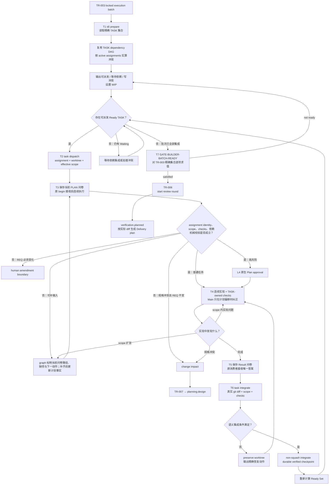

# L3-S6 — 构建（Build）

> 层：第三层 ｜ 上游：L2 §S6 ｜ 前置：S5 TR-003 已锁定 execution batch ｜ 下游：S7 完整验证轮
>
> 本文 §0～§10 为当前设计约束；§11 起为历史记录，不作为当前执行指令。本次实施与验收见 [S6 机制审查](../global-optimization/S6-MECHANISM-REVIEW.md)，未验证能力不得描述成既成事实。
>
> 跨 Stage 的 Sub-agent / Agent Team 拓扑、计划回执、等待、Hook、恢复和 Result 消费统一引用 [L4 Agent 调度与治理机制](../l4-mechanisms/L4-agent-dispatch-governance.md)。本文只定义 S6 如何消费该机制；若本文的迁移审计仍出现 approval/activation，那是在描述现状债务，不是目标协议。
>
> 阅读顺序：§1～§3 理解 S6 的价值流和机制取舍；§4～§7 理解目标工作流、任务调度、状态与数据闭环；§8～§9 理解引导如何进入工具必经之路；§10～§12 对照当前实现、出口和迁移顺序。

> **Revision 口径**：Runtime revision 和 Assignment revision 都由对应 Writer/API 生成。Builder/主会话只消费 Assignment ID、当前 scope、checks、checkpoint 和 `next`；不手工编号、计算或复制 revision。Runtime 的锁、原子写和内部提交序号见 [L4 Runtime revision 使用与命令协调](../l4-mechanisms/L4-revision-usage.md)。

## 0. 当前减负后的 Builder 交付路径（2026-10-16）

正常 S6 入口是原 TR-003 批次、Assignment 与真实执行登记。`building` 中的 PreToolUse 图监听从同一只读投影给当前 Builder 一次完整上下文和实际问卷路径：共享 Worker registry 的 ready execution 使用原 `WorkerSubmissionPaths`；native Assignment 使用原 `assignment_context` 的 PLAN/Result 路径。作者不查状态文件、不猜路径、不运行 `stage-answer issue/consume`。

上游返工后，原规划接收/流转事务须从本次已接受的 TASK 文档同步 Runtime TASK 的文档字段，并保留原 owner、执行与审计事实。S6 仍校验实体与当前锁定来源一致；不得要求 Main 手工刷新字段、重造 TASK，或在准备草稿时旁路修改 Runtime。历史已结束的独立审查责任不占当前 Builder 容量，真实 Builder 与来源不明的责任仍按原图处理。

默认 bound-workspace 派发顺序固定为原 TASK-bound manifest 注册后，Main 对每个登记的
Assignment 运行：

```sh
runtime workspace prepare --root <authority-root> --assignment <id> --agent <owner>
runtime workspace launch --root <authority-root> --assignment <id> --agent <owner>
```

Main 先查看 prepare 返回的 execution、`assignment_context_ref` 与 `submission_paths`
里 PLAN/Result 的实际路径；Hook 随后给当前问卷的准确 view/answer 路径。该路径不额外
调用 `team launch`、导出 readback template 或手工创建 worktree；只有 Runtime 明确选择
native/legacy teammate dispatch 时才用其原路由。Main 从原 S6 准备入口取得 manifest 草稿：系统填当前 Runtime、REQ、generation、锁定文档摘要、TASK scope、依赖和检查；Main 只补真实 Team/Agent 和专业分工。草稿不登记、不授权、不推进阶段，确认后仍交原 register-workgroup。Main 按实际安装可读的公开示例
[`docs/examples/s6-builder/README.md`](../../docs/examples/s6-builder/README.md) 完成原 manifest，
不能依赖目标产品中不存在的 harness `internal/` 源码资产路径。

| 时点 | 作者/系统动作 | 原消费者、本人完成与阶段缺项 |
|:--|:--|:--|
| 开始责任 | 看准确的 dispatch context、PLAN schema/questions 和 PLAN answer 路径；填写并保存一次专业 PLAN，答案给出目标、改动面、依赖、断言检查、风险/假设 | 精确 PLAN 保存自动走 workspace 原 `begin` 或 native `runtime agent-begin`。原 begin/Assignment Writer 校验 Owner、当前 TASK/Record、依赖、planned paths 和 required checks；通过后继续工作。这个真实 PLAN answer 是唯一计划事实；若 L4 checkpoint 仍需保留，由保存适配器从该答案登记，不再让 Builder 另发重复 generic PLAN_REPORT。PLAN 接受只完成计划责任 |
| 实现与交接 | 实际完成被分配 TASK、执行 Worker-owned checks、按原分支纪律提交成果；在准确 Result 路径填写简短完成说明、产物/检查引用、未完成项与真实偏差并保存 | 精确 Result 保存自动走 workspace 原 `report` 或 native `runtime task-complete`。作者不另发 completion envelope、`task-complete` CLI 或重复证据总结；失败提示保留原 Writer 的具体缺项 |
| Main 集成 | Main 对 TR-003 中每个 Result 调用原 `runtime task-integrate`/Integrator | Integrator 从真实 Git 差异核 scope/locked paths、提交和冲突，执行被配置的 Required Checks，写 Main checkpoint/ACK；失败保留现场。Worker Result/commit 本身不算 Main 集成或 stage done |
| Stage done | 所有 TR-003 精确 TASK 都有当前有效 Result、无未批准 scope 偏差、Main 已集成、Required Checks 新鲜通过，原 TR-006/Gate 满足 | TASK Result 是 Builder 的本人交付；Main 集成与检查及原批次 gate 是 stage 缺项。缺哪项就给确切 TASK/检查/责任人和下一动作 |

Result 的 `summary` 明确记录本人实际交付，以及每个注册的 TASK Required Check 实际运行命令与结果；未运行须说明原因或阻塞。Main 集成时重跑检查不替代 Builder 自测，空 Worker runner contract 也不豁免该自测。

阶段完成要求当前每个 TASK 的当前 revision 通过完整 Main 检查。旧 revision 曾合入后检查失败、随后由原 Writer 发行新 revision 修复时，保留旧失败，不要求把它补成 PASS。S7 产品基线仍从原 TR-003 起点读取到最终 Main 的全部实际 Git 差异；历史已验证的贡献沿用原证明，准确绑定但尚未验证的历史合入不计 verified contribution，其残留产品路径仍进入原完整审查范围及未归属路径提示。当前 revision 的任何缺项、历史来源或绑定损坏仍报错，不把失败改写为成功，也不新增历史证明协议。

PreToolUse 在这里仅监听图并投影缺项，不许可/拒绝某个工具或路径。PLAN 的既有 L4 条件、TASK/Assignment Writer、真实 Main Inspect/Integrator 和 TR-006 仍按原领域语义求值。S6 与 S5/S7 的区别是 Builder 确有“开工计划”和“完成交接”两个时间点、两个不同专业答案；它们不构成第三份消息/信封。

普通 Pre 在 Runtime revision 未变时只读原 milestone，不重复求值或写入；提醒不运行 receipt/Git 链。已有 Main 检查失败只读原 checkpoint 中记录的失败及 receipt/log 路径，并展示原恢复动作；不把它泛化成尚待集成，也不要求重交已接受 Result。同 gate 不重复计算 canonical 事实；提交后复用原 Snapshot，减少重复 Reconcile/Load，不新增 handoff 特判。

TR-006 提交后返回真实流转结果；S7 原入口负责使用原完整基线生成与原 ReviewPlan 消费准备当前问卷。未准备时，明确报告系统准备缺口及处理方，不投递填写指令；准备后给出准确问卷路径、问题和当前缺项。不新增交接状态或报告。

原 Git commit 请求也须在返回的准确路径提供现有格式草稿，带入工具已知的 Worker HEAD；作者只选实际提交文件并说明改动，不查源码猜请求形状或抄摘要。准备不得自动提交、选中未声明文件或覆盖已有请求。它仍由原显式 commit 命令执行，不新增履职报告或保存触发器；HEAD 变动仍按原提交冲突反馈处理。

给 Main 的监听反馈只安排派工、观察、接收、集成和原缺项恢复。可以列出某位 Builder 的问卷路径与未完成项，但必须明确由该 Builder 填写；不能把“填写 PLAN、实施 TASK、填写 Result”的本人指令投递给 Main。给 Builder 的反馈继续使用其原登记责任与准确路径。这里区分提示对象，不按身份限制工具或新增报告。

集成失败反馈分别给出原 retry argv、存在时原 rework argv，以及只读 `runtime workspace pending --root <bound-main-root>` 诊断。若原 pending 投影给当前 canonical Assignment 提供 `ReworkCommand`，Main 可用 `s6 prepare --revise-assignment <id> --revision-intent-key <Main-chosen-key>` 生成固定路径 `.claude/workgroups/<REQ>/<TASK>/manifest-s6-r<N>.json`。草稿从当前 Record 和原 manifest 保留已登记 TASK、scope、checks、DoneWhen、Closing Contract 与来源；Main 只选择新的平台 Team/Agent 和 intent key。输出同时给出当前 Record reference/SHA 与原 `register-workgroup` revision flags。草稿不注册、不写 Runtime；原 Writer 重新校验全部注册条件并签发 revision。普通 `s6 prepare` 不变。

`workspace launch` 就是该执行的真实 Builder 派发。异步返回后，Main 跟踪这一原平台会话和交付回执，需要继续时恢复原会话；同一执行由这一 Builder 承接，避免另起原生 Agent 重复进入同一工作目录。PLAN 接收后系统补出的未答 Result 仍是草稿，普通观察不能把机器预填当成作者保存。

### Bootstrap 系统资产与 Git clean 的边界

TR-006 沿用原产品路径投影。Git status 对未跟踪嵌套 worktree 返回的目录尾 `/` 是目录标记，解析时仅对 `??` 行去掉这一标记后校验原字面路径；不能把保留的 `.worktrees` 控制目录误报为不安全路径。产品目录、产品改动与真实不安全路径仍按原条件拒绝。

Worker worktree 的系统资产只按原 workspace registry、Main 中的 execution 坐标、Worker `.claude/loop-workspace.json` 指针及现有 `.claude/loop-bootstrap.json` receipt 识别。receipt 必须通过原验证，绑定同一 runtime、assignment、generation 与实际 Worker root；逐文件内容仍须匹配 receipt 摘要。Main 不能接受 Worker receipt 作为自己的豁免。原 Main checkout 的 clean 检查使用已有的固定 Harness 路径投影，仅识别已登记 Main 中这些未跟踪的系统文件（包括清单草稿）；tracked dirty 和投影外产品改动仍阻止集成。这不是 Main Bootstrap receipt，也不放宽 Worker 的 receipt 校验。
集成失败反馈必须区分 Main checkout 与 Worker worktree，并分别标明实际根路径及对应的 `git -C <root> status --short` 观察命令。

有效 receipt 可以精确区分“本次安装写入的系统文件”和产品差异，却不能绕开 Git 对 dirty worktree 的检查：receipt 列出的 tracked 系统文件仍须先核对未被后续修改，再恢复到该 Worker branch 的基线；列出的 untracked 系统文件仅在当前 bytes 仍等于 receipt 时删除。之后由原 Git clean 检查和普通 `git worktree remove <path>` 收尾，不用 `--force`。任一 receipt/hash 不符、receipt 外的 dirty/untracked 文件、真实产品改动或未合回提交都保留现场并阻止清理。该方案只消费已有 Bootstrap receipt；不建 archive、来源副本或系统资产 commit。

历史 R11 R4 因 Bootstrap dirty 停在 Main 集成。原 receipt 精确识别及安全清理已由回归、新包原消费者与真实 Main/Builder 分段验证；after-r42 的原监听已推进 TR-006 到 S7 入口，但反馈超时；R44 startup 超时同样保留。after-r45 的两次真实 Main probe 已验证已知失败提示和无超时交接，原 TR-006 唯一进入 S7，准确问卷可读，停在入口未填写。专业前置机械重放与真实模型履职分别记账，详见 [S6 机制审查](../global-optimization/S6-MECHANISM-REVIEW.md)。不得把“过滤 dirty 后强制删除”当成修复。

## 1. 第一层：S6 的立意、边界与完成定义

### 1.1 为什么需要 S6

S5 结束时，系统已经锁定“要实现什么、允许改变什么、完成时应证明什么”，但这些仍是文档事实。S6 的职责是把每个锁定 TASK 转换为三类可以交给独立验证者的事实：

1. **实现事实**：代码、测试、配置或迁移已经进入统一集成基线；
2. **执行事实**：正确的 Builder 在明确 assignment 下实施，实际差异、检查、风险和偏差均有记录；
3. **可复验事实**：每条 Closing Contract 都有 S7 能独立运行或检查的入口。

S6 不是“把代码写出来就算完成”，也不负责证明产品最终正确。它完成的是**受控实现与诚实交接**：Builder 负责产出和 owned checks，S7 负责独立复验，二者不能合并成 Builder 自证。

### 1.2 S6 的最小价值流

S6 应收敛成一条短而硬的执行流水线：

> S5 精确任务批次与派发计划 → 生成实时清单 → 派发 → 计划回执后连续执行 → 唯一完成结果 → 语义集成 → 精确批次 Gate → S7

每个额外机制都必须缩短反馈时间、降低漏项或阻止一种具体失败。协议更完整、消息更多、状态更细，不自动等于控制更强。

### 1.3 阶段目标与目标完成定义

| 项目 | 目标定义 |
|:--|:--|
| 输入 | 当前 generation 下由 TR-003 锁定的精确 TASK 集合、TASK DAG、scope、Closing Contract、当前登记文档指纹、源代码基线 |
| 要搞清楚 | 哪些 TASK 已 Ready；谁拥有唯一写入权；哪些任务因依赖或写冲突必须等待；实际实现和检查改变了什么；S7 如何复验 |
| 核心工作 | 生成调度板 → 原子派发 → 计划回执与当前缺项提醒 → 连续实现和 owned checks → 唯一完成交接 → worktree 语义集成 → 批次出口 |
| 正式输出 | 已集成实现；每 TASK 唯一 Builder Result；实际 diff；检查结果与原始引用；integration checkpoint；S7 可消费的构建批次索引 |
| 目标完成 | TR-003 精确批次中的每个 TASK 均满足唯一 Owner、当前 Assignment 对象版本、有效 Result、无 scope 偏差、已集成、Required Checks 通过 |
| 下一阶段 | TR-006 启动新 review round 并进入 verification.planned；S7 原入口再根据实际集成差异和锁定真相生成验证计划 |

### 1.4 S6 的职责边界

- **负责**：执行规划、写所有权、依赖和冲突调度、上下文确认、实现、owned checks、真实完成报告、worktree 集成、构建期规格冲突路由；
- **不负责**：给出最终交付结论、修改 locked 规格、替代 Delivery/QA/E2E、直接处理 S7 finding、发布或部署；
- **规格边界**：非 REQ 规格无法成立时走 TR-007 返回 planning；REQ 目标或 AC 必须变化时走 human amendment；
- **原领域条件**：locked artifact、Assignment/TASK 条件、实际 diff scope、Required Checks 仍由原领域 Writer 与集成门求值；Hook 不在工具前按身份、路径、scope 或 first-write 拦截，只说明本责任的具体缺项和下一动作；
- **独立性边界**：Builder Result 是交接声明，不是 S7 PASS。

## 2. 第二层：机制设计的收益门槛

### 2.1 每个机制必须回答五个问题

任何要进入 S6 正常路径的机制都必须具有：

1. **唯一失败对象**：明确防止哪种故障，不能只说“提高规范性”；
2. **唯一事实生产者**：同一事实不要求 Agent 手工写两到三份；
3. **明确机器消费者**：字段必须影响调度、授权、集成、Gate 或恢复；
4. **可操作失败反馈**：失败时返回缺失事实和下一条恢复动作；
5. **可观测收益**：能够通过反馈时间、漏项、冲突或返工指标证明价值。

若一个字段没有机器消费者，应删除或降级为说明；若一个 Guard 只检查 evidence 非空，名称不应承诺更强的语义；若同一事实被多个载体重复表达，应选择一个权威记录，其余由工具派生。

### 2.2 强制力分层

| 层级 | 适用对象 | 目标形态 |
|:--|:--|:--|
| 原领域门 | locked artifact、禁用 merge 方式、不可恢复产品动作 | 原领域 Writer/集成入口按既有产品条件拒绝或保全；Hook 只给具体缺项和下一动作，不按单次工具操作拦截 |
| Semantic gate | Owner、Assignment 对象版本/plan、实际 diff scope、Required Checks、精确 TASK 覆盖 | dispatch、completion、integration、TR-006 中实算；对象版本由工具生成 |
| Guidance | 阅读顺序、实现方法、风险 Skill、建议命令 | 当前工具上下文、生成模板、失败恢复信息 |

不应把所有指导都升级为文件级硬锁，也不应把本可机器计算的约束降级为长文档提醒。

### 2.3 保留、合并、删除和迁移

| 类别 | 机制 | 处理原则 |
|:--|:--|:--|
| 保留 | TR-003 精确批次与文档指纹 | 是 S6 的输入边界和 Gate 的量化集合 |
| 保留 | 一 TASK 一写 Owner | 派发前和集成时双重实算 |
| 保留 | TASK DAG、按需冲突计算、Worktree | 控制并发、隔离差异、保留失败现场；不维护第二份冲突图 |
| 保留 | 精简 PLAN_REPORT + 原 S6 计划/结果门 | 只保留需要 Agent 判断且有消费者的内容；计划保存后连续执行，Hook 提醒当前责任，不设逐工具首写屏障 |
| 保留 | owned checks + S7 独立复验 | 前者提供快速反馈，后者提供独立结论 |
| 合并 | team manifest、assignment、worktree sidecar | 收敛成一个权威 Assignment Record |
| 删除 | 普通任务的回读批准、activation_sent | 不改变授权边界却制造第二轮等待；高风险任务改用 L4 原生 Plan approval |
| 合并 | completion message、evidence envelope、task event | 变成一个 Builder Result 登记命令 |
| 合并 | 多个 S6 evidence-attestation Guard | 变成一个真实 S6 batch evaluator |
| 内收 | integration acknowledge、cleanup 状态 | 作为 Integrator 内部幂等步骤，不暴露给 Agent |
| 删除 | 正常路径上的长消息哈希链手工维护 | 指纹和关联 ID 由工具生成并审计 |
| 删除 | Builder 默认全量 Skill 预载 | 改为按任务表面、风险和失败类型按需加载 |
| 删除 | 未接入执行器的“Required Checks 已验证”叙事 | 要么真正接线，要么不宣称已验证 |
| 迁移 | S7 Delivery Manifest 前置 | 移到 TR-006 后的 S7 入口 |
| 迁移 | 普通 scope 全路径 policing | 以 dispatch 生成 scope、integration 实际 diff 校验为主 |

## 3. 第三层：S6 目标任务分解

| 任务 | 要解决的问题 | 主要动作 | 阶段产出 |
|:--|:--|:--|:--|
| T1 准备精确批次与调度板 | 这次必须完成哪些 TASK；谁 Ready；哪里冲突 | 从 TR-003 批次及已审签计划读取 TASK DAG；按 active/reported 未消费 assignments 实算冲突；计算可派发、等待依赖和写冲突条件；设置 WIP | S6 Board、批次指纹、调度顺序 |
| T2 原子派发 | 谁拥有任务；允许改什么；使用哪个 worktree | 生成 Assignment Record；校验一 TASK 一 Owner、role/path、写重叠；创建 worktree；生成 PLAN_REPORT 请求 | assignment、worktree、effective scope |
| T3 计划检查点 | Builder 是否理解当前任务；依赖和证据计划是否成立 | 保存专业 PLAN；原 begin 校验 assignment identity/scope/checks；普通任务立即继续，高风险进入 L4 Plan approval | plan checkpoint / approval ref |
| T4 实现与 owned checks | 如何快速兑现 Closing Contract 并尽早发现错误 | 在 scope 内实现；运行任务级测试/lint/build；按需加载 Skill；问题分类 | 实现、测试、原始检查结果 |
| T5 唯一完成交接 | Builder 实际做了什么；后续工具如何消费 | 登记 Builder Result；自动提取 diff、checks、Owner、Assignment 对象版本；校验结果 | canonical builder result |
| T6 语义集成 | 真实差异是否安全、在 scope 内且可复验 | Inspect diff、locked paths、merge conflict、Required Checks；非 squash 集成；写 checkpoint | integrated implementation、checkpoint |
| T7 精确批次出口 | 是否每个锁定 TASK 都真实完成；能否进入独立验证 | 对 TR-003 精确集合逐项求值；TR-006；S7 入口生成验证计划 | review round、verification.planned |

T2～T6 针对每个 TASK 重复；T7 只在精确批次全部收口时执行。并行度由 Ready Set 和 WIP 控制，而不是一次性把所有任务都派出去。

## 4. 目标工作流：从锁定任务到独立验证



正常路径不要求 Agent 手工维护多条 agent/task event。工具在派发、PLAN_REPORT、首次写入、完成和集成的自然动作中原子更新权威记录。异常和审计事件仍可保留，但不能成为每个 TASK 的必做仪式。

## 5. 调度与 Sub-agent 派发

### 5.1 TASK DAG 与即时冲突集决定能否并行

S6 调度器复用一份权威 TASK DAG，并在每次调度时计算一个即时冲突集：

1. **依赖条件**：TASK 声明的前置结果，只有依赖已经集成才能释放下游；
2. **即时冲突**：候选 TASK 与 active assignments 在路径重叠、共享 schema、migration、生成文件、公共契约实现等表面是否不能安全并行。

不持久化第二份完整写冲突图；真实冲突只记录在对应 Assignment/Blocker 中，避免 TASK DAG 与冲突图双重同步。

TASK 进入 Ready Set 的目标条件为：

- 属于 TR-003 锁定的精确批次；
- 所有依赖 TASK 已进入 integrated；
- 与当前 active/reported TASK 没有未解决写冲突；
- assignment 所需输入和文档指纹当前；
- 没有未处理的规格冲突或人工边界。

### 5.2 优先级和 WIP

Ready TASK 的默认优先顺序：

1. 位于关键路径；
2. 完成后能解锁最多后续 TASK；
3. 具有较高技术或集成风险，越早获得反馈越有价值；
4. 在同一表面可以复用已有上下文；
5. 其余任务按稳定 TASK ID 排序，保证可复现。

WIP 由真实平台槽位、明确资源约束和可观察的集成积压确定，不默认固定为 2。边界兼容且输入就绪的任务积极并行；降低并行度应给具体限制原因，容量不足仅排队并持续补位。不得使用“模块数 × 合约数 × 风险系数”一类不可稳定复算的 Agent 数量公式。

### 5.3 一 TASK 一写 Owner

- 一个 execution TASK 在任一时刻只能有一个有效写 Owner；
- 多角色协作应先拆 TASK 或声明串行 handoff，不允许共享模糊写权限；
- role 根据主要写表面和 Primary Contract 选择，不根据 Agent 名称猜测；
- 同一 Agent 可以在前一 TASK 已集成后顺序复用，尤其适用于相同角色和相邻代码表面；
- Reviewer、QA、E2E 不在 S6 获得产品写权限。

### 5.4 调度板是 Main Agent 的决策界面

T1 和每次集成后都应生成：

```text
READY
- TASK-12 / backend-builder / 解锁 3 个后续任务
  scope: internal/order/**
  checks: go test ./internal/order/...
  skills: transaction, migration

WAITING
- TASK-18 等待 TASK-12 integrated

CONFLICT
- TASK-16 与 TASK-12 同时修改 migration，必须串行

ACTIVE
- TASK-15 / frontend-builder / plan reported / executing

NEXT
- TASK-12 集成后释放 TASK-18、TASK-19、TASK-21
```

Main Agent 负责处理异常、优先级和人工边界，不再手工拼装每个 Sub-agent 的完整协议 Prompt。

## 6. Assignment、计划回执和渐进式上下文

### 6.1 一个权威 Assignment Record

Assignment 的跨 Stage 最小字段、全局五态、对象版本和 canonical Result 契约以 L4 §5 为权威。S6 不复制一套独立 Schema，只增加以下阶段引用：

| S6 引用 | 内容 | 生产方式 |
|:--|:--|:--|
| task_ref | task_id、batch_id、generation、当前 TASK/文档指纹 | 从 TR-003/TASK 引用，不复制内容 |
| authority | effective_scope、role maximum、forbidden actions | role maximum ∩ TASK scope，由 dispatch 实算 |
| build context | Closing Contract/Required Checks refs、最小文档集、风险 Skills | 从 TASK 和风险路由器引用 |
| integration | worktree_path、source branch、target branch | dispatch 原子生成；真实 topology 同步回 Assignment |

Team Manifest 可继续作为规划输入或审计视图，但不能与 Assignment、sidecar、checkpoint 各自维护不同版本的 Owner、scope 和 worktree 坐标。

### 6.2 S6 专业 PLAN 答案

Builder 只在当前 PLAN 问卷回答五个需要真实判断的问题：

1. 用一句话说明本 TASK 的目标；
2. 列出准备修改的具体代码表面；
3. 说明依赖是否已经满足，若未满足缺什么；
4. 说明每条关键 assertion 将由什么检查证明；
5. 指出发现的冲突、缺失信息或必须成立的假设。

身份、文档哈希、禁止路径、角色上限、Skill 名称、worktree 坐标、关联 message ID 等由工具填充。原 begin 消费该答案；若需要 L4 的 PLAN_REPORT checkpoint，工具将同一份真实答案投影到 checkpoint，不要求 Agent 再发重复 generic message，也不伪造答案未包含的读回、文件阅读或检查通过。

### 6.3 计划回执后连续执行

S6 默认使用 L4 `plan_checkpoint`，但 PLAN 问卷是唯一作者输入：

- Worker 填写并保存原 PLAN answer；保存入口校验它对应当前 Assignment 对象版本；
- 校验文档和 TASK 指纹仍然当前；
- 校验依赖已 integrated；
- 校验 Owner 唯一且没有 active 写冲突；
- 校验 planned paths 在 effective scope 内且 Required Checks 未漏；
- 校验通过后，Worker 不等待 Main 第二次授意，直接实现；
- Main 只在语义偏移、阻塞或完成时 SendMessage；
- Hook 不按首次 mutation 许可或拒绝工具调用；原 begin/高风险 approval 条件仍由原计划与结果消费者求值，进度提示列出本责任完整问卷路径、具体缺项和下一动作。

只有命中 L4 高风险分类时，派发器才选择 `plan_approval_required` 并进入 teammate 原生 Plan mode。普通路径删除 understanding_approved、activation_sent、work_started；首次有效写入只是执行事实，不新增一个必须人工推进的持久状态。

### 6.4 Skill 按风险加载

Skill 的选择由任务事实驱动：

- Go/API/domain 任务加载直接相关的 Go 或后端实践；
- Vue/UI 任务加载当前组件、状态或路由所需实践；
- migration/security/concurrency/error-handling 等仅在风险被触发时加载；
- 测试失败后可以按失败类别追加 Skill；
- 正常 assignment 默认只注入 2～4 个最相关 Skill。

角色卡应保持短小，只定义不可变边界；技术方法通过 assignment 风险路由渐进披露。

## 7. 实现、完成与集成闭环

### 7.1 Builder 的实现顺序

Builder 直接由 Closing Contract 驱动：

1. 将 assertion 映射到实现表面；
2. 对行为变化先建立能暴露错误的测试或复现；
3. 在 effective scope 内实现；
4. 运行 TASK-owned 快速检查；
5. 记录真实结果、未验证项、风险和偏差；
6. 完成时提交唯一 Builder Result。

测试成本分层：

- Builder：每 TASK 运行快速、精确、owned checks；
- Integrator：每 wave 或 batch 运行编译、冒烟、受影响集成检查，捕捉合并交互；
- S7：独立运行完整 Delivery/QA/E2E 验证。

同一昂贵检查不应在每个 Builder 和每次集成都无差别重复，但任何层都不能借下一层存在而跳过自己独有的反馈责任。

### 7.2 问题分类

| 发现 | 路由 |
|:--|:--|
| scope 内普通实现错误 | 留在原 assignment 修复并重跑 owned checks |
| 外部环境或权限暂缺 | assignment=blocked，保留 worktree；继续可独立完成的工作 |
| 需要扩大写 scope，但规格不变 | 由工具生成新的 Assignment 对象版本；重新计算冲突；普通计划重新回执，高风险 approval 不继承 |
| TASK/contract/design 无法共同成立，REQ 不变 | change impact → TR-007 → planning.design |
| 必须改变 REQ 目标或 AC | human amendment，不得借 TR-007 静默推进 |
| 发现邻近但不属于 assignment 的缺陷 | 记录 finding，不顺手扩大修复 |

### 7.3 唯一 Builder Result

每个 TASK 的专业完成答案只填写一次，后续修正与重放沿原消费者处理：

- 作者填写 `summary`、逐断言实际 `evidence_refs`、`risks_blockers`、`scope_deviations`；有 Closing Contract 时填写 disposition、各条件 judgment/rationale。
- 系统从已接受 PLAN 预填 assertion/oracle、DoneWhen 与 PLAN assertion 索引，专业答案不重抄这些已知事实；提交身份由适配器维护。
- runtime、generation、Owner、Assignment Record/revision/SHA 由原上下文和 Writer 绑定；作者不编 envelope、证据索引或任务事件。
- 实际 Git changed paths、真实 runner checks、Main 集成/ACK 来自各自原消费者，不能用作者文字或问卷保存代替。它们进入原回执和集成事实，不追加为作者必填字段。

目标 task complete 命令应原子执行：

1. 校验 Result schema；系统投影已接受 PLAN 的 assertion/oracle、条件索引和机器身份，作者不重抄；
2. 校验 Owner、Assignment 对象版本当前；
3. 自动提取并核对真实 diff；
4. 写入 Result 和 evidence index；
5. 原 Writer 登记本人交付事实：完整交付为 done，未闭合为 blocked；Main 集成为下一责任；
6. 触发或提示下一步 integrate。

旧的 completion message、gate evidence envelope 和 task lifecycle event 可以在迁移期由适配器派生，但 Agent 不再手工提交三份相同事实。

G02 的 `runtime task-receipt` 是这份原 Result 的只读当前投影：复用原证据资格、
TASK/owner/assignment/指纹和检查内容，将本人交付条件与 Main verified 集成分开。
`checks_source=original_report` 不伪装执行命令；缺/失败检查仍不完成，已登记证据
损坏及输入变化指向 Main 恢复/原返工。该回执不写新生命周期或推进批次门。
有效 Assignment 下 Owner 仍为 pending/active 且尚无 Result 时，回执显示未提交 Result
的进度，不将其归类为 Assignment 无效；绑定、冻结来源及已提交 Result 仍按原规则校验。
S6 对已有 TASK 登记 Builder 时，原 register-workgroup CAS 同步其明确 owner，
保留 TASK 其余事实；原 Inspect 拒绝须落下 Integrator 的 durable preserved
checkpoint，不能只用 Milestone 文本替代可恢复接收记录。

### 7.4 集成是普通 scope 的最终事实门

目标 task integrate 必须检查：

1. Builder Result 可解析且绑定当前 Owner/Assignment 对象版本/TASK；
2. worktree clean，source 有 commit，target 存在；
3. merge-tree 无冲突；
4. 实际 changed paths 是 effective scope 的子集；
5. 没有触碰 locked artifacts 或禁止路径；
6. Result 中没有未批准 scope deviation；
7. TASK-owned checks 已通过且结果当前；
8. 配置的 wave/batch checks 已实际运行通过。

成功后 non-squash 集成并写 durable verified checkpoint；若唯一 dirty 项是通过当前 execution 精确绑定且逐文件哈希仍匹配的现有 Bootstrap receipt，先按上文恢复/删除那些系统资产，再重跑原 clean 检查；不得忽略整个 `.claude` 或跳过 clean。其他失败仍 preserve worktree 和 branch，不销毁现场，并输出：

- 哪个条件失败；
- 观察到的真实值；
- 期望值；
- 可执行的恢复动作；
- 修复后应重试的命令。

工作状态只用 `pending / active / blocked / done / cancelled`。Builder 本人 done、Main 集成 done、S6 done 分属各自责任，不能互相替代。integrated、prepared、merged、verified、acknowledged、cleanup_pending 等是原消费者内部事实和兼容字段，由工具维护，不要求作者推进另一套状态。

### 7.5 根目录接收与临时 worktree

消费 [L4 Worktree](../l4-mechanisms/L4-worktree-governance.md)：创建来源与集成目标均取 REQ 显式 dev_branch，不默认 develop；release_upstream 只供最终发布。主会话确保 TASK、设计、代码依赖已在该分支提交，运行 evidence 另按声明交接。

Builder 在子分支提交成果；主会话负责根目录 merge commit、联合校验、接收及及时清理，根目录是唯一权威。verified 后继续 ack/cleanup，不等待第二次 SubagentStop；Hook 只记录短事务和提示主会话，不在 10 秒事件预算中运行完整测试。

Root/Main 的产品 dirty、目标分支偏离、冲突或 receipt 外的子树新增未跟踪内容时保留现场，给出恢复动作；不自动 checkout/stash/reset 产品内容或强制删除。只允许对经当前 Main→Worker registry/pointer 验证、且逐文件等于原 Bootstrap receipt 的 Worker 系统资产作精确恢复/删除，随后必须满足普通 clean 与 worktree remove。未回收和积压只提醒，不扩展 Stop/PreToolUse 硬门禁。阶段交付从声明的 Git tree 校验，必要成果未合回时不能据子分支结果宣布阶段通过。

## 8. 状态、证据与 Gate 的闭环

### 8.1 复用全局五态

工作状态与 AGENTS.md 一致，不增加状态名：

| 状态 | 本责任的含义 |
|:--|:--|
| pending | 尚未开始；系统给出依赖、分工和问卷路径 |
| active | 正在履职；PLAN 接受不等于完成实现 |
| blocked | 条件不成立；给确切缺项、责任人和恢复动作 |
| done | 本责任要求和证据已满足；同时说明下一责任尚缺什么 |
| cancelled | 已取消或被新发行责任替代；保留原事实 |

可派发、等待依赖、写冲突是调度条件；PLAN/Result 已接收、已集成是领域事实，不形成另一套工作状态机。已有兼容存储字段和 Integrator 幂等阶段由原 Writer 维护，不要求 agent-event/task-event 双写。

Builder done 来自有效专业答案和本人检查。incomplete/blocked 答卷虽可被诚实接收，不能因此宣布完成或提示 Main 直接集成。Main 集成和阶段出口分别求值。

### 8.2 TR-006 的精确量化

GATE-BUILDER-BATCH-READY 必须以 TR-003 锁定的 TASK ID 精确集合为输入，而不是扫描“当前有哪些 evidence”：

对每个 TASK 必须同时证明：

- 恰有一个当前写 Owner；
- Assignment 对象版本当前，且所需 plan checkpoint/approval 有效；
- Builder Result 存在、schema-valid 且 producer=Owner；
- 实际 changed paths ⊆ effective scope；
- scope deviations 为空或已由新 Assignment 对象版本批准；
- Required Checks 全部通过；
- integration checkpoint 已 verified；
- generation 和消费的文档指纹当前。

只有对精确集合逐项全称量化通过，TR-006 才能启动 review round。

### 8.3 S7 团队不再是 S6 Gate 条件

S6 的出口只证明“构建批次已经完整、真实、可复验地集成”。它不要求在 building 状态正式登记 Delivery workgroup，也不接受占位 team-manifest evidence 作为替代。

TR-006 后，S7 入口工具根据以下事实生成 Delivery 计划：

- 锁定 REQ/design/contracts/TASK；
- 实际集成 diff；
- Builder Result 和未验证风险；
- 受影响模块、集成边和回归表面。

这样验证范围基于真实实现，而不是 S6 完成前的预测。S6 可以预计算风险提示，但它不是 Gate evidence。

## 9. 把指引放进 Agent 的必经之路

### 9.1 不做“提示词撒点”，做决策点契约

指引进入工具不等于在每个 Hook 重复长提示。每个决策点只提供四类信息：

1. 当前事实与问卷完整路径；
2. 本责任需要完成的工作；
3. 完成条件；
4. 失败后的下一步。

提示内容必须由当前 Assignment、状态和真实工具结果生成，不能复制一段容易过期的协议正文。

凡是提示某个 Builder 当前进度或未完成责任，都必须同时给出该 Assignment 实际问卷的完整路径、具体缺项和下一动作（或明确等待的 owner）。路径与缺项由当前 Assignment、阶段要求和原门结果直接投影；不得让 Builder 读取 Runtime、状态文件或协议自行拼答案。系统解析不出路径/缺项时，转为 Main 的系统接线待办，不向 Worker 发残缺进度提示。

### 9.2 工具落点

| 必经点 | 工具应自动提供 | 工具应强制 |
|:--|:--|:--|
| TR-003 进入 building | 精确 batch、缺失输入、初始 S6 Board | batch 与指纹来源唯一 |
| s6 prepare | Ready/Waiting/Conflict、关键路径、WIP 建议 | TASK DAG、即时冲突、一 TASK 一候选 Owner |
| task dispatch | 任务上下文、effective scope、checks、Skills、PLAN_REPORT 模板 | 真实 topology、worktree、Owner、role/path、无写冲突 |
| PLAN_REPORT / PostToolUse | 五项判断和当前文档切片 | Assignment 对象版本、planned paths、checks 和依赖一致 |
| PreToolUse / 相关进度事件 | 本责任问卷完整路径、当前 TASK、具体缺项、Closing Contract 和下一动作 | 不执行工具级身份/路径/scope/first-write 拦截；原计划、Writer、locked 条件与集成门仍按原领域契约求值 |
| test wrapper | 当前 assertion、建议命令、失败分类 | 保存真实 command/result |
| TeammateIdle/SubagentStop | 当前缺计划、缺 Result、阻塞或可交卷事实 | 未完成时继续同一 Worker，不自动派下一 TASK |
| task complete | 自动 diff、缺失字段、下一步 integrate | canonical Result、Owner/Assignment 对象版本/Checks |
| task integrate | scope 差集、冲突、检查和恢复动作 | 真实 diff、locked path、merge/checkpoint |
| batch gate | 每 TASK 的 exact missing matrix | 对 TR-003 精确集合全称量化 |
| S7 entry | 基于真实 diff 的 Delivery plan | verification phase 与 review round 当前 |

### 9.3 错误消息也是流程编排

工具不得只返回 not_ready。推荐统一错误结构：

| 字段 | 说明 |
|:--|:--|
| code | 稳定的机器错误码 |
| failed_condition | 哪条前置或完成条件失败 |
| observed | 当前真实观察值 |
| expected | 需要达到的值 |
| owner | 谁负责恢复 |
| next_action | 一个明确动作或命令 |
| preserves | 哪些 worktree/evidence/checkpoint 已被保留 |

Agent 应顺着错误消息继续，而不是返回长协议文档中自行搜索恢复方法。

## 10. agent-protocol.md 的新职责

agent-protocol.md 应缩减为“宪法与路由表”，只保留：

- 全局不可破坏的不变量；
- 简化状态图；
- 每种场景对应的工具入口；
- 人工边界和异常升级条件；
- 权威数据源的位置。

详细约束按职责分布：

| 信息 | 权威位置 |
|:--|:--|
| 为什么需要某条原则 | agent-protocol.md / Blueprint |
| 字段和结构约束 | Schema |
| 当前任务允许做什么 | Assignment Record |
| 当前动作怎么做 | CLI help / generated form |
| 失败后如何恢复 | 工具错误和 checkpoint |
| 是否允许过阶段 | semantic Gate |
| 当前该读哪些 Skill | risk-based context router |

文档负责解释“为什么”，工具负责决定“现在能不能做、下一步做什么”。协议不应是唯一执行真相，也不应要求 Agent 在每次任务前阅读全文。

## 11. 历史实施与迁移记录

以下按当时版本保留，含已被当前五态、问卷和监听模式替代的术语。不得据此要求作者重做 readback、activation、哈希复制或逐工具审批。当前约束以 §0～§10 与本次机制审查为准；历史“当前/尚未实现”只指记录当时。

### 11.1 当前已经具备的地板

- TR-003 能把已验证文档批次带入 building；
- minimal policy 能阻断可识别 locked-artifact 写入和 squash merge；
- team/agent/task、evidence、message、integration checkpoint 已有落盘基础；
- worktree Integrator 能检查 clean/commit/target/conflict，进行 non-squash merge，并在失败时 preserve；
- TR-006、TR-007 和 GATE-BUILDER-BATCH-READY 已有定义；
- S7 verification.delivery 及后续相位状态机已存在。

2026-08-20 P0+P1 起步整改后新增：

- GATE-BUILDER-BATCH-READY 以 TR-003 注册的精确 TASK 集合求值：逐 TASK 实算 completion envelope、checks 全 pass、无未批准 scope deviation、durable integration checkpoint 达到 verified；空批次本身判 not_ready；
- Inspect 增加写域审计：真实 changed paths 必须是 assignment WritePaths 的子集，越界即 preserve（LOOP_SCOPE_VIOLATION）；
- Required Checks 真实接线：workgroup manifest `required_checks` 经 AssignmentContext 进入 Inspect/Integrate，由 shell CommandCheckRunner 实际执行——无检查配置时 verified 不再默认达成；
- integration checkpoint 持久化 task_id 与 worktree_path，controller milestone 同步记录 assignment_id/task_id；
- TR-006 不再要求 team_manifest_record（S7 前置矛盾消除），三个 evidence-attestation stub guard 已删除；
- `req_baseline_unchanged`（TR-004/TR-007/TR-023）改为真实指纹比较：bound_req 登记的 sha256 必须与磁盘 REQ 文件一致；
- `runtime task-complete` 提供原子 Builder Result 登记：一条命令完成消息校验、completion evidence envelope 派生、Agent reported、TASK review、evidence 索引；由 Writer 内部记录提交 revision，Agent 不传递它。

同日复杂度整改（引导层对齐）追加：

- protocol #s6 重写为可照敲操作序列（含 worktree 纪律、12 事件真名表、missing token 词表）；README 序列图/verb 列表、two-phase-activation skill 词汇与运行时对齐；
- not_ready 恢复包与 `explain TR-006` 携带 missing-token 图例（token → 含义 → 下一步），未知 token 显式露出而非沉默；
- activation 哈希链由"必填不校验"转为实校验：approved_readback_sha256/message_id 对已登记 readback 文件 fail-closed（example 的 6666… 占位哈希同步修正为可复算真值）；
- `agent-event activation_sent` 成功输出附 worktree 创建/坐标登记/下一事件提示；manual 恢复协议补 task-complete 条目；
- task-complete 支持修复后重提交：evidence id 升级 -r2/-r3…，Gate 取每 TASK 最新 envelope，旧结果保留为历史；
- example manifest 补 required_checks 与 worktree 坐标字段（schema 增对应可选属性）。

复审追加（同日 N1/N2/N3 批次）：

- `runtime task-integrate` 显式集成动词落地：不依赖平台 SubagentStop payload 的 agent_id 识别，显式命令直驱 Inspect → non-squash merge → required checks → verified checkpoint（保留 preserve 语义与 milestone 持久化）；未知 assignment 报错时列出当前已知 assignment id；
- 集成触达契约文档化：protocol #s6 新增 Integration contract 小节（payload 识别字段 + 显式命令 + 前置条件）；图例 `integration_checkpoint:<TASK>` 的 next_action 指向 task-integrate；automation 白名单（buildGuidance）消除与图例的矛盾；
- manifest `scope` 兜底进 WritePaths（旧 manifest 只带 scope 时写域审计不再沉默跳过）；
- activation 哈希计算命令（`shasum -a 256` / `sha256sum`）写进 protocol、skill 与 schema description；
- envelope 替代链（失败→修复→Gate 转绿）有端到端测试钉住（newer envelope supersedes）；
- Milestone 投影词汇（builder_completion_reports / verified_integration_checkpoints）在 protocol token 简表中与 Gate 词汇建立对应。

认知负荷优化（同日第二轮复审后）：

- `loop-harness s6 status` 只读批次板：读注册的 TR-003 批次 + 各 TASK 的完成信封（checks/scope_deviations）与 verified 检查点，回答"还剩什么没做"，不产生写操作；
- manifest 三字段（`depends_on` / `reuse_decision` / `grouping_rationale`）在 protocol #s6 操作序列步骤 2 里逐一解释；
- `task-complete` 必填字段的 null 策略表（`bug_id`/`team_id` 可为 null）与哈希计算顺序（先登记 readback，再算哈希）写进 protocol #s6 与 skill；
- `agent_id` 识别契约在 protocol #s6 明确写出（停止时携带同一 agent_id 以便集成定位）。

### 11.2 当前高风险缺口

下表为 2026-08-20 P0+P1 起步整改后的现状。标”已闭合”的行有对应机器实现与回归测试；其余仍是目标态。

| 缺口 | 当前事实 | 风险 | 状态 |
|:--|:--|:--|:--|
| Builder manifest 校验不足 | team validator 仍只做形状校验（职责覆盖、数量、separation edges），不强制 BUILD-WORK-PACKAGE、一 TASK 一 Owner、role/path、write overlap | 错派和并发写冲突 | 未闭合（P2 dispatch 实算） |
| S4 DAG 消费 | waves-v1 读取批准计划与 TASK 依赖，S6 投影和 workgroup 注册共用求值 | legacy 仅保留原恢复能力 | waves-v1 已接线；实际平台派发由 Main 执行 |
| 双生命周期未闭合 | agent event 与 task event 仍分离；task-complete 提供了一条原子正常入口，但 12 事件手工面仍在 | 状态漂移和漏推进 | 部分闭合（P1） |
| 回读消息过重 | readback_response 仍要求 32 个必填字段；哈希链字段已从"必填不校验"转为实校验（approved_readback_sha256/message_id fail-closed） | 手工成本高、形式化回读 | 部分闭合（哈希链已实真；字段瘦身待 P3 PLAN_REPORT 五问） |
| Completion 双格式 | `runtime task-complete` 已提供 canonical Builder Result 单命令（支持修复后 -r2 重提交）；旧 agent-event + evidence add 双写路径仍可用，但 protocol/manual/README/skill 已统一教学 canonical 路径 | 重复写、字段漂移 | 部分闭合（P1 起步；旧路径待迁移期后降级） |
| Completion 内容弱消费 | Gate 逐 TASK 实算 envelope checks（非 pass 即阻断）、scope deviations、verified checkpoint | 假绿 | 已闭合（P0-1） |
| Guard 空心（S6 批次侧） | TR-006 三个 stub 已删除，语义移入 GATE-BUILDER-BATCH-READY 实算 | 名称强于保证 | 已闭合；但 agent/task 生命周期侧 stub 仍在（随 P3 处理） |
| reviewed TASK 可漏计 | Gate 以 TR-003 注册的精确集合求值，reviewed/candidate 实体状态不再影响分母 | 批次漏项 | 已闭合（P0-1） |
| Integration 不审 scope | Inspect 计算 changed paths ⊆ WritePaths，越界 preserve + LOOP_SCOPE_VIOLATION | 越界变更进入基线 | 已闭合（P0-3） |
| Integration checks 未接线 | controller 已传 CommandCheckRunner + manifest required_checks 进 Inspect/Integrate | “已验证”叙事不真实 | 已闭合（P0-2） |
| Worktree 元数据分裂 | checkpoint 现持久化 worktree_path + task_id（loader 第三跳不再必然为空）；但派发侧仍无原子 Assignment Record 写入 | SubagentStop 找不到坐标 | 部分闭合（P1 canonical Assignment Record 待做） |
| S7 manifest 前置矛盾 | TR-006 已不再要求 verification_team_manifest_complete / team_manifest_record；S7 计划生成仍未接线到 S7 entry | 占位证据和流程倒置 | 部分闭合（矛盾已消除；S7 entry 计划生成待 P3） |
| Skill 预载过宽 | launch 仍整套合并 role defaults | Token 成本和注意力稀释 | 未闭合（P3 风险路由） |
| 补充真相未锁 | scenario 仍不在 documentKind 枚举内 | Builder 输入漂移 | 未闭合 |
| TR-007 unchanged 弱 | guard 现比较 bound_req sha256 与磁盘 REQ 文件 | 规格返工误触需求边界 | 已闭合（P0-4） |

### 11.3 当前机器保证不得被夸大

- 工具没有拒绝一次普通写入，不代表该写入位于 effective scope（写域审计在集成时才实算）；
- completion 中写了 PASS，不代表 Gate 或 Integrator 重跑过（Integrator 只运行 manifest 声明的 required_checks；未声明的 assignment 仍无检查执行）；
- worktree merge success 不代表 changed paths 合规（合规由 Inspect 写域审计判定，未声明 WritePaths 的 assignment 不审计）；
- 有一条 team-manifest evidence 不代表 S7 responsibilities 已完整覆盖；
- agent=reported 不代表 task=review，也不代表实现已 integrated；
- Guard 名称表达的是设计意图，只有 Guard body 的真实计算才是机器保证。

## 12. 出口、失败路由与迁移计划

### 12.1 S6 正式产出

- TR-003 精确 execution batch 的 S6 Board；
- 每个 TASK 的权威 Assignment Record；
- 当前 Assignment 对象版本和 plan checkpoint/approval ref（由工具生成并回执）；
- 已集成的实现、owned tests、迁移或 fixture；
- 每个 TASK 唯一 Builder Result；
- commands/checks 的原始输出引用；
- 实际 diff 和 scope 审计结果；
- durable integration checkpoint；
- TR-006 后的新 review round 和 verification.delivery cursor；
- 或 TR-007 / human amendment 的受控返工记录。

### 12.2 失败路由

| 情况 | 去向 |
|:--|:--|
| PLAN_REPORT 缺输入、文档指纹不明 | 留 S6，补输入并由工具生成新的 Assignment 对象版本 |
| 普通实现或测试失败且规格明确 | 留原 assignment 修复，保留失败结果 |
| 依赖未集成 | Waiting，不派发；由调度板显示解锁条件 |
| 写路径冲突 | Conflict，串行化或拆 TASK |
| 外部环境/权限阻塞 | blocked + preserve worktree；穷尽其余可做项 |
| 需要扩大 scope | 生成新的 Assignment 对象版本，重新校验冲突并重新提交计划；高风险重新批准 |
| contract/design/TASK 冲突，REQ 不变 | change impact → TR-007 → planning.design |
| 必须改变 REQ | human amendment |
| dirty worktree、merge conflict、检查失败 | preserve，修复后重试 integrate |
| Result/Gate 缺字段 | 补真实事实，不伪造 envelope |
| TR-003 批次有 TASK 未集成 | 留 S6，由 exact missing matrix 指向具体 TASK |

### 12.3 迁移顺序

#### P0 — 先消除假闭环（已落地，2026-08-20）

1. ✅ 让 Gate 以 TR-003 exact TASK set 为输入；
2. ✅ 实算 Owner 侧的 Builder Result、真实 diff scope 和 checkpoint（Assignment 对象版本消费随 P1 canonical Result 收口）；
3. ✅ 将 Required Checks 真正接入 Integrator（manifest `required_checks` + CommandCheckRunner）；
4. ✅ 删除没有真实语义的 S6 批次 Guard（TR-006 三个 stub）；`req_baseline_unchanged` 同批改为真实指纹比较。

#### P1 — 收敛事实和状态（起步已落地）

1. 引入 canonical Assignment Record（未做）；
2. ✅ 引入 canonical Builder Result（`runtime task-complete` 单命令原子登记：消息校验 + envelope 派生 + Agent/TASK 推进 + evidence 索引）；
3. 合并 completion/evidence/task event 的正常写路径（task-complete 即正常路径；旧双写路径待迁移期后降级为兼容入口）；
4. 对齐 L4 主状态，S6 只派生 integrated TASK/checkpoint 视图（未做）；
5. 迁移期由适配器生成旧 message/evidence/state，禁止 Agent 双写（task-complete 已满足；旧路径尚未加阻断）。

#### P2 — 建立顺滑调度

1. 实现 s6 prepare；
2. 投影 TASK DAG 并按 active assignments 实算冲突；
3. 实现 Ready Set、优先级、WIP；
4. dispatch 原子创建 worktree 和 assignment；
5. 输出稳定的 READY/WAITING/CONFLICT/NEXT 调度板。

#### P3 — 渐进披露和协议瘦身

1. dispatch 按 L4 选择隔离 Sub-agent / teammate 和 dispatch_mode；
2. 精简 PLAN_REPORT 字段并改为发送后连续执行；
3. 接入 PostToolUse(SendMessage) 与相关事实监听；首写屏障只作为迁移前历史实现记录，不纳入目标 Hook；保留 TeammateIdle/SubagentStop 原有责任恢复语义；
4. 按任务风险选择 Skills；
5. 将恢复指引写进工具错误；
6. 将 S7 计划生成移到 S7 entry；
7. 把 agent-protocol.md 缩减为不变量和路由表，并链接 L4。

### 12.4 机制收益指标

至少跟踪：

- dispatch 到首次有效写入的时间；
- PLAN_REPORT 因真实误解被纠偏的比例；
- 每 TASK 需要 Agent 手工维护的字段数和命令数；
- scope violation 在 integration 被捕获的数量；
- merge conflict 率和平均恢复时间；
- Gate 假绿、漏报和误报；
- 因规格缺口导致的返工率；
- TASK cycle time、批次 lead time 和平均 WIP；
- 默认注入 Skill 的数量和上下文成本。

如果一个机制连续多个批次没有捕获独有失败、没有唯一消费者，却持续增加手工步骤，应删除或降级。

### 12.5 S6 机制优化的 Definition of Done

S6 机制优化不能以“文档写完”判定完成。只有以下条件全部成立，才算真正闭环：

- Main Agent 不读长协议也能从工具输出得到下一步；
- Sub-agent 只收到自己的最小任务上下文和风险 Skill；
- 普通 Builder 用 SendMessage 回报计划后连续执行，Main 无偏移时不回复；
- 只有命中高风险分类的 Builder 才进入原生 Plan approval；
- 一个 TASK 的 Owner、scope、worktree 和状态只有一个权威来源；
- Builder 只提交一次完成事实；
- Integration 使用真实 diff 和真实 checks 做语义校验；
- TR-006 对 TR-003 精确集合逐项求值；
- S7 计划由实际集成结果生成；
- 每个失败都能保留现场并给出可执行恢复动作；
- 目标态和当前机器能力在文档、Schema、CLI、Gate 与测试中保持一致。

最终原则是：

> 每个事实只生产一次，每个约束必须有机器消费者，每次失败必须给出下一步，每个正常 TASK 最多经过四个显式阶段。


### 2026-09-18 · v1.1.0

构建集成消费 REQ 绑定开发分支，主会话接收与清理形成闭环。


## 共享模型与合同依赖（2026-09-19）

Builder 从 TASK 读取本端条款、协议、模型及必要设计解释。类型、边界校验或客户端必须实际消费同源定义；仅写 model_ref 不算完成。真实共享实现先集成，其余任务允许并行。 机制权威见 [L4 共享模型与合同治理](../l4-mechanisms/L4-shared-model-contract-governance.md)。


<a id="dispatch-execution"></a>
## 整体计划驱动的持续派发（2026-09-19）

waves-v1 首版已扩展 `s6 status --capacity <实际总槽位> [--json]`，读取已审签 Git 输入并投影候选；workgroup 注册事务复核依赖、owner、写域与实际 TASK 内容。没有自动平台 spawn 或自适应容量预测。机制权威见 [L4 整体派发计划](../l4-mechanisms/L4-agent-dispatch-governance.md#dispatch-plan)。

Main 阅读顺序为：批准计划 → 实时 todo 清单 → 下一批 TASK → TASK 精确阅读清单。Builder 从自己的 TASK 开始，按需读取所属波次和前置，不要求每个 Builder 阅读全局任务集。

实时视图从 TR-003 精确集合、批准计划与现有运行事实重建，显示 waiting / ready / queued / running / reported / integrated / blocked 及原因；它们是投影词汇，不新增 TASK 状态机。冻结计划不回填；只有当前有效 verified 集成才能打勾，历史失效成功、完成上报和 Agent 停止都不能代替。

每次结果消费、集成、阻塞变化、槽位释放及恢复后重新求值，挑选互相兼容的下一批。工作项 A→B 与独立慢任务 C 同处计划时，A 回收到根目录绑定开发分支并验证后立即释放 B，不等待 C。逻辑波次、当次派发批次和 workgroup 不强制一一对应，跨 workgroup 的前置仍由 TASK 级求值负责。

派发前复核当前版本、owner 和资源条件；平台动作失败不伪造 running。未集成的 reported 结果仍纳入相关冲突与积压判断。依赖产物仅在 worker 分支或主会话未提交时不能供新 worktree 正式消费。回收是开发集成，使用已有 normal merge/checkpoint 流程，不是 release；清理提醒不成为下游额外门禁。

无关任务在局部失败时继续；存在候选却空闲时提示 Main，依赖/冲突未满足则说明等待对象。提醒复用 Agent 可见通道，不新增 Stop/Tool 门。TR-006 仍以完整精确 TASK 集合求值，不以最后一个波次结束或手工全勾替代完成检查。

修订记录：2026-09-19 · dispatch-plan-v1，将计划交付、审签和持续派发纳入正式设计；首版适配边界见 [L4 §17.7](../l4-mechanisms/L4-agent-dispatch-governance.md#177-首版适配边界)。
## G06 接收优先首切片（2026-10-14）

`s6 status --advice [--capacity <实际总槽位>] [--max-unreceived-results <上限>]`
在原看板追加接收建议。Main 优先消费原报告/checkpoint；直接消费者较多者
优先，同分稳定排序。reported 不释放消费者；预算未知时为 null。
显式上限只限制建议列表，原 next、注册权限、required coverage 与 Main
真实集成检查保持原契约。cleanup 单列，不占未接收上限。
读取的 Runtime 身份/代次/revision 不一致则刷新，执行时由原消费入口再验证。
真实配置反压、存活观测和吞吐对照仍属后续工作，见
[G06 设计](../global-optimization/G06-dispatch-and-integration.md)。

## G06 显式持久反压契约（2026-10-14）

新 1.2 Runtime 初始化可冻结触发/解除阈值。S6 原 Builder 注册在 Writer 内
消费原 Assignment/报告/checkpoint 与迟滞投影，暂停时保留 queued 和 required
集合。原报告 Writer 触发迟滞；原 Main ACK 保存本人的已登记报告路径/SHA，
与当前 checkpoint 一致才解除，不等 cleanup。重交清除旧 ACK、重新 reported。
仅 building 阶段适用；S9 和其他阶段继续按原契约。默认和旧 Runtime 不启用。
完整配置、来源错误、并发/恢复契约见 [G06 设计](../global-optimization/G06-dispatch-and-integration.md)。

## G06 Main 运行观测契约（2026-10-14）

原 s6 status --advice 与 Main 指定 checkpoint 使用原集成锁的瞬时 OS
观测；busy 时当前动作是 observe_integration，给原只读 integration-status
入口。pending/兼容候选保留，不建议再次接收，不改变 required/权限/原门。
锁文件、checkpoint 和 PID 不证明具体作业活性；没有 actor/PASS 推断。
原 CLI 长 Main Go 检查期间的第二次集成必须由原锁拒绝，释放后正常完成。
设计及异常/平台边界见 [G06 §4](../global-optimization/G06-dispatch-and-integration.md)。

## S6 canonical Assignment Record v1.2 首切片契约（2026-10-14）

本节把 L4 §5 的唯一 Assignment Record 收敛到 S6 Builder 的原派发、计划、结果与集成链，
并补上本文件 §11 标记的派发侧缺口。它只约束显式选择的新 S6 Builder 派发；不改原 PLAN/approval
人闸、Main 接收和集成职责、TR-006 精确批次或 TR-006 后新鲜且独立的 S7。

### 显式启用与唯一写入点

- 新路径由 workgroup manifest 的 `assignment_record_contract: "s6-v1.2"` 显式选择。它是新的
  Assignment 契约标记，不等同于 Runtime 已有的 `schema_version: "1.2.0"` 或 manifest 的
  `schema_version`。标记缺失时保留原兼容路径；不得从 Runtime 版本、context 文件或旧 manifest
  推断启用，也不得静默回填历史 Assignment。标记存在但运行时/Schema/来源不能验证时拒绝注册。
- 只对 building 阶段、TR-003 当前 generation 的 S6 Builder Assignment 生效；S7、S9 和其他
  workgroup 使用各自原登记/回执。已经注册的 legacy Assignment 不会因再次读取、workspace prepare
  或回执生成而变成 v1.2。
- `runtime register-workgroup` 仍是 Main 的原登记入口。新记录必须在 `internal/assignment/register.go`
  当前 `Runtime Writer` mutation 的同一个 `Apply` 中，与 Team、Agent、TASK owner 投影一起提交；
  不另建注册命令、sidecar 或第二次“接受派发”事务。存储位置为 Runtime `entities.assignments[]`
  的版本化记录；Runtime schema 当前对 `entities` 使用 `additionalProperties: false`，因此增加
  该集合及行校验属于待实现的 Schema 接线。旧 Runtime 缺少该数组仍按原格式读取，不做暗迁移。
- 每个 manifest assignment 对应唯一的 `assignment_id + assignment_revision` 记录；在同一
  `runtime_id + baseline_generation + assignment_id` 下不得有两个当前版本。记录至少绑定：Runtime
  ID、generation、TASK ID/path/SHA、responsibility、真实 owner Agent ID、Team ID、role、assignment
  revision、Writer 提交 revision、原 manifest ref/SHA、原 Agent definition ref/SHA、已验证的
  effective scope、Required Checks/CheckProfile 来源。Record 自身保持不可变；计划、Result
  和原 integration checkpoint 的当前消费引用由原 Agent/TASK/evidence/checkpoint 索引保存，
  逐项绑定 Record reference/revision/SHA，不在每次交付时改写旧 Record。TASK 指纹必须
  对上当前 generation 的已登记 TASK 文档；`request.TaskPath`、manifest 或
  Agent 自报不能单独替代这个绑定。
- `assignment_revision` 是 Assignment 对象版本，由 Writer 创建；首次为 1。它与 Runtime 全局
  `revision` 分开：后者继续只由 Runtime Writer 分配并留在审计/恢复事实中，不要求 Worker 手算或
  抄写。Scope 是派发器与原集成门使用的单一 effective 值；Hook 可在进度提示中说明任务目标，但不消费 scope 作工具许可或拒绝。不能让每个入口再从 manifest 独立拼出另一份权限。写入范围必须保持原来 role/TASK/manifest
  的交集与 S4/S5 校验，不能因建 Record 而扩大。当前 `register.go` 将 manifest 的
  `write_paths + output_paths` 交给 `ValidateWorkPackage`；该校验只在存在 dispatch plan 时核对真实
  TASK 和其 writes，legacy 分支直接返回，且这段代码不持久 effective scope，也不证明 role 上限已
  与路径集合求交。v1.2 必须接入原授权校验并固定其最终结果，不能把现有的局部 TASK 校验写成完整
  effective-scope 保证。
- 本首切片可机械固定的 scope 仅是 manifest `scope` 与 `write_paths + output_paths` 的交集，再与当前
  reviewed TASK 写域求交；仓库现有来源中未找到可计算 role 最大路径的规则，role 路径保护及 role independence
  沿用原 policy，最大路径的机器校验待真实来源接入后补齐。
- Record 的 `context_sources[]` 固定列出生成任务上下文所读的原始 ref/SHA（至少 manifest、TASK、
  role source，以及实际注入的冻结文档、Skill 和 CheckProfile 依赖）。登记时尚未生成的
  `native-assignment-context` 或 workspace frozen context 不冒充这些源文件；之后生成的投影必须带
  Record ref/SHA 和 Assignment revision。Team manifest 留作原始输入/审计来源，不再是可与 Record
  并列修改的授权记录。

### PLAN_REPORT 与 Result 的专业字段边界

- `agentcontext.Assignment`、native assignment context 和 `workspace.DispatchContext` 都改为从同一
  Record 生成只读投影，并携带 Record ref/SHA、assignment revision。原 assignment ID、Runtime/generation、
  TASK、Team、owner、role、effective scope、Required Checks、依赖及 context source 均由机器填写；
  context 不授予权限、不接受计划、不推进状态。已有 workspace execution 继续经过原
  `ExecutionRegistry`、BootstrapReceipt、worktree 和恢复流程，但其 assignment/owner/scope/checks
  必须回指并逐项匹配同一 Record；执行 path、branch 和 execution generation 是原执行/恢复数据，
  不是可覆盖 Record 的第二权威。
- v1.2 的专业 PLAN_REPORT 答卷只要求 `objective`、`planned_paths`、`assertion_checks`、
  `dependencies`、`risks_blockers`（风险判断）。机器身份、ID、revision、generation、源引用、scope
  和 Required Checks 由 Record 投影。计划答卷不要求 Worker 再填机器已经知道的值，也不以该答卷
  产生 approval。
- 接收继续走原 SendMessage(`plan_ref`) → PostToolUse 校验/记录 → `plan_checkpoint` 自动链；该消费者的 Assignment/计划校验属于原计划门，不授权 PreToolUse 对每个工具操作作拦截。原
  `runtime agent-begin --plan` 仍是同一计划的恢复入口。v1.2 校验必须针对当前 Record revision、
  Owner、TASK/SHA、planned paths 与 checks，并给原 PLAN_REPORT 记录路径和内容 SHA；不新增一套
  计划接收/回执状态。`plan_approval_required` 仍等原生 Plan approval，不得走普通自动链。
- 当前 `agent-message.schema.json` 的通用 plan_report 要求非空 `steps`，`PlanTemplate` 也生成
  `steps: []` 并要求 Worker 补步骤；这与本节五项答卷不一致。v1.2 必须增加按显式契约选择的薄
  PLAN_REPORT 校验/Schema，并只对 v1.2 分支移除 `steps` 专业字段要求；既有消息、SendMessage、
  PostToolUse 与 legacy 消费校验不被改写；历史首写 Hook 仅记录已安装实例的现状，不作为新目标或权限契约。
- Result 保留 Worker 的专业 `summary`、逐条 assertion evidence、风险及 scope/deviation 判断；
  Machine identity、TASK/Owner/revision 和来源仍由 Record 绑定。Worker 不再提供权威
  `changed_paths` 或 Required Check PASS：实际 changed paths 取原 Main `Inspect` 对 source/merge-base
  的 Git diff，执行结果取原 Integrator 的 Main check runner/receipts。Result 只引用这些原检查点事实。
  当前 `CompleteTask` 会把 completion message 自报的 `changed_paths`、`checks` 写进 envelope；
  v1.2 的 `task-complete` 必须改为拒收/忽略它们作为机器事实，不能把现状误记为已实现。
- `result_submitted` 只表示专业 Result 已被原入口接收；不能从 `status=completed`、检查通过、无 scope
  deviation 或空 diff 自动断言 professional Closing Contract 已满足。当前 TR-006 实算精确 TASK、
  checks、scope deviation 和 verified checkpoint，不判定 assertion 的专业语义；Result 中的 assertion
  evidence 交给原有独立验证责任消费。S6 集成 verified 不等于产品正确，也不等于 S7 PASS。

### Revision、重交和失效

同一 runtime/generation 内，Owner 或 effective scope 任一变化（扩大、缩小或重划）、
Required Checks/CheckProfile、TASK 指纹、dispatch mode，或 L4 §5.3 列出的授权/target topology 变化，都由 Main 通过原 Writer
生成下一 `assignment_revision`，保留旧版本及来源，不能原地覆盖。旧版本 plan/result/checkpoint 不得被
新版本消费；新 Owner 必须从原计划入口回执。高风险 approval 不继承；普通 `plan_checkpoint` 也须对
新 revision 重新回执。纯顺序或不改变授权边界的文字澄清仍可走原 SendMessage 纠偏。

Runtime 或 baseline generation 变化形成新的版本命名空间；同名 Assignment 的首版
从 revision=1 开始，旧 generation 的记录只作历史，不跨界消费授权或接收事实。

Result 修正继续保留历史并建立新结果版本，旧 Result 的集成验证失效，必须经原 Inspect/Integrate
重新检查。workspace 原执行 replacement/recovery 仍以原 owner、Record revision 和授权输入为准；
变更若实际改动 Owner、scope、checks 或 target，必须先发新 Assignment revision，不能借 execution
generation 掩盖授权变化。

### 安装资产与嵌入资产的来源边界

Record 的来源必须在实际安装目标上成立。manifest、TASK、角色与 Skill 使用
原 `file_sources`：正式文档仍取 development Git tree，安装的
`.claude/agents`、`.claude/skills` 与 `.claude/workgroups` 明确取 disk，
并绑定真实字节 SHA；不可要求忽略的安装资产先进入产品 Git 基线。
Schema 与 context profile 使用正在执行的 binary 中的实际嵌入字节，分别
表示为 `embedded_schema` / `embedded_context_profile` 和
`gsb-embedded/...` 命名空间；这个引用是嵌入资产标识，不是目标项目路径。
冻结上下文不得把它投成不存在的 `internal/...` 文件；每次消费者仍需校验
实际嵌入字节与原记录摘要一致。该来源规则不新增写入授权或专业判断。

### 原接收、回执、幂等及恢复来源

| 事实 | 现有入口/持久来源 | v1.2 沿用方式与缺口 |
|:--|:--|:--|
| 派发接收 | `register-workgroup` → `assignment.Register` → Runtime Writer `workgroup_registered`；Agent 的 `prompt_ref` 与 Team 的 `manifest_ref` 指回 manifest | 在同一 Writer mutation 加 Record 行；继续使用原 state+journal 事务、锁和 CAS。注册前置 staged activation envelope 沿用原清理/保留规则 |
| 计划接收 | PostToolUse 校验 `plan_ref` 后将 `agent.plan_reported_ref` 写入 Runtime；相同 ref 快速返回，另一 ref 被拒；随后 auto-chain 分步写原 lifecycle 事件 | Record 增加同一已接收 PLAN_REPORT 的 ref/SHA/revision 投影；不要求二次计划。hook 中断继续用原 `agent-begin`；激活 hash-chain 仍绑定原计划字节 |
| Result 接收 | `runtime task-complete` / `CompleteTask` 在一个 Runtime Writer mutation 中推进 Agent/TASK 并登记 evidence envelope；Gate 取当前 TASK Result | 继续原命令和 Writer 接收，不恢复三份手工双写。当前 evidence ID 可产生 `-r2` 等修订，且 mutation idempotency key 带 Runtime revision，不构成内容级幂等；v1.2 要明确 Result digest 重放返回原接收回执、相同键异内容拒绝，修订则新建 Result version 并失效旧 checkpoint |
| 本人回执 | `runtime task-receipt` 只读投影原 Result、TASK/owner/assignment 和当前检查点；现有 `checks_source=original_report` 明确不声称重跑检查 | 保留只读/不推进 Gate 的性质；v1.2 实际检查只可引用原 Main runner receipts/checkpoint。没有有效证据、输入 drift 或 checkpoint 失效继续指向 Main 原恢复/返工 |
| 集成与 Main 接收 | `runtime task-integrate` → 原锁 → Inspect → non-squash merge → Required Checks → `integration.CheckpointStore` → verified 后原 `completion_ack` → cleanup；checkpoint 以 CAS 和 assignment/source-head/target/generation 幂等并绑定 completion report path/SHA | 继续原 Integrator 与 ACK 顺序，不造第二个集成器。现 checkpoint 已留 report SHA、tested head、check receipts、merge/checkpoint 状态，但没有完整实际 changed-path 集合或 Assignment revision；v1.2 把本次 Git changed paths/digest 和 Record revision/ref 一并持久进这个原 checkpoint，作为 Result 的事实引用，并防止旧 revision checkpoint 被复用 |
| pending/recovery | Runtime Writer 使用原 `.commit-pending.json`，后续 mutation 恢复 pending state+journal；只读 Snapshot 报 pending，不代修。workspace prepare 的 `preparing/ready` 是原 `state.workspace` Writer 记录；集成 sidecar 与 Runtime ACK 各按原恢复动作处理 | 新 Record/Result 写入只借用这些原 Writer/checkpoint/reconcile 路径，不增加另一个 pending queue、journal 或可合并 worker-side state。遇到 pending、state/journal 不一致或 source drift 时保留现场并给原恢复命令 |

这里幂等的现有边界必须如实保留：相同 plan ref 已有重复短路；Integrator checkpoint 具备自己的 CAS/merge 恢复；`task-complete` 当前不是同内容重放幂等。v1.2 的 Result 接收键与 Result revision 必须在同一原 Writer 事务内落地，不能把 Runtime 全局 revision 当 Assignment revision，也不能仅靠重复事件 ID 推断接收成功。

### 当前实现与待接线

| 面 | 当前实现 | v1.2 待实现 |
|:--|:--|:--|
| `assignment.Register` | 显式 `s6-v1.2` 在原 Writer 同事务登记 canonical Assignment Record、Team/Agent/TASK owner；真实 Register 定向测试已验证 scope 与来源摘要固定、来源 drift 无变更和 staged artifact 清理。未 opt-in 沿用原登记 | 下一 Assignment revision 的原 Writer 入口、修订后的旧计划/结果/checkpoint 失效与恢复仍待实现 |
| `agentcontext.Assignment` / native context | opt-in S6 经原 file_sources/checkout 校验后由同一 Record 投影 ref/SHA/revision、effective paths/checks；真实 CLI 登记→context→作者 PLAN→Begin→Result 接收/重放通过；legacy 不附加新记录字段 | Record 修订、Result 模板交付与完整原消费者接线继续；context JSON 仍为投影 |
| workspace `Execution` / `DispatchContext` | opt-in S6 的 Plan 绑定原 Record ref/SHA 和完整实际 sources；原 profile 冻结后 Writer 校验 scope/checks/profile digests，context 比对同一 execution 绑定 | actual CLI prepare/replacement/launch 完整链、Record 修订失效与 Main 集成 checkpoint 连接仍待收口；不 retro-fit legacy execution |
| PLAN_REPORT | opt-in S6 薄 PLAN Schema 与原 checkpoint 校验已接入 Record revision/SHA、冻结来源、planned paths 与依赖；native 模板与原实际 Begin 定向链通过；generic legacy 与 ReviewPlan rows 保留各自校验 | workspace 模板/实际激活完整链、Record 修订失效、approval 模式完整回归仍待完成；原人闸保持 |
| completion/integration | opt-in `CompleteTask` 接收薄 Result、耐久证据快照和显式 Result revision；原 Main merge/完整检查/重检/回执/TR-006 跨包通过。显式 closing contract 已冻结；非空原 runner/收件、Result 耐久副本、composite/alias 原 Writer 与消费者已接线，native 实际 fail 接收链通过 | 非空适用宿主 PASS、Record 修订、审批版本绑定、native 原 worktree 完整派发、workspace 完整场景与 fresh S7 仍待收口；旧缺契约不暗迁移 |

只有完成上述接线并由 TR-003 注册的精确 TASK 集合逐项通过现有 TR-006 条件后，才可按原 TR-006 进入一轮新的完整 S7。Assignment Record、Result 或 native/workspace context 都不能缩小该集合、代替 Main merge/verified checkpoint、人类 approval，或把 S7 合并进 Builder 自证。

### v1.2 Builder Result 接收与事实绑定契约（实施中）

本节细化 v1.2 Result 的封闭答卷、接收、集成事实和回执边界。它只适用于 manifest 显式选择
`assignment_record_contract: "s6-v1.2"` 且当前 Runtime 存在可验证 canonical Assignment Record 的
Assignment。未选择的 Assignment 沿用原 completion_report、CompleteTask、Quality Gate 和 receipt
语义；标记已选择但 Record 或绑定校验缺失/不一致时必须拒绝，不得回退到 legacy。
原 CompleteTask、薄 completion Schema 与 CLI 接收/重放已接线并有定向证据；
原 Main checkpoint、TR-006 与 receipt 的跨包机制验收已通过，证据见
[S6 Result Main 集成切片](../evidence/global-optimization-s6-result-main-20261014.json)。
专业收尾、Record 修订与完整 S6 尚未完成，不能据本节设计文字宣称闭环。

#### 专业答卷与机器绑定

v1.2 的 completion Result 使用独立的薄消息分支，`additionalProperties: false`，与 legacy
`completionReport` 并存。未冻结 closing_contract 的四字段答卷如下；显式契约另需
后文定义的 closing_assessment，不能由机器模板预答：

| 字段 | 内容与校验 |
|:--|:--|
| `summary` | 非空专业摘要，说明实际交付内容 |
| `assertion_evidence` | 对当前已接收 PLAN_REPORT 的每项 `assertion_checks` 恰有一项；每项含 `assertion`、`oracle` 与非空、去重的 `evidence_refs`。`assertion` 和 `oracle` 必须与该 PLAN_REPORT 逐字匹配；每个引用由原来源读取器解析为实际来源并记录读得的 ref/SHA，Worker 提交的文字或 hash 本身不证明该断言成立 |
| `risks_blockers` | Worker 的剩余风险或阻塞判断，可为空数组 |
| `scope_deviations` | Worker 的专业偏差判断，可为空数组；不代表 Git scope 审核结果 |

Result 消息中的机器绑定 tuple 为当前 `runtime_id`、`baseline_generation`、`assignment_id`、
`assignment_revision`、`assignment_record_contract`、`assignment_record_sha256`，以及 `agent_id`、
`team_id`、`task_id` 等原消息路由身份。它们由 native/workspace context 的 Result 模板填写，消费端必须
从原 Runtime canonical Record 重读并逐项验证；消息中的副本只用于绑定/拒绝漂移，不是第二权威。模板
也可预填原协议的 message/correlation/time 元数据，但不得要求 Worker 手工复制 Required Checks、
effective scope、实际 diff 或检查 PASS。

v1.2 分支不得接受 Worker 提交的 `changed_paths`、`reviewed_paths` 或 `checks` 作为机器事实；未知字段
拒绝，不能将 legacy completionReport 兼容字段默认为事实。若协议保留 `status` 或 `requested_event` 作为
命令路由字段，它们仅表示提交意图，不代表专业 Closing Contract 已满足。Worker 的 `scope_deviations`
保留在 Result 中供专业复核，不能替代 Main 对实际 Git diff 的 scope 判断。

#### 原 CompleteTask Writer、内容幂等与恢复

v1.2 仍由 `runtime task-complete` → `assignment.CompleteTask` 接收 Result。CompleteTask 在原 Runtime
Writer 持锁的 mutation 中核对当前 Record、PLAN_REPORT 引用/摘要、owner/TASK、Result 消息绑定，再以同一
mutation 推进 Agent/TASK 并索引 Result；不得建立第二条 Result writer、队列或 sidecar。Result envelope
由工具附加已验证的 Record reference/SHA、Result revision、AnswerDigest 和 Result 文件 SHA；AnswerDigest
对四个专业答卷字段的规范化表示计算，machine tuple、消息时间和序列化差异不改变该答案摘要。

接收幂等按当前 Record reference（含 Assignment revision）分区：同一提交 key/message identity 的重放必须
携带相同 AnswerDigest 并返回原 Result ref/SHA、原 Result revision 和原接收回执；同 key 异 AnswerDigest
拒绝。同一 Record revision 下已接收 AnswerDigest 的重放也返回其原回执，不追加重复 Result。新答案内容
必须使用新提交 key，由原 Writer 分配下一个正整数 Result revision，并保留旧 Result；禁止以 Runtime 全局
revision 或 evidence ID 的 `-rN` 推算 Result revision。不同 Assignment revision 的相同答案是不同绑定，
旧 Result 不可被新 revision 消费。重放还须复验原 Result 绑定的 evidence ref/SHA；引用来源 drift 时保留原
回执和证据，转原 Main 恢复/重提路径，不覆盖成一份新的机器事实。

Result artifact 由原 `CompleteTask` 路径在 Runtime Writer 接收时做临时 staging 与失败清理；这是待接线的
局部 staging，不表示已有通用 artifact queue。确定 mutation 未提交的拒绝路径清理未引用的 staged bytes；
Writer 已留下 `.commit-pending.json` 或状态/日志待恢复时保留 pending state 所引用的最终 bytes，交给现有
Store pending recovery / `runtime reconcile` 恢复 state+journal。不得另建 Result recovery 队列。只有 Runtime
evidence index、Agent/TASK 当前 Result ref 及 Result 自身 SHA 一致的 artifact 才构成已接收 Result；孤立
staged 文件不构成回执。Result 修正产生的新 Result revision 立即使旧集成绑定失效。

#### 专业 evidence refs 的实际来源与耐久快照

首次接收的引用读取器由原消费者从当前 Runtime 的 exact Assignment/owner
与已登记 execution 解析物理来源，不能由答卷提供 root 或任意 reader；
workspace 使用当前登记且与 Record 绑定的 execution，native 使用原 authority
root 或经原 worktree 坐标验证的本 Assignment checkout。拒绝路径逃逸、
符号链接、兄弟 execution 和来源歧义。证据文件存在及其 SHA 只能证明
实际字节来源，不证明专业 assertion/oracle 成立。

原 CompleteTask 在同一 Writer Apply 中把读得的证据字节保存为 bounded、
不可覆盖的 authority evidence 副本，并在 Result 记作者逻辑 ref、副本 path
与工具计算的 SHA。该副本是接收时的证据快照，可在原 worktree cleanup 后
复验；不新增产品写权限、check receipt 权威或专业 PASS。重放及原回执读取
复验 Result 绑定的这些耐久 ref/SHA，不能把后来修改的来源重新绑定进旧
Result。新事实使用新 Result revision，继续由原 Main 重检/独立 S7 消费。
所有副本沿同一原 Writer staging、pending 引用保留和失败清理，不另建存储
写者、接收队列或第二 Journal。

#### 原 Main Inspect/Integrate checkpoint 的事实绑定

Main 的原 `Inspect` 从其实际 Git `merge_base..source_head` 计算规范化、排序的全量 changed-path 集合及 digest，
并以当前 Record 的 effective scope 审核；违规仍阻止集成并保留 worktree。检查范围为空或 diff 为空都不产生
professional PASS。原 `Integrate` 继续持有现有 workspace lock、non-squash merge、Main Required Checks、
CAS checkpoint、ACK 与 cleanup 次序；它不得把 Worker 自报 checks 当作检查执行记录，也不得跳过 Record 的
任一 Required Check/CheckProfile。

原 `integration.Checkpoint` 在达到 verified 时，持久本次：

- canonical Assignment Record reference、Record SHA 和 Assignment revision；
- Result path/SHA、Result revision 和 AnswerDigest；
- merge base、source head、tested target head、完整 Git changed paths 与其 digest；
- 对 Record 中每条 Required Check 的 Main runner 命令、实际结果、receipt ref/SHA 和 tested head。缺任一
  Required Check、receipt 缺失/损坏、状态非 pass 或 tested head 不同，不能 verified。

这些字段写入并更新于原 checkpoint CAS，不增加 checkpoint writer。重用 checkpoint 前须逐项匹配当前
Record、Result 和 Git/runner 事实；Assignment revision 不匹配时不得复用，必须走原 Main 检查/返工/恢复路由。
同 Assignment revision 下出现新 Result revision/SHA 时可以保留原 merge commit，但旧 verified 结论失效，原
Integrator 重新验证 Main target 并覆盖当前 checkpoint 的有效验证绑定；历史 Result 仍保留于 Runtime evidence。
检查或提交中断按原 checkpoint state、CAS 和 Main pending/recovery 流程续作；不能把 `verified` 以外的状态
提升为成功，也不能因已有 merge commit 跳过新的 Required Checks。

#### 只读 task-receipt、TR-006 与 S7 边界

`runtime task-receipt` 继续只读，不推进 Agent/TASK、Gate 或 ACK。v1.2 receipt 分开显示两个来源：
专业来源是已接收 Result 的 path/SHA/AnswerDigest、Result revision、Record reference 和逐条 assertion 的
evidence refs；机器来源是同一 Record/Result 绑定的原 Main checkpoint，含实际 diff/scope 结果和每条
Required Check 的 Main runner receipt。receipt 必须重新校验两者来源及 digest；输入 drift、Result/Record
revision 不匹配、缺失/失效 checkpoint 或 Main receipt 失败时指向原 Main 重检/恢复。Worker claims、空
`scope_deviations`、命令退出码和空 diff 均不得单独令专业责任 `work_complete` 或 professional PASS。

v1.2 的 TR-006 消费分支仍覆盖 TR-003 当前 generation 注册的精确 TASK 集合，不得缩小 denominator、删减任一
Record Required Check 或用 receipt 缺失代替检查通过。逐 TASK 必须同时有当前 Record 绑定的已接收 Result、
由该 Record 全量 Required Checks 产生的 Main 通过 receipts、scope 合规的实际 Git diff 和与同一 Record/
Result digest 绑定的 verified checkpoint；assertion 的专业含义仍由原独立验证责任判断。TR-006 满足只允许按
原流程进入一轮新的、fresh 且独立的 S7；Builder Result、Main checks 或 integration verified 都不等于 S7
PASS。

#### 当前专业收尾缺口

原四字段答卷能证明作者已交付、断言引用覆盖和实际证据字节来源，尚未表达
可验证的本人 Closing Contract 判断与本人检查效力。当前 canonical receipt 因而
保留 `professional_status=accepted_unassessed`、`work_complete=false` 和具体欠项
`professional_closing_contract_unproven`。Main verified 只改变机器集成投影。
该欠项继续适用于未冻结 closing_contract 的旧 Record，不是最终 G02 语义。
显式空本人检查的专业判断分支已实现，见下一节；非空 owned check receipts
仍待接原 runner/Writer，不能以 Main 检查补位。

#### 本人专业收尾的实施契约（显式空本人检查已实现）

原 Main manifest 可显式提供 `closing_contract`，原 Register Writer 将它与
同一 Assignment Record 一起冻结。内容为版本 `s6-closing-v1` 和显式
`worker_checks` 集合；每项为 Main 实际派给本人、具有独立 Worker profile
和稳定索引的检查。不得复制 Main `required_checks` 作为默认本人集合。
`worker_checks: []` 只表示原派发明确没有本人 runner 检查；未提供契约表示
收尾来源缺失，继续 `accepted_unassessed`，不能从缺 receipt 推断空集合。
旧 Record 不回填该字段。原角色与 TASK 中的必交实现/本人测试仍须由同一
冻结 DoneWhen/PLAN 专业收尾覆盖，空 runner 集合不能删减交付或独立检查。

首个显式空集合切片要求原 manifest 同时明确 `integration_check_mode=post_merge`，
由 Register 将它冻结为新 Record 的 `integration_check_mode`。Main Required
CheckProfiles 必须原本声明 location=main；不得把旧 worker profile 改名搬运。
workspace Plan/prepare 据该 Record 投影 Main check location，显式冲突的 CLI
location 拒绝；Worker 不重复执行这组 Main 命令。旧缺 closing_contract 的
Record 不补该 mode 或改变现有 location。非空本人集合的执行接线仍待完成。

具有该冻结契约的新 PLAN 的每项 `assertion_checks` 增加非空、去重的
`done_when_indexes`；指向当前 Record 的 DoneWhen 零基索引。消费者拒绝越界
并要求全部 DoneWhen 至少被一项断言覆盖。未具有契约的现有薄 PLAN 保留
原分支，不将历史答案暗迁移成已闭合判断。

Result 专业答卷增加 `closing_assessment`：

```json
{
  "disposition": "complete",
  "conditions": [
    {
      "done_when_index": 0,
      "judgment": "satisfied",
      "plan_assertion_indexes": [0],
      "rationale": "说明实际交付如何满足这条冻结条件，并引用已交断言的证据。"
    }
  ]
}
```

`disposition` 为 complete/incomplete/blocked；逐项 judgment 为
satisfied/incomplete/blocked。每条 DoneWhen 恰有一项；非空理由与非空去重
PLAN 索引必须引用确已接收、映射到该条件且已解析证据来源的断言。该字段
表达原 owner 对本人交付的专业判断，消费者核验覆盖、来源及责任边界；
它不自动执行自由文本 oracle，也不产生独立审查或 S7 PASS。作者明确列出
`risks_blockers` 或未获授权的 `scope_deviations` 时保持本人未闭合；不解析
这些自由文本以猜测无害。complete 只可在全部 judgment=satisfied 时成立。
草稿专业字段仍为 null，必须由本人回答。

显式空本人检查的接线及合并 race/vet 已完成，证据见
[S6 本人收尾切片](../evidence/global-optimization-s6-closing-20261014.json)。
该结论不覆盖非空本人 runner、Record 修订、人类审批修订绑定或完整 S6/S7。

原 CompleteTask 同事务校验当前 PLAN 与判断、保存专业答案和实际来源。
显式无本人 runner 检查的责任，在这份判断和交付来源齐全时可投影
`work_complete=true`/`professional_status=complete`，另列 Main 集成等待。
若本人集合非空，必须从当前原 execution registry 的 runner 接收记录验证
完整 command/profile/owner/runtime/generation/execution/source snapshot 和
receipt/log SHA；Main receipt 与作者自报 PASS 均不补位。原 native 尚缺这条
接收链时保持具体 `owned_check_evidence_unavailable`，不得偷用 Main 证据。

AnswerDigest 包含新增专业判断。显式空本人集合先沿当前内容幂等契约实现；
非空本人检查接线前，必须先固定工具证据闭合摘要的重放身份：同答案的新
runner 事实不得悄悄重绑旧 Result，也不能仅因 AnswerDigest 相同丢弃新的
机器事实。该部分未完成前不能接收非空集合为本人完成。新判断/有效新事实
使用新 Result revision，使旧 Main binding 失效；历史回执保留。

空 Git diff 不单独改变本人判定，仍须满足上述冻结收尾条件；阻断、未知、
来源漂移或缺项分别返回具体本人/原规划/恢复责任。Main 的全部 Required
Checks、真实 merge/checkpoint、TR-003 精确集合及 fresh S7 分母保持原契约。
具有新 closing_contract 的 TASK 在 TR-006 中还须本人闭合成立；合法
incomplete/blocked、本人检查不可用或未决风险不能借 Main 全绿变成 ready。
原 Main Inspect/Integrate 对这种当前答卷返回具体闭合阻断并走原保全路径，
不自动 ACK；已有 merge 的历史保留，新 Result 不能借旧 verified 继续消费。
回执可分别显示机器 integrated=true 与本人 work_complete=false，门仍未满足。
旧缺契约实例保留前述机器接线语义及明确收尾债务，不暗迁移为新契约。

#### 非空本人检查、工具闭合与幂等（设计固定，接线中）

Main RequiredChecks 与 WorkerChecks 始终保持两个集合。原 workspace execution
增加独立 `worker_checks` 和 `owned_check_receipts`，由原 Plan/prepare Writer
投影同一 Record；不能临时替换 `Checks/CheckProfiles/CheckLocation` 来通过
授权校验。prepare 另给 `owned_check_commands`，精确使用原
`runtime workspace check ... --owned-check <index>`；它与原 `--check` 互斥。
旧实例继续原索引，新入口只能选当前冻结 WorkerCheck，不能接受作者 command、
profile、receipt 或 source root。两类命令在 context/policy 中分别投影。

执行继续复用原 disposable copy、Bubblewrap/seccomp、profile observation、
check-run diagnostics 与 process-local CaptureReceipt。接收仍由原 workspace
check Runtime Writer/CAS 登记本次捕获的引用，失败检查也可登记实际失败事实。
当前 Record ref/SHA、owner/runtime/generation、execution generation/path/status、
bootstrap、profile 与输入来源在执行前、接收时重新核对。WorkerChecks 最多
64 项；独立收件索引最多 1024 项（允许多轮实际检查），不得滚动丢弃已登记
身份，溢出明确报错。
复用仅沿原权限/输入/责任闭合；fresh、未知权限、独立或 Main 检查不跳过。

Result 增加工具所有的 `worker_check_facts` 与 `tool_closure_digest`，每个冻结
索引恰一项，按索引排序，状态为 pass/fail/missing/stale/unavailable。机器
闭合身份包含 Record ref/SHA、owner/runtime/generation、workspace execution
或持久 native context ref/SHA/代数、command/profile digest、实际源快照，以及
原 receipt/log ref/SHA 与 observation digests。缺项必须显式表示，不能以空
列表代替非空集合。显式空集合有确定的空闭合身份；旧缺契约保持旧语义。
机器元数据另保留 `current_source_snapshot_sha256`：沿原 copyCheckTree 得到
当前源摘要，即使检查 missing/stale，也进入闭合内容身份，避免多次改源仍以
同一 pending 状态 alias 到旧专业耐久来源。该摘要不提供 PASS；缺原 receipt
的状态仍不得呈现完整 proof。receipt-backed pass/fail 的当前源摘要如存在，
必须等于 sealed snapshot；旧历史未带此元数据不回填。

原 CompleteTask Writer 从当前原收件索引读取并校验，不接受 Worker 自制 seal。
将实际 receipt/log 原字节沿同一原 Result staging/pending 路线保存为不可覆盖的
耐久副本；历史回执/精确重放复验这些副本，不依赖已清理的 worker。snapshot
sha 沿原 copyCheckTree 算法；profile SubjectDigest 沿 TreeDigest 算法，两者
分别比对，不能混用。新接收须在原 workspace 锁内捕获并于原 Runtime Apply
重核当前源/索引，锁顺序沿原 check：workspace lock → Runtime Writer lock。

同已登记 key 与同 AnswerDigest 精确重放先返回原耐久闭合及回执、零写，不读
最新 live checks；同 key 异专业答案拒绝。新 key 才收集当前机器事实，以
`(AnswerDigest, ToolClosureDigest)` 作内容身份；同专业答案的新工具事实形成新
Result revision，失效旧 Main 绑定，不重绑旧 Result。blocked/incomplete 可
接收真实失败/缺项，但非 pass/current proof 不产生本人完成或 Main ACK。

不同新 key 命中同内容身份时，继续返回原 Result，同时在原 CompleteTask
Writer 单次 CAS 记录该 key 到原 Result 的绑定。绑定保存在原 Agent 的
`result_submission_bindings`，含 Record ref/SHA、submission key、AnswerDigest、
工具闭合身份、原 Result ref/SHA/revision；不增加 Result、改当前指针、清 ACK
或另造 writer。之后精确 alias 重放零写、异答案拒绝。索引有明确上限且不
淘汰旧键；旧 Result 自身 SubmissionKey 构成原主键，缺 alias 索引不回填。
不能成功返回一个未持久登记的新键并声称已接受它。

native 检查使用原 `runtime assignment-context check` owner/context 入口，要求
已持久 context binding、原激活 PLAN 和当前 Record，禁止临时 context fallback
和作者指定 source root。首个接线支持 Record 冻结 manifest 中已登记的实际
worktree 坐标，并核对 same common-dir、唯一 owner、branch/target/实际 HEAD；只在
后来未绑定 sidecar 中出现的坐标须先走原 PLAN/activation Writer 固定，不能
直接当 authority。context generation 不是平台 session ID；native 工具事实
明确 execution kind/native binding，workspace execution generation=0，不伪造
workspace bootstrap。实际隔离 runner 复用，native 权限 observation 使用真实
固定 context/activation 摘要：当前 Agent.activation_ref 实际已激活消息的
ref/SHA，而非 phase-1 草稿；封存 receipt 的 activation 对象和原收件/闭合
事实均保持该绑定。强制 fresh，原 Runtime Writer 在 Agent 原收件
字段登记捕获引用。缺 Bubblewrap/user namespace/seccomp 继续能力失败，禁止
未隔离或 Main runner 补位。native sidecar 绑定与适用宿主仍须后续真实验证。

实现按独立机器 DTO/Schema → workspace runner/原收件 → Result 原 Writer 与
alias/composite replay → native 原入口 → receipt/Gate/Main 全量消费者推进。
独立机器 DTO/Schema、workspace/native 原 runner 与收件、Result 机器闭合摘要及
alias Writer 已接线。unavailable 接收和 composite alias/精确重放已通过定向测试；
实际宿主 runner→Result、恢复 journal proof 与合并回归继续验证。非 pass 或缺原
证明继续阻断闭合，完整目标不缩减。原 rebind 只移动 receipt evidence 坐标，
不重标 sealed checkout/权限；已接 Result 的耐久重放保留历史证明，新 key 在
搬迁后的当前 checkout 需要新原捕获。native 当前 SourceHead 精确绑定，提交
改变 HEAD 后同样需要 fresh 检查；后续复用优化不能默认放宽。

#### 修订原入口的实施契约（首个 exact-TASK/plan_checkpoint 切片已接线）

原 Register 已接 optional RevisionRequest、稳定意图/输入摘要、前版 ref/SHA、
原发行 receipt 与单一 Writer；当前输入摘要包含经原来源视图验证的完整 context
source ref/SHA。r1 起保存有界源快照，旧记录保持原 JSON/digest；快照仅供审计，
不得替代当前源校验。原 Runtime pending 保留 staging，部分 publish 失败也先
登记清理意图，再按原 SHA/引用/pending 条件清理。

发行与 Main merge/check/cleanup 使用同一原 workspace 锁，再进入 Runtime
Writer；锁忙/前版漂移拒绝且不写新版本。原 CLI paired flags/异内容 key、同前版
并发单赢家、原 Store pending candidate 恢复、workspace 旧执行移历史、r2→r3
后精确历史 r2 回执 Current=false/Replayed=true 已通过定向及合并 race。
缺失/错误发行 journal 事件不能恢复 r2 authority；不是只看 Record 文件存在。

首个修订实现要求同 namespace、同 exact locked TASK ID/path/SHA 和
plan_checkpoint，fresh Team/Agent，当前旧 Record 断言；新 Record revision
由原 Writer 发行，旧 Record 与字节保留。旧当前结果/ACK 投影失效、旧执行
转历史，新 Owner 必须重新走原 PLAN/Result/Main。人闸模式与 TASK 来源版本
变化暂明确拒绝，不能将本切片当成这些能力已实现。

Main r1 保持旧 checkpoint 路径，r2+ 独立 aN 槽位。当前权威 Record 决定路径，
checkpoint 自述版本不提供 authority；Main facts 保持原 Record/Result 绑定。
原 Register→PLAN→Result→实际 Main r1→原修订 r2→新 PLAN/Result→实际新 scope
commit/双父 merge/fresh 全量 Main check→CurrentBuilderReceipt/TR-006 的真实
Git 夹具已正常及 race 通过：Main 前 not_ready、后 satisfied，旧 Owner 的
Result/ACK 拒绝且原 pair 不变，r1 checkpoint 原字节保全。原历史 submitted
Result 不进入 legacy completed 的消费集合，当前 TASK 分母不缩减。

#### 承接前版 Main merge 的 provenance 契约

旧 source branch 不含前版 merge commit、但从其 side-parent 继续提交时，只有先
证明它属于当前 revision 的 immediate predecessor，原 Main Integrator 才可继续
合并。来源必须是当前 Record 的 `RevisionIssuance.PreviousRecord` 与 SHA；原
Runtime revision receipt 和完整 journal event 必须证明这一发行关系，且前版
Record、source snapshots 均完整有效。不得从旧 Agent/Owner 名称、branch 名或
checkpoint 自述推断 predecessor。

历史 Result 必须来自前版 owner 的原 `completion_report` evidence entry，且只接受
被本次 revision event 精确 supersede 的那条。历史读取需复验 Result/PLAN 对前版
Record、TASK、owner、revision 和 SHA 的绑定及原答卷与耐久证据字节。普通
`LoadAccepted` 继续只验证当前 owner/current evidence；历史消费者不得放宽它，也
不得把历史 `submitted` 答卷解释成 PASS 或当前完成。

前版 checkpoint 路径只能由 `CheckpointStore.PathForRecord` 对前版 Record reference
推导。必须完整验证该槽位原字节、MainFacts 与前版 Record/历史 Result 的精确绑定、
原 check/tool receipts、log、profile 和当时完整 RequiredChecks 覆盖。历史
ExecutionGeneration 从原 Runtime 唯一 retired execution 的前版 Record ref/SHA、
owner/namespace 绑定取得，不从待校验 checkpoint 自述；未登记 workspace 的
native 来源期望 generation=0，歧义或不同绑定拒绝。再从真实 Git
对象确认其 `MergeCommit` 是双父非 squash merge：第一父为 checkpoint 保存的
pre-merge `TargetHead`，第二父为前版 MainFacts 的 `SourceHead`，且当前 target
仍包含该 merge。旧 checkpoint/facts 原样保留供审计。

可续接的 source head 必须是前版 MainFacts `SourceHead` 的后代、尚未包含前版
`MergeCommit`，并且原 Main lock 内重新计算的当前 `merge-base` 必须精确等于该
`SourceHead`。有多个候选旧 merge、提交/parent 不匹配、分支被 rebase、历史证据
缺失或来源不明时，沿原 preserved-pending 路径保全，要求从当前 Main 建新 branch
或返工；不得猜测或合成 predecessor。

rN 本次实际变更只取当前真实 `merge-base..SourceHead` Git pathset，并由 rN 当前
Record 的有效 scope 校验；已在 Main 的前版变化仍属于前版历史，不并入 rN 的
当前 changed-path 分母。通过 predecessor 审计只授权继续进入原 Main Integrator，
不提供任何 rN 验证结论：Integrator 必须生成双父当前 merge，并在新 merge head
重新运行 rN Record 的全部 RequiredChecks/Profiles，保存绑定 rN Result 的全新
MainFacts/check receipts。r1 checkpoint 路径、facts、receipts、ACK 永不迁入或
覆盖 aN 槽位，也不构成 rN verified/complete；rN 当前 ACK 与 TR-006 分母仍按原
current Record/Result 和原 TASK 批次计算。

历史 Result 的独立审计 API、前版 provenance resolver、Git ancestry 放行和
rN fresh-check 接线已实现；只有立即前版已有完整 source snapshots、唯一原
superseded Result、原发行 receipt/journal、完整 Main closure 和精确 Git 关系
时允许续接。legacy 缺 bundle、多个旧 merge 候选、already-integrated 无新提交
等仍 preserved pending。历史读取可审计 r3 后的 r1→r2，但原 Integrator 只允许
当前最高 Record 的立即前版；历史读取不提供当前权限。

真实 Git 定向正常测试已覆盖缺原发行 journal、当前 scope 越界、前版 Main log
篡改的拒绝，并在恢复字节后经原 RetryPreserved 完成新的 merge/全量 Main
checks/责任回执/TR-006；前版 checkpoint 字节全程不动。fresh-from-current-Main
分支继续走当前正常路径。组合 Main race 与补强后的定向 race 已通过，见
[前版 Main 接续验收记录](../evidence/global-optimization-s6-predecessor-main-20261014.json)。
本切片继续信任原受保护 Main checkpoint 与 Runtime 写入目录；虽然读取时
复验事实、收据与日志摘要，尚无在初次 Main verified 时独立锚定 checkpoint
原始 SHA 的 journal 证据，不能声称抵抗整套 checkpoint/receipt/log 连同摘要
被重写。原 revision journal 目前记录 manifest/TASK，不显式列被替代 Result
ID/path；历史 Result 关联依赖原 Writer 在 state 中写入的 exact invalidated_by。
这些独立锚点仍待固定并落地。receipt-only 的旧 r1 来源 bundle 兼容也未开放。
真实平台/宿主 PASS、人闸版本
绑定、TASK 来源修订、完整 workspace 场景和 fresh S7 仍属于完整目标。

以下保留完整契约与尚需落实的部分，首个切片不缩减目标。

Assignment revision 是授权对象版本，身份键固定为
`(runtime_id, baseline_generation, assignment_id)`。每个身份从 r1 开始，之后
严格连续；`Register` 只能在原 Runtime Writer 的锁内从当前 Record 求出
`current.assignment_revision + 1`，绝不接受调用者提供的新 revision，也不从
Runtime `revision` 推算。`registration_revision` 仍由该 Writer 记为本次 Runtime
提交序号。新 Runtime 或新 baseline generation 是新的命名空间，同名 Assignment
仍从 r1 起；legacy manifest、缺失 Record 的旧 Agent/Team 和其他 generation 的
记录均不可暗中补造为 canonical r1，也不能跨 namespace 接受 PLAN、Result 或
Main facts。当前 `FindRecord` 已按 Runtime/generation/Assignment 查最高版本并
拒绝重复或断档；当前首次 Register 和修订查询均按完整三元身份，旧 namespace 不暗迁移。

#### Writer API 与发行前置

唯一发行入口仍是 `runtime register-workgroup` → `assignment.Register` → 原
`updateRuntime`/Runtime Store（普通请求走 `UpdateCurrent`，高级 CAS 才走
`Update`）。给 `Request` 增加显式 revision intent，例如
`RevisionRequest{AssignmentID, ExpectedRecord, ExpectedRecordSHA256, IntentKey}`；
CLI 增加 `--revise-assignment <id> --revision-intent-key <key>`。调用方可带
`ExpectedRecord`/SHA 作为旧版本断言，但不提供下一版本号；普通调用沿原
`UpdateCurrent`，Runtime expected revision 仍只作高级 CAS 断言。首次派发继续走
现有 Register 分支并发行 r1。revision 分支必须找到同 namespace 的 canonical
当前 Record，要求 manifest 只含一个目标 Assignment、保留同一 Assignment ID，
并使用从未登记过的 Workgroup/Team ID 和 Agent ID；不允许把一个多 Assignment
manifest 重新打包后无意中重发其他记录。

修订输入仍完整通过原 Register 校验：manifest schema/semantics、当前锁定 REQ、
当前 generation 下的精确 locked TASK、正式 file view 与 checkout 字节相同、
reviewed dispatch plan、`dispatch.CheckRegistration` / `ValidateWorkPackage`、
Agent 定义、scope 交集、Required Checks/CheckProfile、context sources 和
Protected Scope 检查。两个 dispatch 检查需增加 revision-aware 分支：只豁免本次
被替代的精确 Record/Owner 行，其余依赖、WIP 与活动 TASK 冲突照常检查；不能把
一般的 `running/reported/blocked` gate 关闭。新 Record 必须从这次审定的 manifest/TASK/role/profile
实际字节重新构建；`owner`、effective scope、Required Checks/Profile、dispatch
mode、Closing Contract、TASK ref/version/SHA 任一发生变化都要形成新 Record，旧
值不得在 Agent、workspace 或 activation 投影里继续授权。TASK 只能引用 Runtime
当前登记的 exact locked ID/path/version/SHA；若文件已改但原 TASK Writer 尚未在
合法规划/修订流程中更新锁定投影，`register-workgroup` 必须拒绝，不能把工作组
manifest 当成 TASK amendment。REQ 需要改动时继续走 human amendment/baseline
流程，不以 Assignment revision 越过上游人闸。

`assignmentrecord.BuildRecord` 保持普通 r1 构造；修订分支沿相同完整校验构造，
再由原 Writer 锁内计算下一版本、填入前版 ref/SHA 和 RevisionIssuance，
捕获新版本来源并按新 SHA 预置 activation。Record/Schema 已支持可选
source_snapshots 与 revision_issuance；新发行 r2+ 记录稳定 intent_key 与摘要。摘要绑定前版 Record ref/SHA、
规范化 manifest/TASK 输入及完整 context source refs/SHA；不包括 Runtime 提交
序号或调用时间。同 key、同摘要重放返回原 Record ref/SHA、revision、Runtime
commit receipt 且不再写入；同 key 异摘要硬拒；不同 key 但没有有效授权内容变化的
no-op revision 也拒绝。并发请求先在同一 Writer Apply 比较锁内当前 ref/SHA，旧版
已变化则返回 stale Assignment revision。若另一并发请求刚好提交了相同 intent，
Register 在收到冲突后按原 Store Snapshot/recovery 读取已提交 receipt，再决定
是精确重放还是异内容冲突；不得依赖 `IdempotencyKey` 字段自动去重，因为当前
Runtime Writer 只把它写进 journal/pending，并不提供内容级重放语义。revision
事件 ID 与 `IdempotencyKey` 均由 stable `IntentKey` 确定，不再使用登记前读取的
Runtime revision 组装；相同事件 ID 被原 Store 拒绝时，Register 仍须先按锁内
state/recovery 查 intent receipt 并核对摘要，再返回精确重放或异内容错误。

manifest、TASK、角色、Skill、Profile 依赖和冻结文档的字节必须可供历史 Record
复验。从协议接线起，原 Register 发行的 r1 和每个 revision 都须沿原 artifact
staging/cleanup 边界生成有界、content-addressed 的 source snapshot bundle，并把
ref/SHA 与 Record/发行事件关联；snapshot 只保存审计字节，不产生权限。当前已发
r1 尚无 source bundle，不可暗回填；显式修订时只有仍能从原路径读到且摘要完全
匹配的旧来源才能另存历史 snapshot，漂移或缺失就拒绝声称历史可验证，不能拿新
文件冒充旧字节，先走原来源恢复流程。旧 Record 行本身及其既有 ref/SHA 不回写、
不补号。snapshot 与新 Record、projection 在同一 Runtime mutation 的
pending/recovery 生命周期中处理：提交结果不确定时保留可能被 pending state 引用
的文件，只对确认未引用且摘要相符的 staging 文件调用原清理入口；不增加
revision queue 或第二个 Writer。

#### TASK 来源修订的正式上游证明（下一切片，尚未实现）

首个 exact-TASK revision Writer 继续拒绝 TASK 来源变化。后续仅先支持同 TASK
ID、同规范路径的版本/内容变化：building 中必须先经原 TR-007 规格返工，
回到 S4，再经 TR-002 重新登记、S5 两路对新精确 subjects 审查、TR-003
重新锁定；TR-004 的起点是 document_verification，不能代替 building 返工。

source-revision 消费端须从原 Runtime/journal 核对前版发行之后的上述顺序，
REQ 基线未变，TR-007 实际 changed_artifacts 包含目标 TASK；不能仅凭事件名
或 kind 认定来源合法。当前 documents 中唯一 locked TASK 的 ID/path/version/
SHA 必须与新 manifest、原 file view 与 checkout 实际字节一致，并重跑原
dispatch/scope/角色/检查校验。新 TR-003 的精确 TASK ID 集合须与返工前相同；
Assignment revision 不能增删分母或自行改写 TASK authority。仅在这些证明
齐全后，原同一 Writer 可更新 TASK entity 的来源投影并发行新 Record，保留
旧来源/结果历史，新 Owner 重新 PLAN/Result/Main。

磁盘编辑、过期 S5 PASS、缺失顺序证明、changed_artifacts 未命中、REQ 变化、
并发来源漂移或集合变化继续拒绝。TASK ID/规范路径变化需要另行固定 successor
关系、依赖与完整批次重审；当前 S4 从文件名派生 TASK ID，不能通过放宽同一
Assignment 的比较来改变任务身份。正例验收必须实际走上述原转移/双审/锁定
链，不能用手工填入 locked 状态替代。

#### 同一 mutation 的状态投影与旧 Owner 退役

一次 `assignment_revision_issued` mutation 同时追加不可变新 Record，保存前版
ref/SHA 和 source snapshot receipt，切换这一 Assignment 的当前 Team/Agent/TASK
关系，并清除旧 PLAN/activation/Result/ACK 的当前消费资格。TASK
`owner_agent_ids` 只替换目标 Assignment 的旧 Owner，保留同一 TASK 上其他仍有效
Assignment 的 owners；Record 历史行不被覆盖或删除。Task 当前 report/result 指针
清空，旧 Result evidence 标为 superseded 并记录本 revision 事件为失效来源，原
Result 与 journal 字节保留。TASK 仅能在 Runtime `building` 且仍属于 TR-003 精确
开放批次时修订；需补一个明示的 TASK `assignment_revision_issued` 转移，让合格
的 `locked/in_progress/review/blocked/done` 行在同一 CAS 回到 `in_progress`，
`cancelled`、批次关闭或 lifecycle 离开 `building` 后拒绝。该事件不可伪装成
`integration_rework_requested`。

Workgroup/Agent ID 是一次派发实体身份，不跨 Assignment revision 复用：新 revision
必须创建新 ID（即使执行人未变）。旧 Team 只有在扫描完同 namespace 最新 Records
后确认没有其他当前 Assignment 仍引用时才标记 `retired`（需扩展当前仅有
`planned/active` 的 Team schema）；若同 Team 尚有当前 Assignment，只退役目标
Assignment/Agent 并保留该 Team。旧 Agent 对所有尚未终结的状态经明确的
`assignment_revision_issued` 转移进入 `stopped`，原已 `done/stopped` 的行保留
终态。`loop-definition.json` 增加这些来源状态到 `stopped` 的 Main-only 转移与
事件校验。新 Agent 从 `reading` 和空 readback/activation/ack 投影开始。这样既不
把同一 Agent row 伪装成两个版本，也不删除历史；原 `ForOwner`/current Record
解析只返回最高 revision 的 Owner。legacy/所有 S6 完成、激活和上下文入口还须
增加显式当前 Record 检查，禁止已退役 Agent 用旧 session 继续写入。

若 `Record.Task` 的 ref/version/SHA 变化，只能在相应新 TASK 已经由原 planning/
human 路径成为当前 locked TASK 后发版；revision 不会改写 TASK authority。对
scope/Owner/checks 收缩或扩大同样重跑完整的 dispatch/role/TASK scope 校验；新
Record 的 `effective_write_paths` 是唯一值，不能在 activation、native/workspace
context、Main Inspect 各自拼接旧范围。当前代码中 workspace execution 已绑定
Record ref/SHA，修订后必须按新 Record 正常 prepare 新 execution；旧 execution、
branch 与 source head 留作历史，`ReplaceExecution` 不得给它们改标新授权。

#### 原 PLAN、审批、Result 与 Main 消费

- **PLAN/activation**：新 Agent 必须从原 PLAN_REPORT/readback 入口重新提交；计划
  bytes 和 plan checkpoint 绑定新 `RecordReference + SHA + assignment_revision`、
  owner、TASK/SHA、scope/checks。`plan_checkpoint` 仍沿原 PostToolUse/`agent-begin`
  auto-chain；新的 activation envelope 使用新 Team/Agent 坐标并绑定新 Record。
  旧 plan、workspace context 和 activation artifact 均保留，但当前 resolver 必须
  拒绝不匹配的新旧 Record，不能读取旧 PLAN 继续工作。
- **高风险 Plan gate 与人类决定必须分开记**：canonical `plan_approval_required`
  revision 的平台原生 Plan gate，只能由受信 Host adapter 观察到的原生平台批准事件
  满足；该 receipt 必须在原 Runtime Writer 内绑定当前
  `runtime_id/baseline_generation/assignment_id/assignment_revision`、新 Record
  ref/SHA、fresh PLAN_REPORT ref/SHA、平台原生 request/event ID，以及登记的真实
  Team/teammate 会话身份。批准和拒绝都按原事件幂等、不可跨 Record 或 plan 重放；
  plan 或 Record 改变就重新进入等待并要求新平台事件。Worker 消息只是提案，不能
  自写 receipt。按平台版本确认事件语义：原生 gate 即使由平台自动通过，也只记
  `platform_plan_gate`，不能升格为 `human_decision`。
- 若策略要求**真实人类签字**，必须另有平台可验证的显式人类决策事件并将其绑定同一
  Record/PLAN；当前仓库和当前 `understanding_approved` 路径没有这个来源，CLI
  `--approved-by`/Actor、session ID、Runtime journal actor 或 Worker evidence 均
  不能补成该来源。最小安全切片可保留原生只读 Plan gate，但在受信 adapter 和
  Writer receipt 接好前让 canonical 高风险 revision 停在 `approval_pending`，禁写；
  `plan_checkpoint` revision 不受影响。当前 `lifecycle.go` 的
  `understanding_approved` 接收 Worker 的 `readback_response`，Writer Actor 固定为
  `orchestrator`，只检查 Agent 状态；`agentauth.VerifyActivationReadbackChain` 只核对
  Worker readback 的 bytes SHA/message_id。`activation.approval_evidence_id` 不由
  Writer消费，不能作为批准证据。旧 Agent 的 `understanding_approved`/activation
  状态永不继承到新 Record。
- **Builder Result**：沿用原 `CompleteTask` Writer。它已要求 message、当前
  PLAN_REPORT 和 execution 对齐 current Record ref/SHA/revision；扩展后的 retired
  owner gate 与新 Agent 必须让旧 owner 的回放在 Writer 内拒绝。每个 Assignment
  revision 下 Result revision 从 r1 开始；旧 Result 的 evidence/artifact 保留为
  历史，不得设回 current pointer，也不得以旧 `AnswerDigest`、submission key 或
  Result revision 证明新 charter 已完成。
- **Main 检查、checkpoint、ACK**：原 Main `MainFacts.Binding` 已精确含 Record
  reference/SHA 与 Result ref/SHA/revision/AnswerDigest；当前 `Checkpoint` 通过
  `CanonicalMainFacts` 保存该事实，不能把它说成缺失。Main consumer 必须继续重算
  并比较该完整绑定。由于当前 checkpoint sidecar 路径按 Runtime/generation/
  Assignment 共用，给 canonical checkpoint 增加 Assignment revision 目录层
  （或同一 CAS 中的不可变 history entries）：新 revision 走自己的原
  `CheckpointStore` CAS 与 receipts，旧 merge commit/Main facts 留在旧槽位，仅作
  历史；即使 source head/target 相同，Record binding 不同也绝不复用旧 `verified`。
  Result 同一 Assignment revision 内有新 Result revision 时也须沿现有 Main 重检
  路径令旧验证失效。Runtime mutation 清理旧 Agent/TASK 当前 ACK pointers，ACK
  receipt 必须绑定 current Record 和 Result；历史 ACK、check receipts、merge facts
  不删除、不改写。TR-006 仍对原 TR-003 精确 TASK 分母求值，旧 checkpoint/Result
  不得缩小分母或替代 fresh Main checks/ACK。

#### 重放、恢复、回滚和工作区返工边界

Runtime 锁内 stale check 是唯一发行竞争控制；Runtime commit revision、Assignment
revision、Result revision 和 workspace execution generation 各有独立语义。发现
`.commit-pending.json` 时继续原 `Store` reconcile/recovery，再按 intent key 查最终
receipt：已提交则返回原结果，未提交且源/前版仍有效才允许相同 intent 重试；无法
判断时保留现场并拒绝再发行。绝不创建第二 journal/pending 队列，也不把 Runtime
commit revision 当成业务版本。

Record revision 只 append：不能编辑旧 Record、降低 current pointer、复用旧
approved 状态，或回滚到 rN。要恢复旧权限必须基于当前来源重新经过原验证，发行
`rN+1`（记录 supersedes 的历史 ref/SHA），创建 fresh PLAN/approval/Result/Main
checks；字节相同也不让旧回执复活。`workspace rework` 当前要求原 owner、原
Assignment/execution binding 和 failed/unverified checkpoint，工作范围仍是原
授权；`ReplaceExecution` 也只递增执行 generation 并保留 owner、scope/checks、
Record ref/SHA。二者是原授权下的返工/恢复，不能改 owner/scope/checks/TASK，不能
生成 Assignment revision，也不能解除旧审批/Result/Main 绑定。

#### 实施状态与仍需收口的风险

| 位置 | 需要的改动 | 当前边界/风险 |
|:--|:--|:--|
| `internal/cli/run.go`、`assignment.Request`、`Register` | revision intent CLI/API、旧 Record ref/SHA stale assertion、稳定 intent replay receipt；同一 `UpdateCurrent` 锁内发行 | 首个 exact-TASK/plan_checkpoint 修订及原发行回执已接；并发单赢家、共享 Main 锁、pending 恢复和历史 CLI 回执已定向/race 验证；完整来源变更未开放 |
| `assignmentrecord.Record`、`BuildRecord`、Schema、`record_registration.go` | rN 构造、前版 linkage、source snapshot bundle、请求摘要；沿原 file view 重校验 TASK/manifest/scope/checks | 新 r1/rN 有来源快照；旧未捕获 r1 仅在原摘要可验证时记录审计副本，不回写旧 Record，漂移仍拒绝 |
| `assignment/register.go`、`loop-definition.json`、Runtime schemas | 完整 namespace 查询；同 mutation 切 current Record/TASK owner；新 Team/Agent ID；旧 Team retired、旧活动 Agent stopped、TASK revision transition | 已按完整 namespace/旧 ref 发行并替换精确 owner；退役/历史与 TASK 原转移接线，未授权字段不继承 |
| `assignment/lifecycle.go`、平台 Plan adapter、approval/activation schema | 只消费平台实际产生的 Plan gate observation；Writer 把原生事件、fresh PLAN 和 current Record ref/SHA 原子绑定；需要人类签字时另接平台可验证的人类决策来源；revision 后旧 owner 的所有写入口拒绝 | 现 `understanding_approved` 是 Worker readback 驱动且 Actor=`orchestrator`；activation 只固定 readback bytes；没有 canonical Record 绑定的原生事件 receipt，也没有该路径的人类决策来源 |
| `workspace`、`completion_canonical.go`、`integration`、`TR-006` | 新执行/结果按新 Record 投影；Main checkpoint revision 分槽并保留旧 `MainFacts`；ACK current binding/结果指针失效；全量分母继续走当前 Gate | MainFacts 原绑定复用，r2+ 已独立槽位且原真实 r1→r2 Main/Gate 链通过；predecessor facts 安全来源复用仍 pending |

上述 exact-TASK/plan_checkpoint 原 Writer 与 revision-aware checkpoint 首个切片
已接线；人类审批新版本绑定及更广的 TASK 来源变化仍未实现。完整验收须用 exact TASK、
Owner 执行人保持/改变（均使用新 Agent ID）、scope 收缩/扩大、checks/TASK 变化、
重复/异内容 intent、并发 stale、pending recovery、旧审批/Result/ACK/verified
checkpoint 回放和旧 generation 样本逐项验收；未通过时整个 TR-003 分母保持未完成。
