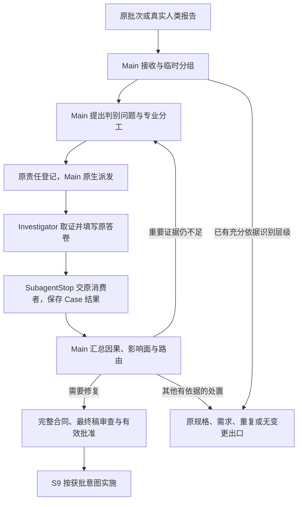

# L3-S8 发现调查与根因推导

## 1. 为什么发现之后不能直接派修

S7 已经确认实际观察与权威预期存在冲突，S8 要解释造成冲突的机制，并确定恢复哪个系统不变量才能完整解决。Finding 是“发生了什么”的事实，不能直接充当“为什么发生”和“应该怎样修”的结论。

例如，表单无法保存、保存后不显示、刷新后字段丢失和服务端解析告警，可能是四个独立问题，也可能共同来自前后端对同一字段的契约漂移。若按表象各派一个 Builder，容易形成默认值、重试、缓存刷新和字段别名四个局部补丁，真正的双重数据定义却继续存在。

S8 因而把观察与修改分开：保留每项原始事实，提出可证伪解释，用判别证据排除重要替代原因，建立完整因果链，再形成修复合同。S9 依据获批合同实施，不重新猜根因，也不能以“先改改看”代替调查。

调查的目标是最小完整根因修复所需的共识，不是最小代码差异。共识应说明触发条件、被破坏的不变量、错误机制、传播过程、受影响范围和漏检原因，既能解释已出现的表象，也能约束修复后的断言与回归。一个可疑行号、设计模式名称或临时能变绿的补丁都不足以完成这一目标。

本阶段承载[设计原则](../l1-principles/L1-design-principles.md)中深入理解、证据驱动、独立责任与可观测收敛的要求。与 [S7 完整验证轮](L3-S7-verification-round.md)的交接是“已确认现场进入原因调查”，与 [S9 修复](L3-S9-repair.md)的交接是“已证实原因和有效批准的修复意图进入实施”。

## 2. 职责与权威对象

### 2.1 三个长期对象，一条调查事实链

| 对象 | 权威内容 | 不能被当成什么 |
| --- | --- | --- |
| Finding，发现项 | S7 接收的不可变观察、真实现场与证据引用 | 已确认根因、修复授权或可覆盖的临时草稿 |
| InvestigationCase，调查案 | 来源集合、分组理由、假设与结果、因果模型、影响面、漏检原因和路由 | 另一个按文件排修复任务的 BUG 清单 |
| RepairContract，修复合同 | 经审查与有效批准的根因修复意图、完整范围及验证约束 | 尚未批准的建议、需求变更或发布授权 |

Hypothesis 是 Case 内待判别的假设，HypothesisResult 是针对该假设的专业结果，CausalModel 是 Main 汇总的因果解释。它们都有准确来源和可审计记录，但不各建独立生命周期。现场仍在原 Finding，证据仍在原文件与索引，不能复制进另一套“故障事件”实体后同时维护。

看板、发现台账和人读 BUG 报告应由这些事实投射。兼容 BUG 如有需要，只在合同获批后生成并保留 Case／Contract 来源；它不拥有独立的调查或修复授权。

### 2.2 Main、调查者与系统各做什么

| 参与者 | 本人责任 |
| --- | --- |
| Main／调查负责人 | 无损接收、提出分组与竞争假设、专业分工和原生派发、汇总因果、搜索完整影响、决定路由、准备合同与有效批准材料 |
| `investigator` | 执行本人被派发的判别问题，取得实际证据，说明支持、反驳或未决，以及能够和不能解释的表象 |
| 原发现者或授权替代者 | 解释已有现场；确有判别缺口时补充受控观察，追加原 Finding 的补充记录 |
| 合同技术审查者与有效授权主体 | 审阅最终真实合同，分别承担技术判断和批准权；角色是否独立按所选授权方式处理 |
| Claude Code | 创建、运行、消息与恢复原生子代理，不替代工程事实或因果判断 |
| Hook 与领域消费者 | 交付准确材料、接收实际专业答案，校验原来源并通过 Runtime Writer 保存事实与合法交接 |

调查者不创建第二个 Case，不改 Main 路由，不批准自己的修复建议，也不顺手改产品。Main 不能代填调查者的专业结果；系统不能因为证据数足够或命令返回绿色就自动宣布假设成立。

Case 修订、合同修订和 Runtime `revision` 用途不同。前两者关联专业对象的版本，后者协调状态事务。身份、版本、摘要和已知绑定由原消费者带出，作者填写专业判断；它们不应成为 agent 手工抄录的一项调查工作。

本人工作的共用五态为 `pending/active/blocked/done/cancelled`；Case 的 `investigating/contract_approved` 与假设结果的 `supported/refuted/inconclusive` 是领域事实。它们保留各自含义，不替代本人进度，也不再派生一套跨阶段工作状态。

### 2.3 调查允许产出证据，不能污染被调查对象

S8 对产品、正式测试、锁定规格与正式环境配置保持只读。它可以阅读代码和契约、查询可信日志与状态、比较数据、执行已有检查，或在明确隔离且安全的条件下开展控制实验并保存证据。

控制实验应改变所观察的输入或隔离实验条件，不能先改产品，再用修后的行为反推原根因。临时探针不是获准落地的产品修改；需要持久改变代码、测试、工具或项目配置时，先形成合同交给 S9。若诊断条件存在风险或需超出既有授权，先完成不依赖该条件的调查，再由原批准主体处理具体实验边界。

## 3. 从哪里进入，以及怎样保留原事实

### 3.1 S7 的封存发现批次

常规入口是 S7 已封存的 ObservationBatch。批次固定 Finding 精确集合、本轮产品对象、逐命题处置、产品问题导致的客观阻塞、原发现者路线和安全采集缺口。它不等于聊天摘要，也不是让 Main 随意选几个表象重建一个更容易调查的批次。

原接收器检查批次指针、文件与摘要、当前 Runtime 和代际、准确 Finding 集合以及实际发现文件的完整性。调查开始前还应读懂每项发现的期望来源、实际观察、模式、失败边界和证据。普通发现的现场准备主要由 S7 负责，S8 不再重建第二套完整验证门。

产品阻断的命题和 P0 紧急停止时未观察的命题要保留为缺口与修复后义务，不能在调查中误当作已验证行为。带明确安全缺口的可信发现仍可调查；缺口不是重新执行危险操作的授权。

接收后建立的发现台账是查阅视图，关联每项 Finding、基线、最后正常点、首次异常点、候选原因、原发现者、补充证据和处置。台账不新增权威状态文件，也不能通过“已归并”删除表象。

### 3.2 消费现场，不默认重新证明症状

调查者首先从 `last_good_checkpoint → wall_action → first_bad_checkpoint` 阅读，关联终态、逐步证据、状态差异、请求或执行追踪。应区分三个工作视图：

- 失败边界：最早在哪个边界偏离了哪项要求。
- 跨层路径：从入口、请求或命令，到服务、状态和持久化，哪些节点已有观察，哪些仍是推断。
- 证据缺口：哪个未知事实会改变原因判断，怎样以最小安全操作取得它。

`journey_summary` 帮助快速理解，不代替原步骤与证据；相同报错或相同撞墙位置只是线索，不证明共同根因。QA／交付的静态检查发现同样是一等输入，使用原阅读入口和调用／数据流，不要求伪造浏览器旅程。

已有事实足以判断时直接使用。仅需解释证据含义、环境或来源时请求澄清；只有一个明确判别问题缺少必要观察时，才安排补充实验。没有再复现，不足以抹去原来已被确认的一次发生。

### 3.3 人类报告与 S9 回流

S11 的真实缺陷决定可经 TR-027 打开调查。该输入没有 S7 Finding 时，直接使用人类实际描述、原决定与边界证据，不伪造批次、Claim 或 Finding 来适配字段。接收器核对原决定确由 TR-027 消费，仍属于当前 Runtime、代际与轮次，且原文件与摘要一致；同时复用原 ReviewPlan 的冻结产品材料与摘要建立 Case 基线。来源 Finding 集合为空，批次字段不填入 Case。

人类报告、专业调查结论和修复授权承担三种责任。原决定说明“人报告了什么”，并不证明候选原因成立，也不授权任意修复。调查者仍执行完整的假设判别，Main 仍需建立因果模型、影响面和漏检解释，最终合同仍需原有效批准。符合这些条件的空 Finding Case 可以沿同一原合同流程进入 S9；无需重新去 S7 获取一个编号。

Case 的专业失败边界可以随调查演进，最初的人类来源由原 Case 修订历史中的准确路径和摘要恢复，不要求作者另维护来源字段。题目交付原报告准确路径及证据元数据；结果边界引用原决定 ID 或路径，所有其他证据继续按原规则检查。进入合同批准时再次核对最初来源、Case 基线及真实冻结材料。原来源缺失、历史字节变化或产品基线漂移由 Main／系统恢复与重新判断，不能让调查者猜引用、重报问题或伪造验证材料。

S9 定向复验的非 `blocked` 失败，则携实际失败证据回到原 Case 重新审查因果。它保留原 Finding 集合与旧合同历史，补充“哪个旧判断被什么新事实挑战”。纯环境或执行前提阻塞先在 S9 恢复，不应一律制造新根因。详细恢复见 §12。

## 4. 候选分组必须可被证据推翻

### 4.1 分组是调查起点，不能先宣判同根

可用来建立候选组的线索包括同一对象或请求、相邻时间窗、相同契约、不变量、读写或序列化路径、共同触发输入，以及一次判别实验可能同时解释的几个表象。Main 在 `grouping_rationale` 写明为什么值得一起调查，同时保留哪些联系尚未证明。

同一页面、同一文件、相似错误文本、同一个发现者或相同自动指纹，都不足以将多个表象确认为同根。调查中若发现独立机制，应拆清原因、受影响面和修复约束；若证据证明同一机制跨多个表象，则把每项表象明确映射到该机制，而不是保留一个代表项后丢弃其余。

确认同根至少要有同一被破坏不变量、证据支持的错误机制、能解释每项来源的传播链，以及相容的完整修复边界和断言。一个表象也可能同时受主因和促成因素影响，不能为方便台账强行选择一个原因。

### 4.2 可逆分组原则与当前落地范围

设计上，原因判断应允许依据新证据调整分组，保留拆分、合并、重复关联的理由与原事实来源。这里的可逆是专业判断可修订，不是原 Case 可以原地替换来源集合。

当前 Runtime 维护一个活动 Case，常规接收将原批次准确集合放入该 Case，各次修订严格保持来源不变；已实现的重复关联会保存规范 Case 的准确引用。它尚不能承载单 Runtime 下任意多 Case 拆分、合并和并行出口协调，不能按完整多案调度能力指导 agent 执行。

遇到混合原因时，Main 应先在原 Case 内把假设、解释集合与未解释项分清；若需要独立 Case 或不相容路由，显式处理原权威与恢复边界，不能删掉难解释项或擅造多案指针。后续完善机制也必须保持每项来源有去向，而不是扩充一套平行台账。

## 5. 用可证伪假设组织调查

### 5.1 先定义什么观察能区分解释

“可能是缓存”“应该抽一个工厂”不是可派发的专业问题。一个 Hypothesis 至少要有：

| 字段 | 要回答的问题 |
| --- | --- |
| `statement` | 在什么条件下，哪种机制导致了哪项偏差 |
| `invariant` | 本应保持的契约或系统不变量是什么 |
| `discriminator` | 比较哪些事实或做什么安全实验，能够区分这个解释与竞争解释 |
| `expected_outcomes.support` | 哪种具体观察支持该假设 |
| `expected_outcomes.refute` | 哪种具体观察反驳该假设 |
| `source_finding_ids` | 它试图解释原 Case 的哪些表象 |
| `evidence_refs` | 提出该问题依赖的实际证据，不是未来希望取得的结果 |

以字段丢失为例，Main 可以先建立以下竞争解释，而不是按四个报错分别派修：

| 候选机制 | 优先使用的判别事实 |
| --- | --- |
| 表单状态到请求载荷的映射丢字段 | 同次操作在表单状态、映射输出和发送边界的字段差异 |
| 前后端对字段名称、类型或空值语义不一致 | 权威契约、客户端类型、实际请求与服务端解码的差异 |
| 服务端到领域或持久化的映射丢字段 | 解码后、服务层、仓储和写入结果之间的差异 |
| 保存成功但响应或缓存回填覆盖了状态 | 持久化、响应、缓存与渲染状态的先后关系 |

这些是假设方向，不是要求每次都派四个人。已有证据已经排除某方向时记录理由；几个问题共享相同阅读集合时可协调执行，但每个实际问题仍须有准确责任与可辨别结果。

纯静态质量发现也要这样处理。例如重复分支可能来自缺失的稳定扩展边界，也可能是两种不应合并的业务差异。调查应核对变化轴、项目惯用法和失效风险，不能把“没有使用某模式”直接转换成根因或强制重构合同。

### 5.2 Main 的专业题目长什么样

Main 的假设工序接收专业问题数组。新行不需要自拟 Hypothesis 或 Assignment ID；系统生成原格式身份，已有行保留原身份以区分重放、新问题与冲突。下面是一行的示意，实际来源必须使用当前 Case 的真实 Finding 与已登记证据：

```json
[
  {
    "statement": "必填字段在客户端共享映射层被丢弃，服务端尚未收到该字段。",
    "invariant": "符合当前契约的有效输入必须完整保留到发送边界。",
    "discriminator": "比较同次调用中表单状态、共享映射输出与发送前载荷，核对映射过滤规则。",
    "expected_outcomes": {
      "support": "字段在表单状态存在，在映射输出首次消失，发送前已缺失。",
      "refute": "映射输出和发送载荷均保留字段，首次异常发生在服务端或回填之后。"
    },
    "source_finding_ids": ["finding-field-loss"],
    "evidence_refs": ["ev-field-boundary"]
  }
]
```

`agent_id` 可由 Main 作为工程 owner 选择填写；未选时原流程可给出默认责任名。它不用于伪造平台身份。分工应考虑实际专业能力、阅读范围、实验环境、数据与资源冲突，以及谁需要保持独立判断。

### 5.3 不为凑形式制造竞争假设

关键替代解释必须处理，支持结论不能只因为“暂时没被反驳”。通常应有能够区分主要竞争机制的实际结果。如果确实没有可信替代机制，Main 通过 `no_competing_hypothesis` 解释搜索过什么、为何没有合理替代，不能为了填表编造一个容易反驳的原因。

当前收口校验要求至少一项 refuted 结果，或上述明确声明。这个结构条件只能证明作者处理过该事项，不能证明被反驳的是重要竞争解释，也不能证明声明理由充分。因果质量仍由 Main 与合同技术审查承担。

## 6. 判别取证怎样开展

调查先读原 Case、Finding 与现场边界，再有针对性地阅读契约、实现、测试和运行证据。不能从整个仓库漫游，直到找到一段看起来可疑的代码后倒推解释。

可采用的方法包括同次调用不同边界的值比较、契约与类型对照、日志与状态关联、读写传播追踪、已有测试判据检查，以及安全隔离的控制实验。每项方法都要说明比较对象、控制条件、预期区分结果和停止条件。证据证明到哪里，判断就停在哪里。

澄清已有证据与取得新观察应分别安排：

| 工作 | 何时需要 | 输出 |
| --- | --- | --- |
| 澄清 | 现有引用、环境或证据含义不清，但不需重新执行 | 对原 Finding 追加解释与准确引用 |
| 补充观察 | 某已登记假设存在会改变判断的证据缺口 | 绑定假设、判别条件及支持／反驳预期的新观察与证据 |

补充通过原 FindingSupplement 追加，不重写原 `observed` 或现场。原发现者不可用时，Main 可安排具备来源和明确授权的替代者；不能因为联系不上原人就把已确认现场判成不存在。

新观察必须保留原基线或能证明等价的快照条件，尤其注意账号、数据、缓存、时序和外部依赖。无法安全重建时记录缺口与对判断的影响；P0 的安全缺口不要求冒险重做。临时诊断动作本身若改变了观察条件，也须如实记录，不能把变化后的结果冒充原始发生过程。

当前调度以已登记假设及其 Assignment 为责任单位。上下文相容的问题可以由 Main 协调相同或不同原生上下文执行，实际答卷仍逐个绑定，不能把多个独立责任合并为一份泛化报告。独立检查可并行，存在前置证据、互斥环境或共享资源时按真实依赖排序；没有质量层面的固定调查人数配额。

## 7. 题目交付、原生派发与结果接收



图中因果汇总和批准均有明确责任人，不由箭头所代表的工具事件自动作出判断。其他出口的实际条件与当前适配范围见 §11、§14。

### 7.1 Main 按工序完成自己的材料

系统渐进提供 Main 的准确工序文件，而不是要求一次填满 Case 的所有字段：

| 工序 | Main 填写 | 原消费者做什么 |
| --- | --- | --- |
| 接收 | `grouping_rationale` | 从原批次或真实人类决定带出来源，建立临时 Case |
| 假设与分工 | 专业问题数组、必要的 owner 选择 | 注册原 Hypothesis 和工程责任，提供实际任务、题干与答卷来源 |
| 因果与路由 | 原因、因果对象、影响面、漏检原因、路由与理由 | 在原 Case 修订中校验并保存，按适用条件消费出口 |
| 修复合同 | 修复不变量、范围、单元和验证断言 | 投射含原 Case 绑定的最终合同稿，等待有效批准 |

Main 的工序文件是对应专业对象，不统一包装成 Worker `answer`。保存后沿原消费者接收，不再让 Main 将相同内容拆成若干信封或重复登记命令。准确路径缺失、来源无法读或准备失败时，Main／系统修复具体接线缺口，不能让作者猜 ID、拼摘要或自行发行另一套答卷。

Main 的准备与 Worker 普通工具的只读边界不同：Main 的原进入／工具事件可以准备工序草稿，真实保存接原专业消费者；已有匹配授权时，后续 Main `PreToolUse` 还可调用原合同批准事务。这是消费既存合法依据，不是 Hook 自行作出批准，也不能据此让普通 Worker 工具开始接收答案。

Main 保存问题数组后，原流程逐项登记假设和责任；前几项成功、后项失败时保留已完成事实，再次保存复用原登记，只恢复未完成部分。改变已登记题意或 owner 则报告冲突，不能把一次重试变成覆盖已派任务。

登记完成不代表平台已经启动调查者。Main 仍须使用 Claude Code 原生 Agent 实际启动或恢复，并把该责任的准确题干与私人答卷引用、实际目标和只读边界放进任务。两个调查者角色相同也不能靠角色名分配队列。

### 7.2 原生事件只连接准确专业责任

`SubagentStart` 提供简短提醒，不猜责任，不承诺完成派发。新只读调查不要求预建框架 execution、bootstrap、session、Team、平台 ID 别名或首写激活。普通 `plan_checkpoint` 直接开展调查；确有 `plan_approval_required` 的责任仍等待原明确批准。

调查者读取原冻结题干、Case、Hypothesis、Finding 和证据，执行本人判别并保存原私人答案。普通工具、闲置或 Main 阅读不接收 Worker 结果。完成时返回同一准确引用，由 `SubagentStop` 交原 HypothesisResult 消费者。

接收依靠实际准确引用匹配唯一责任，不靠平台 actor 字符串、角色或返回次序。未知或多个引用交 Main 解决；已有独立执行继续使用原冻结来源与恢复，缺失时不能退回 Main 借答案。Claude Code 管运行与恢复，工程消费者管专业来源、权限和接受事实。

### 7.3 结果保存在 Case，已完成同伴不因新证据重复做

原消费者核对实际登记的 Hypothesis／Assignment／owner、原题干、来源与版本、证据及答案，再将结果和回执写入 Case 的不可变修订。新线索如要登记为假设，由消费者按既有规则生成身份并保留在同一 Case，Main 再决定派发；Worker 不填写新 ID，也不能宣称已替 Main 启动任务。

同伴结果使 Case 修订向前，不等于所有未交答案立刻过时。原接收器区分新增同伴事实与本人题意、来源、路由的真正变化，按当前有效责任处理。已经接受的结果不再重复投射为填答任务。响应丢失时，Main 优先读取原 Case 与 journal 证明的回执；原生 Agent 返回摘要已使用这一读取，无需再唤醒 Investigator。

回执查询与重新提交有不同语义。查询按原 packet 和 owner 取得已接受的结果，不读取私人 answer/view；这些文件损坏或已删除，也不要求重造答案。原权威 Case、发行与接收事件及其摘要仍须完整，缺失不能由私人文件替代。需要诊断时使用系统已提供的准确责任引用进入原 `stage-answer receipt`，不从角色或文件名猜身份，不把查询变成每次工具前置手续。

同答重放属于实际提交，仍要读取该次提交的文件并核对内容摘要；内容改变必须报冲突，文件丢失不承诺任意 Save 都能成功。未接受的工作仍须完成原答案和来源，不能因为存在一个 packet 就当作已交付。这样既避免让已完成者重复劳动，也保留了“查询原事实”与“提出新内容”的边界。

这结束本人责任，不代表原因已证明或整个 S8 已完成。专业 `supported`、Case 路由、合同批准和阶段交接仍是不同事实。共同机制见[原生子代理治理](../l4-mechanisms/L4-agent-dispatch-governance.md)及[阶段答卷](../l4-mechanisms/L4-stage-form.md)。

## 8. 调查结果应表达什么

调查者只修改原答卷的 `answer`，保留题干。其字段包括实际方法、证据、原现场边界、实际观察、判别或反事实、`supported`／`refuted`／`inconclusive`、能解释与不能解释的 Finding，以及必要的新假设问题。

`source_boundary_refs` 对 S7 来源使用 `finding:<原ID>`，或原 Finding 中确实存在的 `finding:<原ID>#/encounter/...` JSON Pointer；无人为 Finding 的人类来源使用本卷提供的原决定 ID 或准确路径。它说明本次调查从哪里起步；执行证据则放在 `evidence_refs`。任意 `test://...` 字符串不能代替来源边界。人类来源没有 Finding 时，解释与不能解释的 Finding 数组及后续假设的 `source_finding_ids` 填 `[]`，专业问题与判别证据仍须完整。

注册证据 ID 和其 `runtime:<id>` 形式按原共享证据校验关联有效性、代际、轮次及文件摘要；不应新建带前缀的别名或改写原 Finding。执行锚 `scheme://...` 则是另一种引用，当前通用校验主要核对形状，不能仅凭存在该字符串就证明实际运行。调查者必须给真实来源，Main 应读实际证据而非据引用数量采信。

下面是一个**反驳服务端丢字段假设**的专业 `answer` 示意。它确认异常在发送前已经存在，没有越权宣布另一个假设已成立：

```json
{
  "method": "读取同次操作的表单、映射输出与发送前记录，并与服务端接收边界对照。",
  "evidence_refs": ["ev-field-boundary"],
  "source_boundary_refs": ["finding:finding-field-loss#/encounter/first_bad_checkpoint"],
  "observed": "字段在表单状态存在，映射输出与发送前载荷已缺失；服务端尚未参与首次偏差。",
  "counterfactual_or_discriminator": "若服务端首先丢字段，发送前载荷应完整；实际观察不满足这一必要条件。",
  "result": "refuted",
  "explains_finding_ids": [],
  "does_not_explain": ["finding-field-loss"],
  "new_hypotheses": []
}
```

证据不足或判别受阻时使用 `inconclusive`，在 `method`／`observed` 写清实际已做、尚未执行、具体阻塞、缺少什么和 Main 下一步。不要另造 blocker 字段或第二份报告。必需材料根本不存在时先报告准备缺口，不能虚构证据以满足交卷。

`explains_finding_ids` 和 `does_not_explain` 只能使用本 Case 来源，彼此不能重复。受支持的解释会参与未解释集合投射，但“作者把 ID 放进去”不是因果证明。新假设也必须写完整问题、不变量、判别、支持／反驳预期、来源子集和实际证据；单句原因猜测不足以派发。

## 9. 从假设结果形成完整因果解释

### 9.1 区分原因、条件与传播

Main 汇总全部结果，先处理矛盾和未解释项，再形成因果模型。应连通：

```text
实际触发条件 → 被破坏的权威／不变量 → 错误机制
            → 传播路径 → 每项来源表象 → 完整影响面 → 漏检原因
```

| 概念 | 数据契约偏差中的例子 |
| --- | --- |
| 主根因 | 同一业务字段由两套未受约束的定义维护，变化后发生语义漂移 |
| 触发条件 | 新字段进入其中一条写路径，另一条映射未更新 |
| 促成因素 | 缺失字段静默降级，没有明确验证错误 |
| 传播 | 载荷丢值、持久化为空、响应和缓存继续传播缺失值 |
| 表象 | 保存或显示偏差、刷新后丢失等实际 Finding |
| 漏检原因 | 契约检查缺失，现有测试只检查响应成功 |

不能把触发条件、受害组件和所有促成因素都叫作根因。代码位置是机制证据；根因陈述还需解释为何在既定条件下出现偏差、恢复什么约束能消除复发，以及哪些相邻路径没有受影响及其理由。

每个进入模型的来源 Finding 都应有解释。支持结果不足以解释全部来源时继续调查；重要替代解释仍未决时不能靠“最可能”进入 S9。反事实可以来自可信现场、契约比较、静态路径和安全控制实验，不要求先写修复补丁才能成立。

### 9.2 影响面与漏检原因不能写成空泛结论

影响面 `blast_radius` 搜索同一机制可能污染的入口、模型、序列化、存储、历史数据、缓存、消息、异步任务、权限与审计、CASE／PATH、已有通过证据、生成器和共享类型。它不是待改文件计数。至少列出具体路径或表面，并解释为何纳入、哪些邻接面排除以及依据。

漏检原因 `detection_gap` 解释本应在哪一层提前发现、已有机制为何没有拦住、修复后应新增或加强什么判据。当前结构使用 `gap_type` 区分 `test`、`contract`、`type`、`monitoring`、`process`，并提供实际证据。只写“补测试”“提高质量”无法形成有效验证合同。

S8 给出预期影响与修复边界，S9 再根据真实修复差异形成最终 ChangeImpact 并处理受影响证据；不能在调查阶段宣称最终差异已经完整。

### 9.3 机械收口与专业证明的边界

S9 路由按当前 Case 中准确 Hypothesis／Assignment 配对选择唯一原结果：每个当前已登记问题都有实际结果，全部来源 Finding 由当前支持结果解释，主根因和因果对象成立，竞争假设得到处置，影响面非空，并有类型和有效证据的漏检说明。旧 Assignment 的支持或反证不能替当前责任履职。未解释集合由原 Case Writer 同步投影，不因另一处旧缓存为空而绕过当前结果。合同批准继续检查原 Case 的未解释集合、因果材料、当前问题是否已答以及原来源和批准绑定。

`inconclusive` 表示该次工作未能形成支持或反驳，它是已接收的真实结论，不提供正反证据，也不因后续工作改写为 PASS。Main 可以追加不同的判别问题，用后来实际接收的结果解释旧疑点；原路由理由说明为何这些证据足以解决缺口。旧未决记录自身不是永久否决票。仍没有答案的当前问题必须完成，不能用一项无关反驳或一句无竞争声明提前进入修复；仍有重要未知时继续调查。

但 CausalModel 当前是自由对象，并没有对每条因果边进行语义证明。影响面非空、某假设被反驳、`no_competing_hypothesis` 有文字，也不能证明关键机制已经找对。Main 与技术审查应逐边检查证据、对照重要替代解释和修复层级，不能把“机器接受了路由”当作已经完成因果论证。

## 10. 怎样形成能够执行的修复合同

### 10.1 从原因推导修复意图

RepairContract 固定三组共识：

| 部分 | 要固定的内容 |
| --- | --- |
| 原因 | 已确认的主根因、被破坏的不变量、Case 因果模型及实际证据来源 |
| 范围 | 架构修复意图、全部来源、修复单元、预期与禁止写面、兼容迁移和回滚要求 |
| 验证 | 表象断言、根因不变量断言、漏检补强断言、回归面与停止／升级条件 |

修复要恢复共同机制，而不是让第一个报错消失。若根因是双重数据定义，合理意图可能是明确唯一字段权威、统一受影响映射、清除必要的重复定义、处理历史数据与兼容窗口，并补上跨边界断言。若事实只支持一处局部映射缺陷，也不应借此扩大为没有依据的全项目重构。

合同应明确禁止能够掩盖问题的捷径，如用 UI 默认值隐藏丢值、失败时显示成功、静默吞异常、逐页面加别名、只改预期让错误变绿，或只验证一个表象。对促成因素是否修复，按其对不变量和复发风险的必要性说明理由。

S9 可以设计实现步骤、选择适当技术细节，但不能重新定义获批意图、删改断言或扩大业务范围。实现中出现会改变该共识的新事实，应停止受影响工作并按原调查或规格变更路线处理。

### 10.2 修复单元与三层断言

`repair_units` 需要真实可执行的 `scope`、`assertion_ids`、必要依赖与资源约束。数组中的三层断言依次映射为 `symptom-1`、`root-1`、`gap-1` 等原位置 ID，或使用明确的 `all` 归属。ID 是断言索引，不能替代具体业务预期。

表象断言证明原问题得到消除，根因断言证明恢复了正确机制，漏检断言证明以后能及时发现同类偏差。三者不能只保留同一条“页面正常”检查。回归面还应覆盖受影响的邻接路径，兼容迁移写清数据与旧消费者如何处理，停止条件写清何时应交回调查或升级授权。

以下为 Main 合同工序的专业内容示意；系统另外从 Case 带出身份、版本、准确 Finding 集合、主根因与因果引用，不由作者重抄批准信息：

```json
{
  "violated_invariant": "符合已锁契约的订单字段在有效输入到发送边界之间必须完整保留。",
  "architecture_intent": "让请求映射以现有权威契约为依据，消除与契约脱节的字段过滤规则，并对该边界建立稳定验证。",
  "repair_units": [
    {
      "id": "repair-unit-mapping",
      "description": "修正共享请求映射，移除造成必填字段丢失的重复规则。",
      "scope": ["web/src/orders/payload.ts"],
      "assertion_ids": ["root-1"]
    },
    {
      "id": "repair-unit-regression",
      "description": "为字段保留和真实提交旅程补充有判据的回归。",
      "scope": ["web/src/orders/payload.test.ts", "web/e2e/orders"],
      "assertion_ids": ["symptom-1", "gap-1"],
      "depends_on": ["repair-unit-mapping"]
    }
  ],
  "prospective_scope": ["web/src/orders", "web/e2e/orders"],
  "forbidden_scope": ["docs/requirements", "docs/contracts"],
  "compatibility_migration": "维持当前接口字段与语义；若调查发现历史数据需要迁移，停止并补充完整合同及相应授权。",
  "symptom_assertions": ["finding-field-loss 对应的有效提交保留该字段，响应与后续读取符合原场景判据。"],
  "root_invariant_assertions": ["共享请求映射与当前权威契约一致，有效必填字段不会被独立过滤规则丢弃。"],
  "detection_gap_assertions": ["回归在字段被过滤时可靠失败，并检查请求内容而非只检查成功响应。"],
  "regression_surfaces": ["订单有效提交", "订单拒绝分支及禁止副作用"],
  "stop_escalation_conditions": ["需要改变锁定契约、扩大产品写面或改变业务语义时停止，交 Main 重新调查和履行原批准条件。"]
}
```

这是结构示例，不是对这些文件或修复原因的实际判断。专业作者必须使用目标项目中的真实范围与依据。当前一般批准会校验可执行路径，有限委托批准还校验单元断言归属和依赖；不能因为某条入口接受了较弱草稿，就把完整执行映射拖到 Builder 接手后再补。

### 10.3 最终稿、技术审查与有效批准

Main 保存专业合同后，系统投射含当前 Case 绑定的最终真实稿件，按内容生成准确文件路径；修改专业内容产生另一份稿件，不能悄悄改写已审文件。审查对象是这些真实字节，批准摘要绑定该最终稿，而不是聊天中的相似描述。

授权来源有三类，不能互相冒充：

| 来源 | 成立条件 |
| --- | --- |
| 逐稿人类批准 | 真实授权主体审阅当前合同，原决定绑定 Runtime／Case／Contract 与最终稿摘要，并以原有效证据记录 |
| 有限需求委托 | 人类明确签发当前锁定 REQ、Runtime 和代际下的有限范围、指定审查者、有效期与合同预算 |
| 绑定时固定的项目策略 | 项目所有者已选择该策略，REQ 绑定记录准确路径与 SHA，当前合同仍满足范围、语义、审查与有限预算条件 |

有限授权不是省略技术审查。每份合同仍需指定审查者针对准确最终稿给出判断：需求和业务语义是否未变、范围是否完整、是否可逆、证据是否充分。授权人和指定 reviewer 按原规则区分；跨模块、权威来源或契约边界变化还应安排相应架构审查。复选字段表达人的判断，不是系统已证明业务语义未变。

没有现成有效授权时，先把调查和最终稿准备到可审状态，再交原授权主体决定；不能从账号名、安装成功或一句“继续开发”推导获得专门修复授权。有现成有效授权时，原消费者按准确绑定接续，不要求每个文件重复批准。

批准事务校验原 Case、来源、因果闭合、最终稿、有效决定或委托及其范围和预算，并原子保存批准后的 Case／Contract 指针；进入 S9 的 `repair_readback`，之后由原准备接续实施材料。批准会产生含批准事实的新不可变版本，不是改写已审草稿。有限授权的使用计数随批准原子提交，同合同原样重试不重复消耗。

撤销委托或修改策略会阻止后续新批准，不抹除已批准合同。需要紧急停止已开始的修复，应处理对应活动责任和暂停事实。需求修改、S2 设计签署、破坏性操作与 S11 发布仍遵守各自授权；修复批准不代签这些事项。共同边界见[受限执行与授权](../l4-mechanisms/L4-workspace-execution-profiles.md)。

## 11. 选择正确出口，而不是一律派修

### 11.1 一份 Case 保留一个明确路由

| `route` | 专业成立条件与下一责任 |
| --- | --- |
| `s9_repair` | 实现、测试、工具或项目配置需要修改；根因、完整合同和有效批准成立后交 S9 |
| `s2_spec_rework` | REQ 不变，设计、原型、契约或任务事实需要更正；回 S2，重建受影响规格与验证依据 |
| `human_req_change` | 正确行为需要改变锁定需求；进入真实人类暂停与需求修订路径 |
| `s7_no_change` | 有确定证据解释全部报告且无需改变任何产物；原消费者打开新的完整 S7 轮 |
| `investigate_more` | 原因、证据、解释集合或修复准备不足；留在同一 Case 继续有针对性的调查 |
| `duplicate` | 已有规范 Case 的因果模型和修复约束完整覆盖该问题；保存准确关联并跟随原责任 |

选择 `s7_no_change` 时，Main 在原 `route_reason` 中解释实际观察、为何产品／规格／测试／配置等产物都无需修改，以及什么证据会推翻这一判断。它不需要完整 S9 因果对象或修复合同，也不是把尚未解释的问题改称通过；理由的可信度由专业阅读与后续完整 S7 判断，不另建自然语言裁判或证明表。

测试、夹具、harness 或判据本身有缺陷，只要需要持久修改，就应进入相应修复，不能因“不改产品代码”直接判无需修复。重复也必须有可读的规范 Case 与内容绑定，不能只根据名称相似关闭。

证据不足属于 `investigate_more`，不属于误报。无需变更的处置必须解释原观察为何成立、实际偏差如何解释以及为什么所有相关产物都无需修改。当前消费者对该出口没有与 S9 同样的完整因果证据门；Main 不得把较弱机械检查当作专业豁免。

### 11.2 路由登记、路由消费与批准分别成立

Main 保存准确路由材料后，原 `UpdateCaseRoute` 写入原因与决定，不由监听器替 Main 选择。需要继续调查时留在当前案；需要修复时继续合同工序与批准。

无变更、规格返工和重复关联另由原 `ConsumeCaseRoute` 消费下游效果。当前这些出口使用 `S8-ROUTE-CONSUME`，不能只因生命周期定义存在 TR-022／TR-023 就声称每次都实际执行了同名转换。已登记决定、已消费出口和已经生成下一阶段材料也要分别观察。

无变更消费会增加完整轮次，清除活动计划、Claims、Assignments、批次和调查指针，进入新的 `verification.running`；历史产物仍保留。它不会产生新的 PASS 或 CleanRound。规格返工回 `planning.design`，需要重跑受影响的契约、任务与验证链。需求变更在真实暂停边界处理，普通路由消费不能代替人类锁定新 REQ。

原 S9 合同批准同时保存权威合同与阶段交接，不要求调查者再提交通用完成报告。人读 BUG、工作材料与后续准备失败时，从同一批准事实重试相应投射，不重新审批相同内容，也不回滚成“尚未调查”。

### 11.3 混合原因遵守权威层级

若一个批次的不同问题涉及不同层级，应先处理使当前依据失效的决策：需求变化优先交人，需求不变的规格纠正先回 S2；剩余可修复部分才能在仍有效的依据上安排。只有全部问题均有证据说明无需任何产物变化时，才能整体走无变更新轮。

这是专业交接原则。当前单活动 Case 没有完整多案自动聚合能力，不能宣称系统会自动替 Main 合并各案路由或计算完整跨案修复 DAG。出现不相容出口时显式暴露边界，不让多个请求事件竞争或删掉阻碍进度的来源。

## 12. 调查怎样继续、重试与恢复

### 12.1 同一案内继续取得新信息

未解释表象、未决结果或原因不足时继续调查，但每次应说明新增哪个判别、弥补什么缺口。当前 `investigate_more` 重入要求新的假设或结果证据，不能在没有新信息时反复提交同样路由。其连续重入预算用于暴露不收敛；达到限制后由 Main 分析是否应转规格、重复关联或交人决定，不能为过门捏造原因。

继续调查复用原问题列表：保留已登记题目，追加真正不同的判别，不覆盖旧题或旧结果。新的结果仍由原消费者接收并追加，Case 修订与路由理由保留调查怎样收敛的过程。系统没有任意旧题换版或结果覆盖协议，作者不需要维护另一份替代关系表。

防空转使用原路由历史中的证据引用摘要和结果接收位置：新增有效证据或后来确实接收、准确匹配当前问题的结果，均可支持下一次专业路由。相同源证据可以承载新的判别观察，不必捏造新引用。只加问题数量、重排问题、改路由理由或重存原答案不算新的观察；没有实际进展仍拒绝重复重入。

### 12.2 S9 失败回原 Case 重查因果

非 `blocked` 的实际定向失败可通过原重查入口，将带摘要的失败证据加入 `causal_reassessment_refs`。新修订保留原 Finding 集合和路由历史，撤下当前合同指针，让旧已批准意图不再被当成本次实施依据。后续注册新 Hypothesis 时，原事务处理旧 repair 指针，避免新合同被识别为旧 S9 会话。

重查应针对失败挑战的因果边、未覆盖表象或影响面，不能把旧调查全文重交一次当成新增证据。新的合同需要重新履行准确内容的审查与批准；旧批准不能迁移到改变后的修复意图。

`blocked` 失败先留在 S9 消除环境或验证前提障碍，再按原独立复验路径取得结果。执行没能开始不证明根因错误，不应无条件触发因果重开。

### 12.3 失败时保留什么、由谁处理

| 失败 | 正确恢复 |
| --- | --- |
| 批次未封存、指针或原文件不一致 | Main 修复 S7 原交接；反复调用调查接收不能制造批次 |
| 找不到准确题干或原独立来源 | Main／系统恢复真实准备与来源，不猜路径或借 Main 答案 |
| 假设数组部分登记成功 | 保存原专业问题，重试未完成部分，复用已提交责任 |
| 本人结果字段或边界错误 | 按原反馈修正未接受答案；`finding:` 指针必须确实指向原文 |
| 本人结果已接受但响应丢失 | Main 优先读取原回执；实际同答提交才读取原文件并比摘要，不重造私人答案、不重派本人或同伴责任 |
| Case 已因本人题意或来源变化而失效 | Main 处理原修订／恢复，新内容不能冒充旧答卷重放 |
| 基线发生漂移 | 保留旧来源并明确失效影响，按原基线恢复或重新调查；不改摘要给漂移背书 |
| 合同保存但未获有效批准 | 保留可审最终稿，处理具体缺少的授权或审查；不能代填人类决定 |
| 批准已提交、S9 材料准备失败 | 从原批准回执继续后续准备，不能重花预算或要求作者重新签相同稿 |
| 原路线已消费后再次保存旧工序 | 只说明它不再是当前责任，不假称重新接收或给新基线历史签字 |

批准的不可变合同与 Case 在 Runtime 指针提交前发布；失败清理按原 Writer 锁检查 pending、修订、引用和准确摘要，不因当前 state 尚无新指针就删除待恢复产物。已批准后原草稿丢失，恢复沿已固定批准与原人意关联返回既有事实，不再要求重写私人草稿；仍存在但内容改变的草稿保持冲突，走原重查或修订。

Case 每次修订写新文件，旧文件仍由历史引用固定。Runtime Writer 负责并发与中断恢复，监听器不能依靠改本地副本绕过冲突。当前基线警告主要来自 Case 摘要与登记计划摘要的比较，批准再检查原批次和计划绑定；不能将其等同于自动证明全部产品文件、运行数据和环境仍与原现场一致。

## 13. 观测应帮助判断调查是否在收敛

| 观察点 | 需要看见的事实 | 帮助定位的问题 |
| --- | --- | --- |
| 接收与当前来源 | 原 Batch／人类报告、精确来源集合、Case 路径与版本、现场缺口 | 是交接丢失，还是原因尚不清楚 |
| 假设与工程登记 | 具体问题、判别、owner、已登记任务与待实际派发责任 | 已准备但未启动，还是已经开始取证 |
| 原生结束与回执 | 准确引用、接受／拒绝原因、原 Case 结果及同伴进度 | 平台运行、来源交付和专业答案错误的区别 |
| 因果看板 | supported／refuted／inconclusive、未解释集合、新证据、路由历史和基线警告 | 是否只是反复重述，而没有排除重要替代原因 |
| 合同与批准 | 最终稿、当前摘要、实际审查与授权来源、预算、已批准指针 | 技术未就绪、缺授权与批准后接续失败的区别 |
| 下游返回 | 原定向失败、重查引用、新判别与旧合同失效关系 | 执行阻塞、修复不完整与根因判断错误的区别 |

正常入口直接提供本人准确工序路径；`runtime investigation status` 是原恢复诊断入口，不应成为每位调查者先遍历底层命令才能领题的前置。当前 Case 修订与 Runtime journal 已记录接收、问题、结果、路由和批准等事件；看板读取原事实，不制造执行成功。

维护时还应观察首次建案所需补现场次数、从接收到首个有效判别的时间、无目的症状重跑比例、未解释项滞留、受控补充观察比例、根因重开和合同在 S9 被迫重写的原因。这些指标帮助发现资料或设计缺陷，不是全部已经自动采集的承诺，也不能用“发现减少”“假设更多”代替质量结论。

## 14. 实现对应与明确边界

| 环节 | 当前主要落点 |
| --- | --- |
| 输入接收与初始 Case | [intake.go](../../internal/investigation/intake.go)、[Case Schema](../../internal/schema/assets/review-investigation-case.schema.json) |
| 原人类报告与产品基线 | [原决定及修订来源](../../internal/investigation/human_source.go)、[冻结材料核验](../../internal/review/workspace.go) |
| 假设、结果、因果与路由 | [case_workflow.go](../../internal/investigation/case_workflow.go)、[路由消费](../../internal/investigation/route_consume.go) |
| Main 专业工序 | [接收与假设](../../internal/cli/investigation_lead_questionnaire.go)、[因果与出口](../../internal/cli/investigation_lead_disposition.go)、[合同与批准接线](../../internal/cli/investigation_lead_contract.go) |
| Worker 原生交接 | [原生衔接](../../internal/cli/native_review_hooks.go)、[题干与原接收器](../../internal/investigation/hypothesis_result_packet.go)、[原答卷](../../internal/workpacket/hypothesis_result.go)、[S8 题目](../../internal/schema/assets/stage-form-s8-template.json) |
| 证据与现场 | [证据校验](../../internal/investigation/evidence_attestation.go)、[共同证据语义](../../internal/evidence/semantic.go)、[Finding 补充](../../internal/review/supplement.go) |
| 合同与有效授权 | [批准事务](../../internal/investigation/contract.go)、[批准恢复](../../internal/investigation/contract_resume.go)、[有限授权](../../internal/investigation/delegation.go)、[合同 Schema](../../internal/schema/assets/repair-contract.schema.json)、[单元执行映射](../../internal/repair/contract_scope_preflight.go) |

使用入口见[主会话协议](../../docs/control/agent-protocol.md#s8)、[调查角色](../../agents/investigator.md)、[bug-resolution](../../skills/bug-resolution/SKILL.md)与[有限修复授权](../../docs/bounded-repair-autonomy.md)。这些入口承载专业方法和准确操作，不能另立一套调查权威。

需要保持清晰的落地边界包括：

- **多案协作尚不完整。** 当前单活动 Case 与不可变来源集合，不等于已经支持任意拆并和混合路由自动聚合；可逆分组原则必须与具体能力分开说明。
- **人类来源复用原调查和批准链。** 无 Finding 的 Case 从原已消费决定和冻结产品基线出发，结果接收、合同批准与 S9 准备均保留这一来源，空集合不产生免审权。基线检查只将本轮已消费决定的准确控制文件识别为控制材料，不放行同目录的未知文件。此能力不等于任意聊天问题都能绕过 S11 来源或合同批准。
- **证据引用保持同一身份。** 原题干准备与共享校验复用同一引用解析：`runtime:<id>` 只解码一次并查询原证据索引，保留专业来源中的原引用，不登记别名或改写已接受 Finding。带 `runtime:` 的引用始终受索引约束，不能因 ID 含 URI 形式就成为执行锚；状态、代际、轮次、摘要和自引限制仍由原证据校验承担。
- **语义闭合仍需真实审查。** 因果对象、无竞争理由、解释 ID 集合、影响面和审查复选项的结构成立，不证明原因与业务判断正确；无变更出口也没有等同于 S9 的证据门。
- **来源和恢复检查有明确范围。** 摘要比较不代表所有现场仍可重建；历史结论保持原字节，当前证据及其解释决定是否已经收敛。明确缺口与原恢复责任，不能把“可修订”写成无限覆盖已接收事实的能力。
- **原生只读职责不靠工具逐次批准。** 新调查不使用旧通用 PLAN、首写激活或保存即接收。部分角色／技能旧正文仍保留相关措辞，维护时应清除执行冲突并保留专业方法；产品只读边界由实际责任遵守，不能因工具未被拦截就推导允许修复。

S8 是否完成，应看每项来源是否得到有证据的明确处置，修复意图是否完整且获有效批准，以及下一责任是否真正接续。测试、原生事件模拟、真实 Claude Code 执行和产品原因判断各有证据范围，不能互相代签。
