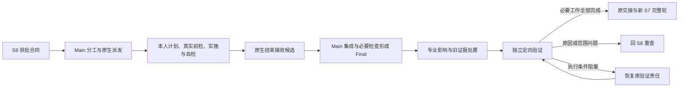

# L3-S9 根因修复与可信度重建

## 1. 修复完成为什么需要超过一次代码修改

S8 已经解释问题机制，并以获批 RepairContract 固定要恢复的不变量和完整修复意图。S9 将这个意图变成真实实现、必要检查和可独立复验的交付，不重新猜原因，也不把修复意图降成“让第一个报错消失”。

局部补丁可能掩盖表象，却保留造成复发的机制。例如请求映射丢字段，页面默认值能改善显示，单独加别名也可能让一次请求成功，但重复字段定义、其他消费者和缺失的契约检查仍可能继续出错。完整修复要对准已确认原因，覆盖受影响消费者和必要兼容责任，并补上原来漏检的判据。

因此，S9 的完成需要连通五种事实：本人实施与自检、实际贡献被接收、Main 必要集成与检查、变更后的证据影响处置、独立定向复验。它们不能被一个“completed”或绿色测试数替代。成功之后仍回到新的完整 S7，确认修复后的整体交付成立。

S9 继承 [S8 调查](L3-S8-finding-investigation.md)形成的准确原因与批准意图，承载[设计原则](../l1-principles/L1-design-principles.md)中的统一事实、独立责任与有界纠错要求。它不代替需求修改、规格签署或发布授权；相应判断仍归原主体和阶段。



## 2. 输入、参与者与几种不同的完成

### 2.1 从获批合同开始

输入应让实施者明白“为什么修、修到哪里、怎样证明”，而不是只拿到一个文件列表：

| 输入 | 在 S9 中的用途 |
| --- | --- |
| 当前批准 RepairContract | 确定主根因、被破坏的不变量、架构意图、范围、修复单元、断言和停止条件 |
| 原 InvestigationCase | 理解支持与排除原因的证据、影响范围、漏检原因及仍明确保留的不确定性 |
| 原 Finding 与补充现场，或原人类缺陷报告 | 了解实际偏差、修前事实、角色与数据条件，保持逐项复验的连续性 |
| 准确需求、设计与契约 | 维持正确行为和已批准边界，避免实现时悄悄改预期 |
| 真实代码、测试与工程环境 | 选择实施路径、前检、自检、集成检查和运行位置 |
| 当前执行与贡献事实 | 明确谁在做什么、依赖是否满足、哪些成果已接收或已集成 |

合同保存不等于批准，S9 不能在批准前先实施试探。进入后也不让 Main 再审批一次相同意图。实施发现根因、范围或断言确实有问题时，明确交回原调查／规格路径，而不是边改合同边写代码。

由 S11 人类缺陷决定进入的 Case 可以没有 Finding 或 ObservationBatch。S8 已核对原报告与冻结产品基线并完成调查、有效合同批准时，S9 直接读取原批准合同，使用同一 Session 与 Plan 准备流程；不能要求作者制造 Finding。空来源集合只反映报告的实际形态，修复单元、断言、范围、批准摘要及独立验证责任仍须成立。

### 2.2 责任分工

| 参与者 | 本人责任 |
| --- | --- |
| Main／修复负责人 | 阅读批准目标、选择专业分工与依赖、真实原生派发、处理阻塞、集成、必要 Main 检查、影响判断和阶段交接 |
| Builder | 理解本人单元与断言，制定计划、做真实前检、实施或测试、自检并交付本人专业结果 |
| 独立定向验证者 | 在修复后产品上验证全部必要断言，报告实际观察、未执行事项和结论 |
| Claude Code | 提供原生上下文、worktree、运行、消息与恢复 |
| 原消费者与 Runtime Writer | 提供准确题干和产物位置，一次记录专业事实与工程关联，维护并发、幂等和阶段更新 |

Main 不代写 Worker 的私人专业答案；Builder 不自行给出独立复验或整轮通过。原发现者可提供专业连续性，但实际验证者仍须未参与被复验实现与合并，不能用相同角色名或不同 ID 代替真实独立分工。

### 2.3 分清工程事实与平台执行

RepairSession 是围绕批准合同组织修复资料、结果与后续交接的领域记录，不是 Claude Code 平台会话，也不是额外的启动预约。RepairPlan 将合同单元变成可分派责任；它与 Builder 的专业 PlanReport 用途不同。

Session／Plan 文件中的初始状态保留创建时含义，不能据此判定实时工作仍停在规划。当前进度看原 Runtime 责任、已接收产物及实际集成事实，不能手改这些快照追平状态。

| 事实 | 已说明什么 | 尚不能说明什么 |
| --- | --- | --- |
| 原责任与题干准备完成 | 对象、工程 owner 和准确专业输入可交付 | 平台已经启动或本人已理解 |
| 专业 PlanReport 形成 | 本人有实施思路与实际前检记录 | 后续修改、自检或集成已经完成 |
| RepairResult 候选接收 | 本人实际专业结果与返回贡献已经记录 | Main 已集成、Final 已成立 |
| Main 集成与 Final | 对应实际交付进入目标，并记录必要检查结果 | 整批影响和独立定向复验已经完成 |
| Targeted 通过 | 已批准修复的必要断言得到独立实际验证 | 系统已形成 CleanRound 或获得发布授权 |
| Handoff 与新 S7 入口 | 修复阶段实际闭合，完整验证需要重新开始 | 新 S7 已经通过 |

共用工作五态仍是 `pending/active/blocked/done/cancelled`。修复工序、专业判定、贡献集成和整个阶段出口是不同事实，不能再造一套通用激活／完成协议把它们揉在一起。

## 3. 把修复意图编译为责任与依赖

### 3.1 先读不变量，再安排实施单元

Main 从合同的修复单元、作用范围、断言和依赖出发，辨认权威源、生成物、消费者、测试、兼容与迁移步骤，再选择 backend-builder、frontend-builder 或 test-builder。不能先规定“前后端各一个人”，再将批准意图切碎塞进角色。

若一个根机制涉及公共模型及多个消费者，应按契约形成机制安排依赖：权威模型先明确，消费者在可用基线上对齐，必要数据处理按兼容顺序实施，检测与回归由明确责任完成。两个单元可以并行，前提是输入已经就绪、写面和共享资源不冲突，且中间状态不会产生新的双重权威或不可运行产品。

同一单元需要密切共享上下文和原子修改时，应保持一致实施；不同信任边界、破坏性操作、工具环境或独立验证责任需要分开。并行度随实际依赖、写冲突、测试资源和平台容量变化，不是固定人数或先收齐所有人计划的屏障。

### 3.2 当前编译与 Main 的选择

当前原编译器通常为每个合同 `repair_unit` 生成一个 `RepairAssignment`，带出 scope、`depends_on`、`resource_locks` 和所承担断言。`assertion_ids` 必须明确列出，或用原 `all` 声明展开；不能默认为每项任务复制整份合同全部断言，从而失去单元责任。

这份计划是实际专业分工的基础，不代表已有任意多合同批次和高级责任合并能力。需要调整单元粒度时，必须保持获批意图及可消费映射；不能在实施中私下合并或删除责任，留下无法解释的完成分母。

Main 在准确分工工序中选择角色和工程 owner，由原消费者登记并准备专业简报。系统已知身份、版本、路径和关联自动带出；作者不用为换取开工反复复制哈希或制作额外登记信封。登记成功仍需 Main 通过 Claude Code 原生 Agent 真正派发。已登记依赖由原 Plan／TASK 交付，Builder 不再重抄一份依赖集合；新分工不要求 `check_location`，Main 检查由实际集成工序承接。

## 4. 原生工作区与专业材料怎样交付

### 4.1 任务交给平台，专业输入交给本人

新写入责任由 Main 携准确简报使用原生 Agent 的 worktree 隔离。简报固定准备时的 Main 提交，说明本人单元、断言、真实资料、计划与结果位置、连续工作和返回要求。

Worker 读取 Main 根下的原题干作为只读输入，在自己的实际原生 worktree 保存私人 PlanReport 和 Result。不能让隔离 Worker 写共享 Main 的问卷，也不能由 Main 用自己的判断替它填。专业文件留在各自原工作位置，产品提交只包含真实交付，不为格式要求提交整个 `.claude`。

```text
Main 控制根
├── 原批准 Contract、Case 和当前 RepairPlan
├── 本次准确 brief 与只读专业题干
└── 原 Runtime、接收后的专业产物、集成与 Final 事实

实际原生 worktree
├── 本人合法产品修改和测试
├── 原 brief 指定相对位置的私人 PlanReport
└── .claude/submissions/native-s9/<原packet>/result.json
```

路径由原准备带出，图中的身份占位不能抄成当前任务。旧已登记独立执行继续使用原冻结来源和恢复；新责任不要求 launcher、bootstrap、平台 ID 映射、通用 Team、session 预约或首写激活。

### 4.2 准备起点与实际 Git 起点分别保留

专业准备时 Main 可能还没有合入前置单元；实际创建原生 worktree 前，依赖可能使 Main 向前。应确保实际工作区包含准备基线与已经满足的依赖，而不是逼 Worker 从过时快照开始。

当前原接收器在首次真实返回时观察该 worktree 与 Main 的共同 Git 起点，确认它包含准备提交，再为该来源后续重试和集成保留这个实际起点。返回来源记录的 `purpose=native_delivery` 表示“供原结果与集成消费者使用的真实坐标”，不创建目录、安装 bootstrap 或管理平台进程。

这些记录解释成果从哪里来，不成为额外开工许可。原生创建、运行与恢复仍归平台；Main 保留专业依赖、真实集成与阶段闭环。

## 5. Builder 怎样计划、前检和实施

### 5.1 先形成自己的计划，再连续工作

Builder 先阅读获批不变量、本人单元、必要断言、实际代码入口和原现场，确定实施顺序、预期修改、消费者、测试及停止条件。专业 PlanReport 只填写 `plan`、`red_checks` 和 `proposed_paths`，在实际工作树的指定位置保存。

计划应先于本人实施形成，但保存计划不是额外授权，也不要求等待其他 Builder 的计划。默认在既有授权内继续修复、自检和交付；真正高风险步骤或合同明确批准点仍依原条件处理。缺计划由明确提醒和原反馈处理，不能在 Stop 倒填一个时间来伪造事前工作。

下面是私人专业计划的结构示例，命令、结果和路径均须替换为本人真实工作：

```json
{
  "plan": "复核共享请求映射与已锁契约的差异，修正本单元字段过滤并检查调用方；补强字段保留判据，完成自检。若需要修改锁定契约或扩大批准范围，停止并交 Main 判断。",
  "red_checks": [
    {
      "name": "字段保留前检",
      "command": "npm test -- payload",
      "result": "fail",
      "evidence_refs": ["logs/payload-before.txt"]
    }
  ],
  "proposed_paths": ["web/src/orders/payload.ts"]
}
```

`red_checks` 是保留的字段名，实际结果可为 `pass`、`fail` 或 `blocked`。检查已经通过、问题不能在当前数据下重现，或没有执行条件，都应如实说明；不能为了形式修改产品来造红。结果若挑战了批准原因或正确行为，交 Main 判断是否回 S8，不由“非红”自动否定整个责任。

`command` 记录已经运行或实际尝试的前检，不是冻结给 Main 未来执行的命令。一次前检失败也不能代替后续逐断言的真实观察。无产品修改的合法测试责任可以用 `proposed_paths=[]`，不强造文件或空提交。

### 5.2 实施完整根因修复

每项修复单元都应持续回答：恢复了哪个不变量，解决哪些来源表象，哪些消费者和数据必须一起处理，什么检查能证明没有只遮住症状。

实施应落实获批的权威归属与交互边界，处理必要的生成物、客户端、服务端、持久化或异步出口。遇到重复定义、兼容别名或过渡双写时，遵守合同给出的责任、条件和退出安排；不能把临时分叉当成永久修复，也不能借“统一机制”扩为未经分析的大范围重构。

测试应保护错误机制：优先在最靠近权威与边界的层面建立可靠判据，再按需要补集成或真实入口回归。只有特定字面输入通过、只检查成功响应或放宽原预期，都不能证明漏检已经补上。采用隔离变体、回退夹具或等价反例时记录其真实用途，不能在目标产品上制造危险回归来凑证明。

兼容、迁移、回滚与发布顺序按合同中的实际义务处理。无需迁移时不制造迁移／回滚双引用；需要迁移时则要说明真实执行、幂等与数据保护、失败停止及恢复安排。提供一个引用不等于迁移或回滚能力已经验证。

## 6. 专业结果与原生结束接收

### 6.1 本人交付记录应如实表达完成与缺口

Builder 完成实施或测试、自检后，在指定私人 Result 写本人判断、逐断言修前观察、逐单元实施、自检证据、检测补强产物、偏差和残余风险。它不是 Main 集成报告，也不是独立 Targeted。

| 专业字段 | 内容 |
| --- | --- |
| `verdict` | `completed`、`blocked`、`contract_conflict` 或 `stale`，由本人据实际工作判断 |
| `before_fix_results` | 对题干中本责任实际断言的修前观察及证据；`observed_red` 是历史名称，不要求编造失败 |
| `unit_results` | 原 unit ID、真实 `pass/fail/blocked`、实施或测试摘要、证据与恢复的不变量 |
| `detection_gap_artifacts`、`evidence_refs` | 实际文件或输出引用的字符串数组，引用形式不证明已经执行 |
| `scope_deviations`、`residual_risks` | 已知偏差和未完成原因，没有时明确 `[]` |
| `migration_ref`、`rollback_ref` | 实际需要的已有依据；不适用时可为空字符串，不强制成对 |

Worker 应在专业摘要和证据中说明本人真正运行的检查及结果，不能因为结果题形没有让作者重抄机器检查清单就省略自检。系统带出的 Main 检查也不代替 Worker 的实际验证。

例如，一项仅承担 `root-1` 的映射修复单元可以形成下列专业 Result；示例不代表仓库中已发生这些事实：

```json
{
  "verdict": "completed",
  "before_fix_results": [
    {
      "assertion_id": "root-1",
      "observed_red": "修前共享过滤规则未包含当前必填字段，原载荷对照显示其在发送前消失。",
      "evidence_refs": ["logs/payload-before.txt"]
    }
  ],
  "unit_results": [
    {
      "unit_id": "repair-unit-mapping",
      "status": "pass",
      "implementation_summary": "映射已对齐现有契约；本人运行 npm test -- payload，字段保留检查通过，输出见所引日志。",
      "evidence_refs": ["logs/payload-after.txt"],
      "restored_invariant_refs": ["root-1"]
    }
  ],
  "detection_gap_artifacts": [],
  "evidence_refs": ["logs/payload-before.txt", "logs/payload-after.txt"],
  "scope_deviations": [],
  "residual_risks": [],
  "migration_ref": "",
  "rollback_ref": ""
}
```

这只完成本单元的职责；另有测试单元或独立复验时仍须真实执行。`completed` 不关闭问题、不宣布 CleanRound，也不授权跳过 Main 集成。失败或阻塞报告可以交接，结构错误仍需修正；有实际缺口时不能用 completed 让阶段前进。

### 6.2 Stop 接收原作者产物，不代作专业判断

Worker 返回原简报引用和实际 worktree 中 Result 的绝对路径。`SubagentStart` 只补充短提示；普通工具、保存、闲置和 Main 阅读不接收或激活专业责任。创建、执行和恢复由 Claude Code 负责。

`SubagentStop` 按准确引用定位唯一责任和实际来源，读取该工作树的私人 PlanReport，将专业 payload 交原 Plan 消费者，再把专业 Result 交原结果消费者。这里的导入只是将本人已经写好的内容适配为原题形，Main 不填写判断，适配器不生成 PASS。

若 Plan 已接收、私人文件后来丢失，原不可变接收事实可用于恢复；若从未接收且私人 Plan 缺失，不能借 Main 草稿冒充。真实 blocked 或 contract_conflict 即使暂时缺 Plan，也可以把具体缺口交回 Main，但不会因此取得本人完成或 Final。

实际返回坐标只供原交付接收与集成使用。没有准确引用、多个来源或来源冲突时由 Main 处理，不能按角色、启动顺序或不透明平台 ID 猜 owner，也不能把旧独立来源替换成 Main。

## 7. Candidate、Main 集成与 Final 为什么分开

### 7.1 接收本人贡献不等于集成完成

原生返回后，原消费者记录 Candidate：实际交付来源、专业内容、已知产品变化和与原责任的关联。它保留本人交付，供 Main 继续核对与集成；不能因为候选已经存在就把共享产品标成修复完成。

真实未完成事项沿原 blocker／resolution 路线交接。原结果、阻塞记录、解决事实和新尝试分别保留，不能把历史存在过的 blocker 当作当前仍有效的阻塞，也不能用解决声明自动生成修复通过。

Main 应及时消费已返回成果，不等待 Final 才开始集成。Final 正是必要集成和检查完成后的事实；反过来等待会形成循环。Main 的阅读入口优先提供自己的分工、简报、已接收产物、原合同和恢复工作，不把 Worker 的私人空答卷交给 Main 续填。已接收 Plan 继续原生本人工作；只有实际已登记的旧冻结执行保留 workspace 恢复提示。原生简报丢失属于 Main／系统准备缺口，不据文件缺失推断应切回旧启动链。

### 7.2 Main 执行真实集成与必要检查

Main 发起集成时，系统先核对候选原字节与登记摘要，并沿原派发材料、当前已登记执行和候选来源关联确认同一责任及完整执行定义。合同、计划报告、原工作区、执行代际与来源提交沿已有自动关联核对；关联不成立时在 Git 修改前拒绝，保留 Main 和 Worker 现场。原 Runtime 投影与候选消费者共用这些判断，作者继续只提交专业事实，系统维护身份和摘要。关联通过后，专业结论、实际 Main 检查与 Final 接收仍各自承担原责任。

有产品修改时，Main 使用真实 Git 贡献，通过原 `runtime workspace integrate` 路线集成到绑定目标；系统提供准确 root、执行责任和工程 owner，Main 选择适合目标与实际改动的必要检查。例如：

```text
loop-harness runtime workspace integrate --root <实际Main根> \
  --assignment <系统给出的执行责任> --agent <原owner> \
  --check-command '<实际必要的Main检查命令>'
```

这属于真实 Main 操作，不藏在 Stop、普通 Pre 或保存回调中，也不能用参数与语义不同的通用 `task-integrate` 冒充。多个必要检查可逐项提供；检查要在实际集成版本上执行，记录命令、工作目录、结果和所检提交。

Main 不能把 Plan 中的前检命令直接当成后续检查合同，也不能在没有配置或没有运行时声称已经验证。原 Final 接收读取实际检查点和成功检查，确认当前 Main 与被检版本一致。Final 尚未正式接收时，若 Main 目标已前进，原集成工序保留同一 merge，并在当前目标运行实际必要检查；旧提交的检查留作历史，不混入当前检查资格集合。缺当前成功观察或当前检查实际失败仍不能交 Final。

阻塞与解除的历史回执核对原不可变产物、消息、证据和日志接收关联。当前源文件或标签变化不抹去已经成立的接收事实，查询也不要求本人重填专业答卷；原系统产物被篡改、记录缺失或日志关联断裂则必须明确报错。历史接收不等于当前执行授权：当前答卷选择与恢复提醒共用已有验证，只有经验证的解除事实才能退下原答卷并支撑后继恢复，指针或索引字样不能单独使旧责任消失。

Git 合并已经发生、合并回执写入前中断时，Main 沿原 `workspace integrate` 恢复。原 ready 中的准确来源与目标用于有界第一父历史辨认，后续普通 Main 提交不要求再次合并或再派 Builder。只有准确原合并关系成立，才接续本来的当前 Main 检查与 Final 接收；无法证明时保留现场交 Main，不能用候选、提交说明或“分支已经合过”替代证明。

Final 已由原 Writer 正式接收，则该贡献和当时必要 Main 检查已经完成。若进程此时中断，检查点可能仍显示 `verified`；Main 再执行原 `workspace integrate` 时，系统核对原已收回执、准确候选与未改变的检查证明，以原 CAS 补齐 `acknowledged`，再继续原安全清理。合法后续目标提交不要求另派 Builder、另交 Result 或改写原 `tested_head`／检查记录。

这项确认不验证后续新增变化。后续贡献由其 Main 集成及完整 S7 责任验证，不能借已完成 Final 声称当前全部产品通过。目标已丢失原 merge、Worker 来源有新提交、原检查被篡改或清理遇到新文件时，保留具体现场交 Main 处理；新选却未运行的检查也不能被说成已通过。原结果不因此失效为“未完成的 Worker 答案”，不另造恢复批准或要求本人重复劳动。

### 7.3 无产品改动不要求伪造贡献

合法测试或已满足的检查责任可以没有产品差异和新提交，仍应保存真实专业结果并做必要 Main 检查。它的完成根据实际工作判定，不通过空 commit、模式修改或无关文件来制造“贡献”。

整批责任都可能真实完成而没有产品变化。例如当前行为已经满足获批断言，本轮只补充真实观察，且不需要改产品、测试、规格或配置。每项责任仍须经过原生返回、候选接收与 Main 必要检查；系统从完整已接收 Final 批次得到空变化集合，不能把“没有接收结果”当成“结果证明无需变化”。

Claude Code 可能在无改动 Worker 返回后立即回收其 worktree 和临时分支。原 `SubagentStop` 已准确接收候选，且 `source_head` 就是实际共同起点时，Main 可以从原 Git 对象接续这份零源差异交付，不要求私人目录继续存在。原集成器保留真实分支和路径记录，核对来源仍在目标历史中，在当前 Main 执行必要检查，再由原消费者接收 Final、确认和收尾；没有产品差异就不执行合并。目录仍在时继续执行原干净检查，不能借此忽略新文件或源分支变化。尚未接收、存在源变化、原对象不可读或目标不包含原来源时，仍交 Main 处理准确来源问题，目录消失本身不授予完成。作者不为保留工作区制造提交，系统也不重建平台资源。

此时原 Changeset 的 `artifacts=[]` 和 Impact 的 `changed_artifacts=[]` 如实保留空集合，`change_types=[]` 不虚构一种文件变更。Main 仍在原 `decisions` 中引用真实 Case／Contract，解释为何无需修改、哪些依据保留、哪些断言需要独立复验；没有专业判断仍不能推进。空集合的内容摘要相同，系统用已有 Session 与来源坐标区分其不可变记录，作者不另填身份或维护证明。

无改动不表示合同义务自动消失。若原原因判断、规格或修复前提已经失效，Main 应回 S8 重新处置；若原合同仍适用，独立验证者仍观察全部必要断言，实际失败或未完成仍阻断。通过原 Handoff 后开启新的完整 S7，不能把零 diff 当作干净轮次，也不要求空 commit 或无关文件。

### 7.4 Final 作为后续变化事实来源

Main 完成必要集成和检查后，原消费者记录 Final。各责任的 Final 批次保留实际变化，同一路径的后续 Final 按原 last-wins 规则带出最终值；只在最后一项出现的路径不能取代整批变化，前面仍有效的路径也不能丢失。

ChangeImpact 和自动 Handoff 都使用这份已接收批次事实，不重新扫描 Session 目录、缓存或工作区来制造第二套变化权威。删除、配置、依赖和其他实际产品变化应在真实交付与 Final 中准确表达；不能在影响判断时再由作者手工猜一份差异集合。

## 8. ChangeImpact 怎样重建证据可信度

### 8.1 对已知实际变化作专业判断

合同中的预期影响只是规划输入。实际完成后，Main 要判断已接收 Final 变化如何影响行为、契约、消费者、数据、配置、依赖和既有验证，而不是再次填写一份自报 diff。

系统提供 Final 批次的变化集合，Main 完成原平面请求中的 `change_types`、`decisions`、升级层级和证据处置。有实际变化时应说明变更类型；整批无产品变化时允许 `change_types=[]`，`decisions` 和真实处置理由仍不可空。这里不加 Worker `answer` 包装，也不另起一份影响报告。系统已知的 Case、身份、变化路径和时间保留原投射，不让作者删掉机器字段来满足另一层准入。原接收复用已收 Final 批次的变化投影，保持路径与摘要关联，避免把其他贡献的变化记入本次影响；它不重新遍历产品或认证专业理由。这些关联仍由系统准备，作者只完成实际影响判断。合同级必需重验编号由当前 Session 推导，不因作者在原卷中留下另一组编号而改变；分析时间由接收器记录，不采用作者选择的时间。产物已生成而提交中断时，系统沿准确原不可变产物恢复原时间，再交原创建消费者核对完整内容；专业内容不同仍拒绝替换原产物。

| 处置 | 含义 |
| --- | --- |
| `invalidate` | 旧证据依赖的行为或输入已改变，不能继续代表当前产品；保留历史和失效来源 |
| `supersede` | 旧依据被明确的新事实替代，保留替代关系 |
| `retain` | 有实际理由说明输入与依赖未受影响，保留其当前适用性 |
| `reverify` | 需要在独立定向或新的完整轮取得新观察，不能把计划重验写成已通过 |

Main 应解释依赖关系，而不只是列文件。预期未改、实际新增、删除或伴随生成物都需判断其原因、风险与是否仍符合获批意图。偏差可以如实记录，不能由作者自行批准；发现根因、规格或业务授权问题时交原责任处理，不以路径差异一概拒收真实报告。

### 8.2 原题形中的专业决定

以下仅展示原 ChangeImpact 请求中需要 Main 填写的专业部分；实际工作在系统给出的原文件保留其他已知字段：

```json
{
  "change_types": ["implementation"],
  "decisions": [
    {
      "source_id": "web/src/orders/payload.ts",
      "target_id": "order-submit",
      "relation": "uses-request-mapping",
      "rule_id": "IM-REQUEST-MAPPING",
      "decision": "reverify",
      "responsibility_id": null,
      "scope": ["web/src/orders/payload.ts"],
      "rationale": "提交入口依赖已改变的映射，应重新验证有效字段保留及拒绝分支，旧成功响应不足以证明当前行为。",
      "recovery_evidence": ["logs/payload-after.txt"]
    }
  ],
  "escalation_level": "assignment",
  "invalidated_evidence_ids": [],
  "superseded_evidence_ids": [],
  "retained_evidence_ids": []
}
```

`source_id` 是实际变化或来源，`target_id` 是受影响对象，`relation` 表达依赖，`decision` 才是处置。`rule_id` 使用原 `IM-...` 规则标签形状说明本次依赖判断，不要求再登记一套规则。已有证据 ID 只引用真实对象；文件或输出路径也只是定位依据，不等于已执行或已恢复。

### 8.3 记录判断与应用失效分别可见

原消费者保存影响判断，按已知变化传播影响，对未被明确替代或保留的相关证据执行原失效规则，并应用显式失效／替代决定。它不把每一项专业理由再次升级成完整证据池注册或全账本精确集准入。

影响已记录但 Final 或 Main 检查还有未完成项时，仍留在影响工序并指出责任；完成后给独立验证者准确资料和题目。不能因影响文件存在就跳过实际修复，也不能为等待下一次 Pre 才准备下一责任而形成流程空档。

原影响提交读取这些已接受事实，不重新证明整份 Session 基线或所有权威文件的实时指纹。因此不能承诺任何外部修改都会在 Impact 保存时自动被判 stale。Main 仍需识别实际规格、原因或运行条件的变化，安排正确返工；不能因系统已接受一份影响判断就继续使用已知过期依据。

证据失效不抹除曾经发生的交付。历史贡献的来源与当前 PASS 的适用性是不同事实：旧结果可能不再支持当前质量判断，但它对应的 Git 贡献和原接收历史仍需用于审计和完整变化面计算。

## 9. 独立定向复验怎样恢复局部可信度

### 9.1 人与对象都要独立、准确

Main 选择未参与对应实现与合并的执行者，提供修复后产品、原合同、现场、Final、影响判断与全部必要断言原文。它可以是原发现者，也可以是有充分背景的另一名独立者；原发现者连续性是专业帮助，不是 owner 池资格。

原分工记录工程 owner 与验证责任，Main 仍通过原生 Agent 实际派发。验证者只完成原 Targeted 请求，不修产品来使结果通过，不代写 Main 影响判断。返回准确路径后，`SubagentStop` 调原 Targeted 消费者；普通保存与工具事件不接收本人结果。

原接收沿既有分工解析当前工程 owner 及其原别名；答卷中的责任名称本身不能代替已知执行者。无法对应当前责任时，由 Main 修复原交付来源，不让作者猜身份、补一套登记或重交专业内容。当前提交可用已记录实现者发现明显独立性冲突，并保留不独立报告但不据此推进。它不能只凭两个 ID 自动证明实际平台上下文或合并者独立，真实分工仍由 Main 负责。

### 9.2 复验全部必要断言

定向验证包含三层核心问题：原表象是否消除，根因不变量是否恢复，漏检机制是否得到补强；再完成适用兼容、迁移、回滚与影响处置要求。不能只读 Builder 总结或只复跑一条单元测试就宣布全部通过。

系统给出 `symptom-N`、`root-N`、`gap-N` 等原槽位和断言原文。作者报告真实结果与证据，不自行发明一套 ID 或靠足够数量补数。缺少必要观察会明确反馈，额外观察不成为拒收理由，也不能掩盖原必需项的失败。

原 Targeted 上下文同时交付获批合同的 `stop_escalation_conditions` 原文与准确来源。Main 的复验交接和携带准确 Targeted 引用的原生启动都使用这项材料，不按角色名称猜责任。自由文本停止条件由独立复验者结合实际观察判断；它不是第四组必填断言，不要求作者复制合同摘要、下标或第二份评估数组，也不能据一个布尔值证明已经正确理解。

触发条件说明需要扩范围或改合同，就在原结果、原因和证据中明确报告 `scope_changed`，沿原 S8 重查与批准路径处理；真实环境原因使用 `blocked` 并保留未执行项。不能把触发条件仅记为残余风险后仍宣称 PASS。来源不可读或发生变化时由 Main 恢复原准备，不要求独立者改写正确答案。

下面展示原 Targeted 请求中的专业内容，不是另一个 Worker `answer` 信封；实际在提供的请求中保留系统关联字段：

```json
{
  "assertion_results": [
    {"assertion_id": "symptom-1", "result": "pass", "evidence_refs": ["logs/order-journey.txt"]},
    {"assertion_id": "root-1", "result": "pass", "evidence_refs": ["logs/mapping-invariant.txt"]},
    {"assertion_id": "gap-1", "result": "pass", "evidence_refs": ["logs/regression-discriminator.txt"]}
  ],
  "result": "pass",
  "failure_class": ""
}
```

每条引用应定位本人的实际观察或输出。未执行、失败或阻塞时如实填写 `fail`／`blocked`，整体结论也保留实际非通过；不能把示例 PASS 当默认答案。`continuity_reason` 与 `scope_compliance` 是可选兼容元数据，不能要求作者编造非空或 pass 来换取接收。记录时间由原接收器生成；已记录环境解除的新尝试沿原解除事实选择位置，未提交的同一原产物重试保留其时间与字节。接收时间不反推检查已经执行，真实观察仍由本人证据说明。作者无需追加时间、连续性证明或回执。

### 9.3 记录报告与允许推进是两件事

原消费者记录真实结果，按当前独立责任的最新尝试和合同必要观察判断完成。已解决环境阻塞后，同一原责任可以产生新的不可变尝试；旧失败保留历史，不永久污染新通过，也不能让一项当前失败被另一项 PASS 隐藏。

只有必要观察都真实通过且独立性成立，才进入 `ready_for_full_review`。有遗漏时继续当前验证，有环境阻塞时处理执行前提；非阻塞失败则根据实际原因回 S8 重查，不在错误因果模型上无限补丁。

定向 PASS 只建立该修复合同的局部因果可信度。它没有判断整个当前需求的交付完整性、工程质量和全部实际行为，这仍由新的 S7 独立完成。

## 10. 完成出口与新的完整验证轮

### 10.1 交接依赖哪些实际工作

S9 完成需要本人单元实施／测试与自检结束，必要 Main 集成和检查成立，专业影响判断已记录，独立验证者完成全部必要断言，且没有未履行的真实决策或阻塞。报告接收、文件存在或阶段标签本身都不能替代这些事实。

最后一项有效 Targeted 完成时，原出口自动汇总 Handoff，不另发一份 Main Handoff 答卷，不要求手工 create／commit，也不靠下一次普通 Pre 补跑整个业务链。

原 Handoff 使用已接收 Final、Impact 与 Targeted 事实。内部写出产物、更新指针与轮次由原 Writer 协调，并发或中断恢复对作者保持原同答语义；重复观察不能重复增加轮次或登记新交接。汇总的 Session、Plan、Contract、Final 与 Impact 保持原接收来源关联，列出的定向观察也必须来自已接收记录。这是已有机器事实之间的关联核对，不是要求作者列齐全部历史尝试，也不重新执行专业复验；阶段完成仍读取原消费者已经形成的当前工作事实。

### 10.2 新 S7 基线不能只覆盖修复小片

有规范 S6 贡献链时，新基线继续使用原共同实现起点到修复后 Main 的完整产品变化，包含原交付、失败残留、删除和实际修复，而不只把本次最后一个修复文件交给验证。历史交付当前质量失效，也不应因此丢掉其真实贡献来源。

TR-012 保存 Handoff、新轮号与 ReviewPlan 种子，清除旧轮通过投射，进入新的 `verification.running`。种子提供机器已知来源与待细化字段，不生成任何新的 Delivery／QA／E2E PASS。不可变种子必须满足原正式计划 Schema，因此其中的 `cold_start` 是结构占位；`PLANNER-REFINE` 保持派发门关闭，Main 在首次专业登记时决定实际资产安排。普通 S7 未决草稿仍留空，不继承这一占位决定。

TR-012 安装的 `review.plan` 种子指针不等于首次专业登记。当前问卷准备、普通保存发现、重放判断和状态提示都须识别这份准确种子，从它生成作者副本并保持身份与固定基线；不能因指针已存在而跳过问卷或把首次专业细化误判为受控修订。真正的专业登记仍交原 RegisterPlan 消费者核对。

Main 应依 [S7](L3-S7-verification-round.md)完成首次专业规划，保持种子身份、轮次、代际和固定产品基线。原未启动种子首次登记与发现后的受控修订不同；实际不需要浏览器时给出有来源的 N/A，不能把保守 cold-start 提示变成虚构浏览器工作，也不能误删适用交付和 QA 命题。

当前规范产品读取仍依赖原 TR-003 准确 TASK 锁集。正式 TASK 源需要重锁而相关读取尚未衔接时，不能仅凭 Assignment 或修复计划修订宣称新 S7 已获得有效基线；应明确原来源缺口，不能降级为空变化面绕过。

### 10.3 预算与人类决策

完整验证反复不收敛时，预算用于暴露产品、设计或治理问题。当前 S9 交接提交处检查完整轮上限；达到限制则保存已完成工作并进入原预算决策路线，由人类明确增加预算或返回治理，不自动降低断言或伪造通过。

修复过程中的常规计划、自检、真实结果接收和已授权集成继续执行。真正需要需求取舍、超出授权范围或发布决定时，先准备可审材料再交原主体，不能把每次保存和每个文件都扩为人工批准。

## 11. 失败应回到能解决它的责任

| 情形 | 下一责任 |
| --- | --- |
| 本人检查或修复未完成 | Builder 保留真实报告与阻塞，Main 根据明确缺口安排原责任继续 |
| 需要的实施范围或合同断言与获批原因冲突 | 停止受影响工作，由 Main 回 S8 修订原因或合同，不由 Builder 自行扩权 |
| 实际规格错误但 REQ 不变 | 回 S2 重建正确依据及受影响验证 |
| 正确行为需要改变锁定需求 | 原人类暂停与需求修订路线 |
| Main 集成冲突或检查失败 | Main 处理实际集成／验证，必要时安排有依据的返工，不代写 Worker 结果 |
| Targeted 的环境／权限／依赖阻塞 | 保留原验证责任，恢复条件后提交真实独立新尝试 |
| 定向结果表明原根因仍在、原因改变或范围判断失效 | 携实际失败证据回同一 S8 Case，重新判别并形成需要的新合同 |
| 来源或阶段已变，旧答卷不再当前 | Main 走原修订或恢复，不能借旧回执给新内容签字 |

S9 的非 `blocked` 定向失败通过原因果重查衔接保留原 Finding 集合和失败证据摘要，撤下旧合同当前绑定，之后再形成新假设与合同。环境阻塞不证明原因错误，不能无条件走相同回流。

已经发生的专业计划、结果、检查和批准不能在事后补造。跳过前置工作时如实记录偏差及其影响，保持可恢复事实，而不增加另一个开工协议来假装历史已正确。

## 12. 重放、阻塞解决与历史执行恢复

### 12.1 本人接收与当前有效性

相同专业内容的接收重试读取原记录，不重复产生 Candidate、Final、影响或交接。内容冲突要指出具体答案或绑定位置；不能因为同一路径曾成功就直接回“已接收”，忽略它已经被改写。

阻塞仍属于当前责任也需要事实支持。答案、来源、合同、阶段或解决状态改变后，不能仅凭历史 blocker 存在继续声称当前有效。Main 通过原解决工序记录实际措施，Worker 继续本人缺失工作，原消费者区分旧尝试与新事实。

### 12.2 独立复验的环境恢复

正常 Targeted 入口识别已记录环境阻塞。环境确实恢复后，独立验证者在原题目记录新的实际结果并返回准确路径，原生 SubagentStop 使用已有 Resume／Create／Commit 路线形成新尝试；普通保存不接收，相同 blocked 重放不改变 Runtime，也不假称已恢复。

需要显式恢复时，按系统给出的原 `targeted resume` 责任处理。恢复声明不是 PASS，必须有后续真实观察。原因或规格变化则使用调查／返工，不把这种变化塞进“环境已解决”。

### 12.3 恢复事实不接管平台生命周期

已接收且实际集成完成、工作树已清理后，迟到的 Stop 保留原接收事实，不重新创建工作区或重新让 Builder 填卷。缺失的未接收私人产物与已经保存的权威结果要分开判断，不能一律从 Main 借答案。

旧登记 execution 的 launcher、固定来源、bootstrap 或恢复坐标仅服务原记录；新原生职责不沿该链取得开工资格。Hook 不自动重启 Worker，不隐藏运行完整测试或合并，不用普通工具事件逐次执行 ACL、身份或全来源证明。

共同事务与修订边界见[状态转换核心](../l4-mechanisms/L4-state-transition-core.md)、[修订机制](../l4-mechanisms/L4-revision-usage.md)和[工作区治理](../l4-mechanisms/L4-worktree-governance.md)。这些机制维持事实与恢复，不替代专业原因、检查或批准判断。

## 13. 怎样观察修复是否在收敛

| 观察点 | 需要看见的事实 | 帮助判断的问题 |
| --- | --- | --- |
| Main 分工与简报 | 原合同、就绪单元、依赖、owner、准确工作资料和私人产物位置 | 尚未分工、尚未派发与平台执行问题 |
| 本人计划与前检 | 实际方法、pass/fail/blocked、预计改动与偏差 | 是否理解原因，还是只有泛化修复意向 |
| 原生结束与候选 | 唯一准确引用、真实返回工作树、专业接收反馈 | 未返回、来源缺失、答案错误和候选待集成 |
| Main 集成与 Final | 实际贡献、所检版本、真实命令、检查点与 Final 记录 | 已接收但未集成、已合入未验证和实际完成 |
| 影响处置 | Final 批次变化、专业理由、失效／替代／保留与必要重验 | 旧 PASS 是否仍在替新实现背书，是否遗漏邻接面 |
| 独立定向与出口 | 必要断言、实际结果、未完成项、阻塞解决和 Handoff／种子 | 局部通过、完整定向通过和新 S7 入口的区别 |

当前原 `runtime repair status` 和相关图投射展示已有 Session／Plan、本人责任、候选、结果与下一动作。正常作者从系统给出的准确资料开始，不需要先研究底层恢复命令；状态查询也不能靠反复准备工作、求整个来源证明链或扫描目录来制造进度。

维护时应关注根因反复重开、漏做消费者或迁移、Main 待集成积压、修复后同类问题复发、合同在实施中大改以及无意义重复测试。指标用于定位设计或资料不足，不用工具调用数、修复文件数、造出的红测试数或人数配额替代质量。

## 14. 实现对应与当前边界

### 14.1 先确定职责层，再安排提示

S9→S7 的指引按以下层次维护。同一个提交动作只在当前职责的准确题面定义；上层提供导航和责任边界，不能另写一套路径、字段包装或接收时机。原消费者决定事实是否成立，提示与角色名称不能代替实际批准、独立性或完成条件。

| 层次 | 内容与主要落点 | 不应承担的内容 |
| --- | --- | --- |
| 阶段规范 | 本文、`agent-protocol.md#s9`、原合法转换定义：输入、责任、完成和失败去向 | 把旧执行方式混入新原生工作的必经步骤 |
| 通用入口与方法 | AGENTS／loop 模板及手册、agent-dispatch／loop-orchestration／bug-resolution：识别当前职责并导航到准确材料 | 重复字段字典、另发报告、每次工具调用重证开工资格 |
| 角色能力 | backend／frontend／test Builder：实施能力与独立验证能力按实际派发区分 | 用 test-builder 名称推断必须实施，或禁止已明确派发的独立 Targeted 结论 |
| Main 工序 | 分工、Candidate 集成、ChangeImpact、独立复验派发的当前问卷与反馈 | 代写 Worker 观察、把分工登记说成平台已启动、让已完成 Worker 承担 Main 集成 |
| Worker 题面 | 原 native brief、Plan／Result 专业题干、Targeted 原请求：准确输入、作者字段、实际输出位置和返回引用 | Main 只读题面与私人输出混用；同时要求 flat JSON 和另一个 answer 信封 |
| Hook 接收与诊断 | Start 短提示、Stop 原消费者、Main 返回摘要：本次接收事实、未完成项、责任人与准确恢复入口 | 普通工具保存激活 native Worker、阻止真实未完成返回、因退出而制造完整结论 |
| 原出口与下一阶段 | Targeted 完成、Handoff、预算应用、S7 问卷准备和 Runtime next_action | 重交已接收专业结果、把 seed 当 PASS、让正常 S7 同时走保存与手动登记两条入口 |

Builder 以私人 brief 中的实际输出位置填写顶层专业字段，原题面只提供问题与来源；独立验证者以当前 Targeted 请求为唯一答题入口，不交 Builder PlanReport，不改产品来取得 PASS。Main 保存 ChangeImpact 时接收，native Worker 的 Plan／Result 或 Targeted 在返回准确引用的 SubagentStop 接收；“保存”与“接收”不能混写。

指引应优先交付当前动作所需的 Contract、已接收 Final／Impact 和相关证据引用；断言只展开一次，其他材料提供来源导航。不能用重复输出整个证据登记表替代明确当前责任，也不能为了缩短提示遗漏必要断言、停止条件或失败恢复。

### 14.2 收尾、未完成返回与恢复边界

首次 native 返回即使没有可接收的完整答案，也应将真实未完成工作与原拒绝原因交给 Main。原消费者继续拒绝不合格结果，不生成完成回执或推进；Hook 不以第二次 Stop、虚构 blocker 字段或凑齐结论作为退出条件。Main 摘要须关联准确 brief／answer、已接收事实与具体缺口，区分恢复来源、继续原专业责任和 Main 收尾，不只让 Main 猜测平台是否仍在运行。

Targeted 登记和 Handoff 完成是两个可能部分成功的步骤。最后一次有效 Targeted 在原完成出口尝试 Handoff；失败保留已接收 Targeted，返回可重入的原收尾入口及已有 Handoff 来源，恢复只补未完成交接，不重跑独立观察、不新增作者报告、不重复增加轮次。普通 Pre／状态查询保持只读，不隐式重跑交接。

当前原恢复入口为 `runtime repair handoff complete --root <Main-root>`，反馈提供实际 Main 路径。它复用原 Handoff 消费者与 S7 准备；仅在真实未完成交接或准备失败时使用，不成为正常作者额外提交步骤。尚未通过的 Targeted 不获得这一交接指令；已登记 S7 计划也不因迟到返回再次要求填卷。

触及完整轮预算时，当前完成出口准备原预算应用并交付准确路径；空选择不授权扩额。原真实决策接收后续接未完成交接。若准备本身失败，明确其原恢复入口。成功 TR-012 后交付新 S7 seed 及原专业 ReviewPlan 问卷入口；正常 Main 填写并保存该问卷，不再要求另一条手工 review-plan 登记。

### 14.3 本轮缺口与分层修复验收

以下是本轮审查发现及修复验收项，不是额外的 agent 提交要求。修复必须同时检查相应提示来源、真实接线与失败反馈，避免只改文案留下旧 next_action。

| 已发现缺口 | 修复归属 | 验收观察 |
| --- | --- | --- |
| 独立 Targeted 使用 test-builder，但角色禁止独立结论并泛化要求 PlanReport | 角色／方法层 | 明确两类职责；独立验证只提交 Targeted，实施者仍履行 Plan／Result |
| 原 Plan 题干的 answer 包装／路径与 native 私人 flat 输出不一致 | 作者题面层 | 题干与 brief 对当前输出一致；冻结旧来源保持其原恢复兼容 |
| S9 首次不完整 Stop 仍阻拦，Main 只得到泛化诊断 | 接收／返回层 | 首次可返回，拒绝与具体缺口可追到原责任，绝不冒充完成 |
| Targeted 已登记但 Handoff 失败后缺少明确重入；预算应用未在该出口准备 | 收尾层 | 部分成功、重试、预算决定和准备失败均有原恢复；轮次只增一次 |
| Targeted 指引仍称 on save，S7 next_action 仍要求手动登记 | 动态提示／阶段边界 | 普通 Worker 保存不接收；Stop 接收；新 S7 保存原问卷登记 |
| 中断重试的 Changeset 引用多出查找 ID；S7 将机器种子指针误认成已登记专业计划 | 原引用／S7 入口层 | 首次和重试使用同一引用结构；种子副本可直接进入原专业登记，原种子保持不可变 |
| 断言重复展开、证据候选不分当前相关性 | 提示投射层 | 完整保留当前问题及来源，减少重复材料与无关证据扫描 |

本次边界复审继续按上述层次收敛，以下约束同时适用于正常提示和失败恢复：

| 复审缺口 | 责任边界与修正 | 验收观察 |
| --- | --- | --- |
| native flat 答案失败后收到内部 `/answer/...` 与旧包装修复指引 | native 接收适配层将原消费者字段反馈映射到本人实际私人文件；旧消费者及冻结执行保持原格式 | 缺字段时准确指向私人文件的顶层字段，不诱导添加 answer 包装；拒绝事实不变 |
| Worker 相对日志引用被提示层直接拼到 Main 根目录 | 原接收／证据交接保留实际来源工作区；本地引用明确基准，读取端不猜 Main 路径，历史未解析引用明确显示来源限制 | Worker 与 Main 存在同名不同内容日志时仍能定位本人观察；URI 保持原义，不以提示拼接冒充证据搬运 |
| 提前登记独立验证者后立刻要求启动，但 Targeted 尚未准备 | Main 分工提示按当前责任区分登记完成、等待 Final／Impact、题面准备缺口与可实际派发 | 只有已进入 Targeted 且原题面可用才要求现在派发；缺卷沿原登记保存恢复，不让验证者猜卷或空等 |
| S9 seed 等待完善时，普通 Pre／S7 status 隐式创建问卷或 guide | 普通投射只读；S9 完成出口与显式 handoff complete 拥有新 S7 准备 | 缺文件时查询不写文件、不推进 Runtime，显示准确恢复入口；完成出口仍能补齐原问卷和 guide；当前 TR-012 的计划指针缺失也不得回退生成通用 S7 草稿 |
| 通用角色实施要求、平台归因与 before save 说法覆盖实际责任 | 在要求所在句限定实施职责；Main checkout 边界是本工作流约定；Targeted 完整性属于返回接收 | 独立验证不被要求另交计划或提交产品；普通保存可保留未完成工作 |

这些修正不增加作者报告、审批或工具禁令。已有真实证据由系统按来源交接；缺失材料明确由原责任恢复，不要求作者编造观察来满足结构。历史已接收产物保持不可变，不能为改善提示而重写其字节或把未搬运的旧引用宣称为已归档。

新 native Result 的顶层及逐观察 `evidence_refs` 中，本地文件以登记的 Builder 工作区为基准。推荐 `path:logs/check.txt`，也接受含 `/` 的相对文件路径及该工作区内绝对路径；单文件名写作 `path:check.log` 或 `./check.log`，没有路径标记或 `/` 的裸词保留为已有标识。原接收器将真实文件内容保存在 Main 的 `.claude/evidence/s9/`，在系统 provenance 中记录原引用、来源相对路径和归档摘要；作者答案及其摘要不改写。URI 保持原义，缺失本地源明确反馈原工作区与恢复责任。普通提示只投射登记的来源和归档位置，不重复读取、散列全部日志。此交接不扩大到 Plan-only 引用、迁移／回滚依据或其他任意字符串；这些材料保留原字段语义。已登记冻结执行沿用原接收要求，不追加本地文件归档准入；其未归档引用保留原来源说明。

### 14.4 实现索引与保持的边界

| 环节 | 当前主要落点 |
| --- | --- |
| 合同、执行计划与责任 | [领域对象](../../internal/repair/model.go)、[Session／Plan 编译](../../internal/repair/session.go)、[Main 分工](../../internal/cli/repair_dispatch_questionnaire.go) |
| 原生简报与返回 | [native_s9.go](../../internal/cli/native_s9.go)、[本人 Plan／Result 题干](../../internal/cli/repair_result_questionnaire.go)、[阅读顺序](../../internal/cli/s9_execution_listener.go) |
| 私人答案纠错与证据交接 | [native 字段反馈](../../internal/cli/native_s9_artifact_feedback.go)、[Result 本地来源保留](../../internal/repair/s9_local_evidence.go)、[来源记录](../../internal/runtime/repair_result_types.go) |
| 候选与 Final | [原结果消费者](../../internal/repair/issued_repair_result.go)、[交付接收](../../internal/repair/workspace_delivery.go)、[Result 记录](../../internal/repair/result.go) |
| 影响与定向 | [原 Main／Targeted 工序](../../internal/cli/repair_lead_questionnaire.go)、[独立分工](../../internal/cli/repair_verifier_dispatch_questionnaire.go)、[影响及复验产物](../../internal/repair/evidence.go) |
| 批次、退出与新轮 | [Final 变化归并](../../internal/repair/artifact.go)、[Runtime 消费](../../internal/repair/runtime.go)、[Handoff](../../internal/repair/handoff.go)、[S7 种子](../../internal/repair/s7_seed.go) |
| 原出口恢复与指引 | [收尾与 S7 准备](../../internal/cli/repair_exit.go)、[预算原申请](../../internal/cli/s7_budget_questionnaire.go)、[原生拒绝诊断](../../internal/cli/native_s9_diagnostic.go)、[Main 返回投射](../../internal/cli/native_main_return.go) |

使用入口为[主会话协议](../../docs/control/agent-protocol.md#s9)、[bug-resolution](../../skills/bug-resolution/SKILL.md)以及各实际 Builder／验证责任。计划与结果的专业字段分别见 [PlanReport 题目](../../internal/schema/assets/stage-form-s9-plan-template.json)和 [RepairResult 题目](../../internal/schema/assets/stage-form-s9-result-template.json)。

当前落地应保持以下区分：

- **真实工作与接收资格不同。** 不恢复通用 PLAN／Begin／激活、强制造红、无需迁移却强求双引用、工具 ACL 或全来源反复证明；结构仍需准确，未完成实际工作仍不能推进。
- **候选与 Final 不同。** 候选没有 Main 检查不等于 Final 可以缺检查；原 Final 接收要求当前被检提交与实际必要检查事实。普通 Hook 不代执行这些工作。
- **空变化与空履职不同。** 已完成整批 Final 可以得到空 Changeset／Impact，仍经原 Main 检查、专业处置、全部必要断言的独立复验及 Handoff；缺结果、检查或断言不会因空集合而成立。规范 S7 保留完整产品基线与 TASK／Claim 分母；旧非规范记录无产品变化时，种子钉住真实获批 Contract 作为规格来源，仍须由 Planner 按原规则形成专业计划，不能把这一兼容种子说成已经验证完整产品。
- **原事实来源与全目录扫描不同。** Impact／Handoff 沿用已接收 Final 的整批 last-wins 变化；不能把旧物理 Session 差异算法或目录缓存重新加成正常接收准入。规范 S7 基线仍有自己的完整来源读取责任。
- **专业独立与身份标签不同。** 消费者能识别已登记实现者冲突，实际合并者和平台上下文的独立性仍由 Main 正确安排；可选 continuity／scope 字段不代替这些事实。
- **计划编译与完整多合同协调不同。** 当前主要按原单元生成责任与处理本批事实，不能将高级合并、跨合同治理或自动修订正式 TASK 来源写成已经落地的能力。

本阶段是否完成由真实修复、集成、影响和独立必要复验及原交接共同决定。文档示例、Go 夹具、原生事件模拟、真实 Claude Code 运行与新 S7 产品验证分别具有自己的证据范围。
