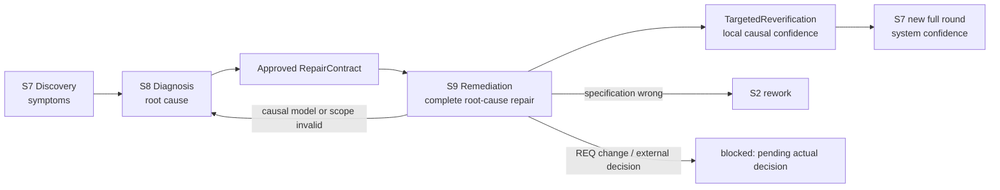
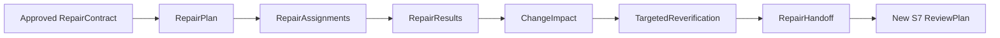

# L3-S9 — 根因修复与可信度重建（Root-Cause Remediation）

> 层：第三层 ｜ Macro-stage：S7 Discovery → S8 Diagnosis → **S9 Remediation** ｜ 上游：S8 approved RepairContract ｜ 下游：S7 新完整验证轮、S8 重新调查、S2 specification rework 或等待真实决策的 blocked
>
> 横切机制：[L4 Agent 调度与治理](../l4-mechanisms/L4-agent-dispatch-governance.md)。S9 只沿用 L4 的通用分工与五态规则，不恢复 generic PLAN/Begin/completion 链；本文只定义 S9 特有的 RepairContract 消费、根因修复、ChangeImpact、定向复验与 S7 回环。
>
> 设计与实现分开：本页当前规范固定工序职责和明确接收边界；具体迁移清单、最新实测与未通过范围见 [S9 机制审查](../global-optimization/S9-MECHANISM-REVIEW.md)。§13、§14 和审计附录均为历史证据，不是保留旧门槛的依据。

<a id="当前最小工作流2026-10-17重新固定减负设计"></a>

## 当前最小工作流（2026-10-18）

目的：避免跳步和遗漏，让作者直接知道做什么、填什么、准确路径和还差什么。
本节替换此前冲突的当前段；以下历史实现与快照不是当前设计。
S9 的 changed_artifacts 与自动 Handoff Changeset 统一取已接收 Final Result 批次记录的实际 changed artifacts，沿原 last-wins 规则归并；不重新 WalkDir 物理 Session 目录或缓存求第二套来源证明。系统带出已知变更集，Main 只填写专业影响判断，不要求作者删除机器字段；删除 Impact/Handoff 的 exact 集合拒收与物理 diff 重做接收准入，不增加 pyc 黑名单、状态、格式或 API，真实测试、Main 集成及独立 Targeted 保留。
S9 分工/工作位置保存只记录选择并反馈现有原 CLI 的准确 workspace bind/prepare 命令，由 Main 在普通工具中执行正常 startup；保存 Hook 不嵌套创建工作区、物化 Bootstrap 或发行 Result。原 prepare 自带 Result 发卷和准确路径；已有 ready execution 但缺 Result 卷时，仍由 Main 运行同一原 prepare 完成 startup，不手工 issue。只有实际工作区与 Result 卷均就绪才可按该位置开工，保存成功不等于 ready。Pre 和重复监听只读；不增加后台、缓存、状态、预算或第三份问卷。
面向作者的 Plan/Result view 复用已有 Draft 专业问卷及 read 材料指针；完整 packet 和整份 inputs 镜像留在系统内部，不增加格式、字段或 schema。

| 工序 | 真实责任与记录 |
| --- | --- |
| Main 阅读批准 Contract 与分工 | 阅读 S8 已批准 Contract，明确修复目标、全部必要断言、分工与真实工作位置，安排真实启动和业务依赖。 |
| Builder 实施前 | 做计划与实际前检，保存本人 PlanReport；正常先于本人实施，不要求所有人先交 Plan 才能有人工作。 |
| Builder 实施后 | 修复或完成测试、自检，保存本人 RepairResult，记录实际结果、证据位置和未完成原因。 |
| Main 集成与检查 | 有实际改动时真实集成并做必要检查；检查按修复目标与实际改动确定并真实执行。 |
| Main 影响判断 | 用 ChangeImpact 判断影响及旧证据处置。 |
| 独立复验 | 未参与对应实现、合并的 verifier 用 Targeted 独立复验全部必要断言，记录真实结果。 |
| fresh S7 | 实际责任完成，如有待履行的真实用户决策则履行后自动交接；无额外 Handoff 答卷。 |

Main 不重新审批 S8 Contract，不另设 readback 交卷或启动许可，只保留现流程真实需要的用户决策。
Main/系统在责任开始或工序切换做一次正常准备，给清晰现入口、结果和准确卷，在原工作位置提供下一卷；无第三份准备问卷。
删除普通 Pre 触 Begin/缺卷 issue、observer 串队列/workspace prepare 的依赖；创建工作区、clone 不放每次 Pre。Hook 不承担调度、测试执行或工作区恢复。
监听只读当前已记录的阶段、责任和答案，提供必要资料、准确路径和具体缺项；
真正保存时记录该答案一次，更新现有工作事实并按阶段条件推进。
复用现有保存监听，支持实际编辑和脚本，不设计新保存协议、缓存或 payload 解析器。
普通工具不重跑业务、重复准备、全扫描或求来源 hash/回执/coverage 证明。
并发和重保存由系统内部处理，不让作者理解 pending/staging 或重交已接收答案。
工作状态只有 `pending/active/blocked/done/cancelled`。

### 删除的旧门槛

- 删除身份、权限、scope ACL 和来源 hash/receipt/coverage 证明的额外准入，包括 `scopeAllows`、packet/source proof 多层重验，不搬到 consumer 保留。
- 删除 `generic PLAN → AgentBegin → activation → work_started → completion` 泛授权及完成证明链；Plan/Result 只是前后工作记录。
- 删除证据 URI 前缀、无需迁移却强制双 refs、测试责任强制造 diff/commit、为形式强迫制造 red 等门槛。真实前检如实记 `pass/fail/blocked`。
- 保留真实测试、独立复验、明确用户审批及一次正确记录；一致性只确保答案准确记录到当前责任，原子性/幂等内部处理。故障优先删依赖，不新增重试、ID 映射或补偿层。

### 异常、重保存与内部边界

接收只做一次必要专业结构检查，并把准确答卷路径关联到当前责任与 attempt。“一次记录”指一次逻辑提交包含本报告及应有 graph 更新，不限制内部物理 I/O 次数。Candidate、Main 真实集成、Final 是不同实际工序，不能按重复报告删掉真实集成。机器 ID、hash、时间、变更集合由系统带出，不反向要求作者证明。原 Writer 内部保留原子性、CAS、幂等和并发处理；相同答案不重复记录，内容冲突说明具体位置，不要求作者重建状态。历史回执只解释既有接收，不作为当前责任的启动许可。

报告 fail、blocked 或偏差可记录；缺实际工序则提示缺项及责任人，不推进。只有明确的真实用户决策沿原授权办理，不扩成泛 Plan 许可。Plan 先于本人实施是履职要求；遗漏由 Hook 提醒，不按工具拦写。已经跳步则如实记录偏差，不伪造先前时间或补来源证明。

### 题形边界

问卷只问专业判断、实际结果、证据位置和未完成原因；已知任务、ID、diff、命令执行事实等系统带出。
JSON 可以继续，题形须明确；不能因为旧 schema 有十个字段就要求作者全抄，本轮不新定格式、字段或 schema。
PlanReport 的前检 command 记录已经做过的工作，不自动冻结为 Main 未来执行命令；
解除 `RedChecks.Command → delivery Checks` 绑定，Main 必要检查按目标和实际改动决定，不迁就旧 runner 增加作者格式条件。
fail/blocked/有偏差的报告可记录；记录成功不等于修复完成，阶段完成按实际未完成工序判断。
无代码改动的测试结果有效，无需造 diff/commit；无需迁移就无需造双 refs。
Targeted 题干给出全部必要断言原文，真实遗漏反馈要明确，不能让作者猜 ID 或机制。

验收先完成一个真实正常 S9 到 fresh S7，再验证必要的真实 blocked 提醒和普通工具/同答不重复执行。
不为旧门槛扩大矩阵；验收看作者是否仍需猜机制、补协议、重复交卷，以及普通 Hook 是否重准备。
Hook exit 0 或机械测试数量不能单独证明减负完成；最新证据与未通过范围见 [S9 审查当前验证边界](../global-optimization/S9-MECHANISM-REVIEW.md#s9-current-validation)。

## 历史实施快照索引（以下保留各记录时口径）

以下实验、实现与待测措辞均为记录当时状态，不是当前设计或当前待办。最新验收仅见 [S9 审查当前验证边界](../global-optimization/S9-MECHANISM-REVIEW.md#s9-current-validation)。

来源统一小片已冻结并通过限定机械验证：r82 原 lead 完整 case PASS（test 4.10s / 包 4.152s / wall 55.536s），原 last-wins 与 stable Changeset identity 两例 PASS（包 0.066s / wall 55.795s），见[原始日志目录](/home/sebs/.cache/gsb-adapter-work-mp771m5c/claude-closure-20261015T011245Z/diagnostics/r82-impact-typed-source-s7_oq7wa)。case 使用明确 synthetic 专业数据，不是 native PASS。after-r75 host-only 构建 exit 0、55.109531s（[清单](/home/sebs/.cache/gsb-adapter-work-mp771m5c/claude-closure-20261015T011245Z/reports/after-r75-source-inventory.json)）；本记录晚于锁定快照。r81 已有真实前半两 Final；下一次在 fresh 同 bike 用真实代码、tests、Git 和原 consumer 建立明确标注合成作者的机械前缀至 Impact，仅由 Claude 验证修复尾链，不冒称单轮全新 native 前半闭环。

r81 限定验证已通过：五个既有例全 PASS（包 **13.226s** / wall **37.070s**，[原始日志](/home/sebs/.cache/gsb-adapter-work-mp771m5c/claude-closure-20261015T011245Z/diagnostics/r81-hook-prepare-split-e9p3j6ki/test.log)）。保存到 workspace 的嵌套准备及 observer 队列遍历已删除；保存/监听给准确命令，Main 普通工具执行原 prepare，原 prepare 负责实际工作区和 Result 卷。覆盖包括 typed normal observer 的显式启动发卷及两个明确 legacy workspace-only 例，不等于完整 S9/fresh S7 通过；后者待全新 r81 真实运行，也未认定 r74 晚 Result 超时根因已解决。after-r74 host-only 构建 exit 0、24.247160s（[清单](/home/sebs/.cache/gsb-adapter-work-mp771m5c/claude-closure-20261015T011245Z/reports/after-r74-source-inventory.json)）；本工作树验收记录晚于该锁定快照，r80 失败证据保留。


r80 / after-r73 真实运行已在 **331.010s** 停止，首次 Edit 保存触原 8s Hook timeout，**revision 18 / 0 Result**，实际工作区 ready 但 Result 卷未发；见[最终报告](/home/sebs/.cache/gsb-adapter-work-mp771m5c/claude-closure-20261015T011245Z/reports/r80-bike-fixed-r73-main-final.json)与[耗时分析](/home/sebs/.cache/gsb-adapter-work-mp771m5c/claude-closure-20261015T011245Z/reports/r80-bottlenecks-and-timing.md)。该保存/startup边界修正及限定验证见上文，未称原超时已解决。


本轮已落限定源码删减：专业 PlanReport 接收真实 pass/fail/blocked 并移除拟改路径 ACL 与重复来源准入；普通 S9 lead/verifier 提醒只读；真实批准、显式启动和保存/集成出口接续当前下一工序；分工/位置保存仅给 Main 原 bind/prepare 命令，workspace 与 Result 由正常 prepare 完成；最后一份 Targeted 成功后自动调用原 Handoff。工作树原公开 integration 单例已通过（46.840s，日志与中间失败见审查 §6）；r65 真实 Main 只读运行 24.89s 后因 Root 已知同版 bug 主动停止，不算 Claude 复现或 PASS，r66 待实测，尚无本轮真实 S9/fresh S7 验收。


> 历史快照说明：以下 §7.52–§7.54 引用保留各自记录时的状态。之后 non-pass 接收、Main resolution 与 Resume lineage 的当时范围见 [GLOBAL §7.61](../GLOBAL-OPTIMIZATION-DESIGN.md#s6-current-r41)。这些结果仍不计入 S9 真实完整阶段验收；本轮契约与待返工范围以上文和 S9 审查为准。
>
> 下一实施契约当时固定于 [L4 stage-form §13.10](../l4-mechanisms/L4-stage-form.md#s9-repair-result-adapter)：typed candidate 本人接收、Main 实际检查与最终原 Result 已经原正向链验证；最终回执重放、候选并发及 candidate/Result sealed-pending 原恢复已验证，独立五目标包与临时安装已通过，更多检查拓扑与真实平台待验收，非 pass/后续 typed consumers 仍待接线；不计入全局完整链。

> 当时的 §7.52 记录了 final 并发/精确重试、合法 sibling CAS 后旧 staging、共享回执 wire 与真实 Worker prepare 能力拒绝；该记录时 Worker 产品检查矩阵仍待受支持宿主，§13.11 的 blocker/resume 也尚未接线。后续进展见本页当前优化实施状态与 [GLOBAL §7.61](../GLOBAL-OPTIMIZATION-DESIGN.md#s6-current-r41)。机器 stale 与 completed 不可集成答卷的额外接收路径仍待设计。

> [全局 §7.53](../GLOBAL-OPTIMIZATION-DESIGN.md#s9-blocker-foundation-progress) 已验证 blocker 数据模型/Schema 基础，并复现后修复原 Agent lifecycle 在 generation 2/3 错记 generation 1 的问题；原 S8/S9 回归通过。历史权威 reader、原 non-pass 接收、Main resolution 与 Resume/Stop 仍待接线，不提高完整链计数。

> [全局 §7.54](../GLOBAL-OPTIMIZATION-DESIGN.md#s9-blocker-reader-progress) 已完成历史 reader、消息/evidence 约束与 blocked PLAN 授权的定向 normal/race。reader 使用机械证据 fixture 验证历史完整性，尚非真实 typed 接收链；原 lifecycle capability/CAS、Hook、Main resolution 与 Resume/Stop 仍在后续实施范围。

> PlanReport 冻结快照已通过五目标本地打包、manifest 校验、临时 --packet 安装及安装后的 release-graph/doctor/validate --all，见[安装证据](../evidence/global-optimization-s9-disposable-install-20261014.json)。后续 RepairResult 工作树变化不继承该快照验收；未执行真实模型或 macOS/Windows 运行。

> **Revision 口径**：S9 消费 approved Contract 的 ID/hash、RepairAssignment、实际 diff 和 targeted assertion；Contract/Assignment 对象版本由工具生成，Runtime `revision` 由 Writer 内部记录。Builder/Repair Lead 不手工计算或复制这些 revision。当前代码中的 CAS/显式 revision 是迁移中的内部实现约束，不是正常 Agent 操作步骤。统一边界见 [L4 Runtime revision 使用与命令协调](../l4-mechanisms/L4-revision-usage.md)。

## 历史优化实施状态（2026-10-15，非本轮验收）

本节下方引用的 §7.52–§7.54 是各自记录时的历史快照；Resume 当前状态以本节更新和
[GLOBAL §7.61](../GLOBAL-OPTIMIZATION-DESIGN.md#s6-current-r41)为准。

non-pass RepairResult 的公开接收已沿原 `SaveRepairResultFrom` → 私有 blocker
capability → 原 `work_blocked` Writer/CAS 接线。公开 PostToolUse 与原历史回执读取、
精确重放零写入、当前 blocker/source/PLAN 证明驱动 Stop 已通过定向机械测试。
通用工作状态为 `blocked`；领域接收事实为 `responsibility_status=blocker_recorded`，
`work_complete=false`、Main consumer pending。历史接收、generic completion、
`one_shot` 或裸 Agent 状态不能授 Stop 或新写入权限。

后续 Main resolution 的公开 authoring Hook、私有 capability、同 CAS 的
message/evidence/Agent pointer 与旧 scope 退役已通过定向机械验证。错误 Main
身份拒绝、空草稿不消费、精确重放零写、变更重放冲突；contract_conflict 保持 S8
人闸。通用工作状态仍 active，Main consumer pending，不表示 Worker done。

新 Resume packet lineage 已从隔离副本选择性合入 Root。r34 指定原链/新链用例通过；
Root r35 的 agentcontext/CLI 包回归和 r36 的 schema/agentcontext/repair/investigation
选定回归通过。r36 resumed Hook 样本为 8.286s、8.543s，均低于原 10s 上限；
只是两个指定样本，不声称一般性性能提升。当前可用包仍为 after-r14，尚不含该合入；
after-r15 尚未构建。其后 r37–r39 的 current-selector / execution-coordinate / revision
选择回归通过，r40 的三项失败已保留并修正，r41 CLI/integration 选择矩阵通过；这些均是
机械回归，不代表真实 S9 阶段或全仓通过。

新设计的 typed Impact adapter 尚未实施。Dependency、expectation 与兼容性投影仍按
本 L3 §13 缺口处理；后续 typed Targeted/Handoff、observability/evaluation 也待完成。
本轮没有 S9 真实模型整阶段验收。全局真实阶段仍为 S2–S5（4/9）；R11 S6 R4 的
Builder Result 已接收，但 Root 正串行执行 Main checks/integration，TASK-002 未完成，
因此不计 S6。上面的 §7.52–§7.54 链接保留各自历史范围；
当前状态见[全局接续记录](../evidence/global-optimization-continuation-20261015.md)
和 [GLOBAL §7.61](../GLOBAL-OPTIMIZATION-DESIGN.md#s6-current-r41)。

### 历史单份答卷与原消费者快照（2026-10-15）

每个 Assignment 的专业工作只有两次有顺序的交付：执行前一份领域 `RepairPlanReport`
（计划、红/blocked 前检和拟改路径），执行后一份 `RepairResult`（实际结果、证据和
剩余风险）。派发/Hook 直接展示当前已发行答卷的真实完整路径；保存即交原 Writer，
由 `execution begin`、Result、Main checks/集成、Impact、独立 Targeted 和 Handoff
按原门继续。Builder 不找 Runtime/Schema，不手动 issue/consume，不抄身份、revision、
hash、diff 或检查 receipt。

generic `PLAN_REPORT` 只能作为既有平台 lifecycle checkpoint，由现有 generic adapter
从同一份 `RepairPlanReport` 派生并交原平台消费者；不得要求 Builder 再写一份相同计划。
`RepairResult` 是唯一专业完成答卷；generic completion/reported 仅是原 lifecycle 事实，
由接收适配从真实 Result 与已有运行/检查事实更新，不能要求第二份完成叙述，也不能
代填尚未执行的检查、Main 集成或 Targeted 结果。现有 S9 接收链若仍依赖两份手工
PLAN/completion 输入，就是待补 adapter 接线，不是 Builder 的额外工序。当前相关回归
入口见 `internal/cli/repair_plan_report_hook_test.go`、`internal/cli/stage_answer_e2e_test.go`、
`internal/investigation/repair_plan_report_hook_test.go` 和 typed RepairResult Hook/恢复测试；
完整 S9 阶段及真实平台 spawn 仍未验收。

环境阻塞后的 Targeted 恢复继续履行同一份 Contract 义务：只有 `result=pass` 且
`scope_compliance=pass` 的原报告能满足 required ID；失败或 blocked 产物保留为历史证据，
不能关闭义务。实际阻塞解除后复用原 `ResumeTargetedReverification`，同一 required ID
的新尝试仍使用原 Targeted DTO 和 Commit 消费者；不可变产物的存储版本由原
`blocker_resolved_at` 派生，同一恢复窗口重放命中同一路径，不增加作者 attempt/hash 表单。
这项恢复接线尚待实现和原链回归，不能计作已完成。

**历史 packet 链路验收（2026-10-14，非当前目标交互）**：此前执行前 PlanReport adapter 的契约见
[L4 stage-form §13.9](../l4-mechanisms/L4-stage-form.md#s9-plan-report-adapter)。
它复用原批准、Session/RepairPlan/实际 dispatch、原 PlanReport Writer 与
`PTR-BUG-10`；professional answer 只含 plan/red_checks/proposed_paths。
中性卷与 Runtime 来源/receipt/checkpoint 定向验证已通过，原 Writer 与公开
Hook 的组合正常验收已通过：generation-2 原审批→dispatch→issue→公开
PostToolUse→原 PlanReport receipt 覆盖了两个 Builder sibling；缺少 sibling 时
`execution begin` 仍拒绝，完整答卷后才放行，阶段推进后的相同答卷只读重放，改写答卷冲突。
Hook 从 Runtime `assignment_owners`、原 workgroup manifest Assignment ID 和已发行卷的
Team/Task/owner 绑定派生 RepairAssignment，不要求 RepairPlan 自带 owner 字段。
这一临时目录 fixture 证明的是本地原 Writer/Hook 链，不代表 Claude/Agent Team 实际 spawn
或模型完成了专业判断。
PlanReport receipt 的 `work_complete=false`；原 BeginRepairExecution、
RepairResult/Main 集成、独立 targeted、Handoff 和 fresh S7 各门继续保留。
当前无执行前 Worker prepare/launch 适配，不能回退 Main 身份。四 target 与 assignment
alias 的定向 race 已通过；原 PlanReport 与 public `stage-answer issue` 的 pending
恢复目标也已分别 normal 通过。stale-staging 后继恢复的 normal 与 race 定向用例也通过；
当前仍未完成的范围是执行前 Worker prepare/launch、真实 Claude/Agent Team spawn、模型运行和
完整 S9 全阶段链。本段机制验证完成时尚未打包；其后的 PlanReport 与 RepairResult
独立包/临时安装进展见本文顶部引用，不代表已安装到当前项目或已通过真实平台验收。

本次证据索引：[S9 issued PlanReport packet implementation record](../evidence/global-optimization-s9-issued-plan-report-20261014.json)。
normal：[原审批/dispatch/Hook/双 Assignment](../evidence/logs/s9-original-approval-dispatch-hook-chain-r4-20261014.log)、
[原 PlanReport recovery](../evidence/logs/s9-plan-report-recovery-normal-r2-20261014.log)、
[public issue pending recovery](../evidence/logs/s9-public-issue-pending-recovery-normal-r2-20261014.log)。
race：[原 Hook 与 recovery 四 target + alias](../evidence/logs/s9-original-hook-and-recovery-final-race-20261014.log)。
stale-staging：[normal](../evidence/logs/s9-stale-staging-sibling-retry-normal-20261014.log)、
[race](../evidence/logs/s9-stale-staging-sibling-retry-race-20261014.log)。

## 输入与交付来源

Main 从已批准 Contract 获取目标、资料、依赖与必要断言，向作者给出可读取的实际路径。Main 通过普通工具完成 workspace startup；实际工作区与 Result 卷均就绪后才安排工作。Git、实现、测试和 Main 集成由实际责任人执行，不藏在保存或普通 Pre 中。

运行证据可从 Main 实际路径读取；引用实际文件或命令输出即可，不要求 URI 前缀、注册 ID 或 hash 来换取报告接收。Impact/Handoff 的已知变更集取已接收 Final 批次，沿原 last-wins 归并，不再扫描物理 Session 目录。

## 0. 一句话结论与阶段关系

> **S9 消费 S8 已批准的修复意图，安排实际修复、测试与 Main 集成检查；新发现或偏差如实报告，由 Main 判断必要回流。影响判断依据已接收 Final 批次的已知实际变更，不物理复扫；独立者实际复验全部必要断言，责任完成后交接 fresh S7 完整审查。**



S7、S8、S9 合在一起才完成一次缺陷闭环：

1. S7 证明“系统出现了哪些可复现表象”；
2. S8 证明“哪些表象由什么机制共同引起、正确修复意图是什么”；
3. S9 证明“该机制已被完整消除、检测缺口已补上、受影响可信度已重建”；
4. 新 S7 再证明“修复后的整体开发结果仍然成立”。

## 1. S9 的立意、目标与不变量

### 1.1 为什么“把代码改绿”不等于修复完成

一个症状通常可以被很多局部补丁暂时遮住。例如“填报内容无法显示”和“填写后无法保存”可能同时来自 FE/BE schema 漂移。只给页面补默认值会让显示变绿，只在一个 endpoint 加 alias 可能让保存变绿，但双重 schema、历史数据兼容和契约漂移仍然存在，后续页面还会以其他方式再次失败。

因此 S9 的成功标准不是 smallest diff，而是 S8 定义的 **Minimum Complete Root-Cause Repair**：

- 恢复被破坏的 authority/invariant；
- 覆盖 RepairContract 中全部 source Findings；
- 完成必要的数据、兼容、迁移、发布和回滚工作；
- 补上原来没能阻止问题的 detection gap；
- 根据真实改动重新判断哪些旧 PASS 已失效；
- 通过独立定向复验，但不把定向 PASS 冒充系统 CleanRound。

### 1.2 阶段目标与完成定义

| 项目 | 定义 |
|:--|:--|
| 输入 | S8 已批准目标、原因与资料；任务分工和真实依赖；必要断言；实际代码、测试和工作位置 |
| 要搞清楚 | 如何在不改变 root-cause intent 的前提下实施完整修复；哪些 repair units 可并行；真实 diff 影响哪些 artifact/evidence；谁独立复验哪些断言；何时必须退回上游 |
| 核心工作 | 读取已批准目标 → 分工与正常 startup → 如实前检 → 执行完整根因修复 → ChangeImpact reconciliation → TargetedReverification → 新 S7 round |
| 最小工程权威 | 一份 approved RepairContract；一份 RepairPlan；每个 Assignment 一份 RepairResult；一份真实 diff 驱动的 ChangeImpact；每个 Contract 一份 TargetedReverification；一份 RepairHandoff |
| 目标完成 | 实际修复/测试、Main 集成检查和专业影响判断完成；独立者对全部必要断言有实际通过结果；如有待履行的真实用户决策则已完成；一次记录交接并创建 fresh S7 入口 |
| 不代表 | 定向复验 PASS 不代表 CleanRound；局部测试绿不代表根因被消除；一条修复报告不代表整批 RepairContracts 完成 |

### 1.3 S9 负责与不负责

S9 负责：

- 读取 S8 已批准的修复目标，不另设审批或来源证明；
- 将 `repair_units[]` 编译成有依赖、有 scope、有验证目标的 RepairPlan/Assignments；
- 在本人实施前做必要真实前检，如实记录 pass/fail/blocked；
- 实施 Minimum Complete Root-Cause Repair；
- 增加 detection-gap tests/oracles；
- 系统带出已接收 Final 变更事实，Main 判断影响及旧依据是否仍适用；
- 由未参与对应实现或合并的责任人完成定向复验；
- 生成 RepairHandoff，并只回到新的 S7 完整轮。

S9 不负责：

- 从 Findings 重新推导另一套 root cause；
- 在 RepairContract 未批准时先写代码“试试看”；
- 不说明实际偏差或隐瞒批准目标与正确行为的变化；
- 发现 Contract 错误后边修边修改因果模型；
- 用 UI fallback、异常吞噬、测试放宽等 symptom patch 代替根因修复；
- 用 targeted PASS 跳过 S7 Delivery/QA/E2E；
- 修改 locked REQ 或在规格错误时继续修过期实现。

### 1.4 不可退让的不变量

1. 按 S8 已批准目标修复；计划、偏差和未完成原因可以记录，不以 scope ACL 拒绝真实报告。
2. 发现诊断或正确行为矛盾时说明事实，由 Main 安排回 S8/S2 或明确用户决策，不让作者猜新根因。
3. Plan 正常先于本人实施，不等待全部人的 Plan；不恢复 generic Begin、activation 或 completion 许可。
4. 前检如实 pass/fail/blocked，不强制造红；无改动测试无需造 diff 或 commit。
5. 有改动由 Main 真实集成并执行必要检查，系统把已接收 Final 的实际变更带入 Impact/Handoff，不再构造第二套物理来源证明。
6. 未参与对应实现和合并者实际复验所有必要断言；真实漏验明确提示，不推进。
7. 专业报告接收不等于修复完成，必要工序未完成不推进；全部完成后一次正常记录交接到 fresh S7，不生成 CleanRound。
8. 原子写、CAS 与幂等由系统内部完成，不变成作者的 hash、回执、身份或登记操作。

## 2. S8→S9 的输入合同

### 2.1 已批准目标与资料

S9 使用 S8 已批准的 Contract，不重新审批。系统提供修复目标、因果说明、分工依赖、必要断言与相关实际资料路径；Main 阅读后安排工作。缺少会影响专业工作的资料时，明确指出缺项及负责补齐的人；可以记录尚未完成的判断，不以全来源 exact set、hash、发行链或注册证据作为报告准入。

### 2.2 当前责任关联与变化

系统持有 Contract、Session、Plan、当前责任和 attempt，内部定位报告及既有记录；作者不抄机器字段。接收只确保准确路径对应当前责任与 attempt，并检查一次必要专业结构，不在 Plan、首次写入、Result、Impact 或 Targeted 反复验证 authority 锁、Bootstrap、freshness 或回执链。

目标或实际工作发生变化时，Main 根据专业事实安排后续责任；失效或历史对象不冒充当前完成，但不新增 stale 状态或自动重建 Session 的恢复协议。真实用户决策仍按原授权办理。

### 2.3 S9 如何使用 Findings

S9 读取 Findings 的目的只有三个：

1. 在修复前重放原始表象；
2. 在修复后逐项验证表象已消失；
3. 保持从 source Finding 到 RepairResult/TargetedReverification 的审计链。

S9 不根据 Findings 单独修改 repair intent，也不把两个 Finding 临时合并或拆分。若某个 Finding 不能由当前 CausalModel 解释，或修复后仍需新的根因假设，必须返回 S8 更新 InvestigationCase/RepairContract revision。

## 3. S9 的权威对象模型

### 3.1 最小对象链



长期权威只保留 RepairContract、RepairPlan/RepairResults、ChangeImpact、TargetedReverification 和 RepairHandoff。TASK、看板、BUG entity、generic gate evidence 都从这些对象投影，不再要求 Agent 手写多份内容相近但无法同步的事实。

### 3.2 RepairPlan

RepairPlan 是系统按 Main 的分工从已批准目标带出的执行资料。下表为既有内部对象字段说明，不新增字段；ID、revision、hash、baseline、路径和关联由系统负责，不是作者填答或反向证明的要求：

| 字段 | 含义 |
|:--|:--|
| `repair_plan_id / session_id / contract_refs[]` | 计划身份和精确输入 |
| `baseline / authority_fingerprints` | 执行基线 |
| `repair_units[]` | Contract repair units 的原样引用，不重新发明 |
| `assignments[]` | 按 ownership/tool context 分组后的执行单元 |
| `dependency_dag` | 生成、迁移、实现、测试、复验之间的顺序 |
| `write_ownership` | 每个 artifact 只有一个 active writer |
| `shared_integration_points` | 需要串行合并的 schema/API/migration 等共享点 |
| `verification_map` | 每个 unit 对应哪些 symptom/root/detection assertions |
| `impact_seed` | prospective surfaces，仅用于预检；最终由真实 diff 覆盖 |
| `approval_policy` | 既有内部资料；仅实际需要的用户决策沿原授权，不作为泛 Plan 启动许可 |
| `status/revision/hash` | 既有机器记录，系统负责，不增加工作状态 |

### 3.3 RepairAssignment

以下是既有 Assignment 的系统资料说明，不是作者必须复制的信封或新增接收资格：

- contract/session/plan revision 与 hash；
- repair unit IDs 和依赖；
- root invariant、architecture intent 与禁止的 symptom patches；
- read scope、prospective write scope、forbidden scope；
- 前检目标与必要断言；实际结果可为 pass/fail/blocked；
- completion assertions 与 required checks；
- migration/compatibility/rollback 责任；
- required Skills/tools；
- expected RepairResult schema；
- stop/escalation conditions；
- 既有计划工序说明；Plan 先本人实施但不是许可，不新增 checkpoint 字段。

Assignment 不复制整份 protocol，也不要求 Agent 在聊天里复述所有文档。工具生成器把最相关约束注入 prompt；read helper 返回按顺序裁剪后的 Contract、authority 和代码入口。

### 3.4 RepairResult

Builder 保存本人当前 attempt 的专业 RepairResult。接收仅检查一次必要专业结构和当前责任/路径关联，再由原 Writer 原子幂等记录。下图仅说明既有对象；机器 ID、引用、hash、时间、变更与命令执行事实由系统带出，作者只填实际判断、观察、结果及路径，不新增字段或证明层：

```text
RepairResult
├── assignment_id / contract_revision / session_id
├── plan_report_ref
├── before_fix_results[]
│   ├── assertion_id
│   ├── observed_red
│   └── evidence_refs[]
├── repair_unit_results[]
│   ├── unit_id
│   ├── implementation_summary
│   ├── changed_artifacts[]
│   └── restored_invariant_refs[]
├── checks[]
├── migration_rollout_rollback_results
├── detection_gap_artifacts[]
├── scope_deviations[]
├── residual_risks[]
├── evidence_refs[]
└── verdict: completed | blocked | contract_conflict | stale
```

`completed` 只说明 Builder 已按 Assignment 实施并完成自检，不关闭 canonical Problem，也不等价于 targeted PASS。

### 3.5 ChangeImpact

系统以已接收 Final Result 批次的实际 changed artifacts、原 last-wins 归并结果带出变更集合。Main 判断变更类型、受影响行为、旧依据是否仍适用、必要复验与未完成原因。实际文件或输出路径足够，不要求引用注册证据或 hash。

不重新扫描物理 Session、缓存或合并目录验证 exact 集合，不用 freshness、ledger 注册或整份来源镜像作为保存/进入后续工序的资格。真实影响尚未判断清楚时，记录报告并提示具体专业缺项，不把机器证明网搬到 consumer/helper。

### 3.6 TargetedReverification 与 RepairHandoff

系统直接给出批准目标中的全部必要断言题干和槽位，包括症状、根因不变量、检测缺口及适用兼容要求。独立 verifier 填每项实际观察与结果，引用真实文件或输出；不能用总 PASS 隐藏失败或遗漏。

不让作者猜 assertion ID、别名、exact 数量、owner 池或发行链。缺哪项真实结果就明确指出题干及缺项，不推进。身份标签不能替代实际独立性：verifier 未参与对应实现与合并，确实在修复后产品上复验。

必要工作与用户决策完成后，系统使用已接收 Final、Impact、Targeted 事实一次正常记录 Handoff 和 fresh S7 入口，无人工 Handoff 卷或全来源重证明。

## 4. 修复规划与有思路的派发

### 4.1 先编译 RepairContract，不从文件列表派任务

Main/Repair Lead 按以下顺序生成 RepairPlan：

1. 读取 architecture intent 和 violated invariant；
2. 保留 Contract 中 repair-unit DAG，不按仓库目录机械切块；
3. 标出 authoritative source、生成物、消费者、迁移和 oracle；
4. 为每个 unit 绑定至少一个 root/detection assertion；
5. 根据 write ownership、工具上下文、合并风险和知识连续性分组；
6. 安排 integration/impact/targeted gates；
7. 计算 critical path，再决定并行度。

“前端一个 Agent、后端一个 Agent、测试一个 Agent”只有在 repair units 和 ownership 恰好对应时才成立。若根因是 schema ownership 漂移，更合理的分派可能是：

| Assignment | 责任 | 依赖 |
|:--|:--|:--|
| A1 Authority | 建立 authoritative schema/owner，删除重复定义或定义生成链 | 无 |
| A2 Server | DTO/domain/persistence/response 对齐权威 schema | A1 |
| A3 Client | FE client/form/display 对齐权威 schema，不保留页面级 alias | A1 |
| A4 Migration | 兼容旧数据、迁移、rollout/rollback | A1，必要时 A2 |
| A5 Detection | contract/integration/E2E oracle，覆盖全部 source Findings | A1～A4 |

这样修复是在恢复机制，而不是把每个症状分别派给最近的文件作者。

### 4.2 Assignment 合并与拆分

可以合并：

- 同一 write owner、同一工具上下文、同一 repair invariant；
- 必须在一个原子变更内保持编译/数据兼容；
- 拆开会制造临时双重 authority 或不可运行中间态；
- 同一 Builder 可以在单个上下文中完成且仍可独立复验。

必须拆分：

- 不同信任边界或破坏性权限；
- 数据迁移与普通代码改动需要不同审批/回滚能力；
- 多 Agent 会写同一 artifact 或共享生成源；
- Builder 会同时成为自己的 targeted verifier；
- 单个上下文无法安全理解所有 repair units；
- unit 之间只有验证依赖，不需要共享写权限。

默认 WIP 不是固定人数。起始可取 `min(2, ready_non_conflicting_assignments)`，随后按 critical path、write conflicts、测试资源和反馈速度动态调整。并行度是结果，不是目标。

### 4.3 专业计划后连续执行

1. 作者读批准目标、必要资料和本人责任，实际做前检。
2. 保存一次本人 PlanReport，记录计划、pass/fail/blocked 和拟改路径；`[]` 是有效无改动计划。
3. 本人 Plan 记录后，Main 正常工具执行给出的 workspace bind/prepare，使用其实际 Worker 与 Result 路径继续工作；不等待 sibling Plans。
4. 保存计划不是启动许可；无 generic Begin/activation/completion，不另交同内容报告。
5. 专业偏差通过明确反馈和沟通处理；需要真实用户批准的动作沿原授权办理，不扩为所有计划的审批轮。

### 4.4 派发时必须注入的思考顺序

Assignment 生成器应直接把以下顺序写进 Agent 的必经 prompt：

```text
理解 invariant → 实际前检并如实记录 → 恢复 authority/ownership →
处理所有 consumers 与数据兼容 → 补 detection gap →
运行 scoped checks → 填写并保存 Hook 提供的准确 RepairResult 答卷
```

工具还应自动附上：

- “禁止只修第一个 source Finding”；
- “禁止以 fallback/alias/swallow/放宽测试掩盖问题”；
- “报告真实目标或诊断偏差，由 Main 决定必要的 S8、S2 回流或真实用户决策；不以 scope ACL 拒收报告”；
- “completed 不是 closed；不得自报 CleanRound”；
- “实际改动与执行事实由系统带出；Impact/Handoff 复用已接收 Final 批次”。

## 5. 从批准 Contract 到完整修复的工作流

Main 阅读批准目标并分工 → 本人 Plan 与实际前检 → Main 普通工具完成实际 startup → 本人实施或测试、自检并保存 Result → Main 实际集成与必要检查 → 专业 Impact → 独立 Targeted 所有必要断言 → 一次记录 Handoff 与 fresh S7。

任一步有未完成工序都明确提醒责任人；真实报告可保存，不能用形式资格取代实际工作。

### 5.1 Step 1：按批准目标做必要真实前检

按 Contract 的 symptom、root invariant 与 detection 要求做必要前检，
如实记录 pass/fail/blocked、真实证据位置及未完成原因，不要求全部 before-fix assertions 为 red。
root assertion 已 green 或无法复现本身不使工作无效，更不能修改产品来造红。
实际结果若与已批准诊断、因果链或正确行为不符，由专业判断说明差异，必要时回 S8 修订，
不靠“非红”自动判无效，也不让 Builder 自行猜新根因。

### 5.2 Step 2：执行 Minimum Complete Root-Cause Repair

每个 repair unit 必须回答四个问题：

1. 恢复了哪个 invariant/authority？
2. 哪些 source Findings 因此被同时解决？
3. 哪些 consumers/data/compatibility 必须一起调整才不留下第二套事实？
4. 哪个 assertion 能直接证明不是 symptom patch？

例如 schema drift 的完整修复可以包含 authoritative schema、FE/BE/domain/persistence 一致性、历史数据迁移、contract tests 和真实 E2E。它可能修改多个模块，却比“两个页面 alias + 一个 endpoint fallback”的小 diff 更小，因为它只保留一个机制和一个 source-of-truth。

### 5.3 Step 3：补上 detection gap

每个根因至少对应一条能阻止同类回归的 oracle。优先顺序是：

1. 最靠近 authority 的 schema/contract/static check；
2. 跨边界 integration test；
3. 真实入口 E2E；
4. 运行期观测/告警，仅用于无法在更早层确定的问题。

不能只增加一个复现当前字面输入的回归测试。Detection assertion 应证明：若把根因修复撤回或再次引入双重 authority，测试会变红。这样它保护的是机制，而不是某个表面样例。

### 5.4 Step 4：处理兼容、迁移、发布和回滚

Contract 声明这些要求时，RepairResult 必须提供可执行事实：

- 数据迁移是否幂等、可重放、可回滚；
- 旧客户端/旧数据的兼容窗口和删除条件；
- 双写/双读若不可避免，谁是 authority、持续多久、如何观测和移除；
- rollout 顺序和失败停止条件；
- rollback 是否会恢复被修复的根因；
- feature flag/config 是否成为新的永久分叉。

“先临时兼容以后再收拾”只有在 Contract 中是显式、限时、有 owner 和 removal assertion 的 repair unit 时才允许。

### 5.5 Step 5：记录真实 RepairResult 与未完成工序

保存专业 RepairResult 时，记录本人实际修复或测试、自检结果、证据位置、偏差和未完成原因；
系统带出已知实际变更与检查事实，反馈具体未完成工序，不另列身份/hash/scope 等资格验证门槛。
blocked、失败或有偏差的真实报告也能保存；记录成功不等于工作完成，实际工序未完成就不推进阶段。
不另交通用完成报告，RepairResult 也不替代 Main 影响判断或独立 Targeted 复验。

## 6. ChangeImpact：判断已知实际变更的影响

### 6.1 输入来源

只使用已接收 Final Result 批次记录的实际 changed artifacts，按原 last-wins 归并，系统带出路径与已有事实。不重新 WalkDir、重新求物理 diff 或对缓存求第二套来源证明；不让作者改掉机器字段来通过消费者。

### 6.2 专业判断

Main 说明行为和依赖如何受影响、哪些旧依据应 invalidated/superseded/retained、哪些工作需要 reverify，并给实际理由或文件/输出路径。无需 URI 前缀、注册证据池、hash 或 ledger 完整性证明；必要复验仍须真正执行。

### 6.3 计划与实际偏差

说明计划未发生或新增改动的实际原因与后果。偏差报告可以记录；若发现诊断、规格或用户决策缺口，由 Main 明确安排相应责任，不把路径差异一概当越权拒收。

### 6.4 保存与推进

一次检查必要专业结构及当前责任关联，使用原 Writer 原子幂等记录判断。系统带出的 Final 变更集直接沿用，不再以 exact 集合、来源 hash、freshness、coverage/ledger 注册资格复验。真实影响判断未完成时提示具体缺项；完成后给独立 verifier 当前题目与实际资料，不靠下一次 Pre 准备。

## 7. TargetedReverification：证明根因修复，不宣称系统 clean

### 7.1 实际独立性

Main 安排未参与对应实现与合并的人复验，提供批准目标、必要断言、Impact 和可读资料。original finder 可提供专业连续性背景，但不是身份/owner 池资格。复验责任不修改产品来使结果通过；不在工具入口检查写权限或 scope ACL。

### 7.2 全部必要断言的真实结果

系统给出断言原文和当前槽位，作者在修复后产品上实际检查症状、根因不变量、检测缺口以及适用兼容要求，填写观察、结果和实际证据路径。无需人工构造 ID/exact 数量、别名或来源发行证明；系统只明确指出哪项真实观察遗漏、失败或 blocked，未完成不推进，不能据此忽略漏验。

旧兼容元数据 `continuity_reason` 与 `scope_compliance` 可选；未填不拒收、不制造 scope fail，也不作为 Handoff 条件，不得为换取接收而编造 pass 或解释。全部必要断言的真实观察、结果、实际证据及未完成原因仍须如实记录，缺真实结果不推进。

### 7.3 结果与下一责任

pass、fail、blocked 或偏差均可记录；仅必要断言全部实际通过且相关工序完成才交接。实现或诊断错误由 Main 按事实安排修复或回 S8，规格问题回 S2，需要真实用户决策则等待该决策。环境/依赖阻塞明确交给解决者，解决后沿既有责任继续，不伪造 PASS，不新增恢复状态或协议。

## 8. S9→S7：从局部因果可信度回到系统可信度

### 8.1 交接的实际完成条件

本人实施/测试、自检、必要 Main 集成检查、专业 Impact 和独立 verifier 对全部必要断言的实际复验已完成；真实用户决策已按授权履行。报告中的 fail/blocked/偏差不被隐藏，尚有实际工序未完成就明确提醒，不交接。

不要求人工证明 exact 集合、ledger 注册、owner 池、发行链、全局 projection 或所有来源 hash/freshness。已有机器关联由系统持有，不作为第二套接收资格。

### 8.2 一次正常记录交接

条件满足时，在实际完成出口由原 Writer 内部原子幂等记录 Handoff，使用已接收 Final、Impact、Targeted 事实产生 fresh S7 seed。Changeset 与 Impact 同用 Final 批次 last-wins 变更集，不做物理 Session 重扫描或全来源重证明。无需人工 Handoff 答卷、create/commit 或等待下一次 Pre。

系统给出实际 Handoff 与 S7 seed 路径及下一责任；重复观察和同答不重复执行。交接不能把 Targeted PASS 变成新轮 Delivery/QA/E2E 的 PASS。

### 8.3 新 S7 为什么仍然必须完整

TargetedReverification 回答的是“这个 Contract 的因果断言是否成立”；S7 回答的是“整个当前开发结果是否仍满足 requirements、architecture、代码质量和真实行为”。修复可能：

- 影响同模块其他功能；
- 改变数据迁移和兼容边界；
- 让未列入 source Findings 的路径失效；
- 解决一个问题但引入性能、安全或可用性回归；
- 修改测试工具本身，使旧结论需要重新评估。

所以 S9 的终点永远是新 S7 的起点，而不是 release gate。

## 9. Sub-agent / Agent Team 调度模型

### 9.1 拓扑选择

| 工作 | 推荐拓扑 |
|:--|:--|
| 单一 repair unit、单一 owner、低风险 | 一个 repair Sub-agent，保存 RepairPlanReport 后连续执行 |
| 多个无写冲突 units | 并行 Sub-agents，Main 按 DAG 汇总 |
| schema/API/migration 跨模块协同 | Agent Team；Lead 维护 authority 和 integration order，成员按 ownership 执行 |
| 需要明确用户决策的动作 | 专业 Agent + 原已授权用户决策 + 独立 reviewer，不增加泛 Plan 许可 |
| impact reconciliation | 系统带出已接收 Final 批次变更，Main 判断专业影响 |
| targeted re-verification | original finder 或独立 verifier；与 repair Builder 隔离 |

### 9.2 Main/Repair Lead 的调度循环

Main 读批准目标、安排依赖与真实独立复验者，实际执行 native spawn/resume；Hook 不替代调度。本人 Plan 后，Main 按准确命令通过普通工具完成 workspace startup；原 prepare 给出真实 Worker 和 Result 卷。只有两者就绪才开工。

作者完成实际工作并保存 Result，Main 完成实际集成及必要检查。Final 批次系统事实供 Main 填专业 Impact，独立者实际复验必要断言，完成出口自动记录 Handoff/fresh S7。普通 Pre、保存分工/位置和重复监听不做 workspace、Git、测试、队列遍历或全来源证明。

提示必须给当前责任、准确路径、真实缺项和下一动作/等待者。专业作者不读 Runtime 猜路径，不手工 issue/consume 或抄机器信封；正常 workspace/Git/check 命令由责任人执行，不受“手工 CLI 禁止”误导。

### 9.3 idle、stop 与失败恢复

- Builder 的 RepairPlanReport 已接收且责任仍在执行时，不因暂时无消息判 idle；
- 只有 Agent 在应提交 plan/result 时进入 idle、或 runtime 明确无 active tool/session，才发送纠偏消息；
- Stop/Idle 提醒本人尚缺的真实工序或已记录等待项，不重验全来源、恢复 workspace 或把历史回执当许可；
- session restore 读取 RepairPlan、Assignment status、last result/hash 和 worktree，不依赖聊天回忆；
- Agent crash 后优先恢复同 Assignment；只有 worktree/ownership 已不可恢复才重派；
- kill/recreate 是最后手段，不能作为正常“两轮对话”流程。

## 10. 在实际工序给清晰指引

| 时机 | 系统行为 |
| --- | --- |
| 进入责任 | 给批准目标、必要资料、真实工作位置和准确问卷。 |
| 保存答案 | 记录真实专业事实一次，带出已知机器事实；失败、blocked 或偏差也能保存。 |
| 普通监听与收尾 | 只提示真实遗漏或等待项及准确路径，不重跑业务或重复准备。 |
| 实际责任完成 | 按阶段条件自动转移，最终交接 fresh S7，无额外交卷。 |

实际工作未完成就不推进阶段；不能以阶段未完成为由拒绝记录真实报告。
专业质量要求由 §5 的真实工序履行，不另设 CLI 身份、hash、scope 或回执资格门槛。

## 11. 生命周期、看板与确定性路由

### 11.1 工作状态与工序投影

工作状态只有 `pending/active/blocked/done/cancelled`。现有 Runtime phase、领域 verdict 和执行标记仅投影已记录工序，不是新增工作状态或作者操作顺序。专业报告可以记录；实际工序未完成不推进。原子记录、幂等与 CAS 留系统内部，不删除全局阶段事实，也不以 generic envelope 授权启动。

### 11.2 看板与提醒

从已有记录展示本人责任、实际完成/阻塞、依赖解决者、专业结果、必要检查和下一准确路径。数量、覆盖或 registered receipt 不作为报告准入；仍明确指出全部必要断言中缺哪项真实结果。

### 11.3 路由优先级

同一批次出现多种结果时：

1. REQ 需要改变：等待真实用户决策并说明受影响工作；
2. specification/contract authority 错：交 S2 纠正目标，不让历史目标冒充当前完成；
3. CausalModel/RepairContract 错或目标不足：交 S8 重新判断；
4. 外部环境或依赖阻塞：交具体解决者，记录 blocked；
5. targeted fail：回 S8判断 same/new cause；
6. 只有所有 Contracts/units/impact/targeted 都完成，才回 S7。

由 Main 按实际结果安排上述责任，系统记录现有事实，不增加 typed 资格、状态或请求竞速协议。

## 12. 职责分布与 L1 准则

### 12.1 职责落点

| 职责 | 主责 | 不得兼任 |
|:--|:--|:--|
| Root cause/RepairContract | S8 Investigation Lead + Main/Architect approval | S9 Builder 不得自行修改 |
| RepairPlan/DAG/ownership | S9 Main/Repair Lead | 不代 Builder提交实现结果 |
| Repair unit implementation | Builder/Sub-agent/Team member | 不关闭 Problem，不批准自己的 targeted result |
| Integration | Repair Lead 或专门 Integrator | 不改写 Contract intent |
| ChangeImpact | 系统带出已接收 Final 批次；Main 判断影响 | 不另求物理 diff 或注册证明 |
| TargetedReverification | original finder 或独立 verifier | 未参与对应 repair unit 的实现或合并 |
| Route/authority escalation | Main 判断实际目标变化；如需用户决策则按原授权办理 | 不扩成一般权限或 Plan 许可 |
| Full-system clean judgment | S7 independent Reviewers | S9 不得生成 CleanRound |

### 12.2 L1 准则映射

| L1 准则 | S9 落点 |
|:--|:--|
| D1 权威外置 | RepairContract、RepairPlan/Result、ChangeImpact、TargetedReverification、RepairHandoff 持久化并带 hash |
| D2 自然路径观测 | assignment/问卷保存、Result submit、合并 diff、impact、targeted、handoff 更新既有 graph；Hook 提醒当前责任，不阻断逐工具路径 |
| D3 门是顾问 | 缺失时返回具体 contract/unit/assertion/evidence/path，而不是笼统 not ready |
| D4 引导性产物 | 题干说明目标与全部必要断言；系统带出 Final 变更供 Main 判断影响，不另建来源证明 |
| D5 三级强制 | 一次必要专业结构检查、当前责任关联与原 Writer 记录；Hook 提醒实际缺项，不保留额外来源准入 |
| D6 三方收敛 | S8 定义修复意图，Builder实施，独立 verifier复验，S7重新审查整体 |
| D7 收敛可观测 | unit DAG、red/green assertions、scope deviations、evidence validity、reopen rate 可计算 |
| 公理一 原型 | 对应现实中的 root-cause remediation、change control、impact analysis、targeted retest、full regression |
| 公理二 分工 | diagnosis、implementation、targeted verification、full review 分开 |
| 公理三 消费 | 批准目标被作者履行，Final 已知变更供 Main 判断影响，实际完成事实交接到 fresh S7 |
| 公理四 成本 | 先做定向因果复验，再用风险驱动但完整的 S7 Claims 覆盖系统 |
| 公理五 传达 | completed/pass/ready/clean 四种语义严格分离 |

## 13. 迁移前实现对照（历史记录，非当前门槛）

本节所有“当前代码”“P0/P1”与缺口均指记录当时；不是当前实施清单或要求保留的门槛。当前迁移仅见 S9 审查。

### 13.0 记录当时已落地的最小闭环

- `internal/repair` 已将 approved Contract 的 hash/status/provenance 作为 S9 输入门禁，并以不可变文件写入 Session、Plan、Result、Changeset、ChangeImpact、TargetedReverification、RepairHandoff。
- 原 Writer 与 Assignment 事实保留 session、plan、dispatch、执行门、Result、impact、targeted、handoff 的校验和状态投影。普通作者路径由 Hook 准备准确问卷，保存时复用原 consumer；Builder 只填 PlanReport/RepairResult 专业答案，不另发 generic PLAN_REPORT 或 completion。低层 CLI 仅供明确兼容、恢复或诊断使用。显式 Runtime revision 只作为集成/恢复断言；Main 检查/集成、Targeted 与 Handoff 的原有领域门保留。
- `runtime investigation project` 只生成 canonical BUG JSON/Markdown 兼容投影，不写 Runtime authority；投影必须消费 approved Case/Contract 和 exact Finding set。
- S9 Runtime 提交点已经绑定当前证据链：`impact commit` 只能消费当前 Runtime 指向的 RepairResult，并要求 RepairResult/ChangeImpact 的 changed-artifact path+SHA exact-set；handoff 还会校验 Changeset 与同一集合一致，targeted reverification 必须命中当前 Impact，不能用同一阶段生成的另一份“看起来有效”的证据替换链上证据。
- `RepairResult.changed_artifacts[]` 对 deleted 文件也必须携带 base/last-good 内容的 SHA256；S8 intake 会逐个核验 ObservationBatch 中 Finding 的 entities 行、文件存在性、内容哈希、Finding schema 和行/文件身份一致性。CAS 失败时，Session/Plan/Result 以及 `register-workgroup` 预写的 activation envelope 都会在安全条件满足时自动清理，避免留下不可重试的孤儿文件。
- `TR-012` handoff 会在同一 CAS 中清空旧 `review.investigation` 指针、旧 S7 看板投影，并保存 repair handoff、targeted artifact 的 path+SHA；同时生成带 post-repair frozen subjects、ChangeImpact 引用和基础 Delivery/QA 责任的 S7 ReviewPlan seed，记录 implementation baseline digest；seed 与普通注册入口共用 artifact-level frozen-subject、coverage 和 regression-asset 校验，作为本轮 ReviewPlan r1 投影。Planner 先审查 seed，覆盖变化时用一次受控 `runtime review-plan revise` 形成 r2，再完成派发/消费路径。
- 本轮已补齐第一阶段执行闭环：Session 打开时冻结非控制面仓库基线，RepairPlan 自动编译一组按 Unit 划分的 RepairAssignment；PlanReport 必须绑定 Assignment 且至少包含一个 red/blocked pre-fix check；Runtime 依次经过 planning→reproducing→fixing，`BeginRepairExecution` 之前不释放执行门。
- `RepairResult` 提交会重算 Session-wide actual diff，拒绝漏报、虚报和错误 SHA；结果携带 Assignment、PlanReport、before-fix/check、scope deviation、migration/rollback/residual-risk 字段。Targeted 非 PASS 结果不再被裸拒绝，而是记录 failure route 并回到 investigation/blocked，向 Agent 显示下一动作；非 `blocked` 失败的下一动作包含带精确路径的 `runtime investigation route --route investigate_more --reassessment-evidence`，回流时创建新 Case revision 并清除旧 Contract 指针。
- **历史实现记录（迁移前）**：RepairAssignment 是 Unit→Assignment 的确定性基础编译；`runtime repair dispatch` 曾将 Assignment 绑定到 Builder Team/Task/Agent/activation，并在同一注册 CAS 写入 `assignment_owners`。当时 S9 Hook 拦截 planning/reproducing 阶段产品写入，并按 PlanReport 绑定 scope 逐工具拒绝越界写入。该 Hook 行为待按当前目标迁移；本段不表示已从代码移除，也不作为目标权限契约。多 Assignment Result 按 exact unit/batch 聚合仍是原领域能力。高级 ownership/conflict/critical-path WIP、真实 Claude/Agent Team spawn 与完整多 Contract batch 仍有各自缺口。

### 13.1 记录当时的事实

| 机制 | 当前表现 | 目标修正 |
|:--|:--|:--|
| S9 输入 | accepted BUG、自由文本 root cause/Closing Contract，多载体并存 | 只消费 approved RepairContract revision/hash |
| 修复授权 | BUG→TASK→Builder 多为字符串关系 | RepairPlan/Assignment 已对 unit、scope、派生 assertion map、依赖/锁和 Contract 做基础全链校验；`runtime repair dispatch` 复用 `register-workgroup`/L4 CAS，写入 Team/Task/Agent/activation 与 `assignment_owners`；高级 ownership/conflict/critical-path WIP 仍待补，平台实际 spawn 仍是环境动作 |
| 两阶段 activation | 一条 activation envelope；read-back 和每个 Builder 未被内容校验 | 当前普通路径以一份领域 PlanReport 更新既有 lifecycle checkpoint，不另要 generic PLAN_REPORT；显式高风险审批仍按原 L4 例外使用 |
| phase-one / 首写条件 | 迁移前 Hook 曾拦截 planning/reproducing 产品写及 fixing 越界路径 | **历史接线事实，待迁移**；目标由问卷提醒当前缺项，原 `execution begin`/Result Writer 保留 S9 阶段条件，不作逐工具拦截 |
| “最小修复” | 容易被理解为 smallest diff | 明确定义 Minimum Complete Root-Cause Repair |
| fix report | `fix_ref` 非空即可推进 entity | RepairResult 已有 Assignment/PlanReport/actual diff/before-fix/check/scope/migration/rollback 字段，并拒绝绿前置、越界和未覆盖 unit |
| repair batch gate | 一条 repair/impact envelope 可推进共享 phase | Runtime 已按每个 Assignment 的 exact unit 收集 Result，完整批次才允许 impact reconciliation；聚合后的 actual diff 才是 ChangeImpact 输入 |
| repair status board | 只读 pointer 能显示当前阶段和最近一次 Result | 已按 Plan/PlanReport/Result 重算每个 Assignment 的 report/result/owner、依赖 `queue_reason`、锁 `lock_state` 和缺口；视图只读，不成为修复事实的第二权威 |
| rich report/generic envelope | 两套契约不自动互换：平台 envelope 只做生命周期 checkpoint，领域对象才驱动 S9 gate；各自入口分别校验 | 领域对象单一权威，gate/entity/看板自动投影；不新增一层格式转换器 |
| impact 输入 | 触发迁移的当前工具 `AffectedPaths` | Session-wide actual diff 已成为 Result 提交和默认 changeset CLI 的事实来源 |
| impact 内容 | rich changeImpact 不驱动失效 action | ChangeImpact 事务已直接更新 evidence validity；完整 dependency graph/impact expectation 仍待补 |
| 空/错 paths | 可静默 committed | diff 不可计算或 reconcile 不完整则 hard deny |
| targeted gate | 一条 responsibility=`Original Finder` 的 PASS envelope | 每 Contract/每 assertion exact completeness + agent independence；失败保留 typed recovery route |
| original finder | responsibility 标签与 BUG actor 身份语义冲突 | 使用 assignment/agent relation 和 continuity reason，不靠标签 |
| BUG entity/phase/evidence | 三套状态可互相矛盾 | 从领域对象投影并在 handoff 事务 reconcile |
| blocked/scope_changed | rich schema 可表达，phase 有确定恢复路由 | `blocked` 先解决验证阻塞，再用 `runtime repair targeted resume --actor <actor> --reason <resolution>` 回到 targeted checkpoint 并提交新的独立复验；其他 Targeted failure 已持久化 `failure_route` 和 exact artifact ref，并通过 `--reassessment-evidence` 回原 Case 的 S8 causal reassessment；S2/paused/stale 细分仍由上游 authority route 处理，不在 S9 增加第二套 phase |
| TR-012/new round | round++、clean_round=null；handoff 已清理旧投影并生成 seed（作为 ReviewPlan r1 投影） | handoff 与普通注册共用 artifact-level frozen-subject、coverage、regression-asset 检查；Planner 审查 seed，覆盖变化时通过同一 plan id 的一次 `runtime review-plan revise` 形成最终 ReviewPlan |
| S9 dispatch | RepairPlan 编译出每 Unit 一个 RepairAssignment，owner 在 PlanReport/Result 链上记录 | `runtime repair dispatch` 已复用 `register-workgroup`/L4 CAS，创建 Builder Team/Task/Agent/activation，并把 owner 绑定到 Assignment；注册时还校验 manifest 中的 Agent 与 owner 一致；平台实际 spawn、idle/stop 事件仍由 Claude/Agent Team 运行时提供 |
| dependency/lock semantics | schema、模型、计划语义校验和 Result/status 消费均已落地 | 校验 unit/assignment 引用、DAG 无环、scope/assertion/依赖/锁 exact-set；Result 按依赖与共享锁确定性排队，status 同时投影 Assignment `status` 与锁 `lock_state`（available/held/released）；不引入独立 S9 scheduler |
| plan report naming | S9 domain `repair-plan-report` 是专业计划事实；同一保存结果更新已有 lifecycle checkpoint | 不另造答卷或状态；generic PLAN_REPORT 的旧双提交说明属于迁移前记录，不能作为普通 Builder 步骤 |
| ChangeImpact/Targeted schema | domain validator 通过 `review-evidence` oneOf 分支校验 | 独立 schema 文件虽已出现于工作树，但尚未成为所有 CLI/文档的单一 authoring 面；不能以“有文件”推断所有入口都消费它 |
| repair-limit | typed helper、adapter、生产路径未接；same-contract counter 不增长 | 以 Case/Contract revisions 和 reopen policy统一防振荡 |

### 13.1.A S7↔S8↔S9 当前链审计（2026-08-26）

当前可依赖的闭环是：S7 sealed `ObservationBatch` → S8 approved `RepairContract` → S9 Session/Plan/Assignment → Builder Team/Task/Agent dispatch → PlanReport/Result → actual Changeset/Impact → independent Targeted PASS → RepairHandoff → S7 seed。每个箭头都有 Runtime pointer/CAS、artifact hash 或 exact-set consumer；平台实际 Agent 进程启动仍是 Claude/Agent Team 的外部动作，Runtime 不伪造 spawn 成功。

- S8→S9 已闭合：`contract approve` 是唯一正常入口，S9 不接受自由文本 BUG 作为授权。
- S9 内部已闭合到 targeted：PlanReport 是领域硬门，`execution begin` 释放写入，Result/Changeset/Impact/Targeted 按 exact set 消费；Targeted 非 `blocked` 失败可沿 exact artifact ref 回到同一 S8 Case，形成可执行的因果重评估闭环。
- S9→S7 只闭合到 registration staging：handoff 已在同一 CAS 递增 round、写 baseline、清理旧投影并应用 seed projection；Planner 仍需把 seed 当本轮 r1 输入重新核对，覆盖变化时以一次受控 `runtime review-plan revise` 形成最终 ReviewPlan。
- S9 依赖/锁是“计划声明 + 轻量确定性消费”，不是独立 scheduler：Agent 以 `runtime repair status` 的 `queue_reason`/`lock_state` 为准，按 `next_action` 提交结果；系统不会后台自动唤醒或替 Agent 修改 Assignment。
- 历史链曾要求 Builder 分别交 generic PLAN_REPORT 与领域 RepairPlanReport。当前正常合同是一份专业 RepairPlanReport，由原 consumer/adapter 更新既有 lifecycle checkpoint；旧双提交要求仅作历史说明，不让 Builder 手工补交第二份。`BeginRepairExecution`、专业前置检查和后续原门仍按真实事实求值，Hook 只提示准确问卷路径和缺项。

### 13.2 P0：先闭合授权、结果与回环

1. 定义并启用 RepairPlan/RepairAssignment/RepairResult/ChangeImpact/TargetedReverification/RepairHandoff schema；
2. 将 S9 入口改为 approved RepairContract revision/hash 的 hard gate；
3. 实现 `repair session open`、PlanReport→原 `BeginRepairExecution` 阶段门和 `repair result submit` 原子事务；
4. 用 session-wide actual diff 替换当前单次 `AffectedPaths` 影响输入；（实际 diff 已由原 Result/Impact 消费；迁移前的 planning/reproducing/fixing Hook 写入拦截是历史接线，待按目标迁移）
5. 实现 ChangeImpact→evidence validity 的原子 reconcile；
6. 实现逐 Contract/assertion targeted completeness 和 verifier independence；
7. 将 RepairHandoff、新 baseline、旧证据失效和 S7 新 ReviewPlan seed 创建合成一个事务；（handoff CAS、baseline digest、seed projection 和 seed/普通注册共用的 artifact-level 校验已落地；完整旧 evidence invalidation 与 seed 的受控 r2 refinement 由后续 S7 consumer 完成）

### 13.3 P1：删除重复控制面

1. 由领域对象投影 BUG entity、generic gate envelope、phase 和看板；（S9 status 已完成 Assignment 批次投影；跨领域统一投影仍是长期方向）
2. 删除独立手写 repair/completion/impact/targeted 多份报告；
3. 删除默认两轮 activation 等待，复用 L4 PLAN_REPORT 后连续执行；（S9 已采用 PlanReport→BeginRepairExecution 连续链）
4. 把 `fix_ref` 升级为 RepairResult ref，不再把非空字符串当完成；
5. 统一 original finder continuity 和 independent verifier 语义；
6. 让 phase 完全由 exact-set completeness 计算。（S9 repair Assignment batch 已落地，跨领域投影仍待统一）

### 13.4 P2：优化规划、派发和影响分析

1. 实现 RepairContract→repair-unit DAG 编译器；（基础 Unit→Assignment 编译与 DAG/引用校验已落地）
2. 按 ownership/conflict/critical path 自动建议 Assignment 和 WIP；（高级编排仍待补，当前 dispatch 只建立一 Assignment 一个 Builder 的确定性桥）
3. 将 unit→invariant→assertion map 注入 PLAN_REPORT；（当前已落地稳定 assertion slot map，细粒度 invariant 语义仍待补）
4. 建 artifact/authority/contract/evidence 依赖图；
5. 提供 prospective-vs-actual scope deviation 和可解释 impact；
6. 根据 ChangeImpact 自动生成 targeted work package 与新 S7 risk hints。

### 13.5 P3：可观测性与防振荡

1. 观测 Contract→plan、plan→first write、repair→impact、impact→targeted、targeted→S7 lead time；
2. 统计 symptom-patch rejection、scope deviation、root-cause reopen 和 stale session；
3. 对同一 Case 多次 Contract revision/reopen 设置结构化升级策略；
4. 记录进度提示是否同时给出实际问卷完整路径、具体缺项和下一动作，以及遗漏工序/重复交付情况；
5. 依据真实数据调整 WIP、high-risk checkpoints 和 full-review risk hints。

## 14. 历史测试与运营指标参考（新验收见顶部）

以下测试矩阵与指标保留为历史，不要求恢复旧身份、来源或发行证明，也不要求扩大本轮验收矩阵。

### 14.1 当时列出的系统测试

| 场景 | 期望 |
|:--|:--|
| 缺 Contract hash/revision/source Finding | S9 session 原子拒绝并指出 exact field |
| authority 或 baseline 已变化 | 原 Session/Plan/Result Writer 不接收过期事实；提示给出问卷完整路径、具体缺项和恢复动作 |
| RepairPlan 的 unit 没有 invariant/assertion mapping | plan compile 拒绝 |
| 计划只修一个 source Finding | 原 PlanReport consumer 给出缺失 Finding/断言；提示定位问卷路径与修正动作，不以 first-write Hook 拒绝工具 |
| 计划采用 Contract forbidden symptom patch | 原 S9 领域结果/impact 门拒收并返回对应条款；Hook 提醒专业修正，不在写工具前拦截 |
| Builder 保存领域 RepairPlanReport | 原 generic adapter 同步 lifecycle checkpoint；不要求第二次手工 PLAN_REPORT，也不进入 idle 等第二轮批准 |
| Agent 未回计划就 idle | Main 可恢复/纠偏，不误判 completed |
| before-fix symptom/root assertion 不红 | RepairResult 不可提交，typed route 回 S8 |
| changed path 越 prospective scope | submit 拒绝；不可用文本 deviation 自动放行 |
| changed path 命中 forbidden scope | 原 Result/Impact/集成门按实际 diff 拒收或保全；Hook 不作逐工具 hard deny |
| 两个 Builder争写同一 artifact | ownership gate 阻止第二个 active writer |
| 多 worktree 合并 | ChangeImpact exact set 等于最终 merged diff，而非各 Agent 自报并集 |
| 最后一次工具调用无 path | 不影响 session-wide diff；impact 仍能正确计算 |
| 旧 evidence scope_refs 缺失 | dependency graph/内容引用给出明确 unknown，不能静默 retained |
| ChangeImpact 少列一个受影响 evidence | reconcile 拒绝或自动补全并记录规则 |
| targeted verifier 是对应 Builder | independence gate 拒绝 |
| original finder 不可恢复 | 允许独立 verifier，但必须有 continuity reason |
| symptom 绿而 root assertion 失败 | targeted result 为 fail，不能关闭 Contract |
| detection-gap test 在根因回退时仍绿 | targeted result 失败 |
| targeted PASS 但有 open repair unit | RepairHandoff 拒绝 |
| targeted PASS | 只能创建 S7 新轮，不能生成 CleanRound/S10 route |
| handoff 后旧 evidence | 受影响项 invalid/superseded，新 S7 不被历史 same-round 记录污染 |
| targeted fail 指向新机制 | 保留原 result并回 S8，不在 S9无限修补 |
| Contract/spec/REQ conflict | 分别确定性路由 S8/S2/paused |

### 14.2 运营指标

| 指标 | 意义 |
|:--|:--|
| Contract DoR first-pass rate | S8→S9 handoff 是否完整 |
| Plan-to-first-write time | PLAN_REPORT 机制是否流畅 |
| PLAN_REPORT interruption rate | 派发上下文和 Contract clarity 是否足够 |
| Before-red reproducibility | S8 causal assertions 是否可证伪 |
| Repair unit completion / reopen rate | unit 粒度和修复完整性 |
| Symptom-patch rejection rate | 机制是否真正阻止局部遮掩 |
| Prospective-vs-actual scope deviation | 调查和计划是否准确 |
| ChangeImpact mismatch rate | 影响依赖图质量 |
| Invalidated evidence replacement time | 可信度重建速度 |
| Targeted first-pass rate | RepairContract/实现质量；不作为压低发现的 KPI |
| Root-cause recurrence rate | 是否真正消除根因 |
| Same Case Contract revision count | 因果模型是否反复振荡 |
| S9→S7 handoff failure rate | batch completeness 和状态投影质量 |
| S7 post-repair new-finding rate | 修复副作用和 blast-radius 估计质量 |

不把“修改行数少”“修得快”“targeted 一次通过”单独设为团队目标，否则会激励 symptom patch、缩小 assertions 或隐瞒 scope deviation。

## 15. Definition of Done

- 当前职责、保留/删除边界与实际实现状态清楚分开；实现迁移与证据见 S9 审查，不以历史测试数量代替验收。
- 一次本人 Plan、一次本人 Result；Main 正常执行 workspace、Git、检查，保存/普通监听不隐式 startup，无全员 Plan 屏障或 generic 许可。
- 接收只检查必要专业结构、准确路径与当前责任/attempt；系统带出机器字段，原 Writer 一次原子幂等记录。
- 前检真实 pass/fail/blocked，无改动测试不造 diff/commit；fail/blocked/偏差报告能记录，真实工序未完不推进。
- Impact/Handoff 只消费已接收 Final 已知变更事实，Main 做专业判断，无 exact/physical diff/freshness/ledger 来源准入。
- 未参与实现与合并者真实复验全部必要断言；系统给题干，漏验明确提示不推进，不以身份池/发行链代替独立工作。
- 实际责任与明确用户决策完成后一次交接 fresh S7；无人工 Handoff 卷，不宣称 CleanRound。
- 先验一个真实正常 S9 至 fresh S7，再验必要真实 blocked 提醒及普通观察/同答不重复；synthetic 专业输入、机械前缀、尾链模型分别标明，不冒充单轮全 native 闭环。

## 16. 易错点与渐进披露

### 16.1 易错点

- 将专业 Plan 当启动许可、等待全部人的 Plan 或恢复 generic Begin/activation/completion。
- 把保存选择、Pre 或 observer 变成 workspace/Git/check/队列执行入口；ready 但缺 Result 卷就称可开工。
- 以“领域完整性/原条件保留”恢复身份、scope、exact、hash、freshness、receipt、Bootstrap 或来源链资格。
- 强制造红、造无改动 commit、无迁移双引用，要求作者猜 ID、别名、URI 或注册证据。
- Impact 从物理目录重新扫描缓存而与已接收 Final 事实矛盾；Handoff 再做全来源证明。
- 把报告接收当实际完成，或因报告 blocked/偏差而拒记事实；删除资格时反而忽略真实漏验。
- 让实现者或合并者做自己的独立复验，或用 Targeted PASS 代替 fresh S7。
- 为规避旧门扩张恢复协议、缓存、状态、预算或测试矩阵；删除原子记录/CAS而造成事实不一致。

### 16.2 阅读预算

- **只想理解 S9 主线**：读 §0、§1、§5、§8；
- **正在做 Repair Lead**：读 §2～§5、§9～§11；
- **正在实施 repair unit**：只消费 approved RepairContract、Assignment、相关 authority/code、实际前检与必要断言、scope 和 §5；
- **正在做 impact**：读 §3.5、§6 和系统带出的已接收 Final 批次，不猜物理目录；
- **正在做 targeted re-verification**：读 §3.6、§7、source Findings、Contract assertions 和 ChangeImpact；
- **正在维护 harness**：读当前 §10～§12、§15 DoD、§16 易错点及机制审查当前迁移清单；§13/§14 仅查历史，不作实施要求；
- **S7 下游 reviewer**：只消费 RepairHandoff、新 baseline、risk hints、invalidated/replacement ledger；不得把 targeted PASS 当当前轮 ReviewResult。

> 以下 14.A–14.E、历史变更记录及旧依赖补充全部为审计证据，不是当前规范；与当前职责/删除边界冲突的规则不作为实现要求。

## 14.A · 复杂度审查审计（2026-08-26，S7~S9 第九轮）

> 方法 = 冷读 sub-agent 完整走 S9 引导链 + 沙盒 r9 从已批 RepairContract 实驱 **S9 全动词序列至 TR-012**
> （session open → plan compile → plan-report submit（红前检）→ execution begin → result submit（精确 changeset）→
> changeset compute → impact create/commit（同事务作废 QA pass 证据）→ targeted create/commit（独立复验人）→
> handoff create/commit → **TR-012 同事务提交：round+1、verification.running、S7 seed 落盘并应用注册投影**）。
> S7→S8→S9→S7 完整闭环自此全部沙盒实证。
>
> **本轮修复（4）**：
> ① **CLI artifactRef Rel 缺陷**：`runtime repair changeset compute --root .` 必然失败（`filepath.Rel(".", 绝对路径)`）——
> 改为先 Abs(root) 再 Rel；
> ② **invalidation_rule 空值**：impact commit 写 `invalidation_rule: null` 被 loop-state schema 拒绝（要求字符串）——
> markEvidence 现按 `change_impact_<status>` 类型化落值；
> ③ **skill 动词链漏两个硬门**：bug-resolution SKILL 的 S9 链缺 `plan-report submit` 与 `execution begin`
> （迁移前首写屏障的释放动词；历史实现记录，不是目标 Hook 策略）——补全并标注各步骤语义（红前检、精确 diff、同事务作废、独立复验、TR-012 种子）；
> ④ **run.go 相位指引缺 planning/reproducing**：恢复投影只认旧相位名——补两相位的 agent 指引
> （plan-report submit 红前检 + execution begin 释放写入）。
>
> **authoring 摩擦（已修）**：PlanReportRequest/RepairResultRequest/HandoffRequest 等 request 结构体无 json tag，
> 请求文件必须写 Go 字段名而嵌套子结构又是 snake_case（混写陷阱）——已统一加 snake_case json tag。
>
> **en route 记录（错误教练质量）**：changeset 精确集合错误逐路径列出 missing/extra；impact 决策四枚举
> （invalidate/supersede/retain/reverify）与 rule_id 模式 `^IM-[A-Z0-9-]+$` 由 verbose 剪枝完整披露；
> targeted 独立性检查（performing != original assignment）支持 canonical `case_id`，并保留
> `bug_id` 作为兼容投影；新路径不再被 BUG 标识门槛阻断。
>
> **冷读其余发现（未修，记待办）**：ChangeImpact/TargetedReverification 无独立 schema 文件（靠 review-evidence
> oneOf 分支校验，authoring 无本地校验面）；TR-012 证据清单未绑 repair_handoff；PTR-BUG-04 legacy 双入口仍
> 发布（新图下不可达）；reproducing 相无独立动词（语义折叠进 plan-report→execution begin 之间，协议已述）；
> S7 seed 的合并规则（seed 内容如何并入 s7 draft）未文档化。
>
> **验证**：go test ./... 全绿、validate --all、doctor（manual current）。

## 14.B · 复杂度审查审计（2026-08-26，第十轮：S9 新修复面复核 + 闭环 #2 实驱）

> 方法 = 冷读 sub-agent 复核新修复面（investigator 卡、S9 写屏障、排队显示、BUG-template 重框架、protocol
> S8/S9 重写）+ 沙盒 r9 从 TR-012 seed 走完 **第二轮完整闭环**（seed 注册 → 派发 → 双 pass → CleanRound →
> TR-009 → S10）。双循环（S7→S8→S9→S7→S10）自此全部沙盒实证。
>
> **上游修复确认（4/10 缺口关闭）**：investigator 卡（动词顺序+可证伪纪律+禁带未解释路由）；S9 写屏障双规则
> （repair_write_before_execution / repair_assignment_scope，写面来自不可变 RepairPlan + PlanReport，恢复动词
> 齐全，矩阵测试锁定）；s7 status 排队显示（queue_reason + 唤醒指引）；BUG-template 兼容投影框架。
>
> **本轮新发现并修复——S7 seed 生成器 4 连缺陷（沙盒逐门撞出，修复前 seed 无法注册、轮次无法重开）**：
> ① delivery claim 缺当前代 TASK source_refs（S7_PLAN_TASK_COVERAGE 拒绝）——生成器现从 state.documents
> 收集 TASK id 注入；② change_impact.source_refs 用 impact id 而注册门要求证据路径——改为钉 impact 工件路径；
> ③ **handoff/impact commit 从不把 change_impact 注册进 runtime.evidence**（S7_REPAIR_BASELINE_REF 永拒）——
> handoff Apply 现在索引 change_impact + targeted_reverification 证据行（含三 invalidation 空槽的 schema 合规
> 形状）；④ qa claim 只引 impact id，S7_REPAIR_BASELINE_COVERAGE 要求每个 changed_artifact 路径出现在 Claim
> source_refs——qa claim 现源 = impact 路径 + 全部变更路径。修复后 seed 即生成即可注册（沙盒 round 2 实证）。
>
> **引导修复（4）**：backend-builder 卡补 "S9 Repair Contract" 节（双屏障、plan-report 红前检、execution begin、
> assignment 写面、changed-artifact 精确集）；investigator 卡补 s7_no_change 路由（TR-022）；protocol 路由表
> 补 TR id（s9_repair→PTR-BUG-08、s2_spec_rework→TR-023、human_req_change→TR-024、s7_no_change→TR-022）；
> manual item 7 补 seed 注册路径（registration-ready、刷新 sha、TR-022 无 seed 分支）。
>
> **仍开放（冷读确认）**：bug_id 模式 ^BUG-[0-9]{3,}$ 与 Case/Finding 语义张力；ChangeImpact/
> TargetedReverification 无独立 schema 文件；PTR-BUG-04 legacy 双入口在 protocol 子相位表仍写 PTR-BUG-02 入口。
>
> **验证**：go test ./... 全绿、validate --all、doctor（manual current）。

## 14.C · 真实残留收口（2026-08-26）

本轮只关闭会改变真实执行结果或让 Agent 走错恢复路径的残留；历史审计段落中的
“未修/仍开放”仍保留为当时的快照，不代表当前状态。

| 残留 | 根因 | 当前修复/边界 | 复杂度收益判断 |
|:--|:--|:--|:--|
| 注册失败留下 activation envelope | `register-workgroup` 在 Runtime CAS 的 `Apply` 中预写 activation 文件；前几个 Agent 已预写后，后续校验/重复 Agent 失败时原逻辑只回滚 Runtime，不清理文件 | 注册过程记录本次预写文件的 path+SHA；CAS 失败后复用 Runtime 的 pending-marker、revision、state-reference 和 SHA 校验，仅在确认未提交且未被引用时删除；若存在可恢复 pending commit 则保留文件交给 recovery | 低复杂度、高收益；复用既有安全清理 API，不引入第二套事务回滚 |
| TR-012 handoff 事实不完整 | `round_entry` 只有 impact/seed 指针，S7 无法从轮次入口直接定位 handoff | `round_entry` 保存 `repair_handoff_ref`/SHA；handoff、impact、targeted 三类工件一并登记到 `runtime.evidence`，S7 通过同一 hash-verified evidence 链消费 | 低复杂度、高收益；字段有明确 S7 consumer 和回归测试 |
| seed “合并”语义模糊 | seed 已投影到 `review.plan`，但 Planner 可能把它误当完整计划，或另起 draft 造成 changed-artifact coverage 丢失 | 协议明确：seed 是唯一输入基线；保留 changed artifact path+SHA、impact source、TASK/E2E coverage，补齐 Claims/Assignments 后重新生成并以正常 `runtime review-plan` 注册最终 Plan | 文档级、近零运行时成本；消除错误操作，不增加新状态机 |
| S9 引导与旧兼容 PTR 混淆 | 当前 Case/Contract 主链已不依赖旧 BUG catalog，但旧描述仍像可选主入口；S9 fixing 文案仍可能暗示重新派发 | 旧 PTR 明确标注 legacy-only；S9 prompt 明确继续已派发 Builder；owner 一致性在 Assignment 注册边界校验 | 低复杂度、高收益；不删除兼容路径，避免迁移风险 |
| targeted failure 回流只有生命周期标记 | 失败提交原先把 S9 phase 切回 investigation，却没有让 S8 Case 接收失败证据或清理旧 Contract，导致下一步只能人工猜测 | 非 `blocked` 失败由 `next_action` 给出精确 `investigation route --route investigate_more --reassessment-evidence`；Case 以 SHA 校验创建新 revision、保存 `causal_reassessment_refs[]`、清除旧 Contract pointer；`blocked` 仍先解决阻塞再重验 | 低到中复杂度、高收益；复用 Case revision/CAS 和现有 targeted artifact，不增加 S9 第二状态机 |

### 当前明确延后项

ChangeImpact/TargetedReverification 独立 schema、完整多 CaseSet、多 Contract batch、独立
S9 scheduler、真实 Claude/Agent Team spawn 和产品浏览器 wrapper 仍不在本轮修复范围。它们
当前没有第二个确定消费者；继续扩张会把校验/投影/状态机重复建设为高成本机制。现阶段由
已有 `review-evidence` oneOf、Case/Plan/Assignment CAS 和平台实际 spawn 承担职责，并在
status/next_action 中披露边界。

## 14.D · 当前引导与身份边界补充（2026-08-26）

- `runtime repair dispatch` 的输入是 `--assignment-id` + `--agent-id`；manifest/task 由命令从不可变 RepairAssignment 生成，调用者不再猜测或传入 `--manifest`。可复制的 PlanReport、RepairResult、ChangeImpact、RepairHandoff 请求形状统一收录在 [`docs/examples/s7-s9/`](../../docs/examples/s7-s9)。
- 历史接线把 generic `PLAN_REPORT` 与 S9 `repair_plan_report` 作为两次输入。当前设计保留两个原消费者，但 Builder 只写领域计划；generic adapter 从同一已保存答卷更新 lifecycle，不创建第三种报告或额外批准轮。
- S9 的普通 next action 继续已派发且已通过计划门的 Builder；不要求重复 dispatch 或额外 lifecycle 提交。Builder 保存 Hook 提供的 exact-unit RepairResult 专业答卷，原 consumer 接受并更新 graph。这与 S8 Investigator 的一次派发→保存专业答卷→继续判别相同，都是一次绑定、连续执行。
- 真实平台 Agent identity 在 S9 dispatch 进入通用注册边界时校验；空值、控制字符和 `TODO(planner)` 不会进入 Runtime agent projection、PostToolUse sender binding 或 auto-chain。该约束只保护 identity 完整性，不收紧合法平台 ID 的前缀或 revision 数量。
- S9 handoff 后的 TR-012 provenance、seed projection gap 和 Claim focus/target mapping 由 S7 status 展示；S9 只负责把可验证 seed 交给下一轮，不把 targeted PASS 伪装成 S7 clean round。

这些都是现有对象/命令的输入披露和边界校验，复杂度成本低于错误派发、错误绑定和二次反查造成的返工；独立 schema、CaseSet、第二调度器等无明确消费者的扩展继续延后。

## 14.C · 复杂度审查审计（2026-08-27，第十三轮：修复核验 + 示例回归修复）

> 方法 = 冷读 sub-agent 逐项核验上轮 11 项发现 + 沙盒 r12 从零手修完整走通双循环
> （S7 r1 → S8 调查 → S9 修复 → TR-012 seed → S7 r2 → TR-009 → S10 acceptance，终态 rev 54）。
>
> **上游修复核验（7/11 干净闭环）**：A1 占位 agent_id 三层闭环（identity/agent_id.go 拒绝 +
> protocol §s7 + manifest-draft 提示，沙盒实测拒绝与教练）；A3 coverage_justification=None；A4/A5/A6
> draft 注脚明示 plan-local claim_id 保留与 e2e-na 必含；B2 repair dispatch 四 flag 齐备且内部生成
> manifest；B3 s7 status 新增 round_entry 块 + seed_projection present/missing 双态显示（超预期：
> "the registered plan is the S9 seed projection; refine only through the controlled revise path"）。
>
> **本轮修复（N1-N4 + 五处摩擦）**：
> ① **N1 示例回归**：docs/examples/s7-s9/ 五个请求示例被误判为应对工件 schema——实际 key 与当前
> 请求 tag 完全一致（沙盒 r12 以同形状走通）。修正 README：明确请求体 vs 持久化工件的双形状设计
> （工件 schema 用 session_id/reported_at、请求用 session_ref/occurred_at 是有意的）；新增
> TestS7S9RequestExamplesTrackRequestContracts 防漂移守卫（逐文件钉请求 tag 与前缀约定，
> tag 改名先在示例暴露）；
> ② N2 assignment 措辞：报错改为"自选 assignment- 前缀 id + dispatch 后绑 Investigator"（上游同步
> 精化为合并措辞，测试锚点对齐）；
> ③ N3 generic PLAN_REPORT 教练标注 optional（S9 权威是域 plan-report，generic 失败不阻塞——沙盒实证）；
> ④ N4 dispatch 读文件报错解释原因（从 definition 提取能力集）；
> ⑤ s7 draft 增 TODO 替换 + coverage_justification 提示行；manual item 7 补 round_entry/seed_projection
> 显示说明并修正 change-impact 依赖方向措辞（impact 是源、frozen_subjects 是投影）；QA-template §5
> worked example 增"仅修复轮适用"引语。
>
> **新机制观察（沙盒，无需修复）**：S8 新增 assignment 纪律（hypothesis register/result 强制
> --assignment-id）与 investigation dispatch/consume 子动词（内部生成 workgroup manifest）；
> S9 dispatch 内部生成 manifest/task（"do not pass --manifest"）。generic PLAN_REPORT 失败不阻塞 S9
> 域流（已由 N3 教练标注）。
>
> **验证**：go test ./... 全绿、validate --all、doctor（manual current）。

## 14.D · 终结收尾审计（2026-08-27，第十四轮发现清零 + 一致性守卫）

> 背景：连续多轮审查后仍有新摩擦出现，用户质询"机制是否过于复杂"。定位：摩擦来自并行开发的
> WIP 接缝与文档摆放位置，而非机制本身（稳定路径连续多轮零机制缺陷；复杂度量化 38 概念/22 必知、
> 每概念对应具名失效模式、操作命令从 12-15 降到 3）。本轮为**终结收尾**：清零第十四轮全部发现
> 并把漂移防御移入 CI。
>
> **修复清单**：
> ① M2（系统性误导）：六个 repair 验证器（session/plan/impact/targeted/plan-report/handoff）的
> "ID 前缀错误"从 "X and Y are required" 泛化消息中分离——前缀错误现指名 "must carry the
> <prefix> prefix so Runtime can bind it (got %q)"，字段缺失才报 required；
> ② M3（sha 时效）：examples README 新增 "Artifact SHA freshness" 节——commit 会重写 create 的
> 工件（status 翻转）、changeset 文件名内容哈希化，handoff 引用前必须从磁盘重读全部 sha；
> ③ 冷读卡点 5 项：investigator 卡补 ingest 第 0 步（fresh S8 无 Case）+ dispatch flags（含
> --agent-definition 默认与能力集提取说明）+ CAS 刷新纪律 + project 的 contract_approved 门；
> examples README 的 "S9 dispatch flags" 节改题 "Non-S9 route consumption"（内容本就是 consume）；
> skill agent-dispatch 的 record_type 措辞对齐请求/工件双形状；manual 新增第 11 条枚举
> runtime-authority 事务 id（S8-REPAIR-CONTRACT-APPROVAL 等，不属 TR 目录故不在 Contents 索引）；
> ④ 摩擦措辞：queue_reason 文案 "scheduler" → "platform TeammateIdle hook"；protocol 修复轮
> 段落预告 "round-2 subject_digest 与 round 1 不同，必须从 s7 status 重抄"。
>
> **一致性守卫（CI 抓漂移，替代审查轮）**：
> - TestGuidanceVerbsExistInRuntime：agent 卡/skill/examples README 里每个 `runtime <verb>` 必须
> 是真实 CLI 子命令（动词改名先在文档测试暴露）；
> - TestProtocolTransitionIdsResolvable：protocol 引用的转移 id 必须在 loop-definition 或
> runtime-authority 白名单内。
>
> **M1（CI 红）**：上游已修（测试不再复现），未动。
>
> **验证**：go test ./... 全绿、validate --all、doctor（manual current）。

## 14.E · S7~S9 当前实现复审（2026-08-27）

历史实现复审记录（2026-08-27）：S7 `ObservationBatch` → S8 `InvestigationCase`/approved `RepairContract` → S9 RepairPlan/Assignment、双层 PlanReport、当时的执行首写门、exact-unit Result、session-wide Impact、独立 Targeted 和 Handoff → S7 full round。此处首写门描述迁移前实现，不作为当前 Hook 目标；兼容 BUG/状态看板不承担授权。

确认的实现偏差已收敛为两项低复杂度输入修复：S8 的重复 flags 现在保留完整值，路由 authoring 文件缺失或非法 JSON 现在返回具体 flag、路径和恢复动作；S8 route 的下一步也会给出完整 Contract approve 命令。它们都不增加生命周期、调度器或额外人工批准，只减少静默数据丢失和反查成本。未实现且有意延后的仍是高级 ownership/conflict WIP、CaseSet、真实平台 spawn/doctor 和产品侧浏览器采集 wrapper，不能在当前文档中写成已完成。

## 14.E · 终态验收（2026-08-27，第十五轮：零卡点判定 + 残余摩擦清零）

> 第十五轮双轨终态验收：冷读四角色（新 Main / Investigator / 修复 Builder / Round-2 Main）**全部零卡点**，
> 错误方向陷阱扫描为零；沙盒 r14 全弧（S7 r1 → S8 → S9 → TR-012 seed → S7 r2 → TR-009 → S10）连续第三次
> 零手修通过（rev 53）。判定：机制收口，审查系列关闭；后续漂移由 CI 一致性守卫
> （TestGuidanceVerbsExistInRuntime / TestProtocolTransitionIdsResolvable / 请求示例防漂移）捕获。
>
> 本轮清零的四条残余摩擦：investigator/builder 卡补 `--agent-definition` flag（builder 卡新增 dispatch
> 签名行，investigator 卡已含）；protocol budget_gate 首句加 shape 指针；manual item 7 的 seed 措辞从
> "registration-ready" 改为 "baseline-complete 但非成品 plan"（Planner 仍需按 control-plane-map 精化）；
> investigator 卡重入段补 "causal_reassessment_refs 从 investigation status 读取"。
>
> **验证**：go test ./... 全绿、validate --all、doctor（manual current）。

## 变更记录

| 日期 | 版本 | 变更 | 原因 |
|:--|:--|:--|:--|
| 2026-08-20 | v0.2.0 | 将 S9 重构为 Macro-stage 的 Remediation 步骤；改为只消费 approved RepairContract；新增 RepairPlan/Result、Minimum Complete Root-Cause Repair、session-wide ChangeImpact、独立 TargetedReverification、RepairHandoff 和 S7 原子回环；统一采用 L4 PLAN_REPORT 后连续执行 | 让 S7 表象经 S8 根因推导后被完整修复，禁止局部 symptom patch，并恢复修复后整体开发结果的可信度 |
| 2026-08-19 | v0.1.0 | 初版：记录 accepted BUG、repair read-back、impact invalidation、targeted re-verification 与 TR-012 当前机制和缺口 | 建立 S9 基线 |


### 2026-09-18 · v1.1.0

修复派发以前置已提交依赖为基线，独立交接运行 evidence。


## 共享模型与合同依赖（2026-09-19）

发现模型或协议缺口时回到事实所属层修订，重审受影响闭包；模型属于冻结设计，不能套用 mutable evidence 哈希自动刷新。 机制权威见 [L4 共享模型与合同治理](../l4-mechanisms/L4-shared-model-contract-governance.md)。
