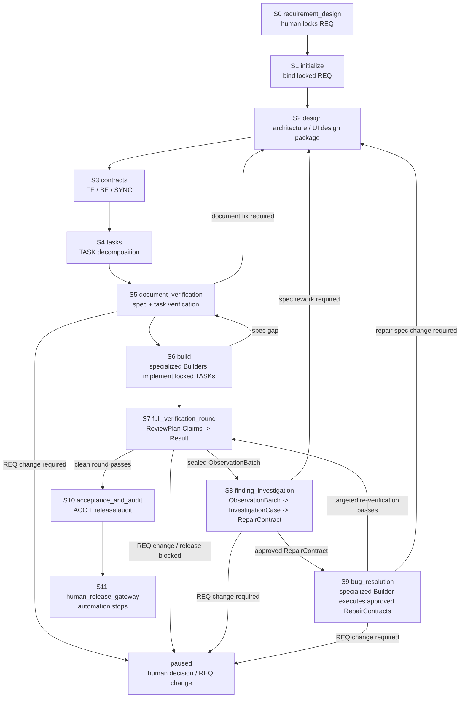

# Agent Protocol — Main Spine

> Authoritative Main Spine. The Main-session Driver (Layer 1) reads the
> current stage's section here on every turn. Each stage has a stable anchor
> (`#s0` through `#s11`) so `AGENTS.md` and Harness `next` output can link to
> it. Runtime authority for current facts lives in `.claude/loop-state.json`;
> legal transitions live in `docs/control/loop-definition.json`.

## Responsibility status and compatibility fields

Agent guidance describes one responsibility attempt with `pending`, `active`,
`blocked`, `done`, or `cancelled` ([shared status rule](../rules/state-machine.md#21-loop-responsibility-status)). New installations default to Runtime 1.3, where Agent, TASK, and S7 ReviewAssignment work-state fields use those values. Runtime 1.1/1.2 stays in its original format on the compatibility/read path; it is not rewritten in place. Stage cursor/gate, professional outcome, artifact status, receipt facts and host-session state remain separate. Keep exact existing command and payload values where their original schema requires them, including Builder `completion_report.status=completed`, legacy Runtime Agent `reported`, assignment `consumed`, and receipt `work_complete`; these are compatibility inputs/projections, not replacement work states. Original approval/activation event evidence remains separate, and `active` alone grants no write authority. Only the original receiver plus current validity and own checks determine whether a responsibility projects to `done`. Agents do not hand-author a generic status or edit frozen document lifecycle fields.

## How to read this file

1. A `SessionStart` or lifecycle Hook `systemMessage` is the first recovery
   packet. It contains the current Stage, the single Next action, the ordered
   read list, and stable links to this file and the Harness Manual. For an
   active responsibility, use the questionnaire's exact view and answer paths,
   required inputs, concrete missing items, and next action shown by the Hook.
2. Follow the packet's `Read in order` list: the project entry document
   (`AGENTS.md`), Runtime/Milestone, this current stage anchor, the bound REQ,
   and the one primary Skill. After compaction, do not reconstruct the stage
   from conversation memory.
3. If the packet says `blocked` or the Runtime is unclear, read
   `.claude/bin/loop-harness.md`. Follow the stage's original work path,
   including its documented planning, dispatch, review, or domain commands.
   Use the CLI for initialization/binding, reconcile after an integrity failure,
   rollback/rollover, human Gateways, and read-only diagnostics as applicable.
   Do not run `stage-answer issue` or `stage-answer consume` as normal work, and
   never use `ready` (or another CLI) to hand-push a Transition. If the Hook
   cannot show the exact current questionnaire paths, send that integration gap
   to Main/system maintenance; do not reconstruct paths from Runtime.
4. Each section has the same shape:
   - `purpose`: why this stage exists
   - `inputs`: what to read before acting
   - `inputs_from`: which upstream stages produce the inputs (explicit data-flow chain)
   - `actions`: ordered work to perform
   - `done_when`: predicates that prove the stage is complete
   - `next`: the default next stage on success
   - `failure_route`: where to go when something is wrong
   - `human_gateway`: conditions that may surface a Gateway
   - `primary_skill`: the main Methodology Skill for this stage

5. Stage advance is allowed only when every `done_when` predicate is true.
   When a predicate is false, the Hook supplies the current responsibility's
   questionnaire, exact view/answer paths, concrete missing items, and next
   action. Fill the professional answers and save that file. The original
   consumer/Writer evaluates its existing stage conditions and updates the
   graph; Hook observes that progress and triggers the existing flow. Do not
   wait for or manually invoke a transition.

> **Design-status note:** this file is the Main-Spine operating contract.
> `docs/control/loop-definition.json`, existing CLI events, and legacy stage details
> may still expose compatibility behavior. Do not infer that a target Hook path
> is fully integrated merely because it is described here. Missing questionnaire
> paths or saves are Main/system integration work; agents do not issue or consume
> packets manually to complete ordinary work.
>
> Revision boundary: Runtime revision and object versions are generated by the
> Writer/API; the Main session follows `next` and does not calculate or carry
> revision values. Any current CLI that still requires such a flag is a
> compatibility implementation gap.

## Event-driven recovery contract

New S5/S7/S8 read-only professional work, `s6-native-v1` Builders, and newly prepared native S9 Builder/Targeted work use SubagentStart/Stop for engineering lifecycle reception. Main carries exact original view/answer or brief references into native Agent. Start supplies bounded context without inferring a responsibility from role or actor; Stop passes actual professional artifacts to the original consumer. Native ordinary tools/messages do not activate or receive work. Engineering owners remain original responsibility labels; actual Claude actor IDs are separate observed facts, including after resume. New read-only responsibility needs no execution/bootstrap/session; registered frozen sources retain their exact recovery. Claude Code owns execution, wait and resume.

The shared per-tool/teammate recovery entries below apply only to Main's original domain work or frozen compatibility responsibilities. They are not native Worker execution prerequisites.
The lifecycle is one continuous journey for one bound REQ. Hook events are
re-entry points into that journey:

| Event | Controller responsibility | Agent responsibility |
|:---|:---|:---|
| `SessionStart` | Read the current graph and original persisted responsibility; emit guidance, ordered read list and current questionnaire paths | Read in the listed order; use the shown view/answer paths, gaps, and next action |
| `SessionStart` native context | Inject a bounded `additionalContext` with current responsibility and a complete answer path; retain full guidance in `systemMessage` | Use it as the immediate re-entry cue; do not read Runtime to guess the questionnaire path |
| `PreCompact` | Perform existing diagnostic maintenance silently; no professional reception, stage control cycle or new Milestone | Keep professional work in its original authoring/receipt path; `SessionStart` recovers current responsibility from persisted facts |
| `SubagentStart` | Observe actual native start and give short engineering context; do not guess or activate responsibility | Follow exact task references and actual inputs; original explicit approval stays required |
| `PostToolUse` `SendMessage` | Capture messages required by the original assignment contract and update its checkpoint | Send a generic PLAN_REPORT only when the frozen role contract requires it (for example, legacy s6-v1.2 Builders); ordinary S5/S7/S8 domain-questionnaire work does not need one, and S9 PlanReport is its original domain answer that projects the existing checkpoint |
| `PostToolUse` questionnaire save | Main domain work and frozen compatibility keep original consumers; native Worker saves are quiet | Native Worker saves the professional artifact, continues work, then returns its exact reference at Stop |
| `PostToolUseFailure` | Record the platform-native failure as audit evidence; never pretend the event can undo the tool action | Treat it as an evidence signal; continue through the existing S7/S8 failure contract |
| `ConfigChange` | Record source/file facts for governance-asset changes as audit evidence; no policy_settings interception is claimed | Reconcile policy/runtime after a governance asset changes; do not infer that audit means approval |
| `SubagentStop` | Match exact engineering reference, call the original consumer and report real acceptance/gaps; ambiguous references go to Main | Return actual professional artifacts or honest blocker; Main owns integration and later closure |
| `TeammateIdle` | Native Worker: quiet; frozen teammate retains original responsibility recovery | Follow the native task; no framework wake-up or next-item claim |
| `Stop` | Before the Main session exits, preflight review assignments: exit 2 only for undispatched responsibility or unconsumed Results; active background Workers are not blockers, and a blocked stop must not first run a Controller cycle that may write Runtime | Follow the single next action from stderr: dispatch responsibility or continue its original result-consumer path; end the turn only when no work remains to close |
| `PreToolUse` `Task|Agent` | Observe the current Assignment/queue and show the next dispatch or responsibility step; it does not deny a tool by identity or scope | Follow the original dispatch and queue; do not claim a responsibility that has not been assigned |
| `PreToolUse` graph guidance | Show the current questionnaire's exact view/answer paths, concrete missing work, and next action; observe graph progression without product-tool authorization | Complete the listed professional work and save the answer; do not infer tool permission from the Hook |

Every responsibility progress cue must include the actual full view and answer
paths, concrete missing items, and the next action (or named waiting owner). If
the paths or gaps cannot be resolved, Main/system maintenance owns that
integration issue; the Agent must not inspect Runtime or protocol files to guess.

A Hook is a natural-event graph listener and flow trigger. Saving a questionnaire
hands the professional answer to the original consumer/Writer, which validates
the existing schema and stage-specific conditions and updates authoritative
facts. The existing Controller/Transition Engine may then apply an allowed
graph transition through compare-and-swap. The Milestone remains a projection,
not a second state machine. `PreToolUse` does not deny product tools or evaluate
identity, tool permissions, or operation scope.

On the normal path, the Agent fills and saves the current questionnaire. The
original domain consumer/gate decides whether the answer satisfies its existing
professional and stage conditions; Hook reports remaining work or graph
progress. A `not_ready` result is guidance, not a product-tool denial. Existing
human approval and domain gates remain in their original workflows, without a
PreToolUse identity, permission, path, or scope interception. Use stage CLIs for
their existing planning, dispatch, verification, or recovery work, but not to
issue/consume the questionnaire or manually advance a stage.

There is no separate PostCompact event in the shipped Hook registration.
Professional facts are persisted by their original consumers, independently of
compaction. `PreCompact` stays silent; the next `SessionStart` reads those facts
and current exact questionnaire paths. Milestone is a summary that may lag,
not a promise that the old prompt was saved or will be replayed verbatim.
Unreceived private drafts remain unreceived; do not recreate accepted answers
or manually write checkpoints to recover context.

Ordinary S2/S3/S4 packet reads show the current original responsibility and
reuse the observed snapshot; they do not re-run the full quality cycle or
receive a private answer. Actual saves and original followups retain their
professional/source checks. Hook calls share an internal work deadline inside
the existing process timeout; authors do not supply budget fields or wait for
another tool just to obtain authority. If a Hook does not finish, Main checks
the original receipt and remaining handoff before retrying: a missing response
does not prove no commit. Preserve accepted work and use its original recovery.

## Stage list

| ID | Stage | Primary skill | Anchor |
|:---|:---|:---|:---|
| S0 | requirement_design | `requirement-funnel` | `#s0` |
| S1 | initialize | `loop-orchestration` | `#s1` |
| S2 | design | `specification-planning` | `#s2` |
| S3 | contracts | `specification-planning` | `#s3` |
| S4 | tasks | `specification-planning` | `#s4` |
| S5 | document_verification | `document-verification` | `#s5` |
| S6 | build | (TASK plus selected Best Practices) | `#s6` |
| S7 | full_verification_round | `loop-orchestration` (DV/QA/E2E Skills are per-Assignment) | `#s7` |
| S8 | finding_investigation | `bug-resolution` + `plan_checkpoint` | `#s8` |
| S9 | bug_resolution | `bug-resolution` | `#s9` |
| S10 | acceptance_and_audit | `acceptance-and-handoff` | `#s10` |
| S11 | human_release_gateway | `acceptance-and-handoff` | `#s11` |

## Stage Flow

The Main Spine is a one-way delivery trunk with explicit correction loops.
S6 and S9 both use specialized Builder capability (`frontend-builder`,
`backend-builder`, or `test-builder`), but they are different stages with
different inputs: S6 builds locked TASKs; S9 executes approved RepairContracts.



## Non-negotiable invariants

These hold across every stage:

1. Chat is not a baseline; decisions land in versioned documents.
2. Engineering Loop binding is independent of Claude `/loop`. Binding requires
   one human-locked REQ; `/loop` only delivers the Wake-up Prompt.
3. UI-impacting work requires module-organized prototypes (HTML + `stories.md`
   + `flows.md` under `docs/design/prototypes/<module>/`) before S3 contract
   lock (see S2). The current implementation IS the baseline; no separate
   capture is required.
4. Every delegated responsibility has one unique Assignment. S6 Builders keep their original professional plan; ordinary S5/S7/S8 reviewers and Investigators use their exact domain questionnaire without a duplicate generic PLAN_REPORT. S9 Builders use the original PlanReport and RepairResult questionnaires; each native answer flows through its original consumer at Stop and does not need a duplicate generic PLAN or completion report. Only an explicit `plan_approval_required` assignment waits for its original approval.
5. The Main Agent does not execute delegated responsibilities itself and does not reply with "approved to start" to an ordinary plan; it intervenes only for plan drift, blocking, permission changes, or Result consumption. Platform session state must not be faked by labeling Runtime `active`.
6. Blocking findings enter S8 finding investigation before S9 repair. The
   authoritative handoff is `sealed ObservationBatch → InvestigationCase →
   approved RepairContract`; a canonical BUG is only a post-approval
   compatibility projection and never a prerequisite for investigation.
   Targeted re-verification never produces a clean round; only a same-round
   complete Delivery + QA + E2E Browser pass does.
7. On the normal path, the Agent fills and saves the current questionnaire;
   the original consumer/Writer evaluates its domain conditions and updates the
   graph. Hook observes and communicates progress and may trigger the existing
   transition path. The Agent never edits `.claude/loop-state.json` or manually
   invokes transition CLI for ordinary stage advancement.
8. Squash merge, publication, deployment, and formal release always require
   human approval.

---

## S0 — requirement_design {#s0}

- **purpose**: produce one human-locked REQ baseline.
- **inputs**: user intent, project facts (`docs/project-map.md`), applicable rules, Project Design Foundation (`docs/design/DESIGN.md` when the product has user-visible UI).
- **inputs_from**: [] (human input + existing project baselines; this is the entry stage)
- **actions**:
  1. determine UI impact (`none` / `changed` / `unknown`) from the expected outcome **before** drafting §A. If the outcome may change user-visible UI, first record `design investment` (`local / core / extended / N/A`) in `project-map.md` §3 with basis (reuse, handoff, Surface count, shared component/token, risk) per `docs/rules/design-foundation.md` §4 — investment (`local/core/extended`) and F2 path (`thin/full`) are orthogonal. `local` → §C records `Foundation reference: local`, `Surface: local`, `Design posture: local` and writes only a module-local `derivation/REQ-{id}.md` (`Foundation: local`), no published Foundation required. `core`/`extended` with `DESIGN.md` `missing`/`draft`/`in-review`/`provisional`/`superseded`/stale/uncovered surface or missing §0 Next-agent card → finish F0–F6 via `skills/design-foundation` (thin path = one merged confirmation, full path = 2–3 worlds differing in ≥3 of six dimensions + three confirmations) and obtain human publish confirmation before writing §A–§C or locking a `changed` REQ. Only `published` with dates recorded is a covering lock; `draft`/`in-review`/`provisional`/`superseded` must not be treated as one. `published` and covering → record versioned refs only (`DESIGN.md@version`, `SUR-*@version`). S0 records references only; it does not copy Kernel or Grammar. Runtime does not yet hard-block a missing Foundation.
  2. distill the user's expected outcome into §A — an agent-filtered restatement (ambiguous colloquial wording removed, implicit premises made explicit), check genuine ambiguity with the human; reuse already explicit decisions rather than asking mechanically again; never record raw quotes
  3. funnel through §A (why) → §B (direction & constraints) → §C (what), as a reasoning method, not mandatory repeated approval; each necessary hand-up is a complete proposal (recommendation + rationale + rejected alternatives) with at most 3 genuine value-decision points for the human
  4. record unknowns, dependencies, and out-of-scope items (§D)
  5. obtain human lock and a lock record (date, identity, version)
- **done_when**:
  - REQ file exists at `docs/requirements/REQ-<id>.md` with `status: locked`
  - lock record is present
- **next**: S1
- **failure_route**: stay in S0 until locked; if locked but flawed, human amendment only.
- **human_gateway**: any REQ change after lock requires `req_amendment`.
- **primary_skill**: requirement-funnel (the human supplies real intent and explicitly locks it; Main owns the professional reasoning without mechanical per-layer confirmation)

## S1 — initialize {#s1}

- **purpose**: bind the actual locked, committed REQ and chosen Git targets through original TR001.
- **inputs**: actual REQ lock/startup decision, committed REQ object, development branch and release target. System supplies known facts and the exact current `requirement-binding.md` path.
- **actions**:
  1. Fill the original four questions: selected REQ, actual authorization record, development branch, release target. Reuse an explicit combined lock/start instruction; lock alone leaves startup authorization unanswered. Name is a record, not identity authentication or a tool-permission confirmation.
  2. Preserve the real selected Git targets and committed REQ association. Report a missing commit or target precisely; do not guess, automatically commit, push or release for binding.
  3. Save the current application normally. The listener calls the original TR001/Writer, records the original binding receipt and prepares the S2 responsibility at completion. No hand-written metadata, command or second confirmation is required; `req bind` remains compatibility/recovery.
- **done_when**: the original transaction has bound the actual REQ/targets and returned the S2 responsibility. Writer owns revision, archive and receipt facts; authors do not prove their hashes.
- **next**: S2 directly at successful binding, without waiting for a later Pre.
- **failure_route**: blank undecided choices wait with concrete missing items; real current responsibility/concurrent conflicts retain their original boundary.
- **human_gateway**: actual explicit startup decision, never automatic approval. No extra confirmation if already given.
- **primary_skill**: `loop-orchestration`

Initial SessionStart, real responsibility start and REQ-lock/unbind/rollover completion prepare the current application once. Ordinary Pre/Stop only read. A consumed old application does not bind again after return to inactive: system locates the current path using the existing archive boundary, without a new attempt field or author metadata. The original Runtime/receipt and Writer pending recovery remain internal.

### Actual tool receipts and reuse observation

Profile-backed invocations capture receipt and log digests from the runner's own output. The original Worker Writer/CAS records them on the current Execution; Main records them in its original integration checkpoint. These are tool facts and do not approve professional answers or complete a responsibility. Authoring a receipt, resealing changed bytes, or finding a file cannot create trusted provenance.

Use the exact `observation_commands["check-reuse"]` adapter for a read-only shadow decision. `action=run` requires the original execution. Main required checks, independent responsibilities, fresh checks and new distinguishing hypotheses always run. Unknown isolation permissions and incomplete input/environment closure cannot enable reuse. Explicit relocation preserves original bytes and checkout facts; it does not authorize reuse across checkouts.

New Worker observations bind the actual original isolation probe, Bubblewrap and shell/library digests, seccomp/argv policy, kernel/identity and frozen authority. The first closed static syntax is limited to `true`, `false`, `test -f <relative file>` and `test -s <relative file>` within the tested tree. Arbitrary shell and external programs remain outside this closed subset. Shadow uses the same disposable-copy algorithm as the real runner; it still executes every required check.

New original Worker profiles may explicitly select `reuse_mode: enabled` for this closed static subset. Default profiles remain shadow. The frozen profile digest includes the mode, so a shadow receipt cannot be upgraded. Exact reuse returns the original accepted reference without publishing another PASS. Main required integration, independent responsibilities and S9/fresh checks always run.

Use the exact `check-running` observation adapter for bounded run diagnostics. A competing identical request returns its existing run reference; the original integration lock and Writer still govern execution and reception. Run diagnostics cannot prove liveness, PASS or completion. Process-owned lock recovery preserves unfinished records as interrupted and rechecks current original authority before proceeding.

## S2 — design {#s2}

- **purpose**: produce architecture decisions and the applicable module current truth: a nine-file UI/scenario package when UI impact is `changed`, or a seven-file service behavior package when UI impact is `none` but an AC targets an FR or service behavior truth changes. The service package preserves CASE IDs and does not contain UI assets.
- **inputs**: locked REQ, existing architecture, existing module packages (if any), applicable design rules (`docs/rules/scenario-model.md`, `docs/rules/design-foundation.md`), Project Design Foundation (`docs/design/DESIGN.md` section 0 first, then `design-language.md` and the current surface row as needed) when UI impact is `changed`.
- **inputs_from**: [S0 (locked REQ), S1 (Runtime Bookmark + baseline generation 1)]
- **actions**:
  1. draft or update `docs/architecture/ARCHITECTURE-<id>.md` (system track)
  2. route by UI impact and AC targets. If UI impact = `changed`, read the **cold-start handoff packet only** — `docs/design/DESIGN.md` §0 Next-agent card + current `SUR-*` diff (or `Foundation: local` packet when investment tier is `local`) — budgeted together ≤120 lines / ≤12 KB; open `design-language.md` only if the card cannot answer Must not. Do not treat a construction hex or library Primary as the brand; after F6 only `semantic_token_only` values via `tokens.css` are legal. Write `docs/design/derivation/REQ-{id}.md` from `docs/design/derivation/DERIVATION-template.md` as a **referenced-ID consumption list** (active `LAW/ANTI/INV` by ID → opening `GR-*`, `Must not` by source ID, `Bindings` by `ROLE/PATTERN`/component, `Proof` by `PROOF-*` with resolvable path) before expanding the module package; `local` uses `Foundation: local` and stays module-local. If any required ID, version (`DESIGN.md@version`, `SUR-*@version`), or Proof path cannot be resolved, stop at semantic fix — do not invent a skin. Then run the dual-track convergence per `skills: specification-planning` — user track first lands `stories.md`; convergence-1 fills the hand-written `cross-matrix.json` carrier (fact×FR×story cells: covering branch or no-branch reason) and produces `scenario-model.json` + `fixture-contract.json`; convergence-2 lands `flows.md`, page HTML, and `index.html`. One macro composition and one stress state must exist before the remaining pages. The current implementation IS the baseline; no separate capture is required. Derivation Note is a semantic duty, not a PTR-PLAN-01 predicate. Foundation does not replace the architecture track. Still do not add aesthetics predicates to `done_when`. If UI impact = `none`, skip Foundation/Derivation and UI assets (HTML, `index.html`, PATH, browser specs). When any AC targets an FR, still maintain the module's seven-file service behavior package: the five sources `scenario-model.json`, `fixture-contract.json`, `cross-matrix.json`, `stories.md`, `flows.md`, plus generated `cases.json` and `scenario-coverage.json`; model the API caller/worker as the story role, use F-NNN without PATH, and set each service branch `browser_required:false`. Also refresh this package when existing service behavior truth changes; if no bound FR sources that change, resolve it through REQ amendment before locking. Do not create per-REQ copies. `ui_impact=none` or `browser_required:false` is not N/A.
  3. at close, when a behavior package exists, run `.claude/bin/loop-harness scenario bridge --root .`, then `scenario generate --module <module> --root .` and `scenario validate --module <module> --root .`. `scenario bridge` checks AC→FR source reachability; module `scenario validate` checks the package and generated outputs. The PTR-PLAN-02 guard still checks the full FR→branch/CASE chain. When all ACs have endorsed NFR/§A4 targets and no behavior package is needed, run the bridge and omit only generate/validate.
  4. Complete the actual applicable architecture/UI/service/ADR work and lock the real `ARCHITECTURE-*.md`. At the S2 responsibility start, the system supplies full duties, conditional material pointers and exact view/answer paths. Fill the existing `architecture_path` and `conclusion`, then save normally: the original Writer records the professional report and original PTR-PLAN-01 outlet. Empty conclusion is draft with concrete missing feedback. Do not copy metadata, hand-create an envelope or run issue/consume/recover. Ordinary Pre/Stop read only; they do not prepare or re-prove sources. Main/Architect labels, full packet equality and development-source hashes are not reception qualifications.
  5. record decisions that the contracts will need (state, data, integration, migration)
- **done_when**:
  - architecture document covers every decision the contract stage needs
  - if UI impact = `changed`: the UI package exists at `docs/design/prototypes/<module>/`, including `index.html`/pages, stories, flows/PATHs, scenario model, cross-matrix, fixture contract, and generated cases/coverage
  - if UI impact = `none` and any AC targets an FR or service behavior truth changes: the **seven-file service behavior package** exists in the same module directory — `scenario-model.json`, `fixture-contract.json`, `cross-matrix.json`, `stories.md`, `flows.md`, generated `cases.json`, and generated `scenario-coverage.json`; it has no HTML, PATH, or browser spec, and each service branch uses `browser_required:false`
  - the AC↔CASE bridge reports every acceptance criterion of the bound REQ reached or carrying an endorsed N/A (a declared NFR id or §A4 negative-space pointer; free text and `ui_impact=none` are rejected as N/A)
  - the actual architecture is locked and the current professional design report records pass; real applicable design materials remain required work, not a producer-label qualification
- **next**: S3 through the original successful save outlet. If the report is recorded but the outlet is unfinished, the same normal save continues it without duplicate registration; completed old-stage replay is read only. Missing actual materials are reported by exact path, not whole-history proof.
- **failure_route**: if a design decision changes REQ semantics, surface `req_amendment`; otherwise iterate the design document. Bridge failures are S2 gaps even when they surface at S3's gate — return here.
- **human_gateway**: `req_amendment`, `unrecoverable_business_decision`, and the ADR direction sign-off (the single S2 human gate of `skills: specification-planning`). The sign-off package = the REQ's `docs/design/decisions/ADR-<id>.md`, whose `## Depth Self-Review` and `## Endorsed N/A` sections (see `docs/design/decisions/ADR-template.md`) carry the three-role self-review conclusion and the endorsed N/A list.
- **primary_skill**: `specification-planning`

## S3 — contracts {#s3}

- **purpose**: write the FE / BE / SYNC development contracts that bound Builder work.
- **inputs**: locked REQ, architecture, the applicable module UI or service behavior truth (if any), naming and API rules.
- **inputs_from**: [S0 (locked REQ), S2 (architecture + applicable module UI or service behavior truth)]
- **actions**:
  1. draft `docs/dev/contracts/CONTRACTS-<id>.md` (index)
  2. converge the shared model and `SYNC-<id>.md` for the affected slice, then derive `FE-<id>.md` and `BE-<id>.md`; follow [shared-model contracts](../rules/shared-model-contracts.md)
  3. ensure the complete contract set covers the bound REQ's acceptance criteria; historical or other REQ contract sets do not satisfy this batch
  4. add bottom-up references and a coverage matrix
  5. At `planning.contracts`, the Hook prepares the current questionnaire and supplies its exact view/answer paths, known or candidate output paths and templates, concrete missing items, and next action. The S3 answer covers one bound REQ index and its complete contract set. Issuance freezes the locked REQ, registered S2 design and only conditional sources those upstream inputs reference; it does not depend on S3's not-yet-authored CONTRACTS index. S3-created shared models/examples are outputs. When Main saves the existing professional answer once, the original shared-model checker discovers their complete dependencies and records them in the existing evidence subjects. Do not change an already frozen S2 model. Set finalized contracts to `locked`; the original consumer validates the answer, the gate checks the full current batch, and PTR-PLAN-02 performs the original registration. Do not hand-create an envelope, copy machine metadata, or repeat checks in the ordinary path. Run `contracts check` or `scenario bridge` only to diagnose a specific reported failure. If the Hook omits the promised paths or missing-item guidance, route that integration gap to Main/system maintenance. The gate still requires `evidence:planning_contract_record`; the consumer supplies it.
  6. Declare each contract's numbered obligations in its existing `本合同条款` table column, using a normal Markdown header and separator. An index citation must match that target's own `§n` or qualified ID. Prose, examples and references to another contract cannot supply a declaration. If reported missing, Main fixes the original contract/index and saves the same unreceived responsibility; no extra registry, fingerprint or proof. This structural check does not judge promise semantics or coverage; those remain S3/S5 work.
- **done_when**:
  - the current bound REQ's complete contract set covers its criteria and declares the applicable shared-model policy; consumers reference the same native definitions
  - every contract has stability metadata (status, version, owner)
  - UI-impacting contracts reference the module UI package by directory path + fingerprint; BE contracts for service behavior map applicable FR clauses to the module CASE IDs even when there is no UI package
- **next**: S4 after the original gate and PTR-PLAN-02 accept the full current batch; otherwise follow the supplied missing-item guidance and save only a revised answer if the original consumer has not accepted it.

For S3 outputs declared `git_tree`, the Hook names the bound development branch
and output paths. Commit the completed contracts and their Git-sourced
model/example dependencies to that branch before saving the current answer.
These are editable S3 deliverables; the frozen upstream inputs are REQ/S2.
If the current answer is rejected because an output differs from that committed
view, commit the intended professional change and save the same answer path.
An unreceived answer needs no named revision; retain required professional fixes.
- **failure_route**: if a contract reveals a REQ gap, return to S2 (architecture) or surface `req_amendment`; if a UI contract is drafted before the module prototype set exists, produce the prototype set first — Quality Gate stays `not_ready` until prototype evidence exists (prototype is not a Hook deny/warn).
- **human_gateway**: only `req_amendment`.
- **primary_skill**: `specification-planning`

The existing S3 questionnaire asks for `applicability` with exactly FE, BE and
SYNC keys. Each value is an object with `disposition` (`required` or
`not_applicable`) and an author-written `rationale` grounded in the actual
scope; applicability remains a Main professional decision, not an automatic
machine judgment. The Hook supplies the current form, exact answer path and
known or candidate output paths/templates; the original consumer validates
the existing shape.

## S4 — tasks {#s4}

- **purpose**: split the contract set into single-responsibility TASKs with bidirectional links.
- **inputs**: contracts, REQ, applicable rules.
- **inputs_from**: [S3 (FE/BE/SYNC contracts), S0 (REQ acceptance criteria)]
- **actions**:
  1. derive one TASK per single-responsibility work package
  2. give each TASK: read order, prospective write paths, closing contract, dependencies
  3. verify the dependency DAG is acyclic and that every contract clause traces to at least one TASK
- **done_when**:
  - every contract clause has TASK coverage
  - every TASK has a verifiable Closing Contract
  - write-path overlaps have explicit sequential ownership
- **next**: S5. Main performs the real TASK/index planning and required ordinary Git work using the exact current questionnaire paths and actual missing items. Preserve real contract coverage, Closing Contracts, dependency DAG and sequential ownership. Fill only the three existing fields (`conclusion`, `index_path`, `task_paths`) and save once. The system runs the actual TASK batch check once, carries the actual batch including cancelled TASKs, and records it through the original Writer and TR-002 into independent S5. Main does not assemble a full directory inventory, source fingerprints, envelopes or machine-recognizable checker commands as reception prerequisites. Check output diagnoses concrete professional gaps; it is not an extra manual normal step. An already recorded pending/no_transition responsibility continues through the original successful Post listener without refilling or resaving the answer. TASK complete/cancelled remains document status, separate from work states. Missing questionnaire paths or system continuation belong to Main/system maintenance; real professional missing work remains explicit.
- **failure_route**: if a TASK reveals a contract gap, return to S3.
- **human_gateway**: none for ordinary work.
- **primary_skill**: `specification-planning`

## S5 — document_verification {#s5}

Current native dispatch: Main carries the original exact view/answer into native Agent. Read-only subjects and private answers may stay in Main; no workspace prepare, Team, opaque ID lookup or generic activation is required. Worker saves its actual professional answer and returns the reference; SubagentStop invokes the original consumer. Ordinary Worker tools are quiet. Existing independent sources, real independence, explicit approval and domain gates remain. Per-save/identity wording in older compatibility details below is not the new native procedure.

- **purpose**: independent Document Verifier pass over the entire spec chain before any Builder activation.
- **inputs**: locked REQ, architecture, contracts, candidate TASK batch, and the original accepted S3/S4 frozen source closure with its document refs for the applicable S2 module current-truth package.
- **inputs_from**: [S2 (architecture + applicable module package), S3 (FE/BE/SYNC contracts and accepted source refs), S4 (candidate TASK batch + DAG + original frozen source closure), S0 (locked REQ baseline)]
- **module package rule**: if UI impact is `none` but any AC targets an FR or service behavior truth changes, both reviewers still inspect the seven-file service behavior package through the refs in the original accepted S3/S4 frozen closure: `scenario-model.json`, `fixture-contract.json`, `cross-matrix.json`, `stories.md`, `flows.md`, generated `cases.json`, and generated `scenario-coverage.json`. Preserve the existing FR denominator and AC→CASE bridge. Service branches use `browser_required:false`, which exempts only HTML, PATH, and browser specs. Read the frozen versions identified by those refs; a missing/stale ref is a finding and must not be replaced with a live workspace Glob result. Do not create a parallel registry or adapter.
- **actions** — S5 has three moves (dispatch → review → three-way closeout):

  **Questionnaire path:** preserve the original independent assignments and frozen input views. When an S5 responsibility is current, the Hook supplies its exact view and answer paths. The Reviewer performs the independent professional review and saves the answer with Write, as allowed by the document-verifier role; the original consumer validates and records it. An ordinary `plan_checkpoint` review has no separate generic PLAN_REPORT/activation step. An explicit `plan_approval_required` assignment waits for its original approval before review; the questionnaire does not grant approval. Do not make a second envelope or manually issue/consume a packet. The existing responsibility receipt and `work_complete` projection remain machine-owned; peer delivery, system followup, and human decisions stay with their original owners. An accepted judgment is immutable. A changed judgment uses Main's exceptional named-revision recovery; changed inputs or stages use the original rework route. Already registered independent S5 executions use their supplied execution view and frozen inputs; see [workspace integration](../workspace-integration.md). If the Hook does not provide the exact paths, Main/system maintenance resolves that preparation gap; do not guess or fall back to manual issue/consume. The legacy envelope workflow applies only to an explicitly unpacketized Runtime.

  1. **dispatch**: the main session uses `team-planning` to create two responsibility assignments—two separate native document-verifier contexts bound to `DV-SPEC-CONSISTENCY` and `DV-TASK-EXECUTABILITY`. The manifest declares `separation_edges` (independence), and the validator rejects a shared agent. Registration anchors on the first S4 dispatch-plan TASK (canonical entity id `^TASK-[0-9]{3,}(?:-[0-9]{2,})?$` mapped machine-side from the plan filename; both reviewers read the whole batch) — Main never selects the anchor. Reviewer questionnaires are issued by the original consumer after registration. Ordinary S5 `plan_checkpoint` assignments go directly to their domain questionnaire; only an explicit `plan_approval_required` assignment waits for its original approval.
  2. **review** (the two responsibilities run in parallel; either finding may enter step 3):
     - `DV-SPEC-CONSISTENCY`: read TASK→contract→REQ→design bottom-up, checking acceptance↔clause mapping, cross-document reference fingerprints, contract-boundary consistency, and scenario mapping. When applicable, inspect the module package only through the original S3/S4 frozen refs; service CASE remains in the FR denominator without UI artifacts. Deep-dive on AC→assert sampling, NFR implementation tracking, and negative error paths (see the `document-verification` SKILL); record professional conclusions/findings in the current questionnaire.
     - `DV-TASK-EXECUTABILITY`: consume the frozen `structural_check` in the packet's `task_analysis` (coverage/DAG are machine-evaluated; do not recalculate or rerun them). For an explicitly older packet that lacks this summary, use the supplied `review_check_command` only when its original frozen inputs are available; otherwise report the missing analysis to Main/system. The command remains available for diagnosis, not as a normal review step. Then evaluate single responsibility/window, semantic coherence, self-contained anchors, forward measurability, and batch cadence. Determine applicable deep-dives from the frozen inputs using the SKILL's Triggered Deep-Dives conditions: data-model migration/debt, external dependency resilience, and critical-profile risk readiness. Do not assume the questionnaire has already classified those triggers.
     - The questionnaire explains the choices directly: `pass` means no issue in this responsibility; `fix_required` means the REQ is clear and correcting design/contracts/TASKs can satisfy it; `req_change_required` means the REQ itself needs a human clarification or change, without authorizing that change. Keep prefilled `findings: []` for pass; otherwise record only the reviewed source path, expected content and actual gap. Save that same current questionnaire once. The original consumer checks subjects, independence, machine evidence, and the professional conclusion; Main does not copy identifiers/hashes or register a parallel envelope. The professional answer is the delivery for both pass and finding outcomes; neither requires a duplicate Markdown REV report.
  3. **three-way closeout** (the original consumer and stage flow route the result; Agents do not call transition commands):
     - two `pass` answers: the original consumer validates both independent reviews and their current source set; the original gate registers the qualified evidence and TR-003 locks the batch → S6.
     - any `fix_required`: the original consumer routes TR-004 to planning; Main fixes the marked document and the affected responsibility is reviewed again. A document fingerprint change invalidates the old pass evidence through the original gate; the other independent reviewer rechecks as required by that gate.
     - `req_change_required` (REQ-level ambiguity prevents a consistent interpretation of the specification chain): record the professional finding in the questionnaire and request the explicit human requirement decision. The original human-boundary path owns TR-005 and amendment or abandonment.

  Two invariants apply: a fix does not reopen an established design decision (change only the marked clause, following S9 discipline); S5's **baseline-generation lock** (TR-003 fingerprint registration) is not the file `Status` field. Contract/TASK files declare `locked`/`complete` when finalized in S3/S4 (`complete` is document status, not implementation responsibility `done`; PTR-PLAN-02/TR-002 consume the on-disk declaration); TR-003 only freezes the exact fingerprint as the S6 baseline boundary.

- **done_when**:
  - both mandatory responsibilities PASS
  - no open finding
  - machine checks pass (`loop-harness validate --all`, `loop-harness doctor`)
  - execution batch is atomically locked (TR-003 committed)
- **next**: S6. Produce any missing independent review or machine-check evidence; the next `PreToolUse` lets the Controller evaluate the document gate and auto-commit `TR-003` when satisfied, including its atomic-lock actions.
- **failure_route**: if a finding reveals a REQ-level ambiguity, surface `req_amendment`; otherwise rework S2/S3/S4 and rerun the affected responsibility (the fix loop is the `fix_required` branch in action 3).
- **human_gateway**: only `req_amendment`.
- **primary_skill**: `document-verification`

## S6 — build {#s6}

- **purpose**: implement the reviewed TASKs, self-test, deliver and integrate.
- **inputs**: the exact TR-003 batch, locked TASK/contract/design links, scope, Closing Contract and required checks.
- **inputs_from**: [S5 locked execution batch, S0 locked REQ]
- **actions**:
  1. Main selects an eligible TASK and backend-builder, frontend-builder or test-builder. Run `loop-harness s6 prepare --root <Main> --task <TASK> --role <role>`. The native delivery contract prepares the actual inputs and professional artifact paths; it does not launch a process. Carry its exact brief reference into a native Claude Code Agent call. No platform Team or preselected platform Agent ID is required.
  2. Use native worktree isolation for writing, with `worktree.baseRef: head` and Main on the committed bound development branch. Claude Code owns foreground/background work, messages, waiting and resume. Do not run workspace prepare/launch or team launch for this native TASK.
  3. Builder reads the TASK and its actual linked sources. Fill and save the supplied professional plan before implementation, then continue without begin, activation or another approval turn. Execute implementation and actual TASK self-checks; Main's later rerun does not replace them.
  4. Commit the actual deliverables, save the professional Result and return its exact delivery reference. Do not copy machine identity/hashes or call task-complete. SubagentStop checks actual artifacts and invokes the original result consumer; ordinary tool-save hooks do not activate or receive this native delivery.
  5. Main follows the native return and explicitly uses the original task-integrate flow to inspect the actual source, merge, run required Main checks and acknowledge it. Worker completion does not wait for Main integration. Preserve failures and use the original rework path; never reset unrelated work.
- **done_when**: every TASK in the TR-003 exact batch has a current accepted professional Result, valid closing/evidence facts, no unresolved scope deviation, and verified Main integration with the required real checks. Original GATE-BUILDER-BATCH-READY / TR-006 decides the exit; Builder self-report is not a clean review round.
- **next**: S7 full verification round.
- **failure_route**: keep actual blockers, results and failed checkpoints; Main handles spec gaps or rework through their original domain paths. Execution revision retains the exact reviewed TASK ID/path/version/content. A repeated native prepare checks that same locked source before returning its original brief; unrelated Main commits do not recapture its source baseline. Formal TASK changes belong to Main through original planning/document review (TR-007 where applicable), and must not be disguised as an Assignment correction. Same-generation TASK replacement is not supported by the current recovery/product reader; do not refresh fingerprints, invent a relock proof or repeatedly retry revision to bypass it.
- **human_gateway**: retain actual requirement/release and operation-specific human decisions; a generic Agent activation is not another human decision.
- **primary_skill**: the TASK-selected engineering practices plus agent-dispatch's native S6 contract.

The native source brief and exact professional output paths are authoritative task references; SubagentStart does not contain the task Prompt and must not guess by role or registration order. SubagentStop consumes the actual report artifacts, not an assumed success from closing text. Ended execution, accepted delivery, Main integration and stage completion remain separate.

Existing assignments with the older s6-v1.2 / workspace contract retain their original recovery commands and frozen inputs. Do not relaunch them as native tasks or reinterpret their historical approval. The native S6 contract is `s6-native-v1`; it versions engineering delivery, not platform execution.

## S7 — full_verification_round {#s7}

Current native dispatch: Main carries the original exact view/answer into native Agent. Read-only subjects and private answers may stay in Main; no workspace prepare, Team, opaque ID lookup or generic activation is required. Worker saves its actual professional answer and returns the reference; SubagentStop invokes the original consumer. Ordinary Worker tools are quiet. Existing independent sources, real independence, explicit approval and domain gates remain. Per-save/identity wording in older compatibility details below is not the new native procedure.

- **purpose**: run one full same-round verification pass over a frozen baseline, under a machine-computed exit. Dispatch mechanics: `skills/agent-dispatch/SKILL.md`.
- **inputs**: S6 integrated baseline, REQ/contracts/TASKs, Builder Result, project rules, risk tags, CASE/PATH, runnable app/test environment.
- **inputs_from**: [S6 (integrated implementation + Result/check evidence), S5 (locked spec chain), S0 (REQ acceptance criteria)]
- **lenses**: one required Claim set per round, partitioned into 1..N single-lens Assignments —
  - `delivery`: traceability — every current-generation TASK appears in at least one Claim's source_refs;
  - `qa`: static engineering quality (pattern-fit, logic/boundary, maintainability oracles);
  - `e2e`: real browser behavior over the declared coverage; a cold start gets an isolated verification-artifact workspace pinned at registration.
- **actions**:
  1. plan: the Hook supplies Main the exact full ReviewPlan JSON path for the current Runtime generation and round. The existing `DraftPlanForRoot` projection provides machine-known source refs, baseline and metadata; Main completes the professional Claims and Assignments in that file, saves it, and the original `RegisterPlan` consumer validates and registers it. Do not manually draft and register a duplicate plan. Inspect its `coverage_inventory` and CASE-level E2E Assignments. Read the adjacent `review-plan.md` guidance supplied with the JSON. Required browser CASEs retain their full `docs/design/prototypes/<module>/cases.json#CASE` identity, including PATH ownership. Script text matches offer candidates only; they do not declare executable assets, locators, routes or environments. The draft leaves E2E state empty until Main chooses the existing formal state from actual facts. Select real reusable paths and exact scenario refs in `e2e_assets`, supply professional selector/route/environment facts, and leave omitted asset IDs/digests to the original receiver. Explicit incorrect digests are rejected. `cold_start` may reuse confirmed assets while creating only missing assets in its declared workspace. Unresolved drafts cannot register or dispatch. The guidance is diagnostic, never a second submission. Only when no readable CASE inventory exists do TODO oracles remain to be filled. Typed path evidence may be written as `path:<repo-relative>#sha256=<64-hex>` for drift detection (bare `path:` remains existence-only compatibility). Use Claim and Assignment IDs shown in the supplied JSON; do not guess them. Keep the generated DV + six QA baseline Claims unless a Planner records an explicit coverage decision; Assignments may be merged only within one lens and only when their non-overlap boundary remains truthful. When `e2e_coverage_state=not_applicable`, keep the generated explicit E2E N/A Claim with `applicability=not_applicable`, `source_refs`, and `na_rationale`; it is a plan disposition, not a dispatched E2E task. The original consumer enforces exact-set coverage and reports concrete gaps; a consumed Result/Finding with `source_ref + affected_surface` permits one controlled revision via `runtime review-plan revise`
     `TODO(planner)` is an authoring marker, not a valid conclusion: replace it in the Claim `target`, `assertion`, `oracle`, `method`, `na_rationale` and relevant source/required-evidence fields defined by `internal/schema/assets/review-plan.schema.json`; the semantic registration gate rejects the literal marker.
  2. dispatch: use the original `loop-harness s7 manifest-draft --assignment <id>` with the actual Assignment ID from the registered ReviewPlan. Main selects the engineering Reviewer owner and professional division of work; machine-known manifest fields and the validation timestamp are supplied by the system, not recopied or hand-filled. Use the returned real TASK candidates and complete registration command for original `runtime register-workgroup` dispatch. If preparation cannot resolve those facts, Main/system repairs the preparation gap rather than guessing parameters. The manifest retains the Assignment's exact Claim set and independence requirements; behavior-wave registration unlocks only after the static Claims settle. Registration rejects authoring placeholders.
  3. submit: after the original Reviewer dispatch, the Hook prepares the current S7 questionnaire for each active Assignment and gives its exact view/answer paths. A queued Assignment receives its questionnaire only after the existing queue releases it. An ordinary `plan_checkpoint` Reviewer does not send a separate generic PLAN_REPORT or complete a duplicate activation handshake. An explicit `plan_approval_required` assignment still waits for its original approval. Each Reviewer reads the supplied view, fills only professional `answer` fields (exact Claim results, observations, evidence, Findings, and explicit verdict), then saves and returns that exact answer reference at native Stop. The original ReviewResult consumer validates the answer, current Claim set, evidence, and independent responsibility; Main does not write Reviewer conclusions or copy system-known identifiers/hashes. For cold-start E2E, report the verification result from the workspace actually executed; the original consumer binds and verifies its artifact digest. Existing capture buffers remain selected by Runtime/generation/Assignment and consumed under their original provenance checks. A valid accepted Result updates its owner's responsibility through the original receipt; it does not wait for the whole round. Receipt queries are read-only diagnostics. Already registered independent Workers use the exact answer path in their original ready execution root and retain original source validation; new read-only native responsibility uses its original Main-root private answer. Do not manually issue/consume a packet or submit a duplicate Canonical ReviewResult on the normal path. If the exact questionnaire is absent, Main/system maintenance owns the integration gap. Controlled Plan revision follows the original Main recovery path; old answers cannot acquire current authority.
     - required answer content: exact Claim results, professional observations, evidence, Findings, explicit verdict, and `capture_gaps` for P0 Findings. Current subject/workspace facts come from the supplied questionnaire and original consumer; do not copy hashes or registration metadata from Runtime.
     - typed evidence refs: `console:<id>`, `network:<id>`, `path:<repo-relative>`, `runtime:<evidence-id>`, `screenshot:<id>`, `state:<id>`, `timeline:<id>`, `trace:<id>`; capture steps may bind `--finding <id>`/`--claim <id>`.
       | ref form | example | use |
       |:---|:---|:---|
       | `console:<id>` | `console:42` | browser console message captured live |
       | `network:<id>` | `network:7` | HTTP request/response pair from the capture buffer |
       | `path:<repo-relative>` | `path:docs/dev/contracts/contracts-001.md` | repo file (append `#sha256=<64-hex>` for drift detection) |
       | `runtime:<evidence-id>` | `runtime:e-01` | evidence registered in the runtime evidence store |
       | `screenshot:<id>` / `state:<id>` / `timeline:<id>` / `trace:<id>` | `screenshot:3` | visual / persisted-state / step / trace capture from the buffer |
     - live timeline capture: the listener supplies this responsibility's exact capture-buffer path and prefilled `capture exec` / `capture step` command prefixes. Append the real professional command or required action/observed text and evidence correlation. On saving the typed answer, the original consumer automatically reads the existing buffer and merges available capture into an empty Finding timeline; reviewer-authored timelines are preserved. Do not pass `--captures`, submit a second log/document, or repeat dangerous actions to fill missing capture; record genuine `capture_gaps` in the answer.
     - **Repair rounds (TR-012 re-entry)**: the Hook-prepared round-2 ReviewPlan carries the current `subject_digest` and post-repair `frozen_subjects`. Review that the plan covers every post-repair artifact named by the current `change_impact`; the original RegisterPlan consumer checks the on-disk hashes and TR-012 binding. Do not copy the digest or frozen-subject hashes from Runtime status. The schema checks field shape; registration validates the actual bytes.
  4. observe: `loop-harness s7 status` is the read-only board: it shows the exact current Main/Reviewer questionnaire paths, current required Claim gaps, pending dispatch responsibilities, recorded `blocker_ref`, round provenance, findings and original exit facts. Fill and save the indicated professional questionnaire. Main/system handles missing questionnaire preparation or recovery wiring; do not guess command parameters or manually submit the same Result. A missing seed projection is reported for original reconciliation. Status reads existing facts without issuing questionnaires or repeating the baseline/receipt/Git chain; domain checks, Reviewer independence and explicit human gates remain with their original consumers. An accepted controlled plan revision retires its explicitly invalidated old Results only when current Claims, Assignments and receipts no longer use them; affected responsibilities still need their actual new results. Keep history invalid and intact. Other invalid evidence and Findings still block; a newer PASS alone never supersedes them.
- **constraint_recovery**: a rejected plan/result is not a dead end. The diagnostic includes `code`, `missing`, `repair`, `next`, `verify`, and `ref`; execute `next`, then verify with `loop-harness s7 status`. A malformed capture buffer must be corrected and resubmitted; an ambiguous multi-Finding buffer must be split with `--finding`/`--claim`; a stale selected asset requires Main to restore the original pinned source or use the controlled plan revision/rework path; never refresh a digest to certify arbitrary workspace drift. Same-answer replay uses the original accepted plan and does not re-read current scripts or imply their current validity. Plan checks report independent failures together and mark dependent checks not_checked when identity is unresolved. Fix author-owned fields in the same plan; source/environment/Writer/pending failures belong to Main recovery and must not be repaired by rewriting valid professional content. No extra lint/confirmation step is required.
- **budget_gate** (decision-file shape: `budget_decision_shape` below in this section): `s7 status` always prints `round N of M`. The active round may drain when `N >= M`, but no new full round opens. A failed `start_review_round` emits the human gateway; submit a JSON decision with `runtime s7-budget-decision --file <decision.json> --actor <user>`. `decision="increase_budget"` must provide `new_max_full_review_rounds > M` and atomically records the scoped `human_decision` evidence plus the new limit; the controller then retries the pending round-opening transition. `decision="return_to_governance"` records the same evidence, invalidates downstream review evidence, clears the old ReviewPlan projection, resets the round counter for the new planning generation, and routes through declared human gateway GTR-006 to planning. The decision artifact must bind the current `runtime_id`, `review_round`, `previous_max_full_review_rounds`, `reason`, and `authorized_by`; Runtime Writer handles the internal commit sequence. Runtime revision is assigned internally; an explicit `--expected-revision` remains an optional integration/recovery assertion, not an Agent-facing protocol requirement.
- **budget_decision_shape**:
  ```json
  {
    "decision": "increase_budget",
    "runtime_id": "loop-REQ-039",
    "review_round": 5,
    "previous_max_full_review_rounds": 5,
    "new_max_full_review_rounds": 8,
    "reason": "the remaining surface requires another complete review round",
    "authorized_by": "user",
    "created_at": "2026-08-25T12:00:00Z"
  }
  ```
- **reviewer scope rule**: Reviewers do not repair; a product problem is a Finding. The original ReviewResult consumer and S7 gate validate the submitted answer and current evidence. PreToolUse only reports graph progress and does not deny product writes by tool, identity, or scope.
- **exits** (all machine/hook-driven; never hand-write an aggregate PASS, a clean_round record, or invoke a transition manually):
  1. no findings — the machine CleanRound is registered inside the final submit → TR-009 to S10
  2. findings — ordinary findings drain the remaining required Claims (a P0 seals immediately), the ObservationBatch seals with the exact Finding set → TR-008 to S8
  3. verdict `req_change_required` — the submit transaction creates the single pause checkpoint → TR-010
  4. verdict `release_blocked` — same single-checkpoint route → TR-011
- **done_when**: the round is clean (machine CleanRound registered) or the ObservationBatch is sealed; both are computed by the round consumer inside the final `review-result submit` and re-verified by the exit gates over the exact Claim set.
- **next**: S10 if CleanRound passes; S8 if ObservationBatch is sealed. The Hook gives the exact current questionnaire path, the concrete missing Claim/evidence, and the next action; the original consumer and gate determine the route. Do not manually invoke a transition.
- **failure_route**: any blocking finding → S8 finding investigation; incomplete/stale evidence restarts S7 with a new round.
- **human_gateway**: none for ordinary work; verdict pauses (TR-010/TR-011) surface the human gateway.
- **primary_skill**: `loop-orchestration` (dispatch mechanics: `skills/agent-dispatch`; focus-specific DV/QA/E2E Skills are per-Assignment dispatch facts, not the round's `primary_skill`); the round exit (CleanRound / ObservationBatch) is machine-owned.

## S8 — finding_investigation {#s8}

Current native dispatch: Main carries the original exact view/answer into native Agent. Read-only subjects and private answers may stay in Main; no workspace prepare, Team, opaque ID lookup or generic activation is required. Worker saves its actual professional answer and returns the reference; SubagentStop invokes the original consumer. Ordinary Worker tools are quiet. Existing independent sources, real independence, explicit approval and domain gates remain. Per-save/identity wording in older compatibility details below is not the new native procedure.

Registered evidence references keep their S7 spelling: both `<evidence-id>` and `runtime:<evidence-id>` resolve to the same original indexed artifact. Preserve the accepted Finding and references; do not register prefixed aliases or copy its evidence to satisfy S8. Original validity, generation, round, kind and on-disk SHA checks still apply. A `runtime:` reference is never an execution anchor, even if its ID contains `://`.

- **purpose**: investigate the actual reported problem from a sealed S7 ObservationBatch or an explicit human report, form InvestigationCases, derive an evidence-backed root cause and approve a complete RepairContract for S9. S8 does not create a canonical BUG at intake; after approval, a canonical BUG may be emitted as a compatibility projection carrying the Case/RepairContract identity and hash.
- **inputs**: the actual sealed ObservationBatch/Finding material when present, or the explicit human problem and original decision material without a fabricated Batch/Finding; locked spec chain, implementation, tests and existing relevant observations remain the investigation materials.
- **inputs_from**: [S7 (sealed ObservationBatch, Finding exact set, encounter/readiness outcome and capture gaps), S5 (locked spec chain), S6 (current implementation)]
- **actions**:
  1. Main reads the exact current Main questionnaire and actual source paths supplied by the Hook: read Batch/Finding material only when present; a human-source Case uses its actual problem/decision material and locked inputs. The original consumers supply and validate known Case/Runtime identities, hashes and frozen source metadata; Main does not copy these into another envelope or repeat discovery by default.
  2. Main fills `intake.json` as an object with the professional `grouping_rationale`, then saves it. The original intake consumer creates the Case from the current sealed set or actual human problem through this same normal save; without a Batch no Batch/Finding is invented, and grouping stays reversible.
  3. Main fills `hypotheses.json` as an array of falsifiable questions: `statement`, `invariant`, `discriminator`, `expected_outcomes` as an object with `support`/`refute`, and `source_finding_ids`/`evidence_refs` as arrays. Existing question IDs are supplied; an optional `agent_id` records Main's actual owner choice. Saving uses the original registration and dispatch consumers. Main then actually starts/resumes each Investigator with that person's exact issued view and answer paths in the platform Agent prompt; registration alone is not a launch.
  4. Each Investigator reads its issued questionnaire and original evidence, makes its own professional judgment, fills only its HypothesisResult answer and saves the exact file, then returns its exact reference for SubagentStop reception. Main follows the original accepted results and outstanding owners; a supported, refuted or inconclusive result remains that Investigator's actual conclusion.
  5. Main fills the supplied `route-…json` object and saves it: choose the professional `route`/`route_reason`; for repair, fill the existing causal-model, blast-radius and detection-gap objects in that same questionnaire. The original route consumer decides qualification and applies the existing downstream route. An unresolved mechanism stays in S8; an earlier specification/REQ/duplicate disposition does not require inventing a supported repair cause.
  6. For `s9_repair`, Main fills the supplied `contract-…json` professional questionnaire and saves it: strings for invariant/intent/migration, arrays for scope/assertions/regression/stop conditions, and `repair_units` objects with `id`, `description`, `scope` and `assertion_ids`. The Case cause and binding are carried automatically into the original Contract. The existing independent technical review and actual policy-bound or human approval remain required; saving a draft does not approve it. Follow the supplied approval/waiting feedback and enter S9 only through the original approval consumer.
- **disposition routing**:

  | S8 result | Required disposition | Next route |
  |:---|:---|:---|
  | Case lacks causal evidence or has unexplained Findings | `investigate_more` | stay in S8; add evidence or discriminator-bound follow-up |
  | confirmed implementation/test/tooling/environment repair | `s9_repair` + approved RepairContract (`S8-REPAIR-CONTRACT-APPROVAL`) | S9 repair |
  | duplicate of an already covered Case | reversible duplicate link | follow canonical Case |
  | specification correction | `s2_spec_rework` | S2 planning (TR-023) |
  | locked REQ must change | `human_req_change` | paused / human Gateway (TR-024) |
  | evidence-backed no artifact change | `s7_no_change` | new complete S7 round via TR-022 (`findings_resolved_without_repair`) when the batch has no remaining repair |
- **done_when**:
  - every Finding maps to a Case disposition without deleting or overwriting the source observation
  - every Case routed to S9 has a supported CausalModel, blast radius, detection gap and approved RepairContract
  - no accepted repair is defined as a symptom-only patch; S9 consumes the approved RepairContract instead of re-deriving root cause
  - any canonical BUG emitted for compatibility references the approved RepairContract and is not an independent S8 authority
- **next**: Normal Main work is **read the supplied exact Main questionnaire and sources → fill professional fields → save → follow original reception, missing fields and waiting owners**. Intake, questions, route and Contract are Main's questionnaires; each HypothesisResult is its assigned Investigator's questionnaire. Main uses the actual platform Agent tool to start/resume the named responsibilities and supplies every person's complete view/answer paths. Two Investigators may share the same role; role names and a native platform ID do not establish the registered owner. When a native owner cannot be resolved, do not guess an identity or create an alias: Main supplies that responsibility's exact paths, and the original save listener resolves its owner from the registered answer path.
- **S8 questionnaire**: The Hook prepares and gives the exact current path; begin there instead of searching directories, running `actions`/`--help`, or consulting the Runtime/recovery manual as a normal prerequisite. Read the questionnaire's actual Batch, Findings, Case and locked inputs, then fill its existing professional shape. Known identity, hash, source-version and registration metadata are automatic. A missing path or unreadable source is a Main/system preparation gap: retain the exact known path and concrete missing source, and let the original preparation/recovery owner resolve it. Do not invent another questionnaire, identity binding, metadata record or approval.
  An ordinary `plan_checkpoint` Investigator needs no duplicate generic PLAN_REPORT or activation handshake; an explicit `plan_approval_required` responsibility retains its original approval. New questions and owner choices are saved in Main's hypotheses questionnaire. Changed own sources, dispatch or routing follow the original Main recovery path, preserving received sibling work. Do not manually issue/consume, submit duplicate result flags, or perform command discovery on the normal questionnaire path.
- **legacy/recovery only**: low-level intake, register, dispatch, route, result and approval CLI commands, expected-revision assertions and optional canonical BUG projection remain available for existing legacy flows, explicit integration and diagnosed recovery. Multi-value `--source-finding`, `--source-boundary`, `--evidence`, `--explains` and `--does-not-explain` flags accept repeats or comma-separated values; the original validator checks exact membership and duplicates. Separate `--causal-model-file`, `--blast-radius-file` and `--detection-gap-file` inputs belong to those explicit CLI flows; normal Main fills the corresponding objects in the supplied route questionnaire.
- **failure_route**: an invalid or incomplete ObservationBatch returns to S7 for evidence completion; an unsupported root cause, unexplained Finding or incomplete contract stays in the same S8 Case; a duplicate follows its canonical Case; specification ambiguity routes to S2; REQ-level ambiguity surfaces `req_amendment`. A follow-up observation is allowed only when it is bound to a named discriminator and a safe evidence gap.
- **human_gateway**: `req_amendment` and explicit RepairContract approval when neither a project policy pinned at REQ binding nor a valid bounded-repair grant applies. Main follows the exact independent-review and approval inputs supplied with the current Contract feedback; the original consumers bind the saved professional review, exact Contract and actual authority metadata. A saved Contract or technical review never impersonates a human decision. The existing policy and bounded delegation requirements remain in [bounded repair autonomy](../bounded-repair-autonomy.md); low-level delegation flags belong to the explicit legacy/recovery flow.
- **primary_skill**: `bug-resolution` plus `plan_checkpoint`; S8 Investigator is read-only against product/spec.

For explicit legacy/recovery, `runtime investigation status` is S8's single recovery entry point: when a Case is `contract_approved` and has no unprocessed S9 targeted failure, `next` directly gives
`runtime repair session open --root <root> --session-id <session> --created-by <agent>`, and also exposes
`repair_contract_ref`; the Agent does not need to run `contract approve` again. When `review.repair.status=blocked` and the lifecycle has returned to S8, status prioritizes S9's saved `next_action` and `repair_recovery`, so the next verb is visible whether the failure is causal reassessment or verification blocking. For a non-`blocked` failure, first read `causal_reassessment_refs[]` using that command, then register a Hypothesis with a new `assignment-*`; the same Writer transaction retires the old `review.repair` pointer, preventing a new Contract from being mistaken for the old S9 session. A `blocked` failure does not enter S8 causal investigation: first execute the `runtime repair targeted resume --actor <actor> --reason <resolution>` shown by status, then create an independent re-verification.

## S9 — bug_resolution {#s9}

Reading follows responsibility: Main uses its own division/recovery questions, exact native dispatch brief and accepted professional artifacts; it does not receive Worker private Plan/Result questions as authoring work. An accepted Worker reads its recorded artifact, while Main integrates the candidate and runs actual checks before continuing to Final/Impact. Do not wait for Final before integration or redispatch an accepted answer. The original Main blocker-recovery question remains available.

**Native S9 delivery:** The professional PlanReport and Result are private outputs in the actual native worktree. The Main-root question is read-only input; an isolated Worker never writes Main. At Stop the adapter imports the actual worktree Plan payload into the existing questionnaire and invokes the original consumer, without Main authoring the answer.  Main selects professional responsibilities and carries the exact prepared brief into Claude Code's native Agent with worktree isolation. The Builder saves its professional PlanReport and real prechecks before implementation, continues repair/self-checks, commits products, and saves its professional Result in the actual native worktree. Return the exact brief and absolute Result path. Start supplies bounded context; Stop calls the original professional consumers. Ordinary saves do not activate or receive work. Main integrates and runs actual necessary checks separately. No Team, opaque platform ID, workspace prepare/launch or session reservation is required. A returned native Git source is recorded only for the original Result/integration consumers, with `purpose=native_delivery` and no bootstrap or platform session. An independent Targeted verifier receives the exact original Targeted path and returns it for Stop reception; actual independence and Contract assertions remain. Existing installed workspace assignments keep their frozen recovery contract.

- **purpose**: execute an approved RepairContract, target-re-verify root-cause elimination, invalidate affected historical PASS evidence, and return for a fresh complete S7 round. A canonical BUG is only a compatibility projection and never the repair authority.
- **inputs**: approved RepairContract and its CausalModel/InvestigationCase references, source Finding evidence needed for verification, original spec chain, implementation, and the current baseline.
- **inputs_from**: [S8 (approved RepairContract), S5 (locked spec chain), S6 (current implementation)]
- **normal authoring contract**: Main selects actual Builders and independent verification work and performs real native spawn/resume. The system supplies exact personal view/answer paths and the current-step brief; Main carries them into each task without authoring or saving Worker answers. The Builder personally saves PlanReport in the actual native worktree before work, then implements/self-checks or performs no-change tests there, saves RepairResult and returns its exact reference for SubagentStop reception. These are two professional facts, without a second generic PLAN/AgentBegin/activation/work_started/completion prerequisite. Missing paths or environment are concrete Main/system preparation gaps. Ordinary tools have no Hook ACL; product scope does not exclude explicitly supplied personal questionnaires/evidence.
- **control shape**:

  ```mermaid
  flowchart TD
      FINDING["S7 sealed ObservationBatch<br/>Findings + actual encounter"]
      INVESTIGATE["S8 InvestigationCase<br/>failure boundary + root cause"]
      CONTRACT["approved RepairContract<br/>repair scope + assertions"]
      BUG["canonical BUG<br/>legacy compatibility projection"]
      READBACK["S9.1 Builder read-back<br/>RepairContract + original spec chain"]
      FIX["S9.2 Builder fixes<br/>RepairContract-scoped plan"]
      INVALIDATE["S9.3 invalidate affected PASS evidence"]
      TARGET["S9.4 original responsibility<br/>targeted re-verification"]
      HANDOFF["S9.5 ready_for_full_review<br/>persisted handoff checkpoint"]
      REVIEW["S7 new full review round<br/>Delivery + QA + E2E"]

      FINDING --> INVESTIGATE --> CONTRACT --> READBACK --> FIX --> INVALIDATE --> TARGET --> HANDOFF --> REVIEW
      CONTRACT -.-> BUG
      BUG -.-> READBACK
  ```

- **actions** (S8 investigation and approval happen above; the legacy phase names remain only as Runtime compatibility projections):
  1. **S9.1 `repair_readback → planning → reproducing`** — Main selects professional division and carries the exact original question and prepared native brief into the real Agent task. Each Builder records `plan,red_checks,proposed_paths` in its own native worktree before implementation; the Main-root question is read-only input, not an output path. Commands describe actual executed checks or blockers with real evidence, without a URI-prefix requirement. Ordinary saving does not receive or activate work. At SubagentStop the adapter imports that actual private professional payload and the original consumer records the Plan and graph facts; this is neither Main authoring nor a second plan delivery. Claude Code owns the worktree and execution; new work has no workspace bind/prepare, generic Begin or activation step. Existing frozen workspace responsibilities keep their exact original recovery. A missing prior Plan is an honest deviation, never invented timestamps or a tool ACL.
  2. **S9.2 `fixing`** — at the supplied prepared Worker root, implement and self-check or complete assigned no-change tests, then personally save the exact RepairResult. Give the professional verdict, assertion observations, unit results, evidence, deviations, risks and applicable migration/rollback facts. Known Git/check data is supplied, not recopied. Saving records the result without a generic completion prerequisite. No-change tests require no product diff/new commit; actual changes use real Git delivery and Main integration, with necessary Main checks in either case. A whole accepted Final batch may also have no product changes: retain the supplied empty Changeset/Impact artifacts and change_types=[], give actual Case/Contract dispositions in the existing decisions, and retain all necessary independent assertion observations and the fresh full S7 round. If the repair premise is invalid, return to the original S8 disposition; never manufacture a diff, empty commit or change type. Nonempty “No migration” text does not force migration/rollback references. Main obtains any required explicit user decision; blockers retain actual gaps and current recovery responsibility.
     Main uses the supplied typed command: `runtime workspace integrate --root <Main-root> --assignment <execution-assignment-id> --agent <owner-agent-id> --check-command '<actual necessary Main check command>'`. The system supplies the exact root/assignment/owner; Main chooses real checks for the task and may repeat `--check-command`. This is the S9 integration/Final path; generic `runtime task-integrate` and its options are not a substitute.
  3. **S9.3 `impact_reconciliation`** — Main/Repair Lead fills the exact ChangeImpact question with actual impact, evidence dispositions and needed re-verification. The system supplies the accepted Final batch’s known actual changes using the existing last-wins merge and records Main’s judgment. It does not rescan physical Session caches or demand exact-set, registered evidence, hash or ledger proof. Do not copy hashes or create a second Impact report.
  4. **S9.4 `targeted_reverification`** — Main actually dispatches and notifies a verifier who did not implement or merge the work. The supplied question shows every necessary assertion’s original text and system-provided slot. The verifier personally performs all necessary observations on the repaired product and saves actual results and file/output evidence paths. Missing any required real result is specifically reported and prevents advancement; extra observations or ID spelling/count/alias/owner-pool/issuance qualifications do not reject the report. Honest fail/blocked observations can be recorded. No URI prefix, evidence registration or historical hash proof is required.
  5. **S9.5 `ready_for_full_review`** — when actual work, Main integration/checks, professional Impact and independent necessary observations are complete, and any actual pending user decision has been fulfilled, the completion outlet records Handoff and the fresh S7 seed once. It uses accepted Final/Impact/Targeted facts, without an additional Handoff form, manual create/commit, next Pre or source-proof replay. Main receives actual handoff/seed paths; their existence is not a new S7 PASS. The seed's PLANNER-REFINE fields, E2E applicability and conservative cold_start hint require the first professional Planner registration before dispatch through `runtime review-plan --file <professional-plan.json>`; preserve the seed id, round, generation and pinned baseline. An untouched TR-012 seed is machine input; ordinary discovery revisions keep their original budget and workspace constraints. For a genuinely browser-inapplicable scope, the original choice is e2e_coverage_state=not_applicable, an explicit sourced N/A Claim without an E2E Assignment, and null verification_artifact_workspace (verification_artifact_digest is Runtime metadata, not a Plan field); preserve every applicable delivery and QA Claim. Do not turn a seed hint into invented browser work.
- **sub-phases** (machine `bug_resolution.*` phases):

  | Target sub-phase (legacy Runtime name) | Role | Entry PTR | Exit PTR | Done when |
  |:---|:---|:---|:---|:---|
  | S8 investigation / Case review (Runtime phase: `investigation`) | Investigator plus Main/Architect when required | enter bug_resolution; then `runtime investigation ingest` | `S8-REPAIR-CONTRACT-APPROVAL` for Contract approval (legacy BUG PTRs are migration-only) | Case has supported causal model, explicit route and approved RepairContract; canonical BUG projection is optional |
  | S9.1 repair_readback → planning → reproducing | Main and dispatched Builders | Main division/native task; each Builder receives an exact PlanReport path | person’s Plan and fixing fact recorded in one logical submission, without a sibling barrier | each Assignment records its actual plan/prechecks or blockers; no generic authorization chain |
  | S9.2 fixing | dispatched Builder(s) | current implementation/test responsibility and supplied execution root | private RepairResult returned for native Stop reception | actual work/results recorded; Main checks and real Git integration for changes, no generic completion prerequisite |
  | S9.3 impact_reconciliation | Repair Lead/main session | every required RepairResult is accepted by its original consumer | exact ChangeImpact questionnaire saved through the original consumer | accepted Final changes are system-supplied; Main’s professional impact judgment is recorded |
  | S9.4 targeted_reverification | independent verifier / original Finding responsibility | ChangeImpact accepted by its original consumer | exact independent Targeted answer returned for native Stop reception | the approved Contract's affected Findings and assertions PASS independently |
  | S9.5 ready_for_full_review | Runtime handoff checkpoint | Targeted PASS accepted by its original consumer | actual completion outlet records Handoff and fresh S7 once → `TR-012` | handoff, fresh baseline and S7 seed are durably recorded; only a new complete S7 may follow |

  PlanReport and RepairResult are the professional facts before and after work.
  Save private artifacts at the exact paths in the native brief, then return their
  references for SubagentStop. Main owns professional division, integration/checks
  and explicit user decisions; Claude Code owns native worktree creation and execution.
  Each Worker owns its answers, without a generic PLAN or activation exchange.
  Independent Targeted verification and fresh S7 remain actual professional work.
  Known data is supplied; preserve minimal JSON, clear question shapes, real results
  and necessary data consistency/CAS without adding schemas, states or protocols.

  Sub-phase invariants:

  - Findings are not repair work. S8 must produce an approved RepairContract with root cause, scope and assertions before any Builder repair starts; a canonical BUG may be created afterward only as a compatibility projection.
  - The S9 Builder follows the approved Contract and assigned professional scope, reporting insufficient scope or invalid cause honestly for Main judgment. Hook guidance does not impose identity, tool, command-class or path ACLs, and the same restrictions are not moved into report reception. Known source/hash/receipt fields are system data, not a second professional admission chain.
  - S9.4 **never produces a clean round**. Targeted re-verification only proves the approved RepairContract's affected Findings and assertions pass. The S9 → S7 handoff starts a fresh complete Delivery + QA + E2E round; it does not claim that round has passed.
  - S9.3 must complete before targeted re-verification and before the S9 → S7 transition commits; otherwise the new S7 round would reference PASS evidence that the fix invalidated.
  - `ready_for_full_review` projects actual S9 completion, not a new work state or author permission. The completion outlet records Handoff/fresh S7 using existing facts.

- **done_when**:
  - an approved RepairContract exists with root cause, scope, causal references and symptom/root/detection assertions; any canonical BUG is a matching compatibility projection
  - Main has recorded which previous observations remain applicable, need replacement or require actual reverification; no new evidence ID registration qualifies the report
  - repair is implemented and the targeted re-verification passes (S9.1, S9.2, S9.4)
  - the completion outlet records the actual Handoff and fresh S7 seed after necessary work and any pending real user decision are complete
- **next**: fresh complete S7. Hook reads current stage/responsibility/answer facts, gives exact current questions and missing work, and advances the existing graph after saved professional work; it does not run a full business cycle on every tool or demand generic lifecycle proof.
- **failure_route**: preserve actual failed or blocked results and give the exact current question/resolution path. Causal or Contract problems return the same S8 Case for professional reassessment; an environment blocker is resolved before independent verification continues. Existing CLI references are compatibility/recovery material, not another ordinary author report or manual issue/consume requirement. Do not invent PASS or overwrite the failed evidence.
- **human_gateway**: only `req_amendment`.
- **primary_skill**: `bug-resolution`

For ChangeImpact and Targeted, the exact questionnaire must show all original professional fields, legal enums, system-supplied references and all necessary Contract assertion text, plus examples of real file/output evidence in the current questionnaire. Known runtime/Case/Contract/assignment/hash/baseline facts are supplied, not recopied. An unchanged accepted answer is read-only; changed content follows original conflict/recovery rather than being called a replay. Every recovery/waiting message retains the exact current answer or Main resolution path. Missing paths are a concrete Main/system preparation gap; only explicitly registered legacy mode uses legacy file/CLI submission. Working states remain pending/active/blocked/done/cancelled; domain phases and results retain their original meaning.

## S10 — acceptance_and_audit {#s10}

- **purpose**: perform actual acceptance of the REQ commitments and the relevant release audit, then hand the professional results and remaining risks to S11 for the human decision.
- **inputs**: current complete S7 clean-round facts, locked REQ commitments, applicable Closing Contracts, existing results and relevant delivery/operations materials. A fresh S7 seed or targeted check is not a clean round.
- **actions**:
  1. Read the exact current Manifest path, supplied commitment text, existing expectations and materials. Fill only the existing professional fields; the system carries current responsibility/round and machine summaries.
  2. Personally check the actual commitments and relevant counterexamples. Reuse real S7 observations and existing outputs where applicable; describe unfinished work honestly in the same report. Do not create duplicate tests, evidence or reports to satisfy row counts.
  3. Review delivery, migration, rollback, operations and system concerns according to this change's actual relevance. Eight audit themes are prompts, not eight mandatory tasks or evidence sets. No applicable contract/change/migration means no invented N/A row; an unchecked applicable concern is unfinished work.
  4. Main uses native Agent and actual professional references for necessary independent reviewers; this stage has no separate execution launcher. Main arranges and notifies these reviewers. An owner label does not prove independence. Record actual risk impact, responsibility and a usable follow-up location without manufacturing tracking tickets.
  5. Save the supplied Manifest once with the explicit professional outcome. Empty, unknown or failed observations and reported blockers can be recorded; recording them does not imply completion. The Hook reads reported facts and gives concrete remaining work; it does not prove semantic coverage, authenticate each evidence reference or rerun the review.
- **machine_artifact**: reuse the existing Manifest, actual observations and evidence locations. Do not copy IDs, hashes, registration coordinates or metrics; do not submit a second envelope, audit summary or Markdown report. The original normal consumer records through the Writer and renders the human-readable report from the same content. No exact-set, fixed category/area count, owner-label or reference-registration qualification applies.
- **completion**: explicit completion plus no current reported unfinished observations or business blockers permits the original TR-015/017 path, while the original current clean-round condition remains. Displayed counts/metrics and empty evidence arrays do not certify or disqualify professional results. Genuine product changes return through the original S7 work; S10 does not make product fixes or replace full S7.
- **next**: a genuinely complete acceptance save continues to the accurate release-audit questionnaire; a complete audit save hands the existing materials to S11. This continuation belongs to the normal save exit, not a required later Pre or manual transition. Incomplete work remains visible at its original path; `review_required`/`blocked` use the existing return/pause routes.
- **full review return**: an explicit acceptance `review_required` reuses the original received report and current ReviewPlan scope to supply TR-016's impact input. It does not declare product edits or require a RepairSession, duplicate report or another approval. The original budget and invalidation rules remain; successful return supplies the new S7 plan path. A missing or changed original plan is Main's source recovery responsibility. Preserve the received report; restoring that source lets normal Main completion resume the original consumer without refilling or resaving acceptance. Changed, unsubmitted report content is not received by an unrelated tool.
- **diagnosis**: `s10 status` or the current Hook reports existing responsibility and next action read-only. Explicit validate/render/evidence-add interfaces remain maintenance tools, not normal author steps.
- **human_gateway**: S11 remains the human release decision. S10 does not approve, merge, publish, deploy or release on the human's behalf; a REQ change or irreversible decision uses its existing human boundary. Removing tool ACLs grants no professional or release approval.
- **primary_skill**: `acceptance-and-handoff`

## S11 — human_release_gateway {#s11}

Main receives the real human decision. S11 creates no subagent dispatcher; defect rejection returns through original S8, acceptance/audit rejection through S10, using the target stage's current native/professional contract.

- **purpose**: show the current candidate, accepted S10 conclusions, real residual risks and exact readable report paths; await a real explicit human choice, without repeating the engineering audit or a Gateway form.
- **entry**: the original TR-017 completion prepares current S11 materials/application once. Ordinary Pre/Stop reads existing facts and paths only; no startup or business progression. On a later return to S11, use current known S10 reports to locate a new decision, not a consumed old application.
- **human_task**: choose `approve`, `defer`, `reject_defect`, `reject_acceptance`, `reject_release_audit` or `abort`, with a reason when actually needed. Silence, timeout and Agent advice are not a human choice; without a real choice keep the original disposition empty and wait. Waiting stops undecided advancement, not reading or explaining the materials.
- **normal_save**: Main faithfully fills the prepared application’s original `disposition` and optional `reason` from the human’s explicit choice and saves the exact supplied path. PostToolUse automatically invokes the existing Writer entry to record/consume the decision and fixed outlet in the same logical submission. Metadata and existing caller attribution are system-supplied. Empty-choice drafts do not write Runtime or default to approval; same-answer replay does not repeat business work. Real human intent is the responsibility boundary, not Hook identity authentication or a new confirmation/proof field.
- **compatibility_command**: the original `runtime human-decision` and optional decision-evidence/revision assertions remain for explicit compatibility/recovery, not a normal author task or second submission. Help explains actual parameters; normal feedback gives the questionnaire path and existing two field meanings, not a command to execute.
- **routes**: `approve` → TR-025 `release_authorized` (authorization only); `defer` → TR-026 existing pause/recovery; `reject_defect` → TR-027 original S8 responsibility with the actual human problem or existing finding, without requiring a fabricated/registered finding first; `reject_acceptance` → TR-028 acceptance; `reject_release_audit` → TR-029 release audit; `abort` → TR-030 aborted. S10 rework receives the original reason and exact paths, retains existing observations and clears the returned step’s old final conclusion so old pass is not a new answer.
- **boundary**: keep current responsibility/explicit choice/consumption facts, original Writer/CAS and normal idempotency. Do not reprove hashes, development sources, identity labels or the entire S10 package. Missing actual choice/materials receives a specific reminder, never a guessed decision. No automatic publish, deployment, merge or rollover follows; S11 does not implement an external release operation.
- **primary_skill**: `acceptance-and-handoff`

`release_authorized` is the S11 human-authorized terminal. `aborted` remains a terminal/blocked projection. Runtime rollover is permitted only from `release_authorized` or `aborted`, never from `awaiting_human_release`.

---

## Cursor mapping (Main Spine ↔ machine lifecycle/phase)

Main Spine stage is the human/agent-readable projection of the authoritative
machine lifecycle/phase cursor. The mapping is fixed by
`docs/control/loop-definition.json`; the Milestone, Hook Guidance, and CLI projections
must agree with the same Runtime identity/context and Writer commit state and cannot advance
independently. Artifact inspection is only a legacy reconcile aid, not the
normal S2/S3/S4 cursor authority.

| Main Spine | Machine `lifecycle` / `phase` |
|:---|:---|
| S0 requirement_design | `inactive` (Runtime not yet bound) |
| S1 initialize | `inactive` binding operation; successful `TR-001` enters `planning.design` / S2 |
| S2 design | `planning.design` |
| S3 contracts | `planning.contracts` |
| S4 tasks | `planning.tasks` |
| S5 document_verification | `document_verification` |
| S6 build | `building` |
| S7 full_verification_round | Target: `verification.plan` / `verification.assignment.result` / `verification.observation_batch.sealed` / `verification.clean_round`; current phase names remain compatibility projections |
| S8 finding_investigation | Runtime phase: `bug_resolution.investigation`; Case artifact status carries `investigating → contract_review → contract_approved → routed`; `runtime investigation status` is the operator projection |
| S9 bug_resolution | Target: RepairContract-scoped plan / fixing / targeted_reverification / ready_for_full_review; current BUG event names remain compatibility projections |
| S10 acceptance_and_audit | `acceptance` / `release_audit` |
| S11 human_release_gateway | `awaiting_human_release` (non-terminal decision gateway) |
| S11 human_authorized_terminal | `release_authorized` (terminal; human authorization recorded only) |
| S11 aborted_terminal | `aborted` (terminal/blocked) |

Illegal combinations return `INVALID_CURSOR_MAPPING`. Independent mutation
of any one cursor field is rejected without snapshot or journal side effect.

## Runtime projection (status / next)

The main session does not infer state from memory or normally query it with the
CLI. It receives the same Runtime projection in the Hook Recovery Packet and
Milestone. The following CLI examples show the equivalent diagnostic projection
for reconcile or human/operator use.

### `loop-harness status --root .`

The sample below represents a runtime after the first ordinary post-bind
transition. The original binding transaction (normally invoked by application save; `req bind` is compatibility/recovery) installs the new active runtime at
`revision: 0` with an empty journal; `binding_receipt.event` is `req_bound`
and the source pair is under `runtime-archive/`.

```json
{
  "runtime_id": "...",
  "revision": 1,
  "bound_req": {"id": "REQ-001", "path": "...", "version": "v1.0.0", "sha256": "..."},
  "stage": "S2",
  "lifecycle": "planning",
  "phase": "design",
  "objective": "complete architecture and optional UI design package",
  "completed": [],
  "open_items": [],
  "active_work": [],
  "human_gateway": null
}
```

### `loop-harness next --root .`

```json
{
  "stage": "S2",
  "protocol_ref": "docs/control/agent-protocol.md#s2",
  "objective": "complete architecture decisions",
  "action": "draft and review the architecture document",
  "read": ["REQ-001", "applicable architecture sources"],
  "primary_skill": "specification-planning",
  "missing": ["architecture_record"],
  "done_when": ["architecture_record is valid"],
  "then": "recompute",
  "human_required": false
}
```

The `missing[]` field is the contract between the Harness and the Driver:
when `missing` is non-empty, the next action is "produce the first item in
`missing`", not "wait for a transition". The `primary_skill` field is the
only method-naming field; legacy `method` is rejected, and unknown Skill IDs
are rejected.

## How stage advance actually happens

- A natural Hook event, normally `PreToolUse`, invokes the Controller; the Hook
  itself does not mutate Runtime.
- The Controller evaluates the current gate and, when satisfied, calls
  `transition.Apply`; the Writer reads the current Runtime under its lock and
  commits at most one allowlisted Transition. An explicit revision assertion
  is optional integration/recovery behavior, not a Controller or Agent step.
- After evaluation or commit, the Controller refreshes the Milestone projection
  and emits the final safety decision plus Recovery Packet.
- The Agent never declares a state change or edits `.claude/loop-state.json`.
  It produces the listed missing deliverable/evidence, and the next `PreToolUse`
  discovers it; ordinary stage advancement requires no manual transition CLI.
- `not_ready` leaves lifecycle unchanged and returns safety `allow` with missing
  items. Only a locked-artifact write or squash-merge attempt is hard-blocked.
- CAS rejection or an unknown gate never guesses success; the Controller emits
  recovery/reconcile guidance and waits for a later natural event.


## Worktree reception and committed stage inputs

Bind each REQ with explicit `--dev-branch` and `--release-upstream`; include the remote for a remote release destination. Legacy bindings use `req workspace` to declare these values. The project root remains the sole authority.

Commit formal stage documents, code and tests before dispatching dependent work. A new Git worktree does not inherit dirty, staged-only or untracked files. New S6 uses native Agent/worktree isolation and the exact prepared task brief; frozen workspace work and not-yet-migrated stages retain their original preparation commands. Hand over explicitly non-versioned evidence separately.

Native S6 Builders commit actual product changes with Git before saving their Result; frozen workspace Workers use their original commit adapter; an accepted report freezes that delivered source; corrections follow the original rework or Assignment revision route. Main runs `runtime task-integrate --assignment-id <id>` at the authority root to merge with a merge commit, verify, acknowledge and clean up. Native S6 source/report corrections use `s6 prepare --revise-assignment <id> --revision-intent-key <stable-key>`, preserving the prior checkpoint and Result without a new platform Team. Frozen s6-v1.2 keeps its original revision contract. Legacy rework retains its original contract. Reception is not release. Unreceived work, checkout deviation and accumulated worktrees receive advisory reminders, without extra Stop or ordinary tool gates.

Gate inputs follow the upstream `file_sources` contract: committed Git trees for formal deliverables, disk for declared runtime evidence. Uncommitted files cannot qualify a stage. Mutable evidence hashes are refreshed according to `mutable_evidence_kinds`, without changing conclusions, generation or frozen product baselines.

## Overall dispatch plan

S4 → S5 → S6 follow [dispatch plan rules](../rules/dispatch-plan.md). Read the approved wave checklist and live S6 board; schedule compatible ready tasks and integrate results promptly.

## Registered assignment source context (G01 shadow)

Native lifecycle and registered teammate readback may supply
`assignment_context_ref: {path, sha256}`. Read that exact view in the Main
authority root and verify its bytes. It describes actual `source_root`,
`agent_state`, registered identity, source hashes and reading order; it grants
no Write, Skill, Bash, activation or domain conclusion. Missing/drifting
sources are Main recovery work. Unregistered examples have no registered
context; independent workspace executions keep their original frozen copy.

For S6 Builder `plan_checkpoint` work, use the plan path, schema, questions and
submission adapter supplied by the current assignment context or Hook. Fill the
professional plan once and continue through its existing consumer; do not guess
a file path or command. S5/S7/S8 ordinary domain-questionnaire responsibilities
use their exact supplied answer path directly and do not create a duplicate
generic PLAN_REPORT. `plan_approval_required` still waits for its original
approval. A questionnaire does not create approval or activation.

Main can fix a registered1.2 native/teammate view with
`runtime assignment-context prepare --root . --agent-id <actual-owner>`.
The original Agent.context_binding records its generation and exact profile
reference. Lifecycle/readback then reuse it, reject source drift, and show
the live Agent state separately from captured agent_state. S5 named revision
uses the exact `--replace-generation <old>` and received predecessor; a retry
does not commit another generation. Original pair/checkpoint recovery retains
this binding; document reconstruction cannot replace its frozen profile.

`runtime assignment-context render-role --root . --role backend-builder` is a
read-only candidate generator with enabled=false. Only the Skill frontmatter
block is reduced; the original authority fields and body remain exact. It is
not installation, activation or proof of actual host loading.

For a new1.2 S6 backend-builder, Main's explicit workspace prepare
`--context-profile backend-core` enables only the generated core Skill preload
in that new Worker role. Its source/target/hash are frozen in the original
Execution.inputs/context and Bootstrap receipt. Default remains shadow;
existing ready/preparing cannot change the fixed profile, and replacement
retains it. Additional selected Skills use Read paths; tools, model, authority
fields/body and original activation SkillRefs remain unchanged. Original
professional-plan, checks, commit/report/integration and human gateways still apply under the active stage contract; native S6 has no activation prerequisite.

## Frozen engineering conventions

A new registered workspace/native assignment context may contain `conventions`.
Read resolved `entries[].status`, scope, exceptions and actual frozen source
hashes; a registry's own `entry.status=approved` does not approve a choice. S5
uses its issued analysis; S6 uses the original registered TASK/Assignment scope
intersection and document snapshot. Worker sources live below `.claude/inputs`;
native sources use the fixed authority root and `input_read_order`. These inputs
never add Skill authorization, product write scope, activation or test PASS.

Existing ready contexts and native bindings keep their original bytes/profile;
missing fields are legacy, not permission to refresh them. Changed sources use
Main's original recovery/replanning route. An owned implementation example may
change through the author's scoped commit and original verified integration;
its initial frozen bytes remain a historical reference. Independent QA/E2E and
fresh S7 still evaluate the actual product.

## Check capability observation

Use the original supplied `observation_commands["check-capabilities"]` for a
read-only current runner report. `entrance_available` verifies a literal tool
or interpreter entrance; `fully_verified=false` explicitly excludes complete
dependency, configuration, fixture and service readiness. Opaque shell syntax
is `unverified`, never guessed or executed during preflight. Missing Main tools
belong to the environment owner and prevent ready publication.

Actual check receipts may include a typed `failure`; preserve its original log
and error chain. `process_exit` is not automatically a failed product assertion.
Retry through the original check/integration entry after its stated condition;
do not change a ready runner or replace required/fresh independent checks with
a receipt lookup. Legacy commands have no approved reusable profile.

## Explicit check profile facts

A new registered Assignment may supply `check_profiles` tied to the exact
original required-check index/command. Read the frozen profile in the original
workspace/native context; it cannot choose another runner or command. Declared
environment facts come from a fixed whitelist and distinguish unset from empty.
Missing dependencies/fixtures or changed environment go to their original owner.

Actual profile observations and v2 receipt integrity are tool records, never an
author's PASS claim. A profile currently executes the original check and records
`reuse_eligible=false`; integrity alone cannot authenticate reuse. Preserve the
original Main required checks, independent responsibility and fresh S7.
